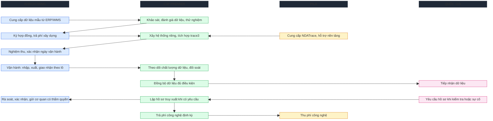

# Đề xuất cơ hội kinh doanh C3P Premier trong ngành thuốc và thiết bị y tế

**Tài liệu đề xuất quyết định · Cập nhật 17/11/2026**

Các nội dung đánh dấu **[Giả định]** là số đặt ra để tính toán, chưa có dữ liệu nội bộ để kiểm chứng: đặc tả của trace3, nguồn gốc mức tham chiếu 25 tỷ/năm (chưa rõ là doanh thu mỗi khách hàng hay tổng doanh thu, nên mục 6 tính cả hai cách), thỏa thuận phí công nghệ giữa C3P và PILA, và thông tin tiếp cận khách hàng.

---

# 1. Tóm tắt quyết định

**Cơ hội.** C3P Premier xây hệ thống truy xuất riêng cho tập đoàn thuốc và thiết bị y tế (TTBYT), tích hợp trace3, đồng bộ lên hệ thống quốc gia. Hai điểm bám là: (a) nghĩa vụ liên thông dữ liệu thuốc lên Hệ thống cơ sở dữ liệu về dược, dữ liệu phải khởi tạo từ 01/01/2026; (b) hướng quản lý TTBYT theo mã định danh đơn nhất (UDI) và chuỗi cung ứng sau vụ Việt Mỹ, với lộ trình 2028, 2030 chưa thành nghĩa vụ.

**Khách hàng mục tiêu.** Nhóm nhỏ tập đoàn có ERP/WMS riêng, nhiều kho, ký hợp đồng trực tiếp: nhà phân phối thuốc nhập khẩu lớn, chuỗi bán lẻ lớn, nhà phân phối TTBYT hạng C, D theo hãng. Ứng viên có tên: FPT Retail (Long Châu), Zuellig Pharma Việt Nam, DKSH Việt Nam, Vimedimex, VMED Group. **Chưa ai trong danh sách này đã được tiếp cận hay xác nhận nhu cầu.** Hàng nghìn nhà bán buôn nhỏ và hơn 95.600 điểm bán lẻ thuộc kênh Mass của VNChain, không thuộc thị trường của C3P.

**Quy mô doanh thu kỳ vọng [Giả định].** Giá mỗi khách hàng: phí xây dựng và tích hợp 4,0 tỷ một lần, thuê bao nền tảng 1,2 tỷ/năm, vận hành 1,0 tỷ/năm. Doanh thu năm đầu 6,2 tỷ, các năm sau 2,2 tỷ mỗi khách hàng. Mức 25 tỷ/năm cho C3P đạt vào năm thứ 4 nếu ký lũy kế 8 khách hàng. **Mức 25 tỷ/năm cho một khách hàng không đạt**: gấp 4 đến 11 lần giá giả định và vượt xa giá trị kỳ vọng khách hàng nhận được.

**Điều làm quyết định khó.** Bằng chứng thiệt hại trực tiếp của doanh nghiệp lớn rất yếu. Năm 2025 cả nước chỉ có 11 lô thuốc bị thu hồi trên 82 lô vi phạm. Mức phạt không liên thông dữ liệu nêu trong nguồn chỉ 3 đến 5 triệu đồng. Giá trị chính của khách hàng là quyền chọn trên chính sách: nếu UDI hoặc truy xuất thành điều kiện đấu thầu, doanh thu giữ được lớn; nếu không, khách hàng khó hoàn vốn. Hòa vốn của khách hàng minh họa khi xác suất xảy ra điều kiện đó từ khoảng 9%.

**Đề xuất.**
- **No-go** đối với việc đầu tư xây module riêng cho ngành y tế hoặc cam kết giá ngay.
- **Go có điều kiện** cho giai đoạn xác minh 8 đến 10 tuần với 5 doanh nghiệp có tên, ngân sách giới hạn ở khảo sát và demo.
- **Tiêu chí Go cho giai đoạn sau:** ít nhất 2 doanh nghiệp ký thư ý định với giá trị năm đầu từ 5 tỷ; Bộ Y tế xác nhận bằng văn bản đặc tả kết nối và lộ trình UDI; danh sách doanh nghiệp đủ tiêu chí Premier từ 60 trở lên.
- **Bước tiếp theo trong 2 tuần:** tiếp cận Zuellig Pharma và Vietmedical qua người ra quyết định về tuân thủ, lấy đặc tả API của Hệ thống cơ sở dữ liệu về dược, lọc danh sách doanh nghiệp theo doanh thu.

---

# 2. Bức tranh ngành và quy mô thị trường

## 2.1 Ranh giới C3P Premier và VNChain Mass

Các con số lớn dưới đây là quy mô ngành. **Không số nào là thị trường của C3P.** Thị trường của C3P chỉ là ngân sách dịch vụ truy xuất của một nhóm nhỏ tập đoàn có hệ thống riêng.

| | **C3P Premier** | **VNChain Mass** |
| --- | --- | --- |
| Khách hàng | Tập đoàn có ERP/WMS riêng, nhiều kho, ngân sách công nghệ thông tin riêng | Nhà bán buôn nhỏ, nhà thuốc lẻ, dùng phần mềm bán hàng thông dụng |
| Cách cung cấp | Xây hệ thống riêng, tích hợp trace3 và ERP/WMS, hợp đồng riêng | Nền tảng dùng chung, đăng ký số lượng lớn, giá thấp |
| Quy mô nhóm | Chưa biết, ước lượng ở mục 2.4 | Khoảng 8.000 nhà bán buôn, hơn 95.600 điểm bán lẻ |
| Doanh thu mỗi khách hàng | Hàng tỷ đồng/năm **[Giả định]** | Vài triệu đến vài chục triệu đồng/năm |

## 2.2 Kim ngạch và cơ cấu thị trường

| Chỉ tiêu | Số liệu | Nguồn và nhận xét |
| --- | --- | --- |
| Thị trường thuốc 2025 | Khoảng 7 đến 8 tỷ USD (IMARC 7,98 tỷ). Một nguồn dẫn IQVIA 8,88 tỷ USD năm 2024 | [IMARC](https://www.imarcgroup.com/vietnam-pharmaceuticals-market). Các nguồn lệch nhau, không dùng làm số chính xác. |
| **Nhập khẩu dược phẩm 2025** | **Gần 4,3 tỷ USD, giảm 2,4%** so với 2024 | Số sơ bộ của Cục Hải quan, qua [Vinanet](https://vinanet.vn/thuong-mai-cha/kim-ngach-nhap-khau-duoc-pham-nam-2025-tri-gia-gan-43-ty-usd-805364.html). |
| Cơ cấu nguồn nhập khẩu | EU 54,3% (2,33 tỷ USD). Hoa Kỳ 12% (514,9 triệu USD). Pháp 11,3%, Đức 9,3%, Italia 7,2%, Ấn Độ 7,1% | Cùng nguồn trên, thứ hạng Hoa Kỳ và Pháp đổi chỗ tùy kỳ số liệu. Nguyên liệu dược chủ yếu từ Trung Quốc, Ấn Độ. |
| Xuất khẩu dược phẩm 2025 | 312 triệu USD, hạng 4 Đông Nam Á | [The Investor](https://theinvestor.vn/vietnams-pharma-export-hits-312-mln-in-2025-ranking-4th-in-southeast-asia-d17991.html). |
| Thị trường TTBYT 2025 | Khoảng 1,77 tỷ USD, dự báo 2,89 tỷ USD năm 2031. Trên 90% nhập khẩu | [Vietnam Briefing](https://vietnam-briefing.com/news/vietnam-medical-devices-market-outlook-projections-insights.html), [Kenresearch](https://www.kenresearch.com/industry-reports/vietnam-medical-devices-industry.md). |
| Nhập khẩu TTBYT 2025 | **Không tìm được tổng kim ngạch.** Chỉ có 3 mã HS thiết bị bức xạ và máy CT: 140,3 triệu USD, gấp 4,6 lần năm 2022. Bài khác ghi 225,6 triệu USD cho cùng 3 mã | [Tiền Phong](https://tienphong.vn/tu-vu-an-cong-ty-viet-my-he-lo-thi-truong-nhap-khau-thiet-bi-y-te-tram-trieu-usd-post1877782.tpo). Hai số không khớp, nguồn không giải thích. |
| Giá trị trúng thầu của một doanh nghiệp (Việt Mỹ) | 246 gói trên 276 gói tham gia, tổng khoảng 5.947 tỷ đồng, giai đoạn 2018 đến 2026 | [Tuổi Trẻ](https://tuoitre.vn/vu-cong-ty-viet-my-va-mang-luoi-cong-ty-con-nang-gia-thuoc-va-thiet-bi-y-te-100260815151524353.htm), [Dân Việt](https://danviet.vn/vach-tran-he-sinh-thai-buon-lau-nang-khong-gia-thiet-bi-y-te-vua-khoi-to-so-tien-trung-thau-khung-gan-10000-ty-d1446368.html). Tiêu đề bài báo ghi gần 10.000 tỷ, nội dung chỉ ghi 5.947 tỷ. |

## 2.3 Cơ cấu người chơi

| Khâu | Cấu trúc | Hệ quả cho C3P |
| --- | --- | --- |
| Phân phối thuốc | Nhà phân phối nước ngoài chiếm khoảng 67%, trong nước khoảng 33% (số khoảng 2022). Ba nhà bán buôn lớn nhất, đều là nước ngoài, giữ khoảng 40% theo một phân tích cũ. Danh sách nhắc tới Zuellig, DKSH, Diethelm, Mega Products | [DI-GEST](https://www.dreamincubator.co.jp/wp-content/uploads/2022/02/DIV_Pharmaceutical-Vietnam.pdf), [VietNamNet](https://vietnamnet.vn/en/alliances-aim-to-control-drug-distribution-market-E199978.html). **Số cũ, cần cập nhật.** |
| Bán lẻ thuốc | FPT Long Châu có 2.517 nhà thuốc quý I/2026, khoảng 16% thị phần cuối 2025 và gần 20% quý I/2026. An Khang 417, Pharmacity hơn 1.000. Hơn 95.600 điểm bán lẻ | [Diễn đàn Doanh nghiệp](https://diendandoanhnghiep.vn/buoc-tien-moi-cua-fpt-retail-frt-10161908.html), [Báo Pháp Luật](https://doanhnhan.baophapluat.vn/chuoi-nha-thuoc-long-chau-chiem-20-thi-phan-ganh-96-loi-nhuan-fpt-retail.html). Thị phần các nguồn lệch nhau. |
| Phân phối TTBYT | Trên 90% hàng nhập khẩu. Phân phối theo hãng, nhiều đơn vị tự giới thiệu là nhà phân phối độc quyền (GE, Siemens Healthineers, Getinge, Medtronic, Fujifilm). **Không có số liệu thị phần độc lập** | [VMED Group](https://vmedgroup.com/phan-phoi-thiet-bi-vat-tu-y-te/), [iMED](https://imed.com.vn/en/). Nguồn tự giới thiệu. |

**Phát hiện cho ranh giới Premier và Mass.** Phân phối thuốc nhập khẩu tập trung ở đỉnh vào vài tập đoàn lớn, trong khi bán lẻ rất phân mảnh. Cấu trúc này khớp mô hình hai kênh: ít khách hàng lớn cho Premier, hàng chục nghìn điểm nhỏ cho Mass. Chưa có bằng chứng người dẫn đầu của ngành này có nhu cầu chưa được đáp ứng, và cơ cấu 67% nước ngoài nghĩa là quyết định mua có thể nằm ngoài Việt Nam.

## 2.4 TAM, SAM, SOM cho riêng C3P

Công thức: số doanh nghiệp × ngân sách dịch vụ truy xuất. Số doanh nghiệp đủ tiêu chí Premier **chưa có dữ liệu**. Bảng dưới là ba kịch bản **[Giả định]** theo số doanh nghiệp, ngân sách lấy từ mục 6 (thuê bao và vận hành 2,2 tỷ/năm, xây dựng 4,0 tỷ một lần).

| | N = 25 | N = 40 | N = 100 |
| --- | --- | --- | --- |
| **TAM**: toàn bộ nhóm đủ tiêu chí. Doanh thu thường xuyên/năm. Xây dựng một lần | 55 tỷ. 100 tỷ | 88 tỷ. 160 tỷ | 220 tỷ. 400 tỷ |
| **SAM**: 30% có dữ liệu, ngân sách và tiếp cận được trong 4 năm | 7,5 doanh nghiệp, 16,5 tỷ/năm | 12 doanh nghiệp, 26,4 tỷ/năm | 30 doanh nghiệp, 66 tỷ/năm |
| **SOM**: 8 khách hàng sau 4 năm, doanh thu thường xuyên/năm | 17,6 tỷ | 17,6 tỷ | 17,6 tỷ |
| SOM chiếm bao nhiêu % SAM | Không thể (trên 100%) | 67% | 27% |

**Kết luận.** Mục tiêu 8 khách hàng, tương ứng doanh thu khoảng 25 tỷ/năm, chỉ thực tế nếu nhóm đủ tiêu chí Premier từ khoảng 90 đến 100 doanh nghiệp. Nếu chỉ có 25 đến 40, mục tiêu này không đạt trừ khi giá cao hơn hoặc thêm nguồn doanh thu. Việc đếm số doanh nghiệp thật là việc đầu tiên của bước xác minh.

---

# 3. Vấn đề của khách hàng, có bằng chứng

**Nguyên tắc dùng bằng chứng.** Chỉ dùng bằng chứng từ chính ngành thuốc và TTBYT, đối với đúng nhóm khách hàng Premier. Không mượn bằng chứng từ ngành sữa, nông sản.

| Điều khách hàng đang mất hoặc đối mặt | Bằng chứng | Nhận định |
| --- | --- | --- |
| **Nghĩa vụ liên thông dữ liệu đã hiện hữu.** Phải khởi tạo dữ liệu từ 01/01/2026, đăng ký tài khoản định danh, kết nối theo đặc tả API | Quyết định 1867/QĐ-BYT ngày 24/06/2026, [Công văn 934/TTYQG-DA ngày 12/08/2026](https://www.misaeshop.vn/47067/cong-van-934-ttyqg-ban-hanh-ngay-12-08-2026) | Nghĩa vụ có. Khó khăn thực tế của tập đoàn chưa kiểm chứng |
| **Rủi ro thu hồi** | Năm 2025, 82 lô thuốc vi phạm, 11 lô thu hồi. Thuốc không đạt chất lượng 0,60%, thuốc giả 0,024% ([VnEconomy](https://vneconomy.vn/nam-2025-da-xu-ly-82-lo-thuoc-vi-pham-thu-hoi-11-lo-tren-toan-quoc.htm)). Thông tư 30/2025/TT-BYT quy định Cục Quản lý Dược ra quyết định thu hồi trong 24 giờ kể từ khi nhận thông tin | **Tần suất thấp**, nên thiệt hại kỳ vọng của một doanh nghiệp nhỏ |
| **Rủi ro bị xử phạt** | Nghị định 90/2026/NĐ-CP, hiệu lực 15/05/2026, mức tối đa chung 150 triệu đồng cá nhân, 300 triệu đồng tổ chức. Nhập khẩu thuốc hết hạn bị phạt tối đa khoảng 70 đến 80 triệu đồng. Phạt không liên thông bán lẻ: nguồn nêu 3 đến 5 triệu đồng, nguồn khác nêu 10 triệu đồng ([LuatVietnam](https://luatvietnam.vn/tin-van-ban-moi/tu-15-5-2026-nhap-khau-thuoc-het-han-su-dung-phat-den-80-trieu-dong-186-108804-article.html), [Cục Quản lý thị trường Sơn La](https://sonla.dms.gov.vn/en/tin-chi-tiet/-/chi-tiet/tang-cuong-xu-ly-vi-pham-hanh-chinh-trong-linh-vuc-y-te-theo-quy-dinh-tai-nghi-dinh-so-902026nd-cp-14363-2607.html)) | **Mức phạt nhỏ so với hợp đồng hàng tỷ đồng.** Tuân thủ đơn thuần không tạo ngân sách lớn |
| **Rủi ro bị kéo vào vụ việc giá và nguồn gốc TTBYT** | Vụ Việt Mỹ: khởi tố ngày 24/07/2026, 9 bị can, mạng lưới 3 công ty Việt Nam, 5 Singapore, 3 Hồng Kông. Nâng khống giá 2 đến 3 lần. Thiệt hại bước đầu hơn 105 tỷ đồng, đã thu hồi 118,05 tỷ đồng và 261.000 USD ([Viettimes](https://viettimes.vn/cong-ty-viet-my-bi-nang-khong-gia-thiet-bi-y-te-2-3-lan-post206516.html), [VOV](http://vov.vn/phap-luat/bo-y-te-thong-tin-ve-vu-an-nang-khong-gia-thiet-bi-y-te-tai-cong-ty-viet-my-post1338182.vov)) | Đây là thiệt hại của Nhà nước, không phải của nhà phân phối khác. Giá trị với C3P là **tác động lên chính sách** |
| **Điều kiện tham gia thị trường sắp tới** | Bộ Y tế nghiên cứu quản lý TTBYT gắn mã định danh, cơ sở dữ liệu quốc gia, niêm yết giá có UDI. Dự án Luật sửa 6 luật y tế (trình 21/10/2026) sửa Điều 113 về vòng đời và truy xuất. Lộ trình UDI 2028 và 2030 theo một bài báo ([Thẩm tra](https://xaydungchinhsach.chinhphu.vn/tham-tra-du-an-luat-sua-doi-bo-sung-mot-so-dieu-cua-6-luat-thuoc-linh-vuc-y-te-119261021101904205.htm), [Báo Đấu thầu](https://baodauthau.vn/hoi-nghi-doi-thoai-doanh-nghiep-thiet-bi-y-te-quyet-tam-khai-thong-nut-that-the-che-va-day-manh-so-hoa-post202654.html)) | Chính sách đang vận động. Chưa là nghĩa vụ, chưa gắn đấu thầu |
| **Yêu cầu của hãng sản xuất với nhà phân phối** (tương đương "yêu cầu của thị trường nhập khẩu") | Không tìm thấy | Không tìm thấy bằng chứng, phải hỏi trực tiếp |

**Vì sao giải pháp hiện tại chưa đủ.**
- Hệ thống nhà nước còn hạn chế: tờ trình ngày 15/06/2026 của Bộ Y tế nhận định cổng dịch vụ công TTBYT (từ 2018) chỉ phục vụ một số chức năng và chưa có hệ thống đọc, xác thực, khai thác dữ liệu ([Tờ trình](https://imda.moh.gov.vn/documents/10182/10030600/Duthaototrinh.15.06.2026/db844d21-f1d8-493e-914e-130b24ab9812)).
- Doanh nghiệp bán lẻ lớn đã tự phát triển: FPT Retail xây lại hoàn toàn phần mềm quản lý hàng hóa cho Long Châu ([BNews](https://bnews.vn/fpt-retail-va-tham-vong-dan-dau-nganh-ban-le-duoc-pham/205279.html)). Không thấy bằng chứng họ cần bên thứ ba.
- Doanh nghiệp nhỏ đã có phần mềm kết nối: Sapo có hướng dẫn đăng ký tài khoản hệ thống cơ sở dữ liệu dược. Đây là kênh Mass và là đối thủ của VNChain, không phải của C3P.
- Tập đoàn đa quốc gia có thể dùng hệ thống khu vực.

**Nhận định thẳng.** Bằng chứng mạnh nhất nằm ở phía chính sách, không phải ở thiệt hại hiện tại của doanh nghiệp lớn. Nếu đề xuất này được bán như "giảm lô bị trả về" thì thiếu căn cứ: không tìm thấy dữ liệu lô thuốc hay TTBYT bị trả về hoặc giữ ở cửa khẩu vì thiếu truy xuất.

---

# 4. Khách hàng mục tiêu có tên

**Chưa liên hệ doanh nghiệp nào.** Cột "người ra quyết định" là vai trò dự kiến, không phải người đã xác nhận. Không có tên cá nhân nào được kiểm chứng.

| Doanh nghiệp | Quy mô | Thị trường, kênh | Hệ thống hiện có | Người ra quyết định (vai trò dự kiến) | Phù hợp và rủi ro |
| --- | --- | --- | --- | --- | --- |
| **FPT Retail (Long Châu)** | 2.517 nhà thuốc quý I/2026. Doanh thu Long Châu 2025 hơn 34.270 tỷ đồng, khoảng 16% thị phần. Niêm yết | Bán lẻ thuốc, tiêm chủng toàn quốc | Phần mềm quản lý hàng hóa tự xây lại. Tên hệ thống và kết nối cơ sở dữ liệu dược **chưa rõ** | Giám đốc công nghệ thông tin, giám đốc chuỗi cung ứng, phụ trách pháp chế dược | Nghĩa vụ liên thông phiếu bán lẻ rõ. **Khả năng tự làm cao**, khả năng mua thấp |
| **Zuellig Pharma Việt Nam** | Doanh thu **không có số**. Nhân sự nguồn mâu thuẫn (166 và khoảng 1.200). Tập đoàn mẹ Singapore, 18 thị trường | Nhập khẩu và phân phối thuốc cho hãng đa quốc gia | **Chưa biết** | Giám đốc tuân thủ, giám đốc vận hành Việt Nam. Có thể cần phê duyệt khu vực | Quy mô phù hợp Premier. **Quyết định có thể ở Singapore** |
| **DKSH Việt Nam** | **Không có thông tin ngoài việc có tên trong nguồn cũ** | Phân phối thuốc, hàng tiêu dùng | **Chưa biết** | **Chưa biết** | Cần xác minh từ đầu |
| **Vimedimex (HOSE: VMD)** | Doanh thu 2025 khoảng 813 tỷ đồng (StockAnalysis, chưa đối chiếu). Lợi nhuận sau thuế hợp nhất 42,4 tỷ đồng, tăng 79,7%. Ý kiến kiểm toán ngoại trừ về khả năng thu hồi phải thu. Bị HoSE nhắc nhở chậm công bố ([Index.vn](https://index.vn/en/news/hose-warns-y-duoc-pham-vimedimex-over-delayed-explanation-of-audited-2025-financial-statements), [StockAnalysis](https://stockanalysis.com/quote/hose/VMD/revenue/)) | Phân phối thuốc, vật tư y tế, thầu bệnh viện | **Chưa biết** | Tổng giám đốc, giám đốc kinh doanh bệnh viện | Quan hệ bệnh viện mạnh. **Khả năng trả thấp**: hợp đồng giả định năm đầu 6,2 tỷ bằng khoảng 15% lợi nhuận sau thuế hợp nhất |
| **VMED Group (Vietmedical)** | **Không có số.** Tự giới thiệu phân phối theo hãng GE, Getinge, Siemens Healthineers, Medtronic, Fujifilm | TTBYT chẩn đoán hình ảnh, phòng mổ, hồi sức cho bệnh viện | **Chưa biết** | Giám đốc vận hành, giám đốc đăng ký và pháp chế | Điểm vào hướng UDI. Phải hỏi hãng có cho dùng lại GTIN gốc không |

**Danh sách chờ.** Pharmacity (hơn 1.000 nhà thuốc, đang mở rộng lại sau tái cơ cấu theo [The Investor](https://theinvestor.vn/pharmacity-returns-to-expansion-after-turnaround-but-vietnams-pharmacy-market-has-changed-d19526.html)), iMED, VIMEC, nhà phân phối TTBYT hãng Nhật, Đức. **Chưa có tên nhà phân phối TTBYT nào có dữ liệu quy mô.**

**Thứ tự ưu tiên tiếp cận (đề xuất):** Zuellig Pharma (nếu có thẩm quyền địa phương), VMED Group, DKSH, Long Châu, Vimedimex. Long Châu để cuối vì khả năng tự làm, Vimedimex vì khả năng trả.

---

# 5. Giải pháp và giá trị cung cấp

**C3P làm gì.** (1) Xây hệ thống truy xuất riêng cho khách hàng trên nền Premier. (2) Tích hợp trace3 và ERP/WMS của khách hàng. (3) Đồng bộ dữ liệu đủ điều kiện lên hệ thống quốc gia: với thuốc là Hệ thống cơ sở dữ liệu về dược, với TTBYT là cơ sở dữ liệu thiết bị khi có. Phạm vi đồng bộ và trách nhiệm xử lý lỗi chốt trong hợp đồng. Đặc tả trace3 chưa có, nên phần tích hợp mô tả ở mức chức năng. Sơ đồ đọc từ trên xuống: mỗi cột là một bên, mũi tên ngang là bàn giao giữa các bên.

**Kết quả khách hàng mua, bằng ngôn ngữ kinh doanh.** Mỗi kết quả kèm trạng thái chứng minh:

| Kết quả | Dành cho | Đo bằng | Hiện trạng |
| --- | --- | --- | --- |
| **Giữ được quyền dự thầu và bán** khi UDI, truy xuất trở thành điều kiện | Nhà phân phối TTBYT | Tỷ lệ model có UDI chuẩn, số gói thầu đáp ứng điều kiện | Giả thuyết. Chưa có điều kiện bắt buộc |
| **Hồ sơ sạch khi cơ quan hoặc bệnh viện kiểm tra** hợp đồng, lô, giá | Nhà phân phối TTBYT, thuốc | Thời gian trả lời một yêu cầu, tỷ lệ lô đủ hồ sơ | Giả thuyết, kiểm chứng ở thử nghiệm |
| **Không bị chặn dữ liệu và không bị từ chối bản ghi** khi liên thông | Nhà phân phối, chuỗi bán lẻ | Tỷ lệ bản ghi gửi thành công, số bản ghi lỗi mỗi tháng | Nghĩa vụ có. Mức khó chưa kiểm chứng |
| **Giữ hàng hẹp hơn khi có cảnh báo** | Nhà phân phối thuốc | Giá trị hàng giữ ngoài phạm vi, so baseline | **Tần suất thấp.** Giá trị nhỏ (xem mục 7) |
| **Rút thời gian thông quan** | Nhà nhập khẩu | Số ngày từ tờ khai đến thông quan | **Không có bằng chứng.** Chỉ đo được nếu hồ sơ chậm vì thiếu liên kết lô và số lưu hành. Chưa chào kết quả này |

---

# 6. Business Model Canvas và mô hình giá

## 6.1 Business Model Canvas của C3P Premier

| Thành phần | Giả thuyết |
| --- | --- |
| Phân khúc khách hàng | Nhóm nhỏ tập đoàn thuốc và TTBYT có ERP/WMS riêng, ký hợp đồng trực tiếp. Không phục vụ nhà bán buôn nhỏ, nhà thuốc lẻ (kênh VNChain Mass) |
| Giá trị cung cấp | Giữ quyền tham gia thị trường theo điều kiện truy xuất và UDI sắp tới, hồ sơ sẵn sàng, liên thông dữ liệu ổn định |
| Kênh bán | Trực tiếp qua phụ trách tuân thủ và vận hành, phối hợp công nghệ thông tin và người duyệt ngân sách. Hiệp hội ngành và GS1 Việt Nam |
| Quan hệ khách hàng | Hợp đồng nhiều năm, đội hỗ trợ riêng, cập nhật khi quy định đổi |
| Doanh thu | Phí xây dựng một lần, thuê bao nền tảng, phí vận hành, phần mở rộng theo báo giá |
| Nguồn lực chính | Premier, quyền dùng NDATrace, trace3, đội tích hợp ERP/WMS, chuyên gia văn bản ngành y tế |
| Hoạt động chính | Khảo sát, xây dựng, tích hợp, vận hành, theo dõi thay đổi quy định |
| Đối tác chính | PILA (công nghệ), nhà cung cấp ERP/WMS của khách hàng, GS1 Việt Nam |
| Chi phí | Giá vốn xây dựng, phí công nghệ trả PILA, hạ tầng, hỗ trợ trực tiếp, chi phí bán hàng |

## 6.2 Dòng tiền

| Từ | Đến | Khoản | Ghi chú |
| --- | --- | --- | --- |
| Khách hàng | C3P | Phí xây dựng và tích hợp một lần, thuê bao nền tảng và vận hành hằng năm | Chốt theo hợp đồng |
| C3P | PILA | Phí công nghệ NDATrace | Giả định bằng 50% thuê bao nền tảng. Mức thật do hai bên thỏa thuận |
| C3P | VNChain | Không có trong gói Premier | Chỉ phát sinh nếu khách hàng kèm mạng lưới đại lý nhỏ đi qua kênh Mass |
| C3P hoặc khách hàng | Nhà cung cấp ERP/WMS | Phí sửa hoặc mở đầu nối | Theo kết nối |

## 6.3 Cơ cấu phí và giá giả định [Giả định]

Chưa có báo giá hay mức giá tham chiếu công khai cho truy xuất doanh nghiệp lớn. Số dưới đây là **[Giả định]** để dựng kịch bản, cần thay bằng báo giá thật.

| Khoản | Mức giả định | Cách tính |
| --- | --- | --- |
| Phí xây dựng và tích hợp hệ thống riêng | 4,0 tỷ một lần | Khảo sát, cấu hình, tích hợp ERP/WMS, đào tạo, nghiệm thu |
| Thuê bao nền tảng (PaaS) | 1,2 tỷ/năm | Quyền dùng nền tảng và đồng bộ lên hệ thống quốc gia |
| Vận hành và hỗ trợ | 1,0 tỷ/năm | Theo dõi chất lượng dữ liệu, đối soát, cập nhật khi Bộ đổi đặc tả |
| **Doanh thu mỗi khách hàng** | **Năm đầu 6,2 tỷ. Từ năm 2: 2,2 tỷ/năm** | |

## 6.4 Đối chiếu mức tham chiếu 25 tỷ/năm

| Cách hiểu | Kết quả | Kết luận |
| --- | --- | --- |
| **Tổng doanh thu của C3P trong ngành này** | Năm 1: 6,2. Năm 2: 14,6. Năm 3: 19,0. Năm 4: 29,6 tỷ. Số khách ký mới 1, 2, 2, 3 (lũy kế 1, 3, 5, 8) | **Đạt vào năm 4**, cần 8 khách hàng. Xem điều kiện số doanh nghiệp ở mục 2.4 |
| **Doanh thu mỗi khách hàng** | 6,2 tỷ năm đầu, 2,2 tỷ các năm sau, bằng 9 đến 25% mức tham chiếu | **Không đạt.** Muốn đạt phải tăng giá khoảng 4 đến 11 lần, trong khi giá trị kỳ vọng khách hàng nhận được ở mục 7 chỉ khoảng 7,5 tỷ/năm trong kịch bản cơ sở |

---

# 7. Hiệu quả kinh tế

Giá trị tính từ **doanh thu giữ được** và **tổn thất tránh được**. Giờ công tiết kiệm chỉ là thành phần phụ.

## 7.1 Kịch bản cho một khách hàng minh họa: nhà phân phối TTBYT hạng C, D

Đây không phải doanh nghiệp thật. Tất cả số trong bảng là **[Giả định]**. Đơn vị: tỷ đồng.

**Chi phí của khách hàng.** Năm 1 = 4,0 xây dựng + 1,2 thuê bao + 1,0 vận hành + 0,8 chi phí nội bộ = **7,0**. Năm ổn định = 1,2 + 1,0 + 0,5 nội bộ = **2,7**.

**Lợi ích mỗi năm ổn định.**

| Thành phần và công thức | Thấp | Cơ sở | Cao |
| --- | --- | --- | --- |
| **A. Biên gộp giữ được** = xác suất UDI hoặc truy xuất thành điều kiện đấu thầu × tỷ lệ doanh thu bị loại nếu không đáp ứng × doanh thu từ bệnh viện công × biên gộp | 10% × 5% × 1.000 × 12% = **0,6** | 30% × 10% × 1.500 × 15% = **6,75** | 60% × 15% × 2.000 × 15% = **27,0** |
| **B. Tổn thất tránh được khi có cảnh báo** = tần suất sự cố × giá trị hàng giữ × phần thu hẹp phạm vi × chi phí giữ và hủy | 1/5 × 10 × 40% × 5% = **0,04** | 1/3 × 20 × 50% × 7% = **0,23** | 1/2 × 40 × 50% × 10% = **1,0** |
| **C. Giờ công tiết kiệm** | 0,3 | 0,5 | 0,8 |
| **Tổng lợi ích** | **0,94** | **7,48** | **28,8** |
| **Lợi ích ròng năm ổn định** = tổng lợi ích − 2,7 | **−1,76** | **+4,78** | **+26,1** |
| Năm 1 ròng (A bắt đầu từ năm 2) = B + C − 7,0 | −6,66 | −6,27 | −5,2 |
| **Thời gian hoàn vốn của khách hàng** | **Không hoàn vốn** | **Khoảng 2,3 năm** | **Khoảng 1,2 năm** |

**Điểm hòa vốn.** Với các giả định còn lại ở mức cơ sở, khách hàng hòa vốn ở trạng thái ổn định khi xác suất điều kiện đấu thầu từ khoảng **9%**. Nếu yêu cầu không bao giờ thành bắt buộc, khách hàng chỉ nhận về 0,73 tỷ/năm cho khoản chi 2,7 tỷ/năm. **Thành phần B nhỏ**, vì tần suất thu hồi thấp (11 lô trên cả nước năm 2025). Giá trị gần như hoàn toàn nằm ở A, tức quyền chọn trên chính sách.

## 7.2 Kinh tế của C3P

Mỗi khách hàng, đơn vị tỷ đồng. **[Giả định]**

| Khoản | Năm đầu | Năm ổn định | Cách tính |
| --- | --- | --- | --- |
| Doanh thu | 6,2 | 2,2 | Mục 6.3 |
| Giá vốn triển khai | 2,4 | | 60% phí xây dựng |
| Giá vốn thường xuyên | 1,1 | 1,1 | Phí PILA 0,6 (50% thuê bao nền tảng) + hạ tầng, hỗ trợ trực tiếp 0,5 |
| **Lãi gộp** | **2,7 (43,5%)** | **1,1 (50%)** | |
| Chi phí bán hàng, gồm thử nghiệm miễn phí | 1,0 | | Cho mỗi khách hàng ký |

**Toàn chương trình.** Chi phí cố định 4 tỷ/năm (đội sản phẩm, pháp lý, hỗ trợ chung) và đầu tư ban đầu 6 tỷ cho module y tế. Số khách ký mới 1, 2, 2, 3.

| Năm | Khách ký mới (lũy kế) | Doanh thu | Lãi gộp | Sau chi phí bán hàng và cố định | Lũy kế sau đầu tư ban đầu |
| --- | --- | --- | --- | --- | --- |
| 1 | 1 (1) | 6,2 | 2,7 | −2,3 | **−8,3** |
| 2 | 2 (3) | 14,6 | 6,5 | +0,5 | **−7,8** |
| 3 | 2 (5) | 19,0 | 8,7 | +2,7 | **−5,1** |
| 4 | 3 (8) | 29,6 | 13,6 | +6,6 | **+1,5** |

**C3P hoàn vốn vào cuối năm 4, và chỉ khi ký đủ 8 khách hàng.** Mỗi khách ký chậm một năm đẩy hoàn vốn ra tương ứng. PILA thu phí công nghệ khoảng 0,6 tỷ mỗi khách hàng mỗi năm, tức khoảng 4,8 tỷ/năm khi có 8 khách hàng. Không tính chi phí phục vụ của PILA vì chưa có dữ liệu.

---

# 8. Rủi ro, giả thuyết cần kiểm chứng và bước tiếp theo

## 8.1 Giả thuyết quan trọng nhất

| Giả thuyết | Vì sao quan trọng | Cách kiểm chứng | Tiêu chí Go | Tiêu chí No-go |
| --- | --- | --- | --- | --- |
| **H1. Doanh nghiệp có trả tiền không.** Họ trả vì điều kiện đấu thầu và quan hệ hãng, không phải vì mức phạt | Mức phạt chỉ 3 đến 5 triệu đồng. Thu hồi hiếm. Giá trị chính là doanh thu giữ được | Phỏng vấn 5 doanh nghiệp ở mục 4. Hỏi ai duyệt ngân sách, đã có kế hoạch gì, sẵn sàng ký thư ý định ở mức nào | Ít nhất 2 doanh nghiệp ký thư ý định, giá trị năm đầu từ 5 tỷ | Cả 5 nói tự làm, chờ bắt buộc, hoặc chỉ chịu mức dưới 1 tỷ |
| **H2. Bộ Y tế có đi cùng không.** Trung tâm Thông tin y tế Quốc gia (hệ thống cơ sở dữ liệu dược), Cục Quản lý Dược, Cục Hạ tầng và Thiết bị y tế | Quyết định nguồn dữ liệu và tính hợp lệ của dữ liệu đồng bộ. Đích đồng bộ của thuốc là hệ thống của Bộ, không phải Nền tảng quốc gia | Làm việc để lấy đặc tả API, hỏi cơ chế cho phép bên thứ ba kết nối, hỏi lộ trình UDI | Có văn bản hoặc biên bản xác nhận đặc tả và lộ trình | Bộ xác nhận chỉ doanh nghiệp tự kết nối, hoặc UDI không bắt buộc trước 2030 |
| **H3. Luật ra có đổi cuộc chơi không** | Quyết định giá trị A (quyền chọn). Dự án Luật sửa 6 luật (sửa Điều 113) đã trình ngày 21/10/2026, chưa biết kết quả. Luật Thiết bị y tế độc lập dự kiến cuối 2027 hoặc 2029. Dự thảo Nghị định quản lý TTBYT 2026 chưa thấy điều khoản UDI | Theo dõi kết quả biểu quyết, văn bản hướng dẫn, hỏi trực tiếp cơ quan soạn thảo | Có văn bản bắt buộc UDI hoặc truy xuất kèm mốc trước 2029 | Không có văn bản bắt buộc đến hết 2027: giữ vai trò định vị, không tính doanh thu |
| **H4. Tập đoàn có tự làm hay mua ngoài.** Long Châu tự xây hệ thống. Tập đoàn đa quốc gia có thể dùng hệ thống khu vực | Giảm số khách thật | Hỏi từng doanh nghiệp về kế hoạch nội bộ, nhà cung cấp ERP hiện tại | Ít nhất 3 doanh nghiệp chưa có kế hoạch tự làm | Hầu hết đã có kế hoạch |
| **H5. Số doanh nghiệp đủ tiêu chí Premier** | Quyết định mục tiêu 25 tỷ có khả thi không (mục 2.4) | Lọc danh sách nhà bán buôn, nhập khẩu, phân phối TTBYT hạng C, D theo doanh thu và số kho | Từ 60 doanh nghiệp (SOM khi đó bằng khoảng 44% SAM, vẫn khó). Từ 90 trở lên mới thoải mái đạt 8 khách | Dưới 40 |
| **H6. Giá chấp nhận được** | Mô hình dựa vào 4,0 tỷ một lần và 2,2 tỷ/năm. Chưa có báo giá tham chiếu | Chào thăm dò khung giá với từng doanh nghiệp | Chấp nhận khung giá, hoặc đề xuất cao hơn | Giá sẵn sàng trả dưới một nửa |
| **H7. GTIN gốc của hãng có dùng lại được** | Quyết định chi phí chuẩn hóa UDI | Kiểm tra mẫu 20 đến 30 model của một nhà phân phối | Từ 60% model đã có GTIN. Ngưỡng này là đề xuất, chưa có căn cứ | Dưới 30% |
| **H8. Hãng sản xuất có yêu cầu nhà phân phối truy xuất** | Có thể là động lực mua lớn hơn quy định Việt Nam | Hỏi nhà phân phối có hãng nào đưa vào hợp đồng, hợp đồng đại lý | Ít nhất 2 hãng có điều khoản | Không hãng nào có |

## 8.2 Rủi ro chính

- **Mua để tuân thủ nhưng mức phạt nhỏ.** Ngân sách có thể chỉ ở mức vài trăm triệu, đủ cho connector, không đủ cho hệ thống riêng.
- **Cạnh tranh từ phía tự làm** của tập đoàn và nhà cung cấp ERP quen thuộc.
- **Phụ thuộc Bộ Y tế** về đặc tả, đổi đặc tả làm tăng chi phí bảo trì.
- **Khả năng thanh toán của khách hàng.** Vimedimex có ý kiến kiểm toán ngoại trừ về phải thu.
- **Nhầm ranh giới Premier và Mass:** khách hàng có mạng lưới đại lý nhỏ sẽ kéo C3P vào việc của VNChain.
- **Số liệu nền yếu:** phần lớn số liệu mục 2 và 3 lấy từ báo chí và trang tổng hợp, chưa đối chiếu báo cáo gốc, nhiều số cũ.

## 8.3 Bước tiếp theo

| Thời gian | Việc | Đầu ra |
| --- | --- | --- |
| Tuần 1 đến 2 | Lọc danh sách doanh nghiệp theo doanh thu (H5). Lấy đặc tả API của hệ thống cơ sở dữ liệu dược, tra toàn văn Quyết định 1867/QĐ-BYT, Nghị định 90/2026/NĐ-CP | Số N thật, đặc tả kết nối |
| Tuần 2 đến 4 | Tiếp cận Zuellig, VMED Group, DKSH, Long Châu, Vimedimex. Phỏng vấn người phụ trách tuân thủ và vận hành | Bảng nhu cầu và ngân sách của 5 doanh nghiệp |
| Tuần 3 đến 6 | Làm việc với Trung tâm Thông tin y tế Quốc gia, Cục Hạ tầng và Thiết bị y tế, GS1 Việt Nam | Xác nhận H2, H3, thủ tục cấp mã |
| Tuần 6 đến 8 | Chào thăm dò khung giá, xin thư ý định | Số thư ý định và giá trị |
| Tuần 8 đến 10 | Họp Go hoặc No-go theo tiêu chí ở bảng 8.1 | Quyết định xây module và đàm phán phí công nghệ với PILA |

**Phụ thuộc cần xử lý song song.** Chốt cơ sở tính phí công nghệ C3P trả PILA trước khi chào giá, vì giả định 50% thuê bao nền tảng quyết định biên gộp 50%.

---

# Phụ lục. Nguồn chính và điểm cần đối chiếu

- Nhập khẩu dược 2025: [Vinanet](https://vinanet.vn/thuong-mai-cha/kim-ngach-nhap-khau-duoc-pham-nam-2025-tri-gia-gan-43-ty-usd-805364.html), [Báo Nghệ An](https://baonghean.vn/kim-ngach-nhap-khau-duoc-pham-nam-2025-dat-gan-43-ty-usd-10323025.html).
- Thu hồi thuốc 2025: [VnEconomy](https://vneconomy.vn/nam-2025-da-xu-ly-82-lo-thuoc-vi-pham-thu-hoi-11-lo-tren-toan-quoc.htm).
- Xử phạt: [Nghị định 90/2026/NĐ-CP qua Cục Quản lý thị trường Sơn La](https://sonla.dms.gov.vn/en/tin-chi-tiet/-/chi-tiet/tang-cuong-xu-ly-vi-pham-hanh-chinh-trong-linh-vuc-y-te-theo-quy-dinh-tai-nghi-dinh-so-902026nd-cp-14363-2607.html), [LuatVietnam](https://luatvietnam.vn/tin-van-ban-moi/tu-15-5-2026-nhap-khau-thuoc-het-han-su-dung-phat-den-80-trieu-dong-186-108804-article.html). Mức phạt liên thông chưa đối chiếu điều khoản.
- Vụ Việt Mỹ: [Tuổi Trẻ](https://tuoitre.vn/vu-cong-ty-viet-my-va-mang-luoi-cong-ty-con-nang-gia-thuoc-va-thiet-bi-y-te-100260815151524353.htm), [Viettimes](https://viettimes.vn/cong-ty-viet-my-bi-nang-khong-gia-thiet-bi-y-te-2-3-lan-post206516.html), [Bộ Y tế qua VOV](http://vov.vn/phap-luat/bo-y-te-thong-tin-ve-vu-an-nang-khong-gia-thiet-bi-y-te-tai-cong-ty-viet-my-post1338182.vov), [Sau vụ Việt Mỹ, Bộ Y tế muốn truy giá](https://viettimes.vn/sau-vu-viet-my-bo-y-te-muon-truy-gia-thiet-bi-y-te-xuyen-suot-chuoi-cung-ung-post206499.html).
- Chính sách TTBYT và UDI: xem báo cáo nghiên cứu sơ bộ `mo-hinh-kinh-doanh-truy-xuat-thuoc-thiet-bi-y-te.md` cùng thư mục.
- Doanh nghiệp: [FRT](https://diendandoanhnghiep.vn/buoc-tien-moi-cua-fpt-retail-frt-10161908.html), [Long Châu](https://doanhnhan.baophapluat.vn/chuoi-nha-thuoc-long-chau-chiem-20-thi-phan-ganh-96-loi-nhuan-fpt-retail.html), [BNews](https://bnews.vn/fpt-retail-va-tham-vong-dan-dau-nganh-ban-le-duoc-pham/205279.html), [VMD](https://stockanalysis.com/quote/hose/VMD/revenue/), [VMED Group](https://vmedgroup.com/phan-phoi-thiet-bi-vat-tu-y-te/), [Zuellig trên AmCham](https://business.amchamvietnam.com/list/member/zuellig-pharma-vietnam-co-ltd-4819).
- Cơ cấu phân phối: [DI-GEST](https://www.dreamincubator.co.jp/wp-content/uploads/2022/02/DIV_Pharmaceutical-Vietnam.pdf), [VietNamNet](https://vietnamnet.vn/en/alliances-aim-to-control-drug-distribution-market-E199978.html). Số khoảng 2022 trở về trước.

**Điểm mâu thuẫn trong nguồn.**
- Thị phần Long Châu: 16%, gần 20%, hơn 25% tùy nguồn và phạm vi.
- Tổng nhập khẩu 3 mã HS thiết bị bức xạ: 140,3 hay 225,6 triệu USD.
- Giá trị trúng thầu Việt Mỹ: tiêu đề nêu gần 10.000 tỷ, nội dung nêu 5.947 tỷ.
- Mức phạt không liên thông: 3 đến 5 triệu đồng hay 10 triệu đồng.
- Doanh thu Vimedimex 2025 chưa đối chiếu với báo cáo gốc.
