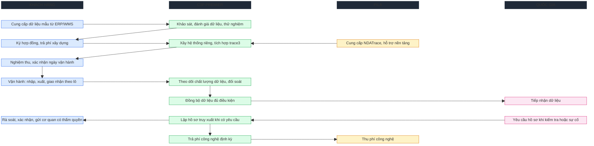

# Đề xuất cơ hội kinh doanh C3P Premier trong ngành thuốc và thiết bị y tế

**Tài liệu đề xuất quyết định · Cập nhật 17/11/2026 (bổ sung nội dung buổi làm việc với Bộ Y tế)**

Các nội dung đánh dấu **[Giả định]** là số đặt ra để tính toán, chưa có dữ liệu nội bộ để kiểm chứng: đặc tả của trace3, nguồn gốc mức tham chiếu 25 tỷ/năm (chưa rõ là doanh thu mỗi khách hàng hay tổng doanh thu, nên mục 6 tính cả hai cách), thỏa thuận phí công nghệ giữa C3P và PILA, và thông tin tiếp cận khách hàng.

Quy ước thuật ngữ theo biên bản làm việc với Bộ Y tế: C1 là hệ thống trung tâm của Trung tâm Dữ liệu Quốc gia (C12); C2 là hệ thống của bộ, tỉnh; C3 là doanh nghiệp đồng hành cung cấp giải pháp truy xuất; C4 là doanh nghiệp trong chuỗi cung ứng; C5 là người dùng cuối. **C3P Premier là một đơn vị C3.**

---

# 1. Tóm tắt quyết định

**Cơ hội.** C3P Premier xây hệ thống truy xuất riêng cho tập đoàn thuốc và thiết bị y tế (TTBYT), tích hợp trace3, đồng bộ lên nền tảng quốc gia. Ba điểm bám:
- **Nghị định 372/2026/NĐ-CP** (ban hành 29/09/2026, hiệu lực 01/01/2027): hàng hóa rủi ro cao phải định danh, xác thực, truy xuất; rủi ro thấp và trung bình khuyến khích; hàng xuất khẩu tự nguyện. Nền tảng quốc gia dự kiến công bố 01/12/2026. Bộ Y tế phải báo cáo phương án trước 31/12/2026, kết quả thí điểm trước 31/03/2027, và không đủ nguồn lực tự xây phần mềm nên dựa vào doanh nghiệp C3. **Danh mục rủi ro cao của ngành y tế và sản phẩm thí điểm chưa được chốt.**
- Nghĩa vụ liên thông dữ liệu thuốc lên Hệ thống cơ sở dữ liệu về dược, dữ liệu khởi tạo từ 01/01/2026.
- Hướng quản lý TTBYT theo mã định danh đơn nhất (UDI), lộ trình 2028 và 2030 chưa thành nghĩa vụ.

**Ngách ưu tiên theo năm tiêu chí chọn thí điểm của Bộ Y tế** (đã có GS1/GTIN, rủi ro cao, giá trị lớn, ít điểm chạm, điển hình): ưu tiên 1 là **vắc xin**; ưu tiên 2 là **thuốc rủi ro cao nhập khẩu ở kênh hẹp**; **thực phẩm chức năng nhập khẩu** chờ Bộ Y tế chốt; **TTBYT giá trị cao** để giai đoạn sau vì trùng mã và khó xác định đơn vị tính.

**Khách hàng mục tiêu.** Nhóm nhỏ tập đoàn có ERP/WMS riêng, nhiều kho, ký hợp đồng trực tiếp. Ứng viên có tên: FPT Retail (Long Châu), VNVC, Zuellig Pharma Việt Nam, DKSH Việt Nam, VMED Group, Vimedimex. **Chưa doanh nghiệp nào được tiếp cận hay xác nhận nhu cầu.** Hàng nghìn nhà bán buôn nhỏ và hơn 95.600 điểm bán lẻ thuộc kênh Mass của VNChain.

**Quy mô doanh thu kỳ vọng [Giả định].** Giá mỗi khách hàng: phí xây dựng và tích hợp 4,0 tỷ một lần, thuê bao nền tảng 1,2 tỷ/năm, vận hành 1,0 tỷ/năm. Doanh thu năm đầu 6,2 tỷ, các năm sau 2,2 tỷ mỗi khách hàng. Mức 25 tỷ/năm cho C3P đạt vào năm thứ 4 nếu ký lũy kế 8 khách hàng. **Mức 25 tỷ/năm cho một khách hàng không đạt**: gấp 4 đến 11 lần giá giả định.

**Điều làm quyết định khó.**
- Bằng chứng thiệt hại trực tiếp của doanh nghiệp lớn yếu: 11 lô thuốc bị thu hồi trên 82 lô vi phạm năm 2025, mức phạt không liên thông nêu trong nguồn chỉ 3 đến 5 triệu đồng.
- **Hai đối thủ lớn của mô hình Premier.** Doanh nghiệp tự làm: Long Châu đã ra mắt hệ thống truy xuất hành trình vắc xin riêng ngày 05/11/2026. Doanh nghiệp rất lớn có thể tích hợp trực tiếp lên nền tảng quốc gia, không qua C3. Ngoài ra khoảng 40 đơn vị C3 đang tồn tại.
- Giá trị của khách hàng vẫn là quyền chọn trên chính sách. Nghị định 372 đã nâng khả năng xảy ra, nhưng điểm quyết định là danh mục rủi ro cao của Bộ Y tế. Hòa vốn của khách hàng minh họa khi xác suất xảy ra điều kiện đó từ khoảng 9%.

**Đề xuất.**
- **No-go** đối với việc đầu tư xây module riêng cho ngành y tế hoặc cam kết giá ngay.
- **Go có điều kiện** cho giai đoạn xác minh 8 đến 10 tuần, tập trung vào hai ngách vắc xin và thuốc rủi ro cao nhập khẩu, với 5 đến 6 doanh nghiệp có tên.
- **Tiêu chí Go cho giai đoạn sau:** Bộ Y tế chốt sản phẩm thí điểm hoặc danh mục rủi ro cao trùng với ngách đã chọn; C3P được xác nhận trong nhóm C3 tích hợp thí điểm; ít nhất 2 doanh nghiệp ký thư ý định với giá trị năm đầu từ 5 tỷ; danh sách doanh nghiệp đủ tiêu chí Premier từ 60 trở lên.
- **Bước tiếp theo trong 2 tuần:** làm việc với đầu mối điều phối C12 để biết sản phẩm thí điểm và bộ tiêu chí tích hợp của C3 trước mốc 01/12/2026; tiếp cận Long Châu, VNVC, Zuellig Pharma; lọc danh sách doanh nghiệp theo doanh thu.

---

# 2. Bức tranh ngành và quy mô thị trường

## 2.1 Ranh giới C3P Premier, VNChain Mass và đường đi trực tiếp

Các con số lớn dưới đây là quy mô ngành. **Không số nào là thị trường của C3P.** Thị trường của C3P chỉ là ngân sách dịch vụ truy xuất của một nhóm nhỏ tập đoàn có hệ thống riêng và chọn đi qua C3.

Theo biên bản, dữ liệu doanh nghiệp lên nền tảng quốc gia qua hai đường: qua doanh nghiệp đồng hành C3, hoặc **tích hợp trực tiếp** với doanh nghiệp rất lớn (biên bản nêu Masan, TH true MILK) đáp ứng bộ tiêu chí nghiệp vụ và an toàn thông tin. Mô hình này đặt C3P Premier vào đường thứ nhất:

| | **Tích hợp trực tiếp** | **C3P Premier (qua C3)** | **VNChain Mass (qua C3)** |
| --- | --- | --- | --- |
| Khách hàng | Doanh nghiệp rất lớn, tự đáp ứng tiêu chí | Tập đoàn có ERP/WMS riêng, nhiều kho, ngân sách công nghệ thông tin riêng | Nhà bán buôn nhỏ, nhà thuốc lẻ, dùng phần mềm bán hàng thông dụng |
| Cách cung cấp | Doanh nghiệp tự nối lên nền tảng | Xây hệ thống riêng, tích hợp trace3 và ERP/WMS, hợp đồng riêng | Nền tảng dùng chung, đăng ký số lượng lớn, giá thấp |
| Quy mô nhóm | Không rõ ngưỡng "rất lớn" | Chưa biết, ước lượng ở mục 2.4 | Khoảng 8.000 nhà bán buôn, hơn 95.600 điểm bán lẻ |
| Doanh thu mỗi khách hàng cho C3P | Không có | Hàng tỷ đồng/năm **[Giả định]** | Vài triệu đến vài chục triệu đồng/năm |

Ví dụ thực tế cho đường trực tiếp: TH true MILK được báo chí mô tả là doanh nghiệp sữa đầu tiên cấp dữ liệu cho hệ thống NDA Trace của Hiệp hội Dữ liệu quốc gia, tích hợp trên nền tảng quốc gia ([Tạp chí Thương Gia qua Báo Mới](https://baomoi.com/th-true-milk-tien-phong-ung-dung-cong-nghe-blockchain-truy-xuat-nguon-goc-san-pham-c53127247.epi)).

## 2.2 Kim ngạch và cơ cấu thị trường

| Chỉ tiêu | Số liệu | Nguồn và nhận xét |
| --- | --- | --- |
| Thị trường thuốc 2025 | Khoảng 7 đến 8 tỷ USD (IMARC 7,98 tỷ). Một nguồn dẫn IQVIA 8,88 tỷ USD năm 2024 | [IMARC](https://www.imarcgroup.com/vietnam-pharmaceuticals-market). Các nguồn lệch nhau, không dùng làm số chính xác. |
| **Nhập khẩu dược phẩm 2025** | **Gần 4,3 tỷ USD, giảm 2,4%** so với 2024 | Số sơ bộ của Cục Hải quan, qua [Vinanet](https://vinanet.vn/thuong-mai-cha/kim-ngach-nhap-khau-duoc-pham-nam-2025-tri-gia-gan-43-ty-usd-805364.html). |
| Cơ cấu nguồn nhập khẩu | EU 54,3% (2,33 tỷ USD). Hoa Kỳ 12% (514,9 triệu USD). Pháp 11,3%, Đức 9,3%, Italia 7,2%, Ấn Độ 7,1% | Cùng nguồn trên, thứ hạng Hoa Kỳ và Pháp đổi chỗ tùy kỳ số liệu. Nguyên liệu dược chủ yếu từ Trung Quốc, Ấn Độ. |
| Xuất khẩu dược phẩm 2025 | 312 triệu USD, hạng 4 Đông Nam Á | [The Investor](https://theinvestor.vn/vietnams-pharma-export-hits-312-mln-in-2025-ranking-4th-in-southeast-asia-d17991.html). |
| Thị trường vắc xin | 20.010 tỷ đồng năm 2023 (VDSC). Doanh số vắc xin dịch vụ trên 300 triệu USD/năm (KPMG 2024). Một báo cáo khác ước 3,93 tỷ USD năm 2025, gấp nhiều lần hai số kia | [KPMG](https://assets.kpmg.com/content/dam/kpmgsites/vn/pdf/publication/2024/10/life-course-immunization-report-vi.pdf), [Expert Market Research](https://www.expertmarketresearch.com/reports/vietnam-vaccine-market). Số lệch lớn, chưa dùng làm quy mô. |
| Thị trường thực phẩm bổ sung | IMARC ghi 0,89 tỷ USD và 2,0 tỷ USD (năm 2024) ở hai báo cáo khác nhau. Euromonitor 2,4 tỷ USD năm 2022 | [IMARC](https://www.imarcgroup.com/report/vi/vietnam-dietary-supplements-market), [Đại biểu Nhân dân](https://daibieunhandan.vn/doanh-nghiep-hop-tac-dua-san-pham-chat-luong-den-voi-nguoi-dung-10385001.html). Lệch gần gấp đôi, chưa có số nhập khẩu. |
| Thị trường TTBYT 2025 | Khoảng 1,77 tỷ USD, dự báo 2,89 tỷ USD năm 2031. Trên 90% nhập khẩu | [Vietnam Briefing](https://vietnam-briefing.com/news/vietnam-medical-devices-market-outlook-projections-insights.html), [Kenresearch](https://www.kenresearch.com/industry-reports/vietnam-medical-devices-industry.md). |
| Nhập khẩu TTBYT 2025 | **Không tìm được tổng kim ngạch.** Chỉ có 3 mã HS thiết bị bức xạ và máy CT: 140,3 triệu USD, gấp 4,6 lần năm 2022. Bài khác ghi 225,6 triệu USD cho cùng 3 mã | [Tiền Phong](https://tienphong.vn/tu-vu-an-cong-ty-viet-my-he-lo-thi-truong-nhap-khau-thiet-bi-y-te-tram-trieu-usd-post1877782.tpo). Hai số không khớp, nguồn không giải thích. |
| Số doanh nghiệp TTBYT | 6.517 doanh nghiệp công bố đủ điều kiện mua bán TTBYT loại B, C, D | Tờ trình Bộ Y tế tháng 06/2026, qua [Báo Đầu tư](https://baodautu.vn/minh-bach-gia-truy-xuat-nguon-cung-thiet-bi-y-te-d705073.html). Đây là cả nhóm; phần Premier chỉ là một tỷ lệ nhỏ. |
| Giá trị trúng thầu của một doanh nghiệp (Việt Mỹ) | 246 gói trên 276 gói tham gia, tổng khoảng 5.947 tỷ đồng, giai đoạn 2018 đến 2026 | [Tuổi Trẻ](https://tuoitre.vn/vu-cong-ty-viet-my-va-mang-luoi-cong-ty-con-nang-gia-thuoc-va-thiet-bi-y-te-100260815151524353.htm), [Dân Việt](https://danviet.vn/vach-tran-he-sinh-thai-buon-lau-nang-khong-gia-thiet-bi-y-te-vua-khoi-to-so-tien-trung-thau-khung-gan-10000-ty-d1446368.html). Tiêu đề bài báo ghi gần 10.000 tỷ, nội dung chỉ ghi 5.947 tỷ. |

## 2.3 Cơ cấu người chơi

| Khâu | Cấu trúc | Hệ quả cho C3P |
| --- | --- | --- |
| Phân phối thuốc | Nhà phân phối nước ngoài chiếm khoảng 67%, trong nước khoảng 33% (số khoảng 2022). Ba nhà bán buôn lớn nhất, đều là nước ngoài, giữ khoảng 40% theo một phân tích cũ. Danh sách nhắc tới Zuellig, DKSH, Diethelm, Mega Products | [DI-GEST](https://www.dreamincubator.co.jp/wp-content/uploads/2022/02/DIV_Pharmaceutical-Vietnam.pdf), [VietNamNet](https://vietnamnet.vn/en/alliances-aim-to-control-drug-distribution-market-E199978.html). **Số cũ, cần cập nhật.** |
| Bán lẻ thuốc | FPT Long Châu có 2.517 nhà thuốc quý I/2026, khoảng 16% thị phần cuối 2025 và gần 20% quý I/2026. An Khang 417, Pharmacity hơn 1.000. Hơn 95.600 điểm bán lẻ (biên bản Bộ Y tế nêu khoảng 97.000 nhà thuốc) | [Diễn đàn Doanh nghiệp](https://diendandoanhnghiep.vn/buoc-tien-moi-cua-fpt-retail-frt-10161908.html), [Báo Pháp Luật](https://doanhnhan.baophapluat.vn/chuoi-nha-thuoc-long-chau-chiem-20-thi-phan-ganh-96-loi-nhuan-fpt-retail.html). Thị phần các nguồn lệch nhau. |
| Tiêm chủng dịch vụ | Hai chuỗi lớn cạnh tranh: VNVC và Long Châu. Giá vắc xin tại Long Châu thấp hơn VNVC khoảng 2 đến 7% theo khảo sát VDSC. Long Châu mở thêm 97 trung tâm tiêm chủng trong năm 2025 | [Diễn đàn Doanh nghiệp](https://diendandoanhnghiep.vn/cuoc-dua-chuoi-phong-kham-tiem-chung-tai-viet-nam-10149899.html), báo cáo DSC về FRT. |
| Phân phối TTBYT | Trên 90% hàng nhập khẩu. Phân phối theo hãng, nhiều đơn vị tự giới thiệu là nhà phân phối độc quyền (GE, Siemens Healthineers, Getinge, Medtronic, Fujifilm). **Không có số liệu thị phần độc lập** | [VMED Group](https://vmedgroup.com/phan-phoi-thiet-bi-vat-tu-y-te/), [iMED](https://imed.com.vn/en/). Nguồn tự giới thiệu. |
| Đơn vị C3 | Biên bản nêu khoảng 40 đơn vị C3 hiện có. Một số tên đã công khai: NDA Trace (Hiệp hội Dữ liệu quốc gia), VNIDCheck do MobiFone tích hợp, CheckVN, VNCX. Bảng giá công khai của một nhà cung cấp: tem QR chuẩn GS1 từ 23 đồng/mã | [VnEconomy](https://vneconomy.vn/techconnect/doanh-nghiep-cong-nghe-tro-thanh-mat-xich-trong-he-thong-truy-xuat-nguon-goc-quoc-gia.htm), [MobiFone](https://www.mobifone.vn/tin-tuc/chi-tiet/mobifone-dong-hanh-cung-bo-cong-an-trien-khai-he-thong-truy-xuat-nguon-goc-vnidcheck-21841), [VNCX](https://vncheck.vn/truy-xuat-nguon-goc). Không tìm thấy danh sách đủ 40 đơn vị. |

**Phát hiện cho ranh giới Premier và Mass.** Phân phối thuốc nhập khẩu tập trung ở đỉnh vào vài tập đoàn lớn, trong khi bán lẻ rất phân mảnh. Cấu trúc này khớp mô hình hai kênh: ít khách hàng lớn cho Premier, hàng chục nghìn điểm nhỏ cho Mass. Ba điều làm hẹp thị trường Premier: cơ cấu 67% nước ngoài nghĩa là quyết định mua có thể nằm ngoài Việt Nam; doanh nghiệp rất lớn có đường trực tiếp; và khoảng 40 C3 cùng tranh khách. Giá tem rất thấp (từ 23 đồng/mã) cho thấy tiền nằm ở tích hợp và vận hành, không ở bản thân mã.

## 2.4 TAM, SAM, SOM cho riêng C3P

Công thức: số doanh nghiệp × ngân sách dịch vụ truy xuất. Số doanh nghiệp đủ tiêu chí Premier **chưa có dữ liệu**. Tờ trình Bộ Y tế nêu 6.517 doanh nghiệp công bố đủ điều kiện mua bán TTBYT loại B, C, D, nhưng đó là cả nhóm; tỷ lệ có hệ thống riêng, nhiều kho và ngân sách vài tỷ đồng chưa biết. Bảng dưới là ba kịch bản **[Giả định]** theo số doanh nghiệp, ngân sách lấy từ mục 6 (thuê bao và vận hành 2,2 tỷ/năm, xây dựng 4,0 tỷ một lần).

| | N = 25 | N = 40 | N = 100 |
| --- | --- | --- | --- |
| **TAM**: toàn bộ nhóm đủ tiêu chí. Doanh thu thường xuyên/năm. Xây dựng một lần | 55 tỷ. 100 tỷ | 88 tỷ. 160 tỷ | 220 tỷ. 400 tỷ |
| **SAM**: 30% có dữ liệu, ngân sách và tiếp cận được trong 4 năm | 7,5 doanh nghiệp, 16,5 tỷ/năm | 12 doanh nghiệp, 26,4 tỷ/năm | 30 doanh nghiệp, 66 tỷ/năm |
| **SOM**: 8 khách hàng sau 4 năm, doanh thu thường xuyên/năm | 17,6 tỷ | 17,6 tỷ | 17,6 tỷ |
| SOM chiếm bao nhiêu % SAM | Không thể (trên 100%) | 67% | 27% |

**Kết luận.** Mục tiêu 8 khách hàng, tương ứng doanh thu khoảng 25 tỷ/năm, chỉ thực tế nếu nhóm đủ tiêu chí Premier từ khoảng 90 đến 100 doanh nghiệp. Nếu chỉ có 25 đến 40, mục tiêu này không đạt trừ khi giá cao hơn hoặc thêm nguồn doanh thu. Việc đếm số doanh nghiệp thật là việc đầu tiên của bước xác minh.

---

# 3. Vấn đề của khách hàng, có bằng chứng

**Nguyên tắc dùng bằng chứng.** Chỉ dùng bằng chứng từ chính ngành thuốc và TTBYT, đối với đúng nhóm khách hàng Premier. Không mượn bằng chứng từ ngành sữa, nông sản.

| Điều khách hàng đang mất hoặc đối mặt | Bằng chứng | Nhận định |
| --- | --- | --- |
| **Nghĩa vụ định danh, truy xuất theo nghị định** | Nghị định 372/2026/NĐ-CP, ban hành 29/09/2026, hiệu lực 01/01/2027, 8 chương 38 điều. Hàng rủi ro cao phải định danh, xác thực, truy xuất; rủi ro thấp và trung bình khuyến khích; hàng xuất khẩu tự nguyện trừ khi luật chuyên ngành quy định. Mã định danh sản phẩm (UID) gắn với định danh số của chủ thể ([LuatVietnam](https://luatvietnam.vn/thuong-mai/nghi-dinh-372-2026-nd-cp-quy-dinh-dinh-danh-xac-thuc-truy-xuat-nguon-goc-san-pham-449053-d1.html), [Báo Chính phủ](https://baochinhphu.vn/quy-dinh-ve-truy-xuat-nguon-goc-san-pham-hang-hoa-102260929180723388.htm)) | Nghĩa vụ có, nhưng **danh mục rủi ro cao của ngành y tế chưa ban hành**. Một số nguồn ghi nhầm số nghị định là 37/2026, cần đối chiếu văn bản gốc |
| **Nghĩa vụ liên thông dữ liệu thuốc đã hiện hữu.** Phải khởi tạo dữ liệu từ 01/01/2026, đăng ký tài khoản định danh, kết nối theo đặc tả API | Quyết định 1867/QĐ-BYT ngày 24/06/2026, [Công văn 934/TTYQG-DA ngày 12/08/2026](https://www.misaeshop.vn/47067/cong-van-934-ttyqg-ban-hanh-ngay-12-08-2026) | Nghĩa vụ có. Khó khăn thực tế của tập đoàn chưa kiểm chứng |
| **Hàng giả ở các ngách giá trị cao** | Thực phẩm chức năng: vụ MediUSA và MediPhar (khởi tố tháng 04/2025) thu khoảng 100 tấn, 17 công ty, nhãn hàng Mỹ và châu Âu nhưng nguyên liệu chủ yếu từ Trung Quốc; cựu chủ tịch khai chi 1,5 tỷ đồng để thông quan 4 lô nguyên liệu. Vụ Herbitech: hơn 200 sản phẩm giả, trị giá hàng trăm tỷ đồng. Bộ Y tế yêu cầu thu hồi 67 thực phẩm bảo vệ sức khỏe giả (tháng 03/2026). Thuốc: nhãn Stivarga 40mg, Xarelto nghi giả; thuốc tiêm HIV YEZTUGO giả; một lô Diamicron MR 60mg chỉ đạt 70,83% hàm lượng ([VTV](https://vtv.vn/phap-luat/khoi-to-vu-an-san-xuat-buon-ban-hon-100-tan-thuc-pham-chuc-nang-gia-20250426211458296.htm), [VOV](https://vov.vn/phap-luat/ong-trum-duong-day-san-xuat-100-tan-thuc-pham-chuc-nang-gia-khai-gi-post1274452.vov), [Báo Đầu tư](https://baodautu.vn/bo-y-te-yeu-cau-thu-hoi-67-thuc-pham-bao-ve-suc-khoe-gia-d538977.html)) | Chứng minh áp lực chính sách và nhu cầu của cơ quan quản lý. Nạn nhân là người tiêu dùng và thương hiệu thật, không phải bằng chứng thiệt hại trực tiếp của nhà phân phối lớn |
| **Rủi ro thu hồi** | Năm 2025, 82 lô thuốc vi phạm, 11 lô thu hồi. Thuốc không đạt chất lượng 0,60%, thuốc giả 0,024% ([VnEconomy](https://vneconomy.vn/nam-2025-da-xu-ly-82-lo-thuoc-vi-pham-thu-hoi-11-lo-tren-toan-quoc.htm)). Thông tư 30/2025/TT-BYT quy định Cục Quản lý Dược ra quyết định thu hồi trong 24 giờ kể từ khi nhận thông tin | **Tần suất thấp**, nên thiệt hại kỳ vọng của một doanh nghiệp nhỏ |
| **Rủi ro bị xử phạt** | Nghị định 90/2026/NĐ-CP, hiệu lực 15/05/2026, mức tối đa chung 150 triệu đồng cá nhân, 300 triệu đồng tổ chức. Nhập khẩu thuốc hết hạn bị phạt tối đa khoảng 70 đến 80 triệu đồng. Phạt không liên thông bán lẻ: nguồn nêu 3 đến 5 triệu đồng, nguồn khác nêu 10 triệu đồng ([LuatVietnam](https://luatvietnam.vn/tin-van-ban-moi/tu-15-5-2026-nhap-khau-thuoc-het-han-su-dung-phat-den-80-trieu-dong-186-108804-article.html), [Cục Quản lý thị trường Sơn La](https://sonla.dms.gov.vn/en/tin-chi-tiet/-/chi-tiet/tang-cuong-xu-ly-vi-pham-hanh-chinh-trong-linh-vuc-y-te-theo-quy-dinh-tai-nghi-dinh-so-902026nd-cp-14363-2607.html)) | **Mức phạt nhỏ so với hợp đồng hàng tỷ đồng.** Tuân thủ đơn thuần không tạo ngân sách lớn |
| **Rủi ro bị kéo vào vụ việc giá và nguồn gốc TTBYT** | Vụ Việt Mỹ: khởi tố ngày 24/07/2026, 9 bị can, mạng lưới 3 công ty Việt Nam, 5 Singapore, 3 Hồng Kông. Nâng khống giá 2 đến 3 lần. Thiệt hại bước đầu hơn 105 tỷ đồng, đã thu hồi 118,05 tỷ đồng và 261.000 USD ([Viettimes](https://viettimes.vn/cong-ty-viet-my-bi-nang-khong-gia-thiet-bi-y-te-2-3-lan-post206516.html), [VOV](http://vov.vn/phap-luat/bo-y-te-thong-tin-ve-vu-an-nang-khong-gia-thiet-bi-y-te-tai-cong-ty-viet-my-post1338182.vov)) | Đây là thiệt hại của Nhà nước, không phải của nhà phân phối khác. Giá trị với C3P là **tác động lên chính sách** |
| **Điều kiện tham gia thị trường sắp tới (TTBYT)** | Bộ Y tế nghiên cứu quản lý TTBYT gắn mã định danh, cơ sở dữ liệu quốc gia, niêm yết giá có UDI. Dự án Luật sửa 6 luật y tế (trình 21/10/2026) sửa Điều 113 về vòng đời và truy xuất. Lộ trình UDI 2028 và 2030 theo một bài báo ([Thẩm tra](https://xaydungchinhsach.chinhphu.vn/tham-tra-du-an-luat-sua-doi-bo-sung-mot-so-dieu-cua-6-luat-thuoc-linh-vuc-y-te-119261021101904205.htm), [Báo Đấu thầu](https://baodauthau.vn/hoi-nghi-doi-thoai-doanh-nghiep-thiet-bi-y-te-quyet-tam-khai-thong-nut-that-the-che-va-day-manh-so-hoa-post202654.html)). Biên bản làm việc còn nêu một mốc chậm nhất 01/12/2028 phải liên thông dữ liệu với các lĩnh vực liên quan, người nói đánh dấu chưa chắc | Chính sách đang vận động. Chưa gắn đấu thầu |
| **Năng lực của cơ quan quản lý** | Biên bản: các vụ, cục của Bộ Y tế không đủ nguồn lực và thời gian tự xây phần mềm, cùng lắm chọn và ban hành chuẩn dữ liệu, yêu cầu. Hạ tầng cấp 1 (quốc gia) đã có sẵn | Tạo chỗ cho C3. Cũng cho thấy Bộ Y tế sẽ chọn ít sản phẩm, làm hẹp, rồi mới mở rộng |
| **Yêu cầu của hãng sản xuất với nhà phân phối** (tương đương "yêu cầu của thị trường nhập khẩu") | Không tìm thấy | Không tìm thấy bằng chứng, phải hỏi trực tiếp |

**Vì sao giải pháp hiện tại chưa đủ.**
- Hệ thống nhà nước còn hạn chế: tờ trình ngày 15/06/2026 của Bộ Y tế nhận định cổng dịch vụ công TTBYT (từ 2018) chỉ phục vụ một số chức năng và chưa có hệ thống đọc, xác thực, khai thác dữ liệu ([Tờ trình](https://imda.moh.gov.vn/documents/10182/10030600/Duthaototrinh.15.06.2026/db844d21-f1d8-493e-914e-130b24ab9812)).
- Doanh nghiệp bán lẻ lớn đã tự phát triển: FPT Retail xây lại hoàn toàn phần mềm quản lý hàng hóa cho Long Châu ([BNews](https://bnews.vn/fpt-retail-va-tham-vong-dan-dau-nganh-ban-le-duoc-pham/205279.html)) và ngày 05/11/2026 ra mắt hệ thống truy xuất hành trình vắc xin riêng (mục 5.2). Không thấy bằng chứng họ cần bên thứ ba.
- Doanh nghiệp nhỏ đã có phần mềm kết nối: Sapo có hướng dẫn đăng ký tài khoản hệ thống cơ sở dữ liệu dược. Đây là kênh Mass và là đối thủ của VNChain, không phải của C3P.
- Tập đoàn đa quốc gia có thể dùng hệ thống khu vực.

**Nhận định thẳng.** Bằng chứng mạnh nhất nằm ở phía chính sách và ở sự cấp bách của cơ quan quản lý, không phải ở thiệt hại hiện tại của doanh nghiệp lớn. Nghị định 372 chuyển câu hỏi từ "có bắt buộc không" sang "sản phẩm nào vào danh mục rủi ro cao và khi nào". Nếu đề xuất được bán như "giảm lô bị trả về" thì thiếu căn cứ: không tìm thấy dữ liệu lô thuốc hay TTBYT bị trả về hoặc giữ ở cửa khẩu vì thiếu truy xuất.

---

# 4. Khách hàng mục tiêu có tên

## 4.1 Ngách sản phẩm và tiêu chí thí điểm của Bộ Y tế

Biên bản đặt chủ trương chọn **một luồng hẹp** để tất cả các cục cùng tham gia, hoàn thiện pháp lý, mô hình, hạ tầng, tổ chức rồi mới mở rộng. Năm tiêu chí chọn sản phẩm: (1) đã có định danh GS1/GTIN, bắt buộc để thử nghiệm ngay; (2) thuộc nhóm rủi ro cao của y tế; (3) giá trị đủ lớn để chi phí tuân thủ chiếm tỷ lệ nhỏ trên giá; (4) ít điểm chạm trong chuỗi; (5) điển hình để lường hết tình huống. Việc chọn sản phẩm thí điểm dự kiến trong 1 đến 2 ngày kể từ cuộc họp. Tìm kiếm chưa thấy thông báo kết quả.

Biên bản đã nêu các ngách: vắc xin, thực phẩm chức năng nhập khẩu (ví dụ từ Mỹ), thuốc, TTBYT, vật tư, chứng chỉ hành nghề. Bảng dưới chấm từng ngách theo năm tiêu chí đó:

| Tiêu chí | Vắc xin | Thuốc rủi ro cao nhập khẩu | Thực phẩm chức năng nhập khẩu | TTBYT giá trị cao | Chứng chỉ hành nghề |
| --- | --- | --- | --- | --- | --- |
| 1. Đã có GS1/GTIN | Một phần. Dược đã tuân thủ GTIN theo lô, riêng vắc xin chưa kiểm chứng | **Đạt.** Dược quản lý đến lô, mỗi thuốc có số đăng ký duy nhất toàn quốc | Chưa biết. Hàng Mỹ thường có mã vạch nhưng chưa kiểm chứng **[Giả định]** | **Chưa đạt.** Hàng từ thị trường không dùng GS1 (ví dụ Trung Quốc) bị cấp mã mới theo từng doanh nghiệp; khoảng 18.000 vật tư, thiết bị chỉ có khoảng 8 nhóm HS | Không áp dụng, không phải hàng hóa |
| 2. Rủi ro cao | **Đạt** | **Đạt** | **Đạt**. Hàng giả, pha trộn, vụ việc 2025 | **Đạt** | Không áp dụng |
| 3. Giá trị lớn | Một phần. Chưa có giá liều trong nguồn | **Đạt.** Thuốc ung thư, HIV, chống đông | **Đạt** theo biên bản | **Đạt.** Biên bản: chi phí tuân thủ không đáng kể trên giá | Không áp dụng |
| 4. Ít điểm chạm | **Đạt.** Nhập khẩu, kho lạnh, trung tâm tiêm chủng, người tiêm | Một phần. Kênh bệnh viện hẹp; kênh nhà thuốc khoảng 90.000 đến 97.000 điểm, mua đi bán lại nhiều tầng | Chưa đạt. Nhiều kênh, có thương mại điện tử | Một phần. Thêm bảo hành, bảo trì, linh kiện | Dễ, làm ngay |
| 5. Điển hình | Một phần. Điển hình cho chuỗi lạnh và quản lý lô | **Đạt** | Một phần | Chưa. Khó xác định đơn vị tính, máy chính và thành phần | Không |

| Góc nhìn của C3P Premier | Vắc xin | Thuốc rủi ro cao nhập khẩu | Thực phẩm chức năng nhập khẩu | TTBYT giá trị cao |
| --- | --- | --- | --- | --- |
| Khách hàng Premier có tên | Long Châu, VNVC, đại diện hãng vắc xin nước ngoài (chưa xác minh tên) | Zuellig Pharma, DKSH | Nhà nhập khẩu và thương hiệu lớn. Herbalife có thị phần 11,2% theo Euromonitor, chưa xác minh quan hệ | VMED Group, iMED và nhà phân phối theo hãng |
| Rủi ro doanh nghiệp tự làm hoặc đi trực tiếp | **Cao.** Long Châu đã ra mắt hệ thống riêng; VNVC có hệ thống theo dõi nhiệt độ chuỗi lạnh riêng | Trung bình | Chưa biết | Thấp. Chưa thấy doanh nghiệp nào triển khai |
| Mức tập trung khách hàng | Cao: hai chuỗi lớn cùng một số hãng | Cao: vài nhà phân phối nhập khẩu | Phân tán | Phân tán: 6.517 doanh nghiệp B, C, D |
| Hiệu ứng nếu Bộ Y tế chọn làm thí điểm | Mạnh: hãng và chuỗi tiêm chủng đều phải kết nối | Mạnh với nhà phân phối nhập khẩu | Mạnh với nhà nhập khẩu và kênh bán | Chậm: Bộ Y tế chủ động tránh ở giai đoạn đầu |

**Thứ tự phân tích sâu [Đề xuất].**
1. **Vắc xin.** Khớp bốn trong năm tiêu chí, số điểm chạm ít, giá trị chuỗi lạnh rõ. Điểm yếu cho Premier: hai khách hàng lớn nhất đã có hệ thống riêng, nên giá trị của C3P phải nằm ở kết nối lên nền tảng quốc gia và hồ sơ cho cơ quan quản lý, không ở việc xây truy xuất nội bộ. Phải trả lời: nhà nhập khẩu, hãng vắc xin có đủ lớn để mua không.
2. **Thuốc rủi ro cao nhập khẩu, kênh bệnh viện hoặc phân phối hẹp.** Đạt tiêu chí 1 và 5, có vụ việc giả cụ thể. Phải trả lời: giới hạn ở danh mục nào để giữ số điểm chạm thấp.
3. **Thực phẩm chức năng nhập khẩu.** Nhu cầu của cơ quan quản lý và bằng chứng vụ việc mạnh nhất, nhưng sản phẩm ít bám ngành thuốc và thiết bị y tế, nhiều kênh bán. Chỉ làm sâu nếu Bộ Y tế chốt làm thí điểm. Gần với kinh nghiệm ngành sữa vì cùng cơ quan quản lý an toàn thực phẩm.
4. **TTBYT giá trị cao.** Cơ hội lớn nhưng đến sau: trùng mã, khó đơn vị tính, bao bì chỉ hỗ trợ nên cần vật mang dữ liệu khác như thẻ RFID. Giữ như hướng giai đoạn hai, theo dõi mốc UDI 2028 và 2030.
5. **Chứng chỉ hành nghề.** Dễ, nhưng nằm phía cơ quan quản lý; không có khách hàng Premier. Không phân tích.

**Chưa biết và quyết định kết quả:** Bộ Y tế sẽ chọn ngách nào. Cách ứng phó: chuẩn bị hồ sơ phân tích cho ba ngách đầu, quyết định đầu tư sau khi có văn bản chọn sản phẩm thí điểm.

## 4.2 Doanh nghiệp có tên

**Chưa liên hệ doanh nghiệp nào.** Cột "người ra quyết định" là vai trò dự kiến, không phải người đã xác nhận. Không có tên cá nhân nào được kiểm chứng.

| Doanh nghiệp | Ngách | Quy mô | Hệ thống hiện có | Người ra quyết định (vai trò dự kiến) | Phù hợp và rủi ro |
| --- | --- | --- | --- | --- | --- |
| **FPT Retail (Long Châu)** | Vắc xin, thuốc bán lẻ | 2.517 nhà thuốc quý I/2026, mở thêm 97 trung tâm tiêm chủng năm 2025. Doanh thu Long Châu 2025 hơn 34.270 tỷ đồng, khoảng 16% thị phần. Niêm yết | Phần mềm quản lý hàng hóa tự xây lại. **Hệ thống Vaccine Traceability riêng, ra mắt 05/11/2026**, mỗi hộp có mã QR, hiển thị lô, nhập kho, địa điểm lưu trữ, nhiệt độ. Kết nối cơ sở dữ liệu dược chưa rõ | Giám đốc công nghệ thông tin, giám đốc chuỗi cung ứng, phụ trách pháp chế dược | Là bằng chứng nhu cầu có thật và là đối thủ tự làm. Khả năng mua dịch vụ xây hệ thống thấp; có thể mua phần kết nối nền tảng quốc gia |
| **VNVC** | Vắc xin | Chuỗi tiêm chủng lớn nhất cùng Long Châu. Không có số tài chính trong nguồn. Là một trong 27 đối tác chiến lược của Trung tâm Sáng tạo và khai thác dữ liệu quốc gia, theo VnEconomy | Cold chain, nhiệt kế hành trình trong thùng vắc xin, kho lạnh GSP (tự công bố). Mã QR trên gian hàng VNVC Shop. Chưa thấy truy xuất từng hộp vắc xin | Chưa biết | Quan hệ sẵn với trung tâm dữ liệu quốc gia, có thể đi đường trực tiếp. Cần xác minh |
| **Zuellig Pharma Việt Nam** | Thuốc rủi ro cao, nhập khẩu | Doanh thu **không có số**. Nhân sự nguồn mâu thuẫn (166 và khoảng 1.200). Tập đoàn mẹ Singapore, 18 thị trường | **Chưa biết** | Giám đốc tuân thủ, giám đốc vận hành Việt Nam. Có thể cần phê duyệt khu vực | Quy mô phù hợp Premier. **Quyết định có thể ở Singapore** |
| **DKSH Việt Nam** | Thuốc rủi ro cao, nhập khẩu | **Không có thông tin ngoài việc có tên trong nguồn cũ** | **Chưa biết** | **Chưa biết** | Cần xác minh từ đầu |
| **VMED Group (Vietmedical)** | TTBYT giá trị cao | **Không có số.** Tự giới thiệu phân phối theo hãng GE, Getinge, Siemens Healthineers, Medtronic, Fujifilm | **Chưa biết** | Giám đốc vận hành, giám đốc đăng ký và pháp chế | Điểm vào hướng UDI, giai đoạn hai. Phải hỏi hãng có cho dùng lại mã gốc không |
| **Vimedimex (HOSE: VMD)** | Thuốc, vật tư, thầu bệnh viện | Doanh thu 2025 khoảng 813 tỷ đồng (StockAnalysis, chưa đối chiếu). Lợi nhuận sau thuế hợp nhất 42,4 tỷ đồng, tăng 79,7%. Ý kiến kiểm toán ngoại trừ về khả năng thu hồi phải thu. Bị HoSE nhắc nhở chậm công bố ([Index.vn](https://index.vn/en/news/hose-warns-y-duoc-pham-vimedimex-over-delayed-explanation-of-audited-2025-financial-statements), [StockAnalysis](https://stockanalysis.com/quote/hose/VMD/revenue/)) | **Chưa biết** | Tổng giám đốc, giám đốc kinh doanh bệnh viện | Quan hệ bệnh viện mạnh. **Khả năng trả thấp**: hợp đồng giả định năm đầu 6,2 tỷ bằng khoảng 15% lợi nhuận sau thuế hợp nhất |

**Danh sách chờ.** Pharmacity (hơn 1.000 nhà thuốc, đang mở rộng lại sau tái cơ cấu theo [The Investor](https://theinvestor.vn/pharmacity-returns-to-expansion-after-turnaround-but-vietnams-pharmacy-market-has-changed-d19526.html)), iMED, VIMEC, đại diện các hãng vắc xin đa quốc gia, nhà nhập khẩu thực phẩm chức năng. **Chưa có tên nhà phân phối TTBYT nào có dữ liệu quy mô.**

**Thứ tự ưu tiên tiếp cận (đề xuất):** Zuellig Pharma (nếu có thẩm quyền địa phương), VNVC, Long Châu (để hỏi phần kết nối nền tảng quốc gia và tham chiếu thực tế), DKSH, VMED Group, Vimedimex.

---

# 5. Giải pháp và giá trị cung cấp

**C3P làm gì.** (1) Xây hệ thống truy xuất riêng cho khách hàng trên nền Premier. (2) Tích hợp trace3 và ERP/WMS của khách hàng. (3) Đồng bộ dữ liệu đủ điều kiện lên hệ thống quốc gia: với thuốc là Hệ thống cơ sở dữ liệu về dược (C2) và nền tảng quốc gia (C1), với TTBYT là cơ sở dữ liệu thiết bị khi có. Biên bản nêu nguyên tắc "kê khai một lần, đạt nhiều yêu cầu": doanh nghiệp khai một lần, vừa đạt truy xuất vừa góp cơ sở dữ liệu quốc gia của ngành. Phạm vi đồng bộ và trách nhiệm xử lý lỗi chốt trong hợp đồng. Đặc tả trace3 chưa có, nên phần tích hợp mô tả ở mức chức năng. Sơ đồ đọc từ trên xuống: mỗi cột là một bên, mũi tên ngang là bàn giao giữa các bên.

**Kết quả khách hàng mua, bằng ngôn ngữ kinh doanh.** Mỗi kết quả kèm hiện trạng chứng minh:

| Kết quả | Dành cho | Đo bằng | Hiện trạng |
| --- | --- | --- | --- |
| **Giữ được quyền dự thầu và bán** khi UDI, truy xuất trở thành điều kiện | Nhà phân phối TTBYT | Tỷ lệ model có UDI chuẩn, số gói thầu đáp ứng điều kiện | Giả thuyết. Chưa có điều kiện bắt buộc |
| **Hồ sơ sạch khi cơ quan hoặc bệnh viện kiểm tra** hợp đồng, lô, giá | Nhà phân phối TTBYT, thuốc | Thời gian trả lời một yêu cầu, tỷ lệ lô đủ hồ sơ | Giả thuyết, kiểm chứng ở thử nghiệm |
| **Không bị chặn dữ liệu và không bị từ chối bản ghi** khi liên thông | Nhà phân phối, chuỗi bán lẻ | Tỷ lệ bản ghi gửi thành công, số bản ghi lỗi mỗi tháng | Nghĩa vụ có. Mức khó chưa kiểm chứng |
| **Chứng minh hàng thật và giữ chuỗi lạnh** | Chuỗi tiêm chủng, nhà phân phối vắc xin và thuốc nhiệt độ | Tỷ lệ hộp quét ra hồ sơ đủ, số lần nhiệt độ vượt ngưỡng được phát hiện | Long Châu đã làm riêng. Chưa có số liệu hiệu quả độc lập |
| **Giữ hàng hẹp hơn khi có cảnh báo** | Nhà phân phối thuốc | Giá trị hàng giữ ngoài phạm vi, so baseline | **Tần suất thấp.** Giá trị nhỏ (xem mục 7) |
| **Rút thời gian thông quan** | Nhà nhập khẩu | Số ngày từ tờ khai đến thông quan | **Không có bằng chứng.** Chỉ đo được nếu hồ sơ chậm vì thiếu liên kết lô và số lưu hành. Chưa chào kết quả này |

## 5.1 Cơ chế định danh và vòng đời dữ liệu (minh họa qua thiết bị y tế)

Theo biên bản làm việc, vòng đời một thiết bị nhập khẩu gồm bốn bước. Thiết bị y tế là hàng hóa gắn với dịch vụ: một thiết bị gồm máy chính và nhiều thành phần, có thể có nhiều đơn vị cung cấp máy, bảo hành, bảo trì, linh kiện.

| Bước | Việc xảy ra | Ai làm | Mã và dữ liệu | Việc cho C3P |
| --- | --- | --- | --- | --- |
| 1. Đăng ký mã doanh nghiệp | Nhà nhập khẩu (C4) đăng ký mã GCP theo chuẩn GS1 toàn cầu trên Cổng dịch vụ công quốc gia do Bộ Khoa học và Công nghệ chủ trì. Chi phí khoảng 1 triệu đồng/năm (doanh nghiệp nhỏ) đến 2 triệu đồng/năm (lớn hơn) | Nhà nhập khẩu | Mã GCP định danh doanh nghiệp | Hỗ trợ đăng ký, quản lý GCP của các pháp nhân trong tập đoàn |
| 2. Định danh tại thông quan | Kê khai nhập khẩu như thường. Hải quan liên thông mã HS và mã định danh GS1. Hệ thống C1 cấp mã GS1 cho loại thiết bị, có thể cả từng thành phần. **Thời điểm định danh là thời điểm thông quan**, theo Nghị định 372 | Nhà nhập khẩu, hải quan, C1, qua C3 | Mã HS và mã GS1 liên kết | Nối tờ khai với danh mục sản phẩm, xử lý trùng mã |
| 3. Chuyển giao trong chuỗi | Nhập khẩu bán cho nhà phân phối (cũng đăng ký GCP, qua C3). Khi xuất hóa đơn, hệ thống ghi sự kiện chuyển giao. Có phải **sự kiện trọng yếu** hay không do bộ chủ quản quy định; nếu có thì bắt buộc ghi. **Không sinh mã mới**, mã chạy từ nhập khẩu đến hết vòng đời tại Việt Nam | Nhà nhập khẩu, nhà phân phối | Sự kiện chuyển giao | Ghi sự kiện từ phần mềm bán hàng, kho, hóa đơn |
| 4. Dịch vụ và tiêu dùng | Đơn vị cung cấp dịch vụ (bệnh viện, mô hình hợp tác công tư) ghi sự kiện cung cấp dịch vụ. Bệnh nhân là người thụ hưởng. Hồ sơ y tế điện tử hoặc bảo hiểm có thể ghi thiết bị đã dùng kèm mã | Bệnh viện, đơn vị dịch vụ | Sự kiện sử dụng | Kết nối hệ thống bệnh viện |

**Các loại mã.** Mã định danh doanh nghiệp (GCP) khác mã định danh sản phẩm. Số series theo chủng loại máy là một nhóm mã; mã định danh toàn cầu duy nhất của từng máy là mã riêng. Các mã được liên kết để tạo dấu vết suốt vòng đời. Mức định danh theo GS1 do bộ chủ quản chọn theo rủi ro: theo chủng loại là GTIN, theo lô là LGTIN, theo từng sản phẩm có serial là SGTIN. Dược đã quản lý đến lô, sản phẩm quan trọng như vắc xin, sinh phẩm có thể đến từng hộp.

**Cơ chế "đổ dữ liệu".** Mã GS1 là một ô chứa dữ liệu. Chỉ nhà sản xuất hoặc nhập khẩu dán mã một lần; các khâu sau chỉ quét và bổ sung thông tin bằng phần mềm quản lý, phần mềm bán hàng hoặc API do C3 cung cấp. Sự kiện chia thành trọng yếu (bắt buộc) và không trọng yếu. Mọi chủ thể được định danh trên VNeID, có phân quyền cho nhân viên; sai sót nhiều thì siết chặt, nếu không thì "ai khai người đó chịu trách nhiệm", biên bản ghi đây mới là lý thuyết.

**Chi phí tuân thủ.** Cấp người dùng cuối (C5) không thu phí. Phía doanh nghiệp, chi phí nằm ở in hoặc dán mã hai chiều và thay bao bì. Thang chi phí từ rẻ đến đắt: in thẳng lên bao bì, tem dán, vật mang dữ liệu chuyên dụng như chip. Biên bản lấy ví dụ hộp giá 1.000 đến 2.000 đồng thêm khoảng 3.000 đồng thì đội giá 100%, nên cần chọn sản phẩm giá trị lớn. Thiết bị y tế có bao bì chỉ mang tính hỗ trợ nên có thể cần chip RFID.

**Điểm khác với cách hiểu ban đầu trong nghiên cứu.**
- Mã không chỉ do bên ghi nhãn tự gán. Với hàng không có GS1, C1 cấp mã tại thông quan. Hai nhà nhập khẩu cùng nhập một sản phẩm từ thị trường không dùng GS1 sẽ nhận hai mã khác nhau, và một sản phẩm bị quản lý thành hai. Với khoảng 18.000 vật tư, thiết bị mà chỉ khoảng 8 nhóm HS, tên chủng loại rất dễ trùng. Cách xử lý là hệ thống tập trung cảnh báo và phân loại thêm theo GCP và GTIN; thí điểm chọn mặt hàng tránh tình huống này. **Đây là việc C3 có thể làm: phát hiện và giải trùng mã ở phía doanh nghiệp.**
- Chi phí mã doanh nghiệp rất nhỏ (1 đến 2 triệu đồng/năm); tiền nằm ở tích hợp và thay bao bì.
- Doanh nghiệp tuân thủ thông qua C3, không qua cơ quan nhà nước trực tiếp, và sau khi tích hợp xong, C3 hướng dẫn các doanh nghiệp khác. Đây là nguồn khách hàng thứ hai của C3 sau thí điểm.

## 5.2 Thực tế doanh nghiệp đang triển khai

Biên bản mô tả **cơ chế thiết kế và kế hoạch thí điểm**, chưa nêu doanh nghiệp y tế nào đã triển khai xong. Những triển khai thực tế tìm thấy:

| Đơn vị | Đã làm gì | Cơ chế định danh và vòng đời | Nhận xét |
| --- | --- | --- | --- |
| **FPT Long Châu, vắc xin** | Ra mắt hệ thống Vaccine Traceability ngày 05/11/2026 tại Hội nghị khoa học Y học dự phòng toàn quốc 2026. Mỗi hộp có mã QR riêng; quét ra nguồn gốc, xuất xứ, số lô, thời điểm nhập kho, địa điểm lưu trữ, nhiệt độ bảo quản từ kho tổng đến trung tâm tiêm chủng ([Tuổi Trẻ](https://tuoitre.vn/long-chau-ung-dung-cong-nghe-minh-bach-hanh-trinh-vac-xin-tot-nhat-2026-100261105163415637.htm), [VTV](https://vtv.vn/minh-bach-thong-tin-hanh-trinh-vaccine-giup-nguoi-dan-them-an-tam-phong-benh-100261106144214105.htm), [Znews](https://znews.vn/long-chau-minh-bach-hanh-trinh-nhiet-do-bao-quan-cua-tung-hop-vaccine-post1694397.html)) | Định danh theo hộp, dữ liệu kho và nhiệt độ | Thông tin từ phía Long Châu. Chưa thấy số liệu hiệu quả độc lập hay xác nhận của cơ quan quản lý. Chưa rõ có nối nền tảng quốc gia không |
| **FPT Long Châu, thuốc** | Từ 04/2025, hóa đơn bán lẻ ghi nơi sản xuất từng thuốc. Tra cứu qua cổng của Cục Quản lý Dược bằng số đăng ký trên hộp ([Thanh Niên](https://thanhnien.vn/chuoi-nha-thuoc-dau-tien-tich-hop-tinh-nang-tra-cuu-nguon-goc-san-pham-185250428154231012.htm)) | Tra cứu theo số đăng ký, không phải định danh từng hộp | Báo chí dùng cách nói "từng viên thuốc", nhưng nguồn không mô tả mã riêng cho từng viên |
| **TH true MILK (sữa, tham chiếu đường trực tiếp)** | Cấp dữ liệu cho NDA Trace của Hiệp hội Dữ liệu quốc gia, chạy trên NDA Chain và định danh số NDA DID; mỗi lô có mã định danh, mã QR dẫn tới hồ sơ 12 bước sản xuất ([Báo Chính phủ](https://baochinhphu.vn/th-true-milk-trinh-lang-ky-tich-moi-ung-dung-blockchain-truy-xuat-nguon-goc-san-pham-102250829131127716.htm)) | Định danh theo lô, tích hợp nền tảng quốc gia | Là ví dụ doanh nghiệp rất lớn đi trực tiếp, ngoài ngành y tế |
| **VNVC, vắc xin** | Tự công bố hệ thống chuỗi lạnh, nhiệt kế hành trình trong thùng, kho lạnh GSP; mã QR trên gian hàng VNVC Shop ([VNVC](https://vnvc.vn/cold-chain/)) | Theo dõi nhiệt độ theo lô vận chuyển; chưa thấy định danh từng hộp | Chưa thấy kết nối nền tảng truy xuất |
| **Bộ Nông nghiệp, sầu riêng (tham chiếu trong biên bản)** | Dán tem cho từng quả do Bộ Công an cấp; dữ liệu từ vườn, thương lái đến cửa khẩu | Định danh từng quả, luồng ngắn | Biên bản dùng để so sánh: chuỗi thuốc nhiều điểm chạm hơn |
| **Nhà cung cấp C3 trên thị trường** | NDA Trace, VNIDCheck (MobiFone), CheckVN, VNCX. VNCX công bố tem QR chuẩn GS1 từ 23 đồng/mã | Tem GS1, định danh số | Là các đối thủ trực tiếp của C3P Premier |

**Chưa tìm thấy:** doanh nghiệp TTBYT nào đã triển khai định danh ở mức UDI; bất kỳ nhà phân phối thuốc nào ngoài Long Châu; cơ quan quản lý xác nhận các hệ thống trên. Điều này vừa là khoảng trống thị trường, vừa là dấu hiệu chưa có áp lực mua.

---

# 6. Business Model Canvas và mô hình giá

## 6.1 Business Model Canvas của C3P Premier

| Thành phần | Giả thuyết |
| --- | --- |
| Phân khúc khách hàng | Nhóm nhỏ tập đoàn thuốc và TTBYT có ERP/WMS riêng, ký hợp đồng trực tiếp, chọn đi qua C3. Không phục vụ nhà bán buôn nhỏ, nhà thuốc lẻ (kênh VNChain Mass) |
| Giá trị cung cấp | Giữ quyền tham gia thị trường theo điều kiện truy xuất và UDI sắp tới, hồ sơ sẵn sàng, liên thông dữ liệu ổn định, "kê khai một lần" cho cả cơ sở dữ liệu ngành và nền tảng quốc gia |
| Kênh bán | Trực tiếp qua phụ trách tuân thủ và vận hành, phối hợp công nghệ thông tin và người duyệt ngân sách. Hiệp hội ngành, GS1 Việt Nam, nhóm C3 thí điểm cùng Bộ Y tế |
| Quan hệ khách hàng | Hợp đồng nhiều năm, đội hỗ trợ riêng, cập nhật khi quy định đổi |
| Doanh thu | Phí xây dựng một lần, thuê bao nền tảng, phí vận hành, phần mở rộng theo báo giá |
| Nguồn lực chính | Premier, quyền dùng NDATrace, trace3, đội tích hợp ERP/WMS, chuyên gia văn bản ngành y tế |
| Hoạt động chính | Khảo sát, xây dựng, tích hợp, vận hành, giải trùng mã, theo dõi thay đổi quy định |
| Đối tác chính | PILA (công nghệ), nhà cung cấp ERP/WMS của khách hàng, GS1 Việt Nam |
| Chi phí | Giá vốn xây dựng, phí công nghệ trả PILA, hạ tầng, hỗ trợ trực tiếp, chi phí bán hàng |

## 6.2 Dòng tiền

| Từ | Đến | Khoản | Ghi chú |
| --- | --- | --- | --- |
| Khách hàng | C3P | Phí xây dựng và tích hợp một lần, thuê bao nền tảng và vận hành hằng năm | Chốt theo hợp đồng |
| C3P | PILA | Phí công nghệ NDATrace | Giả định bằng 50% thuê bao nền tảng. Mức thật do hai bên thỏa thuận |
| C3P | VNChain | Không có trong gói Premier | Chỉ phát sinh nếu khách hàng kèm mạng lưới đại lý nhỏ đi qua kênh Mass |
| C3P hoặc khách hàng | Nhà cung cấp ERP/WMS | Phí sửa hoặc mở đầu nối | Theo kết nối |
| Khách hàng | Cổng dịch vụ công quốc gia | Mã GCP, khoảng 1 đến 2 triệu đồng/năm mỗi doanh nghiệp | Do khách hàng đăng ký, C3P hỗ trợ |

## 6.3 Cơ cấu phí và giá giả định [Giả định]

Chưa có báo giá hay mức giá tham chiếu công khai cho truy xuất doanh nghiệp lớn. Số dưới đây là **[Giả định]** để dựng kịch bản, cần thay bằng báo giá thật. Tem mã rất rẻ (từ 23 đồng/mã ở một nhà cung cấp) nên giá của C3P phải dựa vào tích hợp và vận hành.

| Khoản | Mức giả định | Cách tính |
| --- | --- | --- |
| Phí xây dựng và tích hợp hệ thống riêng | 4,0 tỷ một lần | Khảo sát, cấu hình, tích hợp ERP/WMS, đào tạo, nghiệm thu |
| Thuê bao nền tảng (PaaS) | 1,2 tỷ/năm | Quyền dùng nền tảng và đồng bộ lên hệ thống quốc gia |
| Vận hành và hỗ trợ | 1,0 tỷ/năm | Theo dõi chất lượng dữ liệu, đối soát, cập nhật khi Bộ đổi đặc tả |
| **Doanh thu mỗi khách hàng** | **Năm đầu 6,2 tỷ. Từ năm 2: 2,2 tỷ/năm** | |

## 6.4 Đối chiếu mức tham chiếu 25 tỷ/năm

| Cách hiểu | Kết quả | Kết luận |
| --- | --- | --- |
| **Tổng doanh thu của C3P trong ngành này** | Năm 1: 6,2. Năm 2: 14,6. Năm 3: 19,0. Năm 4: 29,6 tỷ. Số khách ký mới 1, 2, 2, 3 (lũy kế 1, 3, 5, 8) | **Đạt vào năm 4**, cần 8 khách hàng. Xem điều kiện số doanh nghiệp ở mục 2.4 |
| **Doanh thu mỗi khách hàng** | 6,2 tỷ năm đầu, 2,2 tỷ các năm sau, bằng 9 đến 25% mức tham chiếu | **Không đạt.** Muốn đạt phải tăng giá khoảng 4 đến 11 lần, trong khi giá trị kỳ vọng khách hàng nhận được ở mục 7 chỉ khoảng 7,5 tỷ/năm trong kịch bản cơ sở |

---

# 7. Hiệu quả kinh tế

Giá trị tính từ **doanh thu giữ được** và **tổn thất tránh được**. Giờ công tiết kiệm chỉ là thành phần phụ.

## 7.1 Kịch bản cho một khách hàng minh họa: nhà phân phối TTBYT hạng C, D

Đây không phải doanh nghiệp thật. Tất cả số trong bảng là **[Giả định]**. Đơn vị: tỷ đồng.

**Chi phí của khách hàng.** Năm 1 = 4,0 xây dựng + 1,2 thuê bao + 1,0 vận hành + 0,8 chi phí nội bộ = **7,0**. Năm ổn định = 1,2 + 1,0 + 0,5 nội bộ = **2,7**.

**Lợi ích mỗi năm ổn định.**

| Thành phần và công thức | Thấp | Cơ sở | Cao |
| --- | --- | --- | --- |
| **A. Biên gộp giữ được** = xác suất UDI hoặc truy xuất thành điều kiện đấu thầu × tỷ lệ doanh thu bị loại nếu không đáp ứng × doanh thu từ bệnh viện công × biên gộp | 10% × 5% × 1.000 × 12% = **0,6** | 30% × 10% × 1.500 × 15% = **6,75** | 60% × 15% × 2.000 × 15% = **27,0** |
| **B. Tổn thất tránh được khi có cảnh báo** = tần suất sự cố × giá trị hàng giữ × phần thu hẹp phạm vi × chi phí giữ và hủy | 1/5 × 10 × 40% × 5% = **0,04** | 1/3 × 20 × 50% × 7% = **0,23** | 1/2 × 40 × 50% × 10% = **1,0** |
| **C. Giờ công tiết kiệm** | 0,3 | 0,5 | 0,8 |
| **Tổng lợi ích** | **0,94** | **7,48** | **28,8** |
| **Lợi ích ròng năm ổn định** = tổng lợi ích − 2,7 | **−1,76** | **+4,78** | **+26,1** |
| Năm 1 ròng (A bắt đầu từ năm 2) = B + C − 7,0 | −6,66 | −6,27 | −5,2 |
| **Thời gian hoàn vốn của khách hàng** | **Không hoàn vốn** | **Khoảng 2,3 năm** | **Khoảng 1,2 năm** |

**Điểm hòa vốn.** Với các giả định còn lại ở mức cơ sở, khách hàng hòa vốn ở trạng thái ổn định khi xác suất điều kiện đấu thầu từ khoảng **9%**. Nếu yêu cầu không bao giờ thành bắt buộc, khách hàng chỉ nhận về 0,73 tỷ/năm cho khoản chi 2,7 tỷ/năm. **Thành phần B nhỏ**, vì tần suất thu hồi thấp (11 lô trên cả nước năm 2025). Giá trị gần như hoàn toàn nằm ở A, tức quyền chọn trên chính sách.

**Cập nhật theo Nghị định 372.** Xác suất ở dòng A không còn là "có luật hay không" mà là "danh mục rủi ro cao của Bộ Y tế có gồm sản phẩm của khách hàng và có gắn vào đấu thầu hay không". Nghị định 372 nâng mức sàn, nhưng chưa đủ để kết luận. Với ngách TTBYT, Bộ Y tế còn chủ động tránh ở giai đoạn thí điểm đầu vì trùng mã, nên mốc có hiệu lực thực tế khó sớm hơn 2028. Với ngách vắc xin, kịch bản khác: giá trị đến từ việc đáp ứng yêu cầu của cơ quan quản lý và niềm tin người tiêm, chưa có số liệu để mô hình hóa.

## 7.2 Kinh tế của C3P

Mỗi khách hàng, đơn vị tỷ đồng. **[Giả định]**

| Khoản | Năm đầu | Năm ổn định | Cách tính |
| --- | --- | --- | --- |
| Doanh thu | 6,2 | 2,2 | Mục 6.3 |
| Giá vốn triển khai | 2,4 | | 60% phí xây dựng |
| Giá vốn thường xuyên | 1,1 | 1,1 | Phí PILA 0,6 (50% thuê bao nền tảng) + hạ tầng, hỗ trợ trực tiếp 0,5 |
| **Lãi gộp** | **2,7 (43,5%)** | **1,1 (50%)** | |
| Chi phí bán hàng, gồm thử nghiệm miễn phí | 1,0 | | Cho mỗi khách hàng ký |

**Toàn chương trình.** Chi phí cố định 4 tỷ/năm (đội sản phẩm, pháp lý, hỗ trợ chung) và đầu tư ban đầu 6 tỷ cho module y tế. Số khách ký mới 1, 2, 2, 3.

| Năm | Khách ký mới (lũy kế) | Doanh thu | Lãi gộp | Sau chi phí bán hàng và cố định | Lũy kế sau đầu tư ban đầu |
| --- | --- | --- | --- | --- | --- |
| 1 | 1 (1) | 6,2 | 2,7 | −2,3 | **−8,3** |
| 2 | 2 (3) | 14,6 | 6,5 | +0,5 | **−7,8** |
| 3 | 2 (5) | 19,0 | 8,7 | +2,7 | **−5,1** |
| 4 | 3 (8) | 29,6 | 13,6 | +6,6 | **+1,5** |

**C3P hoàn vốn vào cuối năm 4, và chỉ khi ký đủ 8 khách hàng.** Mỗi khách ký chậm một năm đẩy hoàn vốn ra tương ứng. PILA thu phí công nghệ khoảng 0,6 tỷ mỗi khách hàng mỗi năm, tức khoảng 4,8 tỷ/năm khi có 8 khách hàng. Không tính chi phí phục vụ của PILA vì chưa có dữ liệu.

---

# 8. Rủi ro, giả thuyết cần kiểm chứng và bước tiếp theo

## 8.1 Giả thuyết quan trọng nhất

| Giả thuyết | Vì sao quan trọng | Cách kiểm chứng | Tiêu chí Go | Tiêu chí No-go |
| --- | --- | --- | --- | --- |
| **H1. Doanh nghiệp có trả tiền không.** Họ trả vì điều kiện đấu thầu, yêu cầu của cơ quan quản lý và quan hệ hãng, không phải vì mức phạt | Mức phạt chỉ 3 đến 5 triệu đồng. Thu hồi hiếm. Giá trị chính là doanh thu giữ được | Phỏng vấn 5 đến 6 doanh nghiệp ở mục 4.2. Hỏi ai duyệt ngân sách, đã có kế hoạch gì, sẵn sàng ký thư ý định ở mức nào | Ít nhất 2 doanh nghiệp ký thư ý định, giá trị năm đầu từ 5 tỷ | Cả nhóm nói tự làm, chờ bắt buộc, hoặc chỉ chịu mức dưới 1 tỷ |
| **H2. Bộ Y tế và Trung tâm Dữ liệu Quốc gia có đi cùng không.** Gồm Cục Quản lý Dược, Cục Hạ tầng và Thiết bị y tế, Trung tâm Thông tin y tế Quốc gia, đầu mối điều phối C12 | Quyết định nguồn dữ liệu và tính hợp lệ của dữ liệu đồng bộ. Thuốc có hai đích: cơ sở dữ liệu dược (C2) và nền tảng quốc gia (C1) | Lấy đặc tả API, bộ tiêu chí tích hợp của C3, hỏi cơ chế để một lần khai đi cả hai đích | Có văn bản hoặc biên bản xác nhận đặc tả, tiêu chí C3 và lộ trình | Chỉ doanh nghiệp tự kết nối, hoặc không nhận C3P là C3 trước mốc 01/12/2026 |
| **H3. Danh mục rủi ro cao của y tế có đổi cuộc chơi không.** Nghị định 372 có hiệu lực từ 01/01/2027, điểm còn mở là danh mục | Quyết định giá trị A (quyền chọn). Dự án Luật sửa 6 luật (sửa Điều 113) đã trình ngày 21/10/2026, chưa biết kết quả. Luật Thiết bị y tế độc lập dự kiến cuối 2027 hoặc 2029. Bộ Y tế báo cáo phương án 31/12/2026 | Theo dõi văn bản chốt sản phẩm thí điểm, danh mục rủi ro cao, báo cáo thí điểm 31/03/2027 | Danh mục có ngách đang phân tích kèm mốc trước 2029 | Không có danh mục đến hết 2027: giữ vai trò định vị, không tính doanh thu |
| **H4. Tập đoàn có tự làm, đi trực tiếp hay mua ngoài.** Long Châu đã tự xây hệ thống vắc xin. Doanh nghiệp rất lớn có đường trực tiếp. Khoảng 40 C3 cùng tranh khách | Giảm số khách thật | Hỏi từng doanh nghiệp kế hoạch nội bộ, nhà cung cấp hiện tại, có đi trực tiếp không | Ít nhất 3 doanh nghiệp chưa có kế hoạch tự làm | Hầu hết đã có kế hoạch |
| **H5. Số doanh nghiệp đủ tiêu chí Premier** | Quyết định mục tiêu 25 tỷ có khả thi không (mục 2.4) | Lọc 6.517 doanh nghiệp TTBYT B, C, D và danh sách nhà bán buôn, nhập khẩu thuốc theo doanh thu và số kho | Từ 60 doanh nghiệp (SOM khi đó bằng khoảng 44% SAM, vẫn khó). Từ 90 trở lên mới thoải mái đạt 8 khách | Dưới 40 |
| **H6. Giá chấp nhận được** | Mô hình dựa vào 4,0 tỷ một lần và 2,2 tỷ/năm. Chưa có báo giá tham chiếu | Chào thăm dò khung giá với từng doanh nghiệp | Chấp nhận khung giá, hoặc đề xuất cao hơn | Giá sẵn sàng trả dưới một nửa |
| **H7. Mã gốc của hãng có dùng lại được, và tỷ lệ trùng mã** | Quyết định chi phí chuẩn hóa UDI, và việc ngách TTBYT có làm được sớm không | Kiểm tra mẫu 20 đến 30 model của một nhà phân phối: có GS1 gốc hay phải cấp mã tại thông quan | Từ 60% model đã có mã gốc. Ngưỡng này là đề xuất, chưa có căn cứ | Dưới 30% |
| **H8. Hãng sản xuất có yêu cầu nhà phân phối truy xuất** | Có thể là động lực mua lớn hơn quy định Việt Nam | Hỏi nhà phân phối có hãng nào đưa vào hợp đồng, hợp đồng đại lý | Ít nhất 2 hãng có điều khoản | Không hãng nào có |
| **H9. Bộ Y tế chọn ngách nào làm thí điểm** | Quyết định ngách nào đáng đầu tư sâu | Làm việc với đầu mối C12 và các cục, vụ; theo dõi văn bản chốt sản phẩm | Ngách được chọn trùng với một trong ba ngách đầu ở mục 4.1 | Bộ Y tế chọn ngách ngoài danh sách và không có khách hàng Premier |
| **H10. C3P được nhận vào nhóm C3 tích hợp thí điểm** | Thí điểm chạy đến 31/03/2027, cơ hội vào nhóm đầu sau nền tảng công bố 01/12/2026 | Hỏi tiêu chí tích hợp của C3, nộp hồ sơ | Được xác nhận trước 31/12/2026 | Không được nhận hoặc không có tiêu chí rõ |

## 8.2 Rủi ro chính

- **Mua để tuân thủ nhưng mức phạt nhỏ.** Ngân sách có thể chỉ ở mức vài trăm triệu, đủ cho connector, không đủ cho hệ thống riêng.
- **Cạnh tranh từ phía tự làm** của tập đoàn (Long Châu đã làm), từ đường tích hợp trực tiếp của doanh nghiệp rất lớn, và từ khoảng 40 C3.
- **Phụ thuộc Bộ Y tế** về đặc tả, đổi đặc tả làm tăng chi phí bảo trì. Biên bản ghi nhận Bộ Y tế chọn hướng làm hẹp, làm từng ngách.
- **Khả năng thanh toán của khách hàng.** Vimedimex có ý kiến kiểm toán ngoại trừ về phải thu.
- **Nhầm ranh giới Premier và Mass:** khách hàng có mạng lưới đại lý nhỏ sẽ kéo C3P vào việc của VNChain.
- **Tên nghị định và một số mốc chưa thống nhất giữa nguồn.** Cần đối chiếu văn bản gốc trước khi trích dẫn trong tài liệu gửi ngoài.
- **Số liệu nền yếu:** phần lớn số liệu mục 2 và 3 lấy từ báo chí và trang tổng hợp, chưa đối chiếu báo cáo gốc, nhiều số cũ.

## 8.3 Bước tiếp theo

| Thời gian | Việc | Đầu ra |
| --- | --- | --- |
| Tuần 1 đến 2 | Hỏi đầu mối điều phối C12 về sản phẩm thí điểm và tiêu chí tích hợp của C3. Lọc danh sách doanh nghiệp theo doanh thu (H5). Lấy đặc tả API của hệ thống cơ sở dữ liệu dược, tra toàn văn Quyết định 1867/QĐ-BYT, Nghị định 372, Nghị định 90/2026/NĐ-CP | Ngách thí điểm dự kiến, số N thật, đặc tả kết nối |
| Trước 01/12/2026 | Nền tảng quốc gia công bố. Nộp hồ sơ C3P là C3 tích hợp (H10) | Xác nhận tham gia hoặc yêu cầu bổ sung |
| Tuần 2 đến 4 | Tiếp cận Zuellig, VNVC, Long Châu, DKSH, VMED Group, Vimedimex. Phỏng vấn người phụ trách tuân thủ và vận hành | Bảng nhu cầu và ngân sách của 5 đến 6 doanh nghiệp |
| Tuần 3 đến 6 | Làm việc với Trung tâm Thông tin y tế Quốc gia, Cục Hạ tầng và Thiết bị y tế, GS1 Việt Nam | Xác nhận H2, H3, thủ tục cấp mã |
| Trước 31/12/2026 | Bộ Y tế báo cáo phương án (pháp lý, mô hình, tổ chức, đầu tư) | Thông tin để chốt danh mục và ngách |
| Tuần 6 đến 8 | Chào thăm dò khung giá, xin thư ý định | Số thư ý định và giá trị |
| Tuần 8 đến 10 | Họp Go hoặc No-go theo tiêu chí ở bảng 8.1 | Quyết định xây module và đàm phán phí công nghệ với PILA |
| 31/03/2027 | Báo cáo kết quả thí điểm liên thông lĩnh vực y tế | Căn cứ mở rộng sang ngách kế tiếp |

**Phụ thuộc cần xử lý song song.** Chốt cơ sở tính phí công nghệ C3P trả PILA trước khi chào giá, vì giả định 50% thuê bao nền tảng quyết định biên gộp 50%.

---

# Phụ lục. Nguồn chính và điểm cần đối chiếu

- Biên bản làm việc giữa Trung tâm Dữ liệu Quốc gia (C12) và Bộ Y tế về định danh, xác thực, truy xuất thuốc, thiết bị và vật tư y tế (Chương trình 03, Nghị định 372): nguồn cho kiến trúc 5 cấp, bốn bước vòng đời, tiêu chí thí điểm, các mốc 01/12/2026, 31/12/2026, 01/01/2027, 31/03/2027.
- Nghị định 372/2026/NĐ-CP: [LuatVietnam](https://luatvietnam.vn/thuong-mai/nghi-dinh-372-2026-nd-cp-quy-dinh-dinh-danh-xac-thuc-truy-xuat-nguon-goc-san-pham-449053-d1.html), [Báo Chính phủ](https://baochinhphu.vn/quy-dinh-ve-truy-xuat-nguon-goc-san-pham-hang-hoa-102260929180723388.htm), [Báo Công an Nhân dân](https://cand.vn/nghi-dinh-372-va-trach-nhiem-du-lieu-cua-tung-ben-trong-truy-xuat-nguon-goc-san-pham-hang-hoa-post827851.html).
- Nhập khẩu dược 2025: [Vinanet](https://vinanet.vn/thuong-mai-cha/kim-ngach-nhap-khau-duoc-pham-nam-2025-tri-gia-gan-43-ty-usd-805364.html), [Báo Nghệ An](https://baonghean.vn/kim-ngach-nhap-khau-duoc-pham-nam-2025-dat-gan-43-ty-usd-10323025.html).
- Thu hồi thuốc 2025: [VnEconomy](https://vneconomy.vn/nam-2025-da-xu-ly-82-lo-thuoc-vi-pham-thu-hoi-11-lo-tren-toan-quoc.htm).
- Xử phạt: [Nghị định 90/2026/NĐ-CP qua Cục Quản lý thị trường Sơn La](https://sonla.dms.gov.vn/en/tin-chi-tiet/-/chi-tiet/tang-cuong-xu-ly-vi-pham-hanh-chinh-trong-linh-vuc-y-te-theo-quy-dinh-tai-nghi-dinh-so-902026nd-cp-14363-2607.html), [LuatVietnam](https://luatvietnam.vn/tin-van-ban-moi/tu-15-5-2026-nhap-khau-thuoc-het-han-su-dung-phat-den-80-trieu-dong-186-108804-article.html). Mức phạt liên thông chưa đối chiếu điều khoản.
- Vụ Việt Mỹ: [Tuổi Trẻ](https://tuoitre.vn/vu-cong-ty-viet-my-va-mang-luoi-cong-ty-con-nang-gia-thuoc-va-thiet-bi-y-te-100260815151524353.htm), [Viettimes](https://viettimes.vn/cong-ty-viet-my-bi-nang-khong-gia-thiet-bi-y-te-2-3-lan-post206516.html), [Bộ Y tế qua VOV](http://vov.vn/phap-luat/bo-y-te-thong-tin-ve-vu-an-nang-khong-gia-thiet-bi-y-te-tai-cong-ty-viet-my-post1338182.vov), [Sau vụ Việt Mỹ, Bộ Y tế muốn truy giá](https://viettimes.vn/sau-vu-viet-my-bo-y-te-muon-truy-gia-thiet-bi-y-te-xuyen-suot-chuoi-cung-ung-post206499.html).
- Hàng giả: [VTV về MediUSA và MediPhar](https://vtv.vn/phap-luat/khoi-to-vu-an-san-xuat-buon-ban-hon-100-tan-thuc-pham-chuc-nang-gia-20250426211458296.htm), [VOV](https://vov.vn/phap-luat/ong-trum-duong-day-san-xuat-100-tan-thuc-pham-chuc-nang-gia-khai-gi-post1274452.vov), [Báo Đầu tư về 67 sản phẩm bị thu hồi](https://baodautu.vn/bo-y-te-yeu-cau-thu-hoi-67-thuc-pham-bao-ve-suc-khoe-gia-d538977.html).
- Doanh nghiệp: [FRT](https://diendandoanhnghiep.vn/buoc-tien-moi-cua-fpt-retail-frt-10161908.html), [Long Châu](https://doanhnhan.baophapluat.vn/chuoi-nha-thuoc-long-chau-chiem-20-thi-phan-ganh-96-loi-nhuan-fpt-retail.html), [BNews](https://bnews.vn/fpt-retail-va-tham-vong-dan-dau-nganh-ban-le-duoc-pham/205279.html), [Vaccine Traceability của Long Châu](https://tuoitre.vn/long-chau-ung-dung-cong-nghe-minh-bach-hanh-trinh-vac-xin-tot-nhat-2026-100261105163415637.htm), [VNVC](https://vnvc.vn/cold-chain/), [VMD](https://stockanalysis.com/quote/hose/VMD/revenue/), [VMED Group](https://vmedgroup.com/phan-phoi-thiet-bi-vat-tu-y-te/), [Zuellig trên AmCham](https://business.amchamvietnam.com/list/member/zuellig-pharma-vietnam-co-ltd-4819).
- Cơ cấu phân phối: [DI-GEST](https://www.dreamincubator.co.jp/wp-content/uploads/2022/02/DIV_Pharmaceutical-Vietnam.pdf), [VietNamNet](https://vietnamnet.vn/en/alliances-aim-to-control-drug-distribution-market-E199978.html). Số khoảng 2022 trở về trước.

**Điểm mâu thuẫn trong nguồn.**
- Tên nghị định: biên bản và nhiều bài báo ghi Nghị định 372/2026/NĐ-CP; một số nguồn ghi 37/2026/NĐ-CP. Biên bản còn nhắc Nghị định 37 như cổng truy xuất của Bộ Khoa học và Công nghệ, nên cần đối chiếu văn bản gốc để biết có phải hai văn bản khác nhau.
- Số đơn vị C3: biên bản ghi khoảng 40 đơn vị, nguồn tìm được chỉ liệt kê 27 đối tác chiến lược của Trung tâm Sáng tạo và khai thác dữ liệu, không phải danh sách C3.
- Mốc chậm nhất 01/12/2028 phải liên thông với các lĩnh vực liên quan: người nói trong biên bản đánh dấu chưa chắc.
- Số nhà thuốc: biên bản ghi khoảng 97.000 nhà thuốc, 5.000 cơ sở bán buôn, hơn 300 cơ sở xuất (đánh dấu chưa chắc); nguồn khác ghi hơn 95.600 điểm bán lẻ và gần 8.000 nhà bán buôn.
- Quy mô thị trường vắc xin: 20.010 tỷ đồng (2023) so với 3,93 tỷ USD (2025).
- Thị phần Long Châu: 16%, gần 20%, hơn 25% tùy nguồn và phạm vi.
- Tổng nhập khẩu 3 mã HS thiết bị bức xạ: 140,3 hay 225,6 triệu USD.
- Giá trị trúng thầu Việt Mỹ: tiêu đề nêu gần 10.000 tỷ, nội dung nêu 5.947 tỷ.
- Mức phạt không liên thông: 3 đến 5 triệu đồng hay 10 triệu đồng.
- Doanh thu Vimedimex 2025 chưa đối chiếu với báo cáo gốc.
