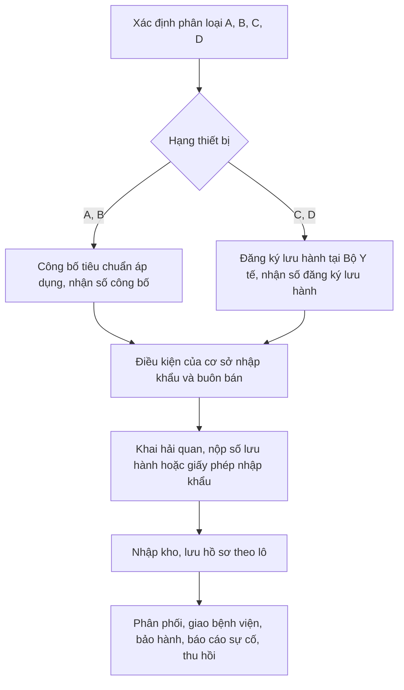
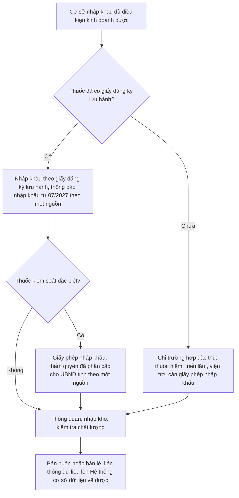

# Mô hình kinh doanh truy xuất nguồn gốc ngành thuốc và thiết bị y tế

**Báo cáo nghiên cứu sơ bộ · Cập nhật 17/11/2026**

Quy ước độ tin cậy trong báo cáo: **[Có nguồn]** là nội dung có ít nhất một nguồn tìm kiếm nêu rõ. **[Thứ cấp]** là nội dung chỉ thấy ở bài báo, trang tư vấn hoặc bản tóm tắt, chưa đối chiếu văn bản gốc. **[Chưa xác minh]** là hiểu biết chung hoặc suy luận của tôi, cần kiểm tra trước khi dùng để chào bán hay ký hợp đồng.

# Tóm tắt và kết luận chính

**Câu hỏi chính: có thể giải quyết bài toán nào cho doanh nghiệp, tổ chức lớn ngành thuốc và thiết bị y tế (TTBYT)?** Kết luận sơ bộ có ba bài toán, xếp theo mức chắc chắn về người trả tiền.

1. **Liên thông dữ liệu thuốc lên Hệ thống cơ sở dữ liệu về dược** cho nhà nhập khẩu, bán buôn và chuỗi nhà thuốc lớn. Đây là nghĩa vụ đã hiện hữu: Công văn 934/TTYQG-DA yêu cầu cơ sở bán buôn, bán lẻ đưa dữ liệu từ 01/01/2026 lên hệ thống, và Quyết định 1867/QĐ-BYT ngày 24/06/2026 phê duyệt kế hoạch triển khai hệ thống mới. **[Thứ cấp]** Người đau rõ nhất là doanh nghiệp có nhiều kho, nhiều hệ thống ERP/WMS và khối lượng giao dịch theo lô lớn. Đối thủ là phần mềm quản lý nhà thuốc đã có sẵn tính năng kết nối.
2. **Chuẩn bị UDI (mã định danh đơn nhất) và truy xuất chuỗi cung ứng TTBYT nhập khẩu**, đặc biệt hạng C, D. Chưa có văn bản bắt buộc UDI nào được tìm thấy. Tín hiệu chính sách rất mạnh nhưng người trả tiền phải được tạo ra bằng lộ trình, không phải bằng nghĩa vụ có sẵn.
3. **Minh bạch chuỗi cung ứng và giá TTBYT cho tổ chức mua sắm** (bệnh viện, sở y tế, đơn vị mua sắm tập trung). Vụ Việt Mỹ (khởi tố ngày 24/07/2026, Bộ Y tế phản hồi về quản lý giá và chuỗi cung ứng đầu tháng 10/2026) và dự án Luật sửa đổi 6 luật y tế trình Quốc hội ngày 21/10/2026 đẩy nhu cầu này lên. Bên trả tiền chưa rõ, và dữ liệu giá nhạy cảm về bí mật kinh doanh.

**Khuyến nghị.** Không chào bán rộng cả hai ngành. Chạy hai hướng với vai trò khác nhau: hướng **thuốc** làm sản phẩm có doanh thu sớm nếu xác nhận được khó khăn thực sự của nhà phân phối lớn; hướng **TTBYT/UDI** làm sản phẩm định vị, thử nghiệm với một nhà nhập khẩu hạng C, D. Chưa nên cam kết giá hay phạm vi cho đến khi hoàn tất kế hoạch xác minh ở mục 7.

**Điều cần nói thẳng ngay từ đầu.**

- "Đăng ký UDI" tại Việt Nam hiện **không phải một thủ tục nộp hồ sơ cho cơ quan nhà nước**, theo những gì tìm thấy. Về kỹ thuật, doanh nghiệp được cấp tiền tố mã doanh nghiệp GS1, tự gán mã định danh thiết bị theo TCVN 13996:2024, rồi in lên nhãn. Khai báo vào cơ sở dữ liệu chỉ có ý nghĩa rõ ràng với thị trường xuất khẩu (FDA, EU). Cơ sở dữ liệu UDI quốc gia của Việt Nam chưa thấy. **[Có nguồn / Thứ cấp]**
- Phần lớn văn bản gốc không mở được trong phiên này vì mạng chặn các trang `thuvienphapluat.vn`, `suckhoedoisong.vn`, `baodauthau.vn`, `nbc.gov.vn`. Nội dung điều khoản dưới đây dựa trên kết quả tìm kiếm và bản tóm tắt. Danh mục văn bản cần đối chiếu nằm ở phụ lục.

# Bối cảnh chính sách và các mốc thời gian

| Văn bản hoặc mốc | Nội dung liên quan đến truy xuất và UDI | Trạng thái và độ tin cậy |
| --- | --- | --- |
| [Luật 44/2024/QH15](https://moh.gov.vn/en/che-do-chinh-sach-linh-vuc-y-te/-/asset_publisher/5uVUQOCXQDjt/content/luat-so-44-2024-qh15-sua-oi-bo-sung-mot-so-dieu-cua-luat-duocj) sửa đổi Luật Dược | Hiệu lực từ 01/07/2025, một số quy định từ 01/01/2025. Mở rộng quyền bán trực tiếp của cơ sở nhập khẩu, bán buôn cho một số cơ sở y tế. Sửa các Điều 56, 59, 60 về giấy phép xuất nhập khẩu, thuốc và nguyên liệu nhập khẩu. Theo tài liệu của Cục Quản lý Dược, cơ sở GPP, GDP, GSP và thương mại điện tử phải bảo đảm truy xuất và liên thông dữ liệu. | Đang hiệu lực. **[Có nguồn]** Phần truy xuất: **[Thứ cấp]** |
| [Nghị định 163/2025/NĐ-CP](https://thuvienphapluat.vn/van-ban/The-thao-Y-te/Nghi-dinh-163-2025-ND-CP-huong-dan-va-bien-phap-de-to-chuc-thi-hanh-Luat-Duoc-636862.aspx) ngày 29/06/2025 | Hướng dẫn thi hành Luật Dược, gồm nhập khẩu thuốc. Một nguồn nêu cơ chế **thông báo nhập khẩu** cho thuốc đã có giấy đăng ký lưu hành áp dụng từ **tháng 07/2027**. | Số điều giữa các trang tổng hợp không thống nhất (Điều 62, 64, 66, 83, 87). **[Thứ cấp]** |
| [Thông tư 32/2026/TT-BYT](https://luatvietnam.vn/y-te/thong-tu-32-2026-tt-byt-quy-dinh-dang-ky-luu-hanh-thuoc-va-nguyen-lieu-lam-thuoc-442224-d1.html) (kế thừa Thông tư 12/2025/TT-BYT) | Đăng ký lưu hành thuốc và nguyên liệu. Nhãn bao bì ngoài phải in mã vạch, QR hoặc DataMatrix để truy xuất **theo lộ trình do Bộ quy định**. | Chưa thấy mốc ngày cụ thể. **[Thứ cấp]** |
| Quyết định 1867/QĐ-BYT ngày 24/06/2026 và [Công văn 934/TTYQG-DA](https://luatvietnam.vn/thuc-pham/cong-van-934-ttyqg-da-2026-trien-khai-he-thong-co-so-du-lieu-ve-duoc-444001-d6.html) | Kế hoạch triển khai Hệ thống cơ sở dữ liệu về dược, thay Quyết định 5071/QĐ-BYT. Cơ sở xuất nhập khẩu, bán buôn, bán lẻ, chuỗi nhà thuốc đăng ký tài khoản, định danh xác thực. Dữ liệu phải khởi tạo từ 01/01/2026. Hệ thống cũ đã ngừng. | Nghĩa vụ đang chạy. Chi tiết hai giai đoạn và hạn cụ thể chưa thấy. **[Thứ cấp]** |
| [Nghị định 98/2021/NĐ-CP](https://thuvienphapluat.vn/van-ban/The-thao-Y-te/Nghi-dinh-98-2021-ND-CP-quan-ly-trang-thiet-bi-y-te-493940.aspx), sửa bởi [Nghị định 07/2023/NĐ-CP](https://thuvienphapluat.vn/van-ban/The-thao-Y-te/Nghi-dinh-07-2023-ND-CP-sua-doi-Nghi-dinh-98-2021-ND-CP-quan-ly-trang-thiet-bi-y-te-557403.aspx) và [Nghị định 04/2025/NĐ-CP](https://thuvienphapluat.vn/van-ban/The-thao-Y-te/Nghi-dinh-04-2025-ND-CP-sua-doi-Nghi-dinh-98-2021-ND-CP-quan-ly-thiet-bi-y-te-639587.aspx) | Khung quản lý TTBYT: phân loại A–D, công bố, đăng ký lưu hành, giấy phép nhập khẩu. Nghị định 04/2025 sửa điểm d khoản 4 Điều 76: giấy phép nhập khẩu cấp theo khoản đó có hiệu lực đến hết 30/06/2025. | Đang hiệu lực. Có các văn bản hợp nhất 04/VBHN-BYT (2026), 08/VBHN-BYT và 12/2026/VBHN-TT-BYT (hợp nhất hướng dẫn thi hành, hiệu lực 01/07/2026). **[Có nguồn]** |
| [TCVN 13996:2024](https://luatvietnam.vn/y-te/tieu-chuan-quoc-gia-tcvn-13996-2024-ma-so-ma-vach-ma-dinh-danh-don-nhat-cho-trang-thiet-bi-y-te-358549-d3.html) và [TCVN 13995:2024](https://luatvietnam.vn/y-te/tieu-chuan-quoc-gia-tcvn-13995-2024-truy-xuat-nguon-goc-yeu-cau-doi-voi-chuoi-cung-ung-trang-thiet-bi-y-te-358547-d3.html) | UDI cho TTBYT và yêu cầu truy xuất chuỗi cung ứng TTBYT. Công bố ngày 01/02/2024. Áp dụng cho tổ chức, cá nhân sản xuất, nhập khẩu, phân phối, bán lẻ và sử dụng TTBYT. | Tiêu chuẩn quốc gia. Theo nguyên tắc chung, tiêu chuẩn quốc gia mang tính tự nguyện trừ khi văn bản khác viện dẫn bắt buộc. **[Chưa xác minh]** |
| [Thông tư 19/2024/TT-BYT](https://lawnet.vn/thong-tin-phap-luat/en/chinh-sach-moi/list-of-medical-equipment-assigned-hs-codes-according-to-vietnam-s-nomenclature-of-exports-and-imports-from-november-16-2024-173049.html) | Danh mục TTBYT được xác định mã HS, áp dụng từ 16/11/2024. | **[Có nguồn]** |
| Tờ trình ngày 15/06/2026 của Bộ Y tế và đề án quản lý chuỗi cung ứng TTBYT 2026–2030 | Nêu lộ trình quản lý chuỗi cung ứng gắn UDI và lộ trình niêm yết giá TTBYT có UDI. Tờ trình nhận định cổng dịch vụ công TTBYT (từ 2018) mới có chức năng hạn chế và chưa có hệ thống đọc, xác thực, khai thác dữ liệu. | Kế hoạch, chưa hiệu lực. [Tờ trình](https://imda.moh.gov.vn/documents/10182/10030600/Duthaototrinh.15.06.2026/db844d21-f1d8-493e-914e-130b24ab9812). **[Có nguồn]** |
| Lộ trình UDI theo hội nghị đối thoại doanh nghiệp TTBYT | Đến 2028: 100% thiết bị cấy ghép, duy trì sự sống, chẩn đoán hình ảnh, xét nghiệm chẩn đoán được cấp phép mới có UDI. Đến 2030: hoàn thành gắn UDI cho TTBYT hạng C, D mới và một số hạng B. | Chỉ thấy trong bài báo tóm tắt hội nghị. [Bài báo](https://baodauthau.vn/hoi-nghi-doi-thoai-doanh-nghiep-thiet-bi-y-te-quyet-tam-khai-thong-nut-that-the-che-va-day-manh-so-hoa-post202654.html). **[Thứ cấp]** |
| Dự thảo Nghị định về quản lý thiết bị y tế 2026 | Phân cấp, thay đổi cách ưu tiên hồ sơ đăng ký, cải cách thủ tục, siết hậu kiểm. Chưa thấy điều khoản UDI hay nghĩa vụ riêng cho nhà nhập khẩu. [Bài báo](https://suckhoedoisong.vn/xay-dung-chuoi-cung-ung-thiet-bi-y-te-hien-dai-minh-bach-169260713145647575.htm) | Dự thảo. **[Thứ cấp]** |
| Dự án Luật sửa đổi, bổ sung một số điều của 6 luật y tế | Trình Quốc hội ngày 21/10/2026 tại Kỳ họp thứ 2. Sửa Điều 113 Luật Khám bệnh, chữa bệnh: quản lý TTBYT theo vòng đời và chuỗi cung ứng, truy xuất nguồn gốc, kiểm soát giá, chia sẻ dữ liệu giữa y tế, hải quan, thuế, đấu thầu, bảo hiểm y tế. Yêu cầu công khai giá niêm yết trên hệ thống dữ liệu TTBYT. Ủy ban Văn hóa, Xã hội đề nghị làm rõ truy xuất và cơ chế khai thác dữ liệu không xung đột bí mật kinh doanh. Chưa thấy nhắc UDI. [Thẩm tra](https://xaydungchinhsach.chinhphu.vn/tham-tra-du-an-luat-sua-doi-bo-sung-mot-so-dieu-cua-6-luat-thuoc-linh-vuc-y-te-119261021101904205.htm) · [Vietnamnet](https://vietnamnet.vn/bo-truong-y-te-trinh-du-luat-ngan-mua-ban-long-vong-nang-gia-thiet-bi-y-te-2566876.html) | Chưa biết kết quả biểu quyết. **[Có nguồn]** |
| Luật Thiết bị y tế độc lập | Hai mốc trình Quốc hội mâu thuẫn nhau: cuối 2027 (phát biểu của Bộ trưởng) và 2029 (kế hoạch hoàn thiện hồ sơ đề xuất). | Dự kiến, chưa chắc. **[Thứ cấp]** |

# Quy mô thị trường

| Chỉ tiêu | Số liệu tìm thấy | Nguồn và nhận xét |
| --- | --- | --- |
| Thị trường thuốc 2025 | Khoảng 7–8 tỷ USD. IMARC 7,98 tỷ; The Report Cubes 7,8 tỷ; VnEconomy khoảng 7 tỷ và mục tiêu 10 tỷ năm 2026. Riêng thuốc kê đơn khoảng 4,87 tỷ (SSI, qua The Investor). | [IMARC](https://www.imarcgroup.com/vietnam-pharmaceuticals-market) · [The Investor](https://theinvestor.vn/vietnams-pharma-market-set-to-top-10-bln-as-aging-population-regulatory-reforms-fuel-growth-d19535.html). Các nguồn lệch tới gần gấp đôi, không dùng làm số chính xác. |
| Mức phụ thuộc nhập khẩu, thuốc | Khoảng 60% thuốc thành phẩm và khoảng 90% nguyên liệu dược (API) nhập khẩu. | [trade.gov](https://www.trade.gov/knowledge-product/vietnam-healthcare) |
| Mạng lưới phân phối thuốc | Gần 8.000 nhà bán buôn và hơn 95.600 điểm bán lẻ. Mạng lưới phân mảnh. | The Investor (số liệu thấy trong kết quả tìm kiếm, chưa xác định đúng bài), [Incorp Asia](https://vietnam.incorp.asia/vietnam-pharmaceutical-companies/) mô tả mạng lưới phân mảnh. **[Thứ cấp]** |
| Thị trường TTBYT 2025 | Khoảng 1,77 tỷ USD, dự báo 2,89 tỷ USD năm 2031. Phân khúc "hi-tech" khoảng 687 triệu USD (IMARC). | [Vietnam Briefing](https://vietnam-briefing.com/news/vietnam-medical-devices-market-outlook-projections-insights.html) · [Kenresearch](https://www.kenresearch.com/industry-reports/vietnam-medical-devices-industry.md) |
| Mức phụ thuộc nhập khẩu, TTBYT | Trên 90% thiết bị y tế nhập khẩu. Nhật, Đức, Mỹ, Trung Quốc, Singapore chiếm khoảng 55–59% nhập khẩu tùy năm. | [Vietnam Briefing](https://vietnam-briefing.com/news/vietnam-medical-devices-market-outlook-projections-insights.html) · [trade.gov](https://www.trade.gov/knowledge-product/vietnam-healthcare) |

**Chưa tính được quy mô thị trường dịch vụ truy xuất.** Công thức đề xuất: số doanh nghiệp đủ tiêu chí (nhà nhập khẩu, phân phối TTBYT hạng C, D có số lưu hành; nhà bán buôn, nhập khẩu thuốc có doanh số trên ngưỡng) × tỷ lệ có nhu cầu thật × thuê bao bình quân mỗi doanh nghiệp. Số lượng doanh nghiệp tra được từ cổng công bố TTBYT của Cục Hạ tầng và Thiết bị y tế, nhưng chưa có số tổng hợp công khai. Doanh số thuốc nhập khẩu của từng nhà phân phối chưa tìm được nguồn tin cậy (một bảng xếp hạng cho Zuellig Pharma khoảng 500 triệu USD nhập khẩu, độ tin cậy thấp).

Các thông số ảnh hưởng tới nhu cầu thật: TTBYT nhập khẩu chiếm trên 90% nên gần như mọi nhà phân phối TTBYT là nhà nhập khẩu; thuốc thành phẩm nhập khẩu 60% nên bán buôn thuốc ngoại gắn chặt với hồ sơ nhập khẩu.

# Nghiệp vụ doanh nghiệp phải thực hiện

## Nhóm 1. Gán và quản lý UDI cho thiết bị y tế

Cơ sở kỹ thuật là TCVN 13996:2024. UDI gồm **mã định danh thiết bị (UDI-DI)** là GTIN do GS1 cấp, mã hóa thành GTIN-14 với định danh ứng dụng (01), và **mã định danh sản xuất (UDI-PI)** gồm số lô, ngày sản xuất, hạn dùng, số sê-ri tùy loại thiết bị. Mã do **bên ghi nhãn** ấn định theo quy tắc cấp mã GS1. Sau khi gán, mã không được dùng cho thiết bị khác. **[Có nguồn]**

| Bước | Việc doanh nghiệp phải làm | Đầu ra | Độ tin cậy |
| --- | --- | --- | --- |
| 1 | Xác định mình là bên ghi nhãn hay chỉ là nhà nhập khẩu. Nếu hàng đã mang GTIN của chủ sở hữu nước ngoài thì nhà nhập khẩu dùng lại mã đó, không tự cấp mã mới. | Bảng phân vai theo từng dòng sản phẩm | Nguyên tắc GS1. **[Chưa xác minh]** |
| 2 | Với doanh nghiệp là bên ghi nhãn: đăng ký thành viên với GS1 Việt Nam để nhận tiền tố mã doanh nghiệp. Thủ tục, lệ phí, thời gian chưa tìm được nguồn chính thức. | Tiền tố mã doanh nghiệp | Tiền tố: **[Có nguồn]**. Thủ tục: chưa rõ |
| 3 | Rà soát danh mục sản phẩm theo model, phiên bản và từng cấp bao gói (đơn vị, hộp, thùng), gán một GTIN cho mỗi cấp. Thay đổi thuộc tính làm thay đổi mã, nên cần quy tắc quản lý phiên bản. | Danh mục UDI-DI | Cấu trúc: **[Có nguồn]**. Quy tắc đổi mã: **[Chưa xác minh]** |
| 4 | Xác định UDI-PI cho từng loại thiết bị: số lô (AI 10), ngày sản xuất (AI 11), hạn dùng (AI 17), số sê-ri (AI 21). | Quy tắc dữ liệu in | Chuẩn GS1. **[Chưa xác minh]** |
| 5 | Mã hóa và in trên nhãn bằng GS1 DataMatrix, GS1-128 hoặc QR, kèm dạng đọc được bằng mắt. Kiểm tra chất lượng in. | Nhãn đạt chuẩn quét | **[Chưa xác minh]** |
| 6 | Duy trì dữ liệu chủ liên kết UDI-DI với tên, model, hạng A–D, số lưu hành, chủ sở hữu, người ủy quyền. | Danh mục sản phẩm chuẩn | Hợp lý theo cấu trúc quản lý. **[Chưa xác minh]** |
| 7 | Khai báo vào cơ sở dữ liệu. Trong nước: chưa thấy cơ sở dữ liệu UDI quốc gia, Bộ Y tế đang xây dựng. Xuất khẩu: nhà ghi nhãn nộp dữ liệu thiết bị lên [FDA GUDID](https://www.registrarcorp.com/vi/blog/medical-devices/medical-device-registration/gudid/) (Mỹ) hoặc EUDAMED (EU). | Bản ghi trong cơ sở dữ liệu | Trong nước: chưa có. Xuất khẩu: **[Có nguồn]** |
| 8 | Ghi nhận UDI-PI tại các điểm giao nhận: nhập kho, xuất bán, giao cho bệnh viện. TCVN 13995:2024 yêu cầu mỗi bên có hệ thống truy xuất nội bộ và bên ngoài. | Nhật ký giao nhận theo lô, sê-ri | **[Có nguồn]** |

**Khoảng trống quan trọng.** Chưa tìm thấy yêu cầu bắt buộc hay mốc ngày áp dụng UDI trong văn bản đã hiệu lực. Một tài liệu tư vấn quốc tế cũng nêu Việt Nam chưa có hệ thống UDI đầy đủ nhưng khuyến nghị chủ giấy phép giữ hồ sơ truy xuất theo lô tương đương. **[Thứ cấp]** Hai mốc 2028 và 2030 ở trên nên được xem là hướng chính sách, chưa phải nghĩa vụ.

## Nhóm 2. Nhập khẩu thiết bị y tế

Khung pháp lý là Nghị định 98/2021/NĐ-CP đã sửa đổi. Nội dung dưới đây tổng hợp từ kết quả tìm kiếm và các trang tư vấn. Trước khi dùng cần đối chiếu văn bản hợp nhất 04/VBHN-BYT (2026).

| Bước | Việc doanh nghiệp phải làm | Đầu ra | Độ tin cậy |
| --- | --- | --- | --- |
| 1. Phân loại | Phân loại thiết bị theo mức rủi ro từ A (thấp) đến D (cao). Thiết bị nhập khẩu cần rà lại kết quả phân loại của nước xuất xứ vì quy tắc phân loại của Việt Nam có thể khác. Ai được phân loại và công bố kết quả theo cơ chế nào cần đối chiếu điều khoản hiện hành. | Kết quả phân loại | Có 4 hạng: **[Có nguồn]**. Cơ chế công bố kết quả: **[Chưa xác minh]** |
| 2. Hồ sơ từ chủ sở hữu nước ngoài | Thường gồm giấy ủy quyền của chủ sở hữu, giấy chứng nhận lưu hành tự do (CFS), chứng chỉ ISO 13485, tài liệu kỹ thuật theo mẫu CSDT của ASEAN. Danh mục chính xác phụ thuộc hạng thiết bị. | Bộ hồ sơ kỹ thuật và pháp lý | Mẫu CSDT và CFS từ tóm tắt Nghị định 169/2018 (đã bị thay thế phần lớn). **[Thứ cấp]** |
| 3. Công bố hoặc đăng ký | Hạng A, B: công bố tiêu chuẩn áp dụng, nhận số công bố, nộp tại Sở Y tế theo một nguồn thứ cấp. Hạng C, D: đăng ký lưu hành, Bộ Y tế cấp số đăng ký lưu hành. Số lưu hành là số công bố (A, B) hoặc số giấy chứng nhận đăng ký lưu hành (C, D). Một nguồn nêu số lưu hành không có thời hạn, trừ cấp khẩn cấp. | Số lưu hành | Phân loại số: **[Có nguồn]**. Nơi nộp và thời hạn: **[Thứ cấp]** |
| 4. Điều kiện của cơ sở | Cơ sở nhập khẩu và buôn bán phải đáp ứng điều kiện về nhân sự, kho, hồ sơ theo hạng thiết bị và hoàn thành thủ tục công bố hoặc thông báo tương ứng. Điều khoản cụ thể chưa đối chiếu được. | Hồ sơ điều kiện cơ sở | **[Chưa xác minh]** |
| 5. Giấy phép nhập khẩu | Thiết bị đã có số lưu hành nhìn chung không cần giấy phép. Giấy phép dành cho các trường hợp ngoại lệ: chưa có số lưu hành nhưng nhập cho viện trợ, quà tặng cho cơ sở y tế, triển lãm, khám chữa bệnh nhân đạo, và một danh mục thiết bị riêng theo điểm d khoản 2 Điều 76. Nội dung danh mục chưa xem được. | Giấy phép, nếu thuộc diện | Ngoại lệ: **[Thứ cấp]**. Danh mục: chưa xem |
| 6. Hải quan | Khai tờ khai điện tử, xác định mã HS theo Thông tư 19/2024/TT-BYT, nộp số lưu hành hoặc giấy phép. Thủ tục kiểm tra chuyên ngành, thuế, chứng từ chưa kiểm chứng. | Thông quan | Mã HS: **[Có nguồn]**. Còn lại: **[Chưa xác minh]** |
| 7. Sau nhập khẩu | Lưu hồ sơ theo lô, giữ số liệu cung cấp cho cơ sở y tế (tên, loại, số lưu hành, số lượng), bảo hành, bảo trì, báo cáo sự cố bất lợi, thu hồi khi cần. Cổng công bố phải đăng thông tin số lưu hành trong 3 ngày làm việc sau khi cấp. | Sổ theo dõi, báo cáo | Công khai trong 3 ngày: **[Có nguồn]**. Phần còn lại: **[Chưa xác minh]** |

## Nhóm 3. Nhập khẩu thuốc và nguyên liệu làm thuốc

Khung pháp lý là Luật Dược (sửa bởi Luật 44/2024/QH15), Nghị định 163/2025/NĐ-CP và Thông tư 32/2026/TT-BYT. Các trang tổng hợp đánh số điều không thống nhất, cần đối chiếu văn bản gốc.

| Bước | Việc doanh nghiệp phải làm | Đầu ra | Độ tin cậy |
| --- | --- | --- | --- |
| 1. Điều kiện cơ sở | Có điều kiện kinh doanh dược phù hợp loại hình nhập khẩu và bán buôn, đáp ứng thực hành tốt phân phối (GDP), bảo quản (GSP). Luật 44/2024 yêu cầu cơ sở GPP, GDP, GSP bảo đảm truy xuất và liên thông dữ liệu. | Giấy chứng nhận, hồ sơ GDP | Truy xuất: **[Thứ cấp]**. Điều kiện chi tiết: **[Chưa xác minh]** |
| 2. Đăng ký lưu hành | Thuốc phải có giấy đăng ký lưu hành. Thông tư 32/2026/TT-BYT quy định đăng ký lưu hành thuốc và nguyên liệu. Thường chủ sở hữu hoặc cơ sở đăng ký nộp hồ sơ, không phải nhà phân phối. | Giấy đăng ký lưu hành | **[Có nguồn]** |
| 3. Cấp phép nhập khẩu | Thuốc có giấy đăng ký lưu hành nhập theo giấy này. Thuốc chưa có giấy chỉ được xem xét cấp phép cho thuốc hiếm, triển lãm, viện trợ. Thuốc kiểm soát đặc biệt cần giấy phép nhập khẩu, thẩm quyền đã phân cấp cho UBND cấp tỉnh. Nguyên liệu theo hồ sơ thuốc đã đăng ký không cần cấp phép, nguyên liệu kiểm soát đặc biệt vẫn cần. | Giấy phép, nếu thuộc diện | **[Thứ cấp]** |
| 4. Thông báo nhập khẩu | Cơ chế thông báo cho thuốc đã có giấy đăng ký lưu hành, một nguồn nêu áp dụng từ 07/2027. | Thông báo nhập khẩu | Mốc ngày: **[Thứ cấp]**, cần đối chiếu |
| 5. Nhãn và mã | Bao bì ngoài in mã vạch, QR hoặc DataMatrix theo lộ trình của Bộ. Cơ sở sản xuất, phân phối được ủy quyền ghi thêm thông tin truy xuất trên nhãn mà không cần phê duyệt lại, theo một bài viết. | Nhãn có mã truy xuất | Lộ trình: chưa có mốc. **[Thứ cấp]** |
| 6. Hải quan và kiểm tra chất lượng | Thủ tục thông quan, kiểm tra lô nhập khẩu, hồ sơ chất lượng, phiếu kiểm nghiệm của nhà sản xuất. | Thông quan, hồ sơ lô | **[Chưa xác minh]** |
| 7. Liên thông dữ liệu | Đăng ký tài khoản, định danh xác thực trên Hệ thống cơ sở dữ liệu về dược. Khởi tạo và kết nối dữ liệu từ 01/01/2026. Cập nhật hướng dẫn kết nối và tài liệu đặc tả API. | Dữ liệu nhập, xuất, tồn theo lô trên hệ thống quốc gia | **[Thứ cấp]** |
| 8. Sau lưu hành | Thu hồi thuốc, báo cáo theo quy định, lưu hồ sơ. Thời hạn lưu và thời gian báo cáo thu hồi chưa tìm được. | Hồ sơ thu hồi | **[Chưa xác minh]** |

## Điểm dữ liệu chung giữa UDI, thiết bị y tế và thuốc

| Dữ liệu | Sinh ra ở đâu | Dùng để làm gì | Chỗ dễ lệch |
| --- | --- | --- | --- |
| GTIN, UDI-DI (thiết bị) hoặc mã thuốc chuẩn | Chủ sở hữu hoặc bên ghi nhãn | Định danh sản phẩm xuyên chuỗi | ERP của nhà phân phối thường chỉ giữ mã nội bộ, không giữ GTIN |
| Số lưu hành hoặc giấy đăng ký lưu hành | Bộ Y tế, Sở Y tế | Điều kiện nhập khẩu, đấu thầu, bán | Hết hạn, đổi chủ sở hữu hoặc người ủy quyền mà dữ liệu nội bộ không cập nhật |
| Số lô, hạn dùng, số sê-ri | Nhà sản xuất | Truy xuất, thu hồi | Mất khi đổi mã tại kho, tách lô, gộp lô |
| Tờ khai hải quan, mã HS | Nhà nhập khẩu | Thông quan, đối chiếu thuế | Không liên kết với lô trong ERP |
| Giao nhận theo lô cho cơ sở y tế hoặc nhà thuốc | Kho, nhà phân phối | Truy ngược điểm nhận, thu hồi | Hệ thống bán hàng chỉ giữ mã sản phẩm, không giữ lô |

# Bài toán có thể giải quyết cho doanh nghiệp và tổ chức lớn

| Bài toán | Ai đau và vì sao | Căn cứ | Mức chắc chắn | Hướng sản phẩm |
| --- | --- | --- | --- | --- |
| **P1. Liên thông dữ liệu thuốc lên Hệ thống cơ sở dữ liệu về dược** | Nhà nhập khẩu, bán buôn lớn có nhiều kho, nhiều ERP/WMS và giao dịch theo lô khối lượng lớn. Phải khởi tạo dữ liệu từ 01/01/2026 và đối soát sai lệch. | Quyết định 1867/QĐ-BYT, Công văn 934/TTYQG-DA | Nghĩa vụ **có**. Mức độ khó khăn thực tế của doanh nghiệp lớn **chưa kiểm chứng** | Connector từ ERP/WMS lên hệ thống quốc gia, kiểm tra chất lượng dữ liệu, đối soát |
| **P2. Chuẩn bị UDI và dữ liệu chủ cho TTBYT nhập khẩu** | Nhà nhập khẩu, phân phối hạng C, D có hàng nghìn model. Dữ liệu sản phẩm nằm rải rác trong ERP, bảng tính, hồ sơ lưu hành. | TCVN 13996:2024, lộ trình 2028, 2030, đề án 2026–2030 | Nghĩa vụ **chưa có**. Nhu cầu phụ thuộc lộ trình | Chuẩn hóa dữ liệu chủ, gán GTIN, liên kết UDI–số lưu hành–lô, đọc mã tại kho |
| **P3. Truy xuất theo lô và thu hồi** | Nhà phân phối thuốc, TTBYT phải xác định nhanh điểm nhận của một lô khi có cảnh báo. | Luật Dược, TCVN 13995:2024 | Bài toán nghiệp vụ **có**. Khả năng chi trả **chưa kiểm chứng** | Sổ truy xuất theo lô, báo cáo phạm vi, diễn tập thu hồi |
| **P4. Minh bạch chuỗi cung ứng và giá TTBYT cho bên mua sắm** | Bệnh viện, sở y tế, đơn vị mua tập trung. Cán bộ y tế lo ngại khi mua sắm sau vụ Việt Mỹ. | Vụ Việt Mỹ, Điều 113 Luật Khám bệnh, chữa bệnh sửa đổi, đề án 2026–2030 | Nhu cầu chính sách **có**. Bên trả tiền **chưa rõ**, dữ liệu giá nhạy cảm | Xác thực thiết bị theo UDI khi nhận, liên kết hợp đồng–lô–bệnh viện, dữ liệu cho cơ quan quản lý |
| **P5. UDI và serialization cho nhà sản xuất xuất khẩu** | Nhà sản xuất TTBYT trong nước bán sang Mỹ, EU phải đáp ứng UDI của thị trường đích. | FDA GUDID, EUDAMED | **Chưa kiểm chứng**. Chưa có số liệu về nhóm này | Quản lý dữ liệu UDI, đồng bộ lên GUDID, EUDAMED |
| **P6. Kiểm tra trước thông quan số lưu hành, ủy quyền, hạn hiệu lực** | Nhà nhập khẩu bị chậm hàng vì hồ sơ lưu hành hết hạn, sai chủ sở hữu hoặc sai mã HS. | Quy trình nhập khẩu ở mục trên | **Chưa kiểm chứng** | Đối chiếu tự động tờ khai với hồ sơ lưu hành |

## Yêu cầu nghiệp vụ viết theo người dùng

- Là **trưởng bộ phận pháp chế và đăng ký của nhà nhập khẩu TTBYT**, tôi muốn xem một danh mục duy nhất liên kết mỗi model với hạng thiết bị, số lưu hành, chủ sở hữu, người ủy quyền và ngày hết hạn, để không nhập hàng khi hồ sơ lưu hành đã sai hoặc hết hạn.
- Là **quản lý kho của nhà phân phối TTBYT**, tôi muốn quét mã trên thùng và từng thiết bị khi nhập kho và khi xuất cho bệnh viện, để mọi lô và sê-ri đều gắn với điểm nhận.
- Là **người phụ trách chất lượng của nhà phân phối thuốc**, tôi muốn nhập một số lô bị cảnh báo và nhận ngay danh sách nơi đã nhận, số lượng đã giao, đã bán và còn tồn, để quyết định phạm vi thu hồi trong thời gian ngắn.
- Là **trưởng bộ phận công nghệ thông tin của nhà bán buôn thuốc lớn**, tôi muốn dữ liệu từ ERP và WMS tự động gửi lên Hệ thống cơ sở dữ liệu về dược và báo cho tôi những bản ghi lỗi hoặc thiếu, để không phải nhập lại thủ công và không bị từ chối dữ liệu.
- Là **cán bộ phòng vật tư thiết bị của bệnh viện**, tôi muốn quét mã khi nhận thiết bị và đối chiếu với hồ sơ lưu hành, hợp đồng và lô, để phát hiện hàng sai thông tin trước khi nghiệm thu.
- Là **cán bộ cơ quan quản lý**, tôi muốn xem chuỗi từ nhà nhập khẩu đến cơ sở y tế của một thiết bị theo mã định danh, để kiểm tra mà không phải yêu cầu từng doanh nghiệp gửi bảng tính.
- Là **nhà sản xuất TTBYT xuất khẩu**, tôi muốn quản lý một bộ dữ liệu thiết bị và đồng bộ lên cơ sở dữ liệu của thị trường đích, để không phải khai lại cho từng thị trường.

# So sánh phương án và quy tắc chọn

| Phương án và bên mua dự kiến | Nhu cầu và căn cứ | Dữ liệu và khả năng tiếp cận bên mua | Giá trị đo được và chi phí chính |
| --- | --- | --- | --- |
| **Thuốc · Connector liên thông cơ sở dữ liệu dược · Nhà nhập khẩu, bán buôn, chuỗi nhà thuốc lớn mua theo kho hoặc theo pháp nhân** | Nghĩa vụ dữ liệu từ 01/01/2026 đã nêu. Phần mềm quản lý nhà thuốc đã có hướng dẫn đăng ký tài khoản hệ thống (ví dụ Sapo), cho thấy thị trường nhỏ lẻ đã có người phục vụ. Nhu cầu của doanh nghiệp lớn là giả thuyết. | Dữ liệu nằm trong ERP, WMS. Cần đặc tả API của Bộ và quyền truy cập từ IT. Người duyệt ngân sách là giám đốc công nghệ thông tin hoặc giám đốc tuân thủ. | Đo tỷ lệ bản ghi gửi thành công, số giờ nhập lại thủ công, số bản ghi bị từ chối. Chi phí chính: tích hợp từng ERP, bảo trì khi Bộ đổi đặc tả. |
| **TTBYT · Chuẩn hóa UDI và truy xuất · Nhà nhập khẩu, phân phối hạng C, D mua theo gói triển khai và thuê bao** | Lộ trình 2028, 2030 và đề án 2026–2030 là tín hiệu. TCVN 13996, 13995 là cơ sở kỹ thuật. Chưa có nghĩa vụ bắt buộc. | Cần danh mục model, hồ sơ lưu hành, dữ liệu nhập kho. Cần sự đồng ý của chủ sở hữu nước ngoài khi muốn dùng GTIN gốc. Người mua là giám đốc vận hành hoặc pháp chế. | Đo số model có GTIN chuẩn, tỷ lệ lô gắn được với điểm nhận, thời gian trả lời một yêu cầu truy xuất. Chi phí chính: làm sạch dữ liệu, đầu đọc mã, đào tạo kho. |
| **TTBYT · Xác thực thiết bị và minh bạch chuỗi · Bệnh viện, sở y tế, đơn vị mua tập trung** | Vụ Việt Mỹ, Điều 113 sửa đổi, đề án 2026–2030. Bên trả tiền chưa rõ vì ngân sách bệnh viện bị ràng buộc bởi đấu thầu. | Cần nhà cung cấp tham gia quét mã. Dữ liệu giá nhạy cảm, Ủy ban Văn hóa, Xã hội đã nêu lo ngại về bí mật kinh doanh. | Đo tỷ lệ thiết bị nhận có đối chiếu được hồ sơ, số lần sai thông tin phát hiện. Chi phí chính: phối hợp nhiều nhà cung cấp. |

**Quy tắc chọn.** Ưu tiên thuốc khi xác nhận được ít nhất một nhà bán buôn hoặc nhập khẩu lớn đang gặp khó khăn với việc liên thông và có ngân sách. Ưu tiên TTBYT khi có nhà nhập khẩu hạng C, D chịu mở danh mục model và sẵn sàng thử nghiệm UDI trước mốc bắt buộc. Chỉ làm hướng bệnh viện khi một bên có thẩm quyền (sở y tế, đơn vị mua tập trung) cam kết trả phí hoặc yêu cầu bắt buộc trong đấu thầu.

# Mô hình thương mại đề xuất (giả thuyết)

Giữ khung phân vai của báo cáo ngành sữa: PILA cung cấp công nghệ NDATrace, C3P triển khai Premier và ký hợp đồng với khách hàng, VNChain triển khai Mass. Chưa kiểm chứng riêng cho ngành thuốc và TTBYT. Hai điểm khác ngành sữa cần cân nhắc:

- **Người dùng bên ngoài là cơ quan quản lý có hệ thống dữ liệu riêng.** Với thuốc, đích đến là Hệ thống cơ sở dữ liệu về dược của Bộ Y tế, không phải Nền tảng truy xuất quốc gia. Với TTBYT, chưa có hệ thống đích. Vì vậy sản phẩm thuốc thiên về connector, sản phẩm TTBYT thiên về dữ liệu chủ và truy xuất nội bộ.
- **Khoảng trống giữa nghĩa vụ và giá trị.** Với thuốc, doanh nghiệp mua để tuân thủ, nên so sánh bằng chi phí tự làm. Với TTBYT, doanh nghiệp mua để chuẩn bị sớm, nên cần chứng minh bằng thử nghiệm.

| Giai đoạn | Phạm vi và đầu ra | Cơ chế thu phí |
| --- | --- | --- |
| Thử nghiệm | Một doanh nghiệp, một kho hoặc một nhóm model. Thuốc: gửi thử dữ liệu một kho lên hệ thống quốc gia và đối soát. TTBYT: gán GTIN và liên kết số lưu hành cho một nhóm model, chạy một lượt truy xuất theo lô. | Miễn phí trong phạm vi chốt trước. C3P chịu chi phí. |
| Triển khai | Tích hợp ERP/WMS, chuẩn hóa dữ liệu, cấu hình đầu đọc mã (TTBYT), đào tạo, nghiệm thu. | Phí triển khai một lần theo phạm vi. |
| Vận hành | Theo dõi chất lượng dữ liệu, đối soát, cập nhật khi Bộ đổi đặc tả, hỗ trợ truy xuất. | Thuê bao theo pháp nhân hoặc kho theo năm. Phần mở rộng theo báo giá. |

| Thành phần | Giả thuyết cho gói thuốc và TTBYT |
| --- | --- |
| Phân khúc khách hàng | Nhà nhập khẩu, bán buôn thuốc lớn. Nhà nhập khẩu, phân phối TTBYT hạng C, D. |
| Giá trị cung cấp | Dữ liệu đủ và đúng để liên thông, truy xuất nhanh theo lô, sẵn sàng với UDI. |
| Kênh bán | Trực tiếp qua pháp chế, chất lượng, vận hành, phối hợp công nghệ thông tin và người duyệt ngân sách. Hội thảo phối hợp GS1 Việt Nam và các hiệp hội ngành. |
| Doanh thu | Phí triển khai một lần và thuê bao theo năm. |
| Nguồn lực chính | NDATrace, năng lực tích hợp ERP/WMS, hiểu biết về văn bản ngành dược và TTBYT. |
| Đối tác chính | PILA, GS1 Việt Nam, nhà cung cấp ERP/WMS, tư vấn pháp lý chuyên ngành. |
| Chi phí | Giá vốn triển khai, phí công nghệ, bảo trì kết nối, theo dõi thay đổi quy định. |

# Giải pháp và đối thủ cạnh tranh

Chưa lập được danh sách đối thủ nội địa cho thuốc và TTBYT bằng nguồn tin cậy. Đây là khoảng trống cần nghiên cứu riêng. Những gì đã thấy:

| Nhóm | Ghi nhận | Độ tin cậy |
| --- | --- | --- |
| Hệ thống do Nhà nước vận hành | Hệ thống cơ sở dữ liệu về dược (Bộ Y tế). Cổng dịch vụ công TTBYT của Cục Hạ tầng và Thiết bị y tế, theo chính tờ trình 15/06/2026 còn hạn chế về chức năng. Nền tảng truy xuất nguồn gốc quốc gia do PILA xây dựng. | Có nguồn |
| Phần mềm quản lý nhà thuốc và phân phối | Ít nhất một nhà cung cấp (Sapo) đã có hướng dẫn đăng ký tài khoản Hệ thống cơ sở dữ liệu về dược. Phạm vi và chất lượng với doanh nghiệp lớn chưa rõ. | Thứ cấp |
| GS1 Việt Nam (Trung tâm Mã số Mã vạch Quốc gia) | Chuẩn mã, đào tạo, từng phối hợp với Vụ Trang thiết bị và Công trình y tế về bộ mã định danh và module truy xuất TTBYT. Thông tin từ năm 2021, có thể đã cũ. Vừa là đối tác vừa có thể làm cạnh tranh một phần. | Thứ cấp |
| Nhà cung cấp quốc tế TraceLink, Systech, rfxcel | Giải pháp serialization và truy xuất cho dược. TraceLink liệt kê Việt Nam trong tài liệu cập nhật quy định thị trường mới nổi. Khả năng cung cấp và giá tại Việt Nam chưa rõ. | Thứ cấp (tài liệu của chính nhà cung cấp) |
| iCheck | Giải pháp truy xuất thương mại đã nêu trong báo cáo ngành sữa. Chưa kiểm tra năng lực với thuốc, TTBYT. | Chưa xác minh |
| ERP nội bộ (SAP, Oracle và tương tự) | Nhiều doanh nghiệp lớn có thể tự phát triển module kết nối. Là đối thủ chính của connector. | Chưa xác minh |

# Kế hoạch xác minh trước khi chào bán

| Giả thuyết cần kiểm chứng | Cách kiểm chứng | Người xác nhận | Go hay No-go |
| --- | --- | --- | --- |
| Doanh nghiệp thuốc lớn đang gặp khó khăn với việc liên thông lên hệ thống quốc gia | Phỏng vấn 5–8 nhà nhập khẩu, bán buôn lớn. Hỏi tỷ lệ dữ liệu đã gửi, số bản ghi lỗi, ai làm, tốn bao nhiêu giờ. | Giám đốc công nghệ thông tin, giám đốc tuân thủ | Go nếu ít nhất 3 doanh nghiệp xác nhận tốn công đáng kể và có ngân sách |
| Nhà nhập khẩu TTBYT hạng C, D chịu chi tiền cho UDI trước mốc bắt buộc | Phỏng vấn 5–8 nhà nhập khẩu và phân phối. Hỏi đã có GTIN gốc của hãng chưa, ERP có giữ không, có kế hoạch gì cho 2028, 2030. | Giám đốc vận hành, pháp chế | Go nếu có ít nhất một đơn vị cam kết thử nghiệm với dữ liệu thật |
| Có thể tái sử dụng GTIN của chủ sở hữu nước ngoài | Kiểm tra mẫu 20–30 model về tỷ lệ mang GTIN trên nhãn | Kho, đăng ký | Ngưỡng đề xuất của tôi, chưa có căn cứ: Go nếu từ 60% model đã có GTIN gốc, thấp hơn thì chi phí làm sạch có thể quá lớn |
| Hạn và quy định chi tiết của Hệ thống cơ sở dữ liệu về dược | Đọc toàn văn Quyết định 1867/QĐ-BYT, Công văn 934/TTYQG-DA và tài liệu đặc tả API | Pháp lý, công nghệ | Chưa có thì chưa báo giá connector |
| Văn bản bắt buộc UDI hoặc mốc áp dụng | Theo dõi dự thảo Nghị định, Luật sửa 6 luật, đề án 2026–2030. Hỏi Cục Hạ tầng và Thiết bị y tế, GS1 Việt Nam | Pháp lý | Giữ vai trò định vị, chưa tính doanh thu cho đến khi có văn bản bắt buộc |
| Người trả tiền ở nhóm bệnh viện, mua sắm tập trung | Hỏi sở y tế, đơn vị mua tập trung ai chịu ngân sách, có thể đưa vào yêu cầu đấu thầu không | Lãnh đạo đơn vị | No-go nếu không có bên cam kết trả phí |

**Việc cần làm ngay.**

1. Cho phép phiên làm việc truy cập `thuvienphapluat.vn`, `suckhoedoisong.vn`, `baodauthau.vn`, `nbc.gov.vn` để đọc văn bản gốc, hoặc gửi trực tiếp văn bản. Tôi sẽ đối chiếu lại toàn bộ cột **[Thứ cấp]** và **[Chưa xác minh]**.
2. Xác nhận với GS1 Việt Nam thủ tục, lệ phí, thời gian cấp tiền tố mã doanh nghiệp và quy định về dùng lại GTIN của hãng nước ngoài.
3. Lập danh sách 10–15 doanh nghiệp mục tiêu theo hai hướng để phỏng vấn.

# Phụ lục nguồn và mâu thuẫn trong nguồn

## Văn bản cần đối chiếu bản gốc

- Luật Dược 105/2016/QH13 và Luật 44/2024/QH15: các Điều 56, 59, 60 và điều khoản về truy xuất, liên thông.
- Nghị định 163/2025/NĐ-CP: các điều về nhập khẩu thuốc, thông báo nhập khẩu, thuốc kiểm soát đặc biệt.
- Thông tư 32/2026/TT-BYT và Thông tư 12/2025/TT-BYT: điều về nhãn và mã truy xuất, lộ trình.
- Quyết định 1867/QĐ-BYT, Công văn 934/TTYQG-DA: phạm vi đối tượng, hạn kết nối, đặc tả API.
- Nghị định 98/2021/NĐ-CP, 07/2023/NĐ-CP, 04/2025/NĐ-CP và các văn bản hợp nhất 04/VBHN-BYT, 08/VBHN-BYT, 12/2026/VBHN-TT-BYT: phân loại, công bố, đăng ký, danh mục thiết bị phải xin giấy phép nhập khẩu, điều kiện cơ sở buôn bán.
- TCVN 13996:2024, TCVN 13995:2024, TCVN 13258:2020: yêu cầu kỹ thuật.
- Dự thảo Nghị định quản lý thiết bị y tế 2026, tờ trình 15/06/2026, đề án quản lý chuỗi cung ứng TTBYT 2026–2030, dự án Luật sửa 6 luật y tế.

## Mâu thuẫn và chỗ chưa thống nhất

- Số điều của Nghị định 163/2025/NĐ-CP về nhập khẩu thuốc khác nhau giữa các trang tổng hợp (Điều 62, 64, 66, 83, 87).
- Mốc trình Luật Thiết bị y tế: cuối 2027 hay 2029.
- Hạng thiết bị nộp công bố ở đâu: một nguồn nêu Sở Y tế cho hạng A, B, nguồn khác nêu Bộ Y tế cho hạng D. Cần đối chiếu để tránh ghi sai trong báo giá.
- Số liệu quy mô thị trường thuốc lệch từ khoảng 4,9 đến 8,9 tỷ USD tùy phạm vi và nguồn.
- Một trang tư vấn nêu thời hạn xử lý hồ sơ và số loại thiết bị bổ sung cụ thể mà không xác minh được. Không dùng.

## Nguồn tìm kiếm đã dùng

- Pháp luật thuốc: [Luật 44/2024/QH15](https://moh.gov.vn/en/che-do-chinh-sach-linh-vuc-y-te/-/asset_publisher/5uVUQOCXQDjt/content/luat-so-44-2024-qh15-sua-oi-bo-sung-mot-so-dieu-cua-luat-duocj), [Nghị định 163/2025/NĐ-CP](https://thuvienphapluat.vn/van-ban/The-thao-Y-te/Nghi-dinh-163-2025-ND-CP-huong-dan-va-bien-phap-de-to-chuc-thi-hanh-Luat-Duoc-636862.aspx), [Thông tư 32/2026/TT-BYT](https://luatvietnam.vn/y-te/thong-tu-32-2026-tt-byt-quy-dinh-dang-ky-luu-hanh-thuoc-va-nguyen-lieu-lam-thuoc-442224-d1.html), [Kế hoạch Quyết định 1867/QĐ-BYT](https://thuvienphapluat.vn/chinh-sach-phap-luat-moi/vn/ho-tro-phap-luat/chinh-sach-moi/115713/ke-hoach-trien-khai-he-thong-co-so-du-lieu-ve-duoc-tu-ngay-24-6-2026-quyet-dinh-1867-qd-byt), [Công văn 934/TTYQG-DA](https://luatvietnam.vn/thuc-pham/cong-van-934-ttyqg-da-2026-trien-khai-he-thong-co-so-du-lieu-ve-duoc-444001-d6.html).
- Pháp luật TTBYT: [Nghị định 98/2021](https://thuvienphapluat.vn/van-ban/The-thao-Y-te/Nghi-dinh-98-2021-ND-CP-quan-ly-trang-thiet-bi-y-te-493940.aspx), [Nghị định 07/2023](https://thuvienphapluat.vn/van-ban/The-thao-Y-te/Nghi-dinh-07-2023-ND-CP-sua-doi-Nghi-dinh-98-2021-ND-CP-quan-ly-trang-thiet-bi-y-te-557403.aspx), [Nghị định 04/2025](https://thuvienphapluat.vn/van-ban/The-thao-Y-te/Nghi-dinh-04-2025-ND-CP-sua-doi-Nghi-dinh-98-2021-ND-CP-quan-ly-thiet-bi-y-te-639587.aspx), [Văn bản hợp nhất 12/2026/VBHN-TT-BYT](https://luatvietnam.vn/y-te/van-ban-hop-nhat-12-2026-vbhn-tt-byt-2026-quy-dinh-chi-tiet-thi-hanh-nghi-dinh-98-2021-nd-cp-ve-quan-ly-thiet-bi-y-te-441166-d5.html), [Văn bản hợp nhất 04/VBHN-BYT](https://luatvietnam.vn/y-te/van-ban-hop-nhat-04-vbhn-byt-2026-quy-dinh-chi-tiet-thi-hanh-nghi-dinh-98-2021-ve-quan-ly-thiet-bi-y-te-424617-d5.html), [Thông tư 19/2024/TT-BYT về mã HS](https://lawnet.vn/thong-tin-phap-luat/en/chinh-sach-moi/list-of-medical-equipment-assigned-hs-codes-according-to-vietnam-s-nomenclature-of-exports-and-imports-from-november-16-2024-173049.html).
- UDI và truy xuất: [TCVN 13996:2024](https://luatvietnam.vn/y-te/tieu-chuan-quoc-gia-tcvn-13996-2024-ma-so-ma-vach-ma-dinh-danh-don-nhat-cho-trang-thiet-bi-y-te-358549-d3.html), [TCVN 13995:2024](https://luatvietnam.vn/y-te/tieu-chuan-quoc-gia-tcvn-13995-2024-truy-xuat-nguon-goc-yeu-cau-doi-voi-chuoi-cung-ung-trang-thiet-bi-y-te-358547-d3.html), [Trung tâm Mã số Mã vạch Quốc gia về TCVN 13996](https://nbc.gov.vn/tintuc/tcvn-139962024-huong-dan-ky-thuat-doi-voi-ma-dung-de-dinh-danh-trang-thiet-bi-y-te), [GS1 Việt Nam về truy xuất y tế](https://gs1.org.vn/tintuc/hoi-thao-truy-xuat-nguon-goc-trong-linh-vuc-y-te/), [Truy xuất nguồn gốc trong lĩnh vực y tế](https://thuonghieucongluan.com.vn/ap-dung-truy-xuat-nguon-goc-trong-linh-vuc-y-te-a132442.html), [FDA GUDID](https://www.registrarcorp.com/vi/blog/medical-devices/medical-device-registration/gudid/).
- Chính sách và vụ việc 2026: [Tờ trình Bộ Y tế 15/06/2026](https://imda.moh.gov.vn/documents/10182/10030600/Duthaototrinh.15.06.2026/db844d21-f1d8-493e-914e-130b24ab9812), [Hội nghị đối thoại doanh nghiệp TTBYT](https://baodauthau.vn/hoi-nghi-doi-thoai-doanh-nghiep-thiet-bi-y-te-quyet-tam-khai-thong-nut-that-the-che-va-day-manh-so-hoa-post202654.html), [Dự thảo Nghị định quản lý thiết bị y tế 2026](https://suckhoedoisong.vn/xay-dung-chuoi-cung-ung-thiet-bi-y-te-hien-dai-minh-bach-169260713145647575.htm), [Sau vụ Việt Mỹ, Bộ Y tế muốn truy giá TTBYT](https://viettimes.vn/sau-vu-viet-my-bo-y-te-muon-truy-gia-thiet-bi-y-te-xuyen-suot-chuoi-cung-ung-post206499.html), [Bộ trưởng Y tế trình dự luật](https://vietnamnet.vn/bo-truong-y-te-trinh-du-luat-ngan-mua-ban-long-vong-nang-gia-thiet-bi-y-te-2566876.html), [Thẩm tra dự án Luật sửa 6 luật](https://xaydungchinhsach.chinhphu.vn/tham-tra-du-an-luat-sua-doi-bo-sung-mot-so-dieu-cua-6-luat-thuoc-linh-vuc-y-te-119261021101904205.htm), [Xây dựng Luật Thiết bị y tế 2026](https://suckhoedoisong.vn/xay-dung-luat-thiet-bi-y-te-chinh-sach-phai-bat-nguon-tu-thuc-tien-lay-nguoi-benh-lam-trung-tam-16926071414270511.htm).
- Thị trường: [Vietnam Briefing](https://vietnam-briefing.com/news/vietnam-medical-devices-market-outlook-projections-insights.html), [trade.gov Vietnam Healthcare](https://www.trade.gov/knowledge-product/vietnam-healthcare), [IMARC](https://www.imarcgroup.com/vietnam-pharmaceuticals-market), [Kenresearch](https://www.kenresearch.com/industry-reports/vietnam-medical-devices-industry.md), [The Investor](https://theinvestor.vn/vietnams-pharma-market-set-to-top-10-bln-as-aging-population-regulatory-reforms-fuel-growth-d19535.html).
- Giải pháp: [TraceLink](https://www.tracelink.com/knowledge-base/regulatory-updates/emerging-markets-regulatory-updates), [Hướng dẫn tài khoản hệ thống cơ sở dữ liệu dược (Sapo)](https://www.sapo.vn/blog/huong-dan-dang-ky-tai-khoan-he-thong-co-so-du-lieu-ve-duoc-moi).
