# PRD — F-M5: CTE Builder (Xây dựng Sự kiện trọng yếu)

| Thuộc tính | Giá trị |
|---|---|
| Sản phẩm | NDATrace — Domain F: Chuẩn EPCIS & Mẫu sự kiện trọng yếu |
| Module | F-M5 — CTE Builder |
| Layer | C2 — Cơ quan ban hành tiêu chuẩn TXNG (Bộ / Sở) |
| Phiên bản tài liệu | v5.0 (viết lại chi tiết từ bản v4) |
| Ngày | 30/10/2026 |
| Tác giả | Nguyễn Hà Cương — Product Owner |
| Trạng thái | Draft — chờ review |
| Tiêu chuẩn tham chiếu | GS1 EPCIS 2.0 (ISO/IEC 19987:2024), CBV 2.0 (ISO/IEC 19988:2024), Nghị định 37/2025/NĐ-CP |

> **Quy ước:** Nội dung đánh dấu **[Bổ sung v5]** là phần mới so với bản v4, được đưa vào để khép kín nghiệp vụ. Các mục này cần được xác nhận trong buổi review PRD.

---

## 1. Tóm tắt

CTE Builder là nơi **Cán bộ tiêu chuẩn C2** (Bộ quản lý ngành / Sở chuyên ngành địa phương) xây dựng **Sự kiện trọng yếu (CTE — Critical Tracking Event)** cho tiêu chuẩn TXNG của ngành hàng mình phụ trách. Mỗi CTE được cấu hình theo **7 lớp cascade tuần tự** bám theo mô hình dữ liệu EPCIS 2.0:

| Lớp | Nội dung | Trả lời câu hỏi EPCIS |
|---|---|---|
| 1 | Event Type (loại sự kiện) | Cấu trúc sự kiện |
| 2 | action mặc định | Vòng đời đối tượng (tạo / quan sát / kết thúc) |
| 3 | bizStep (bước nghiệp vụ) | **Why** — đang làm gì |
| 4 | disposition + persistentDisposition | **Why** — trạng thái đối tượng sau sự kiện |
| 5 | bizTransactionType (loại chứng từ giao dịch) | **Why** — gắn với giao dịch nào |
| 6 | KDE (dữ liệu then chốt) + ilmd (dữ liệu lô/cá thể) | **What / When / Where / How** |
| 7 | Cấu hình bổ sung: ngưỡng sensor, chứng nhận, mô tả trigger | **How** — điều kiện kiểm soát |

CTE là **"viên gạch"** — một sự kiện đơn lẻ. CTE Template (F-M6) gom nhiều CTE thành **"bức tường"** — mẫu khai báo cho cả một ngành hàng. Chỉ CTE ở trạng thái **Đang áp dụng** mới được gom vào Template và được C3 (doanh nghiệp/hệ thống khai báo) sử dụng.

Module gồm **8 feature** (7 feature bản v4 + 1 feature bổ sung):

| ID | Feature | Priority |
|---|---|---|
| F-M5-F1 | Tạo CTE mới (wizard 7 lớp) | Critical |
| F-M5-F2 | Xem và tra cứu CTE | High |
| F-M5-F3 | Sửa CTE (chỉ Nháp) | High |
| F-M5-F4 | Xoá CTE (chỉ Nháp) | Medium |
| F-M5-F5 | Clone CTE (từ Thư viện C1 / từ CTE cấp Bộ) | High |
| F-M5-F6 | Công bố CTE (validate chéo + vòng đời áp dụng) | Critical |
| F-M5-F7 | Quản lý phiên bản CTE | High |
| F-M5-F8 | **[Bổ sung v5]** Ngừng áp dụng CTE & xử lý thay đổi từ thư viện C1 | High |

---

## 2. Bối cảnh và vấn đề

### 2.1. Bối cảnh pháp lý và nghiệp vụ
- Nghị định 37/2025 yêu cầu tổ chức, cá nhân tham gia chuỗi cung ứng phải ghi nhận **CTE kèm KDE** tại mỗi điểm trọng yếu. Tuy nhiên, Nghị định không định nghĩa cụ thể CTE nào, KDE nào cho từng ngành hàng — việc này thuộc trách nhiệm cơ quan quản lý ngành (Bộ) và cơ quan địa phương (Sở).
- NDATrace chọn **EPCIS 2.0** làm chuẩn kỹ thuật (AD-01) vì mô hình 5 chiều bao quát được mọi nghiệp vụ TXNG và tương thích các chuẩn quốc tế (FSMA 204 — Hoa Kỳ, DSCSA — dược phẩm, GDST — thuỷ sản).
- C1 đã chuẩn hoá "ngôn ngữ chung": 5 Event Type (F-M1), 28 CTE mẫu (F-M2), ~64 KDE (F-M3), 43 bizStep / 26+ disposition / 9 bizTransactionType (F-M4).

### 2.2. Vấn đề cần giải quyết
| # | Vấn đề hiện tại | Hệ quả | CTE Builder giải quyết bằng |
|---|---|---|---|
| P1 | Cán bộ tiêu chuẩn C2 là chuyên gia ngành hàng, **không phải chuyên gia EPCIS**. | Cấu hình sai tổ hợp (VD: TransformationEvent có action, ObjectEvent OBSERVE có ilmd) → dữ liệu C3 gửi lên không hợp lệ chuẩn. | Wizard cascade: lớp trước lọc lựa chọn của lớp sau; validate chéo trước khi công bố. |
| P2 | Mỗi đơn vị tự đặt tên bước/trạng thái theo thói quen. | Không liên thông, không truy xuất xuyên chuỗi được. | Bắt buộc chọn từ thư viện C1 (BR-D-03), không nhập tự do. |
| P3 | Tiêu chuẩn thay đổi theo thời gian (bổ sung KDE, siết ngưỡng nhiệt độ). | Doanh nghiệp bị "đổi luật giữa chừng", dữ liệu cũ/mới lẫn lộn. | Phiên bản hoá + ngày áp dụng tương lai cho v2+; lưu lịch sử vĩnh viễn. |
| P4 | Sở địa phương cần yêu cầu chặt hơn Bộ (VD: thêm chứng nhận VietGAP tỉnh). | Sở tự làm lại từ đầu, hoặc nới lỏng yêu cầu của Bộ. | Clone CTE cấp Bộ, chỉ được **thêm chặt**, không được **bớt** (AD-06). |
| P5 | Hiện CTE và CTE Template đang gộp làm một. | Không tái sử dụng được CTE giữa các ngành hàng. | Tách CTE (F-M5) khỏi CTE Template (F-M6) — AD-05. |

---

## 3. Người dùng và vai trò

| Vai trò | Mô tả | Nhu cầu chính với F-M5 | Hành vi điển hình |
|---|---|---|---|
| **Cán bộ tiêu chuẩn C2 – cấp Bộ** | Chuyên viên Cục/Vụ thuộc Bộ NN&MT, Bộ Công Thương, Bộ Y tế… | Ban hành CTE chuẩn cho toàn quốc theo ngành. | Clone từ Thư viện C1 rồi tinh chỉnh; ít khi tạo từ đầu. Làm việc theo đợt, gắn với văn bản ban hành. |
| **Cán bộ tiêu chuẩn C2 – cấp Sở** | Chuyên viên Sở NN&MT, Sở Công Thương, Sở Y tế, Sở KH&CN tỉnh/thành. | Kế thừa CTE cấp Bộ, bổ sung yêu cầu địa phương. | Chủ yếu Clone CTE cấp Bộ; thêm KDE required, sensor, chứng nhận địa phương. |
| **Lãnh đạo phê duyệt C2** *(tham chiếu)* | Lãnh đạo phòng/Cục. | Quyết định công bố. | Trong phạm vi PRD này, quyền Công bố gắn với vai trò Cán bộ C2 được cấp quyền "Công bố CTE" trong IAM. Quy trình phê duyệt nhiều cấp thuộc PRD IAM/Workflow. |
| **Admin C1** | Quản trị chuẩn EPCIS quốc gia. | Xem CTE đã công bố của toàn bộ C2 để giám sát. | Chỉ xem CTE Đang áp dụng / Chờ áp dụng. Không tạo/sửa CTE. |
| **C3 — Doanh nghiệp / Agent khai báo** | Hệ thống của doanh nghiệp, HTX, nền tảng Agent. | Biết chính xác sự kiện nào phải khai báo, trường nào bắt buộc. | Gọi API lấy CTE Đang áp dụng; nhận thông báo khi có version mới. Không thao tác trên CTE Builder. |
| **Hệ thống (Scheduler)** | Tác vụ tự động. | Chuyển trạng thái đúng ngày áp dụng. | Chạy định kỳ, chuyển Chờ áp dụng → Đang áp dụng. |

---

## 4. Phạm vi

### 4.1. Trong phạm vi
- Tạo CTE bằng wizard 7 lớp cascade, lưu Nháp, sửa/xoá Nháp.
- Clone CTE từ Thư viện CTE C1 (F-M2) và từ CTE Đang áp dụng của C2 cấp trên (Bộ → Sở) hoặc của chính đơn vị.
- Validate chéo 7 lớp trước khi công bố; báo cáo lỗi (chặn) và cảnh báo (không chặn).
- Vòng đời 4 trạng thái: Nháp → Đang áp dụng / Chờ áp dụng → Ngừng áp dụng.
- Phiên bản hoá, lịch sử phiên bản, xem chi tiết phiên bản cũ (read-only).
- Ngừng áp dụng CTE chủ động **[Bổ sung v5]**.
- Cảnh báo khi dữ liệu thư viện C1 mà CTE đang dùng bị vô hiệu hoá **[Bổ sung v5]**.
- Thông báo cho C3 và cho C2 cấp Sở khi CTE thay đổi trạng thái.
- Ghi nhật ký (audit log) mọi thao tác.

### 4.2. Ngoài phạm vi
| Nội dung | Thuộc về |
|---|---|
| Gom CTE thành mẫu ngành hàng, ban hành Template | F-M6 — CTE Template |
| Quản lý Event Type, Thư viện CTE mẫu, KDE, CBV | F-M1 → F-M4 (C1) |
| C3 khai báo sự kiện thực tế | PRD Agent Platform — EPCIS Event Capture |
| Lưu trữ, truy vấn sự kiện EPCIS | PRD C1 — Event Repository / Query & Trace |
| Quy trình phê duyệt nhiều cấp trước khi công bố | PRD IAM / Workflow |
| Giám sát sensor thời gian thực, cảnh báo chuỗi lạnh | PRD mở rộng Sensor & Cold Chain |
| Ký số văn bản ban hành tiêu chuẩn | Ngoài phạm vi giai đoạn này |

---

## 5. Mô hình nghiệp vụ

### 5.1. Đối tượng CTE — thông tin nghiệp vụ cần lưu

| Nhóm | Trường | Mô tả | Bắt buộc |
|---|---|---|---|
| Định danh | Mã CTE (`cte_code`) | Sinh tự động, duy nhất trong đơn vị C2, giữ nguyên qua mọi version. **[Bổ sung v5]** Định dạng đề xuất: `{mã đơn vị}-CTE-{số thứ tự 4 chữ số}`. | Có (tự sinh) |
| | Tên CTE (tiếng Việt) | VD: "Xuất kho thuỷ sản tươi". Duy nhất trong cùng đơn vị C2 (không phân biệt hoa/thường, có dấu). | Có |
| | Tên tiếng Anh | Phục vụ trao đổi quốc tế. | Không |
| | Mô tả | Mục đích, phạm vi áp dụng. | Không |
| | Ngành hàng áp dụng | Chọn từ danh mục ngành hàng (dùng để lọc khi gom Template). | Có |
| Phiên bản | Số version | v1, v2… tăng tuần tự theo `cte_code`. | Tự sinh |
| | Trạng thái | Nháp / Đang áp dụng / Chờ áp dụng / Ngừng áp dụng. | Tự sinh |
| | Ngày áp dụng | Ngày bắt đầu hiệu lực (v1 = ngày công bố). | Có khi công bố |
| | Ngày ngừng áp dụng | Ngày bị thay thế/huỷ/ngừng. | Tự sinh |
| | Lý do thay đổi | Bắt buộc nhập khi công bố v2+ **[Bổ sung v5]**. | Có với v2+ |
| | Thay thế bởi / Thay thế cho | Liên kết version. | Tự sinh |
| Nguồn gốc | Nguồn | `CREATED` (tạo mới) / `CLONED_FROM_C1` / `CLONED_FROM_C2`. | Tự sinh |
| | CTE gốc | Mã + version CTE nguồn khi clone. | Khi clone |
| Chủ sở hữu | Cấp C2 | Bộ / Sở. | Tự sinh |
| | Đơn vị C2 | VD: Sở KH&CN Hà Nội. | Tự sinh |
| | Người tạo, ngày tạo, người cập nhật cuối, người công bố, ngày công bố | Phục vụ audit. | Tự sinh |
| Nội dung 7 lớp | Xem mục 6 | | |

### 5.2. Vòng đời trạng thái CTE (theo từng version)

| Trạng thái | Tên hiển thị | Màu badge | Hiển thị trên C2 | Hiển thị trên C1 | C3 lấy được | Sửa | Xoá |
|---|---|---|---|---|---|---|---|
| `draft` | Nháp | Trắng viền xám | Có | Không | Không | Có | Có |
| `active` | Đang áp dụng | Xanh lá | Có | Có | **Có** | Không | Không |
| `scheduled` | Chờ áp dụng — dd/mm/yyyy | Vàng | Có | Có (kèm ngày) | Không (chỉ nhận thông báo trước) | Không | Không (chỉ Huỷ) |
| `superseded` | Ngừng áp dụng — dd/mm/yyyy | Xám | Có (lịch sử) | Không | Không | Không | Không |

**Quy tắc tồn tại đồng thời (BR-M5-09):** với một `cte_code`, tại một thời điểm có tối đa **1 Đang áp dụng + 1 Chờ áp dụng + 1 Nháp**. Số version Ngừng áp dụng không giới hạn.

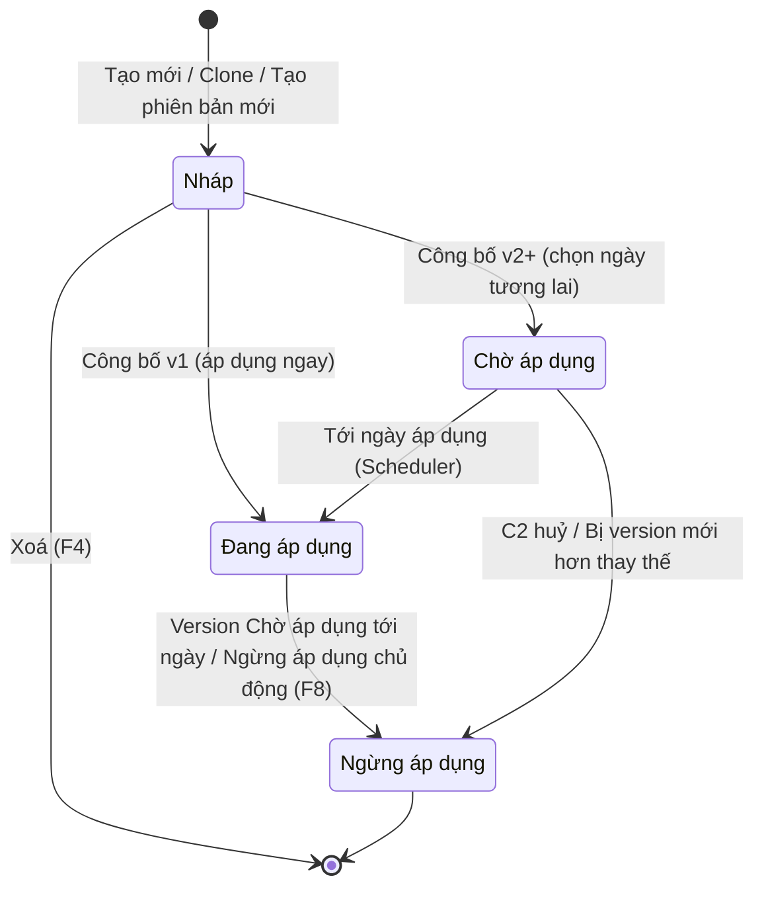

### 5.3. Ma trận phân quyền

| Thao tác | C2 Bộ — CTE của đơn vị mình | C2 Sở — CTE của đơn vị mình | C2 Sở — CTE cấp Bộ | C2 khác cùng cấp | Admin C1 |
|---|---|---|---|---|---|
| Xem danh sách / chi tiết | ✅ | ✅ | ✅ (chỉ Đang áp dụng, mục "CTE cấp Bộ") | ❌ **[Bổ sung v5]** | ✅ (chỉ Đang áp dụng + Chờ áp dụng) |
| Tạo mới | ✅ | ✅ | — | — | ❌ |
| Sửa / Xoá Nháp | ✅ | ✅ | ❌ | ❌ | ❌ |
| Clone | ✅ | ✅ | ✅ (áp ràng buộc AD-06) | ❌ | ❌ |
| Công bố / Huỷ Chờ áp dụng / Ngừng áp dụng | ✅ (cần quyền "Công bố CTE") | ✅ (cần quyền "Công bố CTE") | ❌ | ❌ | ❌ |
| Tạo phiên bản mới | ✅ | ✅ | ❌ | ❌ | ❌ |

> Phân cấp Bộ → Sở xác định theo **cùng ngành quản lý** do IAM cung cấp (VD: Sở NN&MT Hà Nội kế thừa CTE của Bộ NN&MT). Sở không xem CTE của Bộ khác ngành.

---

## 6. Đặc tả 7 lớp cascade

### 6.1. Nguyên tắc chung
1. **Tuần tự:** lớp N chỉ mở khi lớp N-1 hợp lệ. Có thể quay lại sửa lớp trước (trừ lớp 1); khi sửa, các lựa chọn lớp sau không còn tương thích sẽ bị **đánh dấu và yêu cầu xác nhận lại** **[Bổ sung v5]**.
2. **Event Type bất biến (BR-D-06):** sau khi rời lớp 1, Event Type chỉ đọc. Muốn đổi → xoá Nháp và tạo CTE mới.
3. **Chỉ chọn từ thư viện C1 (BR-D-03):** mọi dropdown lấy từ API Select của F-M1/F-M3/F-M4, chỉ trả bản ghi `active`. Không có ô nhập tự do. Thiếu giá trị → liên hệ Admin C1 bổ sung user-defined.
4. **Gợi ý, không chặn (BR-D-09):** mapping bizStep × ET và disposition × bizStep × ET chỉ để sắp xếp, gợi ý, cảnh báo. Ngoại lệ là các ràng buộc cứng của chuẩn EPCIS (mục 6.3).

### 6.2. Chi tiết từng lớp

| Lớp | Nội dung | Nguồn dữ liệu | Bắt buộc | Kiểu chọn | Logic cascade |
|---|---|---|---|---|---|
| 1 | Event Type | F-M1 (ET active) | Có | Chọn 1 | Quyết định toàn bộ lớp 2–7. Bất biến. |
| 2 | action mặc định | Theo ET | Có, trừ ET-03 | Chọn 1: ADD / OBSERVE / DELETE | ET-03 ẩn lớp 2. action ảnh hưởng ilmd (lớp 6) và KDE bắt buộc. |
| 3 | bizStep | F-M4-F1, lọc theo ET (bảng 3.3) | Có | Chọn 1 | 3 mức: ✅ khuyến nghị (đầu danh sách), ⚠️ ít dùng (cảnh báo khi chọn), ❌ không phù hợp (ẩn). |
| 4a | disposition | F-M4-F2, lọc theo ET + bizStep (bảng 4.4) | Có | Chọn 1 | 🔵 tự chọn sẵn giá trị gợi ý chính; ⚪ gợi ý phụ bên dưới; cho phép chọn ngoài gợi ý. |
| 4b | persistentDisposition | F-M4-F2, chỉ giá trị `persistent_capable = true` | Không | set / unset, chọn nhiều | Chỉ mở khi disposition đã chọn. |
| 5 | bizTransactionType | F-M4-F3 (9 loại) | ET-04: ≥1; ET khác: tuỳ chọn | Chọn nhiều | Chọn ET-04 → badge "Bắt buộc" (BR-D-10). |
| 6a | KDE | F-M3, lọc theo ET (+ action) | ≥1 KDE ngoài nhóm tự động bắt buộc | Chọn nhiều, mỗi KDE gắn Required/Optional + ghi chú hướng dẫn | KDE cấm theo ET bị ẩn. KDE tự động bắt buộc khoá ở Required. |
| 6b | ilmd | F-M3 (nhóm ILMD) | Tuỳ chọn | Chọn nhiều + Required/Optional | Chỉ mở khi ET-01 + ADD, hoặc ET-03 (cho đầu ra). |
| 7 | Bổ sung | Nhập tay có cấu trúc | Tuỳ chọn | — | Ngưỡng sensor chỉ mở khi đã chọn KDE `sensorElementList`; chứng nhận chỉ mở khi đã chọn `certificationInfo`. |

### 6.3. Ràng buộc cứng theo Event Type (chuẩn EPCIS 2.0)

| ET | Tên | action | KDE tự động bắt buộc | KDE bị cấm (ẩn) | ilmd | bizTransaction |
|---|---|---|---|---|---|---|
| ET-01 | ObjectEvent | ADD / OBSERVE / DELETE | eventTime, eventTimeZoneOffset, epcList **hoặc** quantityList | parentID, childEPCs, childQuantityList, inputEPCList, outputEPCList, inputQuantityList, outputQuantityList | Chỉ khi ADD | Tuỳ chọn |
| ET-02 | AggregationEvent | ADD / OBSERVE / DELETE | eventTime, eventTimeZoneOffset, parentID (khi ADD/DELETE), childEPCs **hoặc** childQuantityList | epcList, quantityList, inputEPCList, outputEPCList… | Không | Tuỳ chọn |
| ET-03 | TransformationEvent | Không có | eventTime, eventTimeZoneOffset, (inputEPCList hoặc inputQuantityList) **và/hoặc** (outputEPCList hoặc outputQuantityList) | parentID, childEPCs, epcList, quantityList | Có (cho đầu ra) | Tuỳ chọn |
| ET-04 | TransactionEvent | ADD / OBSERVE / DELETE | eventTime, eventTimeZoneOffset, **bizTransactionList**, epcList hoặc quantityList | inputEPCList, outputEPCList… | Không | **Bắt buộc ≥1** |
| ET-05 | AssociationEvent | ADD / OBSERVE / DELETE | eventTime, eventTimeZoneOffset, parentID, childEPCs hoặc childQuantityList | epcList, quantityList, inputEPCList, outputEPCList… | Không | Tuỳ chọn |

> Bảng chi tiết bizStep × ET (bảng 3.3) và disposition × bizStep × ET (bảng 4.4) giữ nguyên như PRD gốc phần F-M4, là đầu vào bắt buộc của DoR.

### 6.4. Activity diagram — Luồng cascade tổng quát

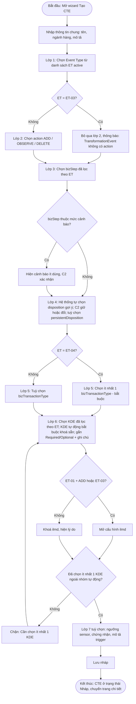

---

## 7. Business Rules tổng hợp

| BR ID | Quy tắc | Mô tả | Feature áp dụng |
|---|---|---|---|
| BR-M5-01 | Event Type bất biến | Kế thừa BR-D-06. Không đổi ET sau lớp 1, qua mọi lần sửa, clone, version. | F1, F3, F5, F7 |
| BR-M5-02 | Validate chéo trước công bố | Kiểm tra ET–KDE, action–ilmd, ET-04–bizTransaction, KDE tối thiểu, dữ liệu tham chiếu còn active. | F6 |
| BR-M5-03 | Chỉ Nháp được sửa/xoá | Đang áp dụng / Chờ áp dụng / Ngừng áp dụng là bất biến. | F3, F4 |
| BR-M5-04 | Sở chỉ thêm chặt hơn Bộ | Kế thừa AD-06/BR-D-02. CTE clone từ Bộ: khoá ET, action, bizStep; không hạ KDE Required → Optional; không bỏ KDE/ilmd/bizTransactionType/chứng nhận bắt buộc; không nới ngưỡng sensor. | F5, F3, F6 |
| BR-M5-05 | Cascade gợi ý, không chặn | Kế thừa BR-D-09. | F1, F3 |
| BR-M5-06 | ET-04 bắt buộc bizTransaction | Kế thừa BR-D-10. | F1, F6 |
| BR-M5-07 | ilmd có điều kiện | Chỉ ET-01 + ADD hoặc ET-03. | F1, F3, F6 |
| BR-M5-08 | Chặn xoá khi đang tham chiếu | Kế thừa BR-D-07: Nháp đang nằm trong CTE Template (kể cả Template Nháp) → chặn xoá. | F4 |
| BR-M5-09 | Tồn tại đồng thời | Tối đa 1 Đang áp dụng + 1 Chờ áp dụng + 1 Nháp trên một mã CTE. | F6, F7 |
| BR-M5-10 | v1 áp dụng ngay | Chưa từng có version Đang áp dụng → không hỏi ngày. | F6 |
| BR-M5-11 | v2+ bắt buộc ngày tương lai | Ngày áp dụng ≥ ngày mai. **[Bổ sung v5]** Hệ thống gợi ý mặc định = hôm nay + 30 ngày để C3 kịp chuẩn bị; C2 được đổi. | F6 |
| BR-M5-12 | Version mới huỷ version đang chờ | Công bố v_new khi đã có v_scheduled → v_scheduled chuyển Ngừng áp dụng. | F6 |
| BR-M5-13 | C1 chỉ thấy Đang áp dụng + Chờ áp dụng | Nháp, Ngừng áp dụng không hiện trên C1. | F2 |
| BR-M5-14 | **[Bổ sung v5]** Tên CTE duy nhất | Trong cùng đơn vị C2, tên CTE (đã chuẩn hoá khoảng trắng, không phân biệt hoa thường) không trùng giữa các mã CTE khác nhau. | F1, F3, F5 |
| BR-M5-15 | **[Bổ sung v5]** Chặn ngừng áp dụng khi đang trong Template hiệu lực | CTE Đang áp dụng nằm trong CTE Template Đang áp dụng → không được Ngừng áp dụng trực tiếp; phải gỡ khỏi Template (F-M6) trước. | F8 |
| BR-M5-16 | **[Bổ sung v5]** Dữ liệu thư viện bị vô hiệu hoá | Khi C1 vô hiệu hoá ET/bizStep/disposition/KDE/bizTransactionType: CTE Nháp đang dùng → đánh dấu lỗi, chặn công bố; CTE Đang áp dụng/Chờ áp dụng → **giữ nguyên hiệu lực**, gắn cảnh báo cho C2 tạo version mới. | F2, F6, F8 |
| BR-M5-17 | **[Bổ sung v5]** Thông báo kế thừa | CTE cấp Bộ có version mới / ngừng áp dụng → thông báo tới các Sở đã clone CTE đó. Không tự động cập nhật CTE của Sở. | F6, F8 |
| BR-M5-18 | **[Bổ sung v5]** Khoá chỉnh sửa đồng thời | Một Nháp chỉ một người sửa tại một thời điểm; người thứ hai mở ở chế độ chỉ đọc kèm thông tin người đang sửa. | F3 |

---

## 8. Đặc tả Feature

---

### F-M5-F1: Tạo CTE mới (wizard 7 lớp)

**Actor:** Cán bộ tiêu chuẩn C2 (Bộ/Sở) · **Priority:** Critical · **Kết quả:** CTE version 1, trạng thái Nháp

#### Mô tả
Giao diện dạng wizard/stepper 7 bước + 1 bước thông tin chung. Thanh tiến trình hiển thị trạng thái từng lớp (Chưa mở / Đang làm / Hoàn thành / Có lỗi / Bỏ qua). Lớp sau chỉ mở khi lớp trước hợp lệ. Có thể **Lưu nháp tạm** ở bất kỳ bước nào sau khi đã chọn ET **[Bổ sung v5]** — Nháp chưa đủ lớp bắt buộc sẽ mang nhãn "Chưa hoàn thiện" và không công bố được.

#### User Stories
- **US-F1-01:** Là Cán bộ tiêu chuẩn C2, tôi muốn được dẫn dắt qua 7 bước theo thứ tự, mỗi bước chỉ hiển thị các lựa chọn hợp lệ với bước trước, để tôi không phải thuộc lòng chuẩn EPCIS mà vẫn tạo được CTE đúng chuẩn.
- **US-F1-02:** Là Cán bộ tiêu chuẩn C2, tôi muốn hệ thống gợi ý sẵn disposition phù hợp với bước nghiệp vụ tôi chọn, để tiết kiệm thời gian và tránh chọn sai trạng thái.
- **US-F1-03:** Là Cán bộ tiêu chuẩn C2, tôi muốn đánh dấu từng KDE là bắt buộc hay tuỳ chọn và viết ghi chú hướng dẫn, để doanh nghiệp biết chính xác phải khai báo gì và khai báo thế nào.
- **US-F1-04:** Là Cán bộ tiêu chuẩn C2, tôi muốn lưu nháp giữa chừng, để có thể tham vấn chuyên môn rồi quay lại hoàn thiện.

#### Luồng nghiệp vụ
**Luồng chính:** xem Activity diagram mục 6.4.

**Luồng thay thế**
| ID | Điều kiện | Xử lý |
|---|---|---|
| A1 | ET-03 được chọn | Bỏ qua lớp 2, tự chuyển sang lớp 3, thông báo lý do. |
| A2 | Chọn bizStep mức ⚠️ | Hiện hộp xác nhận; C2 "Vẫn chọn" → tiếp tục; "Chọn lại" → giữ ở lớp 3. |
| A3 | C2 đổi disposition khác gợi ý | Chấp nhận, không cảnh báo. |
| A4 | C2 quay lại sửa lớp 3 sau khi đã làm lớp 4–6 **[Bổ sung v5]** | Hệ thống tính lại gợi ý lớp 4; nếu disposition đang chọn không còn trong danh sách gợi ý → giữ nguyên nhưng hiển thị cảnh báo vàng; các KDE không còn tương thích → đánh dấu đỏ, yêu cầu bỏ. |
| A5 | C2 quay lại đổi action ADD → OBSERVE ở ET-01 **[Bổ sung v5]** | Nếu đã cấu hình ilmd → hộp xác nhận "Cấu hình ilmd (n trường) sẽ bị xoá. Tiếp tục?". |
| A6 | Lưu nháp tạm khi chưa xong lớp 6 | Lưu với nhãn "Chưa hoàn thiện". |

**Luồng ngoại lệ**
| ID | Điều kiện | Xử lý |
|---|---|---|
| E1 | Không có ET active nào | Lớp 1 hiển thị trạng thái trống: "Chưa có loại sự kiện khả dụng. Liên hệ quản trị C1." Không cho tiếp. |
| E2 | API thư viện C1 lỗi/timeout | Hiển thị lỗi tại lớp tương ứng, nút "Thử lại"; dữ liệu đã nhập ở các lớp khác giữ nguyên. |
| E3 | Trùng tên CTE | Chặn lưu, thông báo tại trường Tên (BR-M5-14). |
| E4 | Phiên đăng nhập hết hạn khi đang nhập **[Bổ sung v5]** | Tự lưu bản tạm trên trình duyệt; sau đăng nhập lại khôi phục và hỏi C2 có tiếp tục không. |
| E5 | Rời trang khi có thay đổi chưa lưu | Hộp xác nhận "Bạn có thay đổi chưa lưu. Rời trang?". |

#### Activity diagram — Lưu nháp
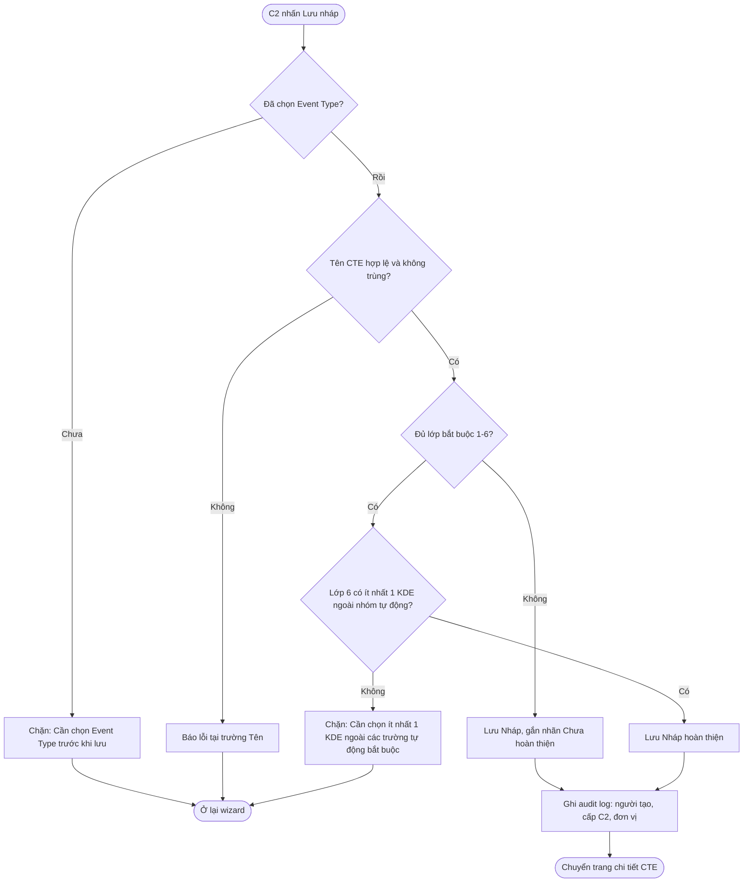

#### Acceptance Criteria

**S0 — Thông tin chung [Bổ sung v5]**
| AC | Kịch bản | Given | When | Then | Loại |
|---|---|---|---|---|---|
| AC-00a | Nhập thông tin chung hợp lệ | C2 mở "Tạo CTE mới" | Nhập tên "Xuất kho thuỷ sản tươi", chọn ngành "Thuỷ sản", nhấn "Tiếp tục" | Mở lớp 1. Mã CTE chưa sinh (sinh khi lưu lần đầu). | Happy |
| AC-00b | Trùng tên | Đơn vị đã có CTE "Xuất kho thuỷ sản tươi" | Nhập cùng tên (khác hoa/thường), nhấn "Lưu nháp" | Chặn: "Tên CTE đã tồn tại trong đơn vị. Vui lòng đặt tên khác." | Negative |

**S1 — Chọn Event Type (Lớp 1)**
| AC | Kịch bản | Given | When | Then | Loại |
|---|---|---|---|---|---|
| AC-01 | Hiển thị 5 ET active | Cả 5 ET đang active | Lớp 1 hiển thị | Danh sách ET-01→ET-05, mỗi mục: mã, tên tiếng Việt, mô tả ngắn, ví dụ nghiệp vụ. | Happy |
| AC-02 | ET inactive bị ẩn | ET-05 đã bị C1 vô hiệu hoá | Lớp 1 hiển thị | Chỉ 4 ET; ET-05 không xuất hiện. | Happy |
| AC-03 | Chọn ET-01 | C2 chọn ET-01 | Nhấn "Tiếp tục" | Mở lớp 2 (ADD/OBSERVE/DELETE). Lớp 3 sẵn sàng với ~30 bizStep ✅ + ~5 ⚠️. Lớp 4–7 khoá. | Happy |
| AC-04 | Chọn ET-03 | C2 chọn ET-03 | Nhấn "Tiếp tục" | Lớp 2 ẩn; thông báo "TransformationEvent không có trường action." Mở lớp 3 (~4 bizStep). | Happy |
| AC-05 | Chọn ET-04 | C2 chọn ET-04 | Nhấn "Tiếp tục" | Lớp 5 gắn badge "Bắt buộc"; thông báo "TransactionEvent yêu cầu chọn ≥1 loại giao dịch." | Happy |
| AC-06 | ET bất biến | Đã chọn ET-01, đang ở lớp 4 | C2 quay lại lớp 1 | ET chỉ đọc: "Event Type không thể thay đổi. Tạo CTE mới nếu cần Event Type khác." | Negative |
| AC-06a | **[Bổ sung v5]** Không có ET active | C1 vô hiệu hoá cả 5 ET | Mở wizard | Trạng thái trống, nút "Tiếp tục" bị khoá. | Negative |

**S2 — action mặc định (Lớp 2)**
| AC | Kịch bản | Given | When | Then | Loại |
|---|---|---|---|---|---|
| AC-07 | Chọn action | Đã chọn ET-01 | Lớp 2 hiển thị | 3 lựa chọn ADD / OBSERVE / DELETE kèm tooltip ý nghĩa và ví dụ. | Happy |
| AC-08 | ET-03 bỏ qua | Đã chọn ET-03 | Lớp 2 | Hiển thị "bỏ qua", tự chuyển lớp 3. Thanh tiến trình đánh dấu lớp 2 "Không áp dụng". | Happy |
| AC-09 | action ảnh hưởng ilmd | ET-01, action OBSERVE | Đến lớp 6 | ilmd khoá: "ilmd chỉ khi action = ADD. Action hiện tại: OBSERVE." | Happy |
| AC-09a | **[Bổ sung v5]** Đổi action làm mất ilmd | ET-01, ADD, đã cấu hình 3 trường ilmd | Quay lại đổi sang OBSERVE | Hộp xác nhận: "Cấu hình ilmd (3 trường) sẽ bị xoá. Tiếp tục?" — Đồng ý: xoá ilmd; Huỷ: giữ ADD. | Negative |

**S3 — bizStep (Lớp 3)**
| AC | Kịch bản | Given | When | Then | Loại |
|---|---|---|---|---|---|
| AC-10 | Lọc theo ET-01 | Đã chọn ET-01 | Lớp 3 hiển thị | ✅ ở đầu danh sách, ⚠️ kèm icon cảnh báo, ❌ ẩn. Có ô tìm kiếm theo mã và tên tiếng Việt. | Happy |
| AC-11 | Lọc theo ET-03 | Đã chọn ET-03 | Lớp 3 hiển thị | 3 ✅ (transforming, commissioning, creating_class_instance) + 1 ⚠️ (packing). | Happy |
| AC-12 | Chọn bizStep ⚠️ | ET-02 | Chọn collecting | Cảnh báo "bizStep 'collecting' ít dùng với AggregationEvent. Bạn có chắc?" — cho tiếp tục. | Happy |
| AC-13 | Mở lớp 4 | ET-01 + shipping | Nhấn "Tiếp tục" | Lớp 4 mở, disposition tự chọn 🔵 in_transit. | Happy |
| AC-13a | **[Bổ sung v5]** Đổi bizStep sau khi đã làm lớp 4 | ET-01 + shipping + in_transit | Quay lại đổi sang receiving | Gợi ý lớp 4 tính lại thành in_progress; in_transit vẫn giữ nhưng hiển thị cảnh báo "Disposition hiện tại không nằm trong gợi ý cho bizStep mới". | Happy |

**S4 — disposition + persistentDisposition (Lớp 4)**
| AC | Kịch bản | Given | When | Then | Loại |
|---|---|---|---|---|---|
| AC-14 | Tự chọn gợi ý | ET-01 + shipping | Lớp 4 hiển thị | 🔵 in_transit được chọn sẵn; gợi ý ⚪ hiển thị bên dưới; các disposition còn lại trong mục "Khác". | Happy |
| AC-15 | Cùng bizStep khác ET | (a) ET-01 + packing; (b) ET-02 + packing | Lớp 4 hiển thị | (a) gợi ý active; (b) gợi ý in_progress. | Happy |
| AC-16 | ET-03 | ET-03 + transforming | Lớp 4 hiển thị | 🔵 active (cho đầu ra), ghi chú "Disposition cho sản phẩm đầu ra"; gợi ý thêm disposed/destroyed cho phế phẩm. | Happy |
| AC-17 | persistentDisposition | ET-01 + inspecting, disposition conformant | Mở mục persistent | Chỉ hiện giá trị persistent_capable (conformant, non_conformant…). C2 chọn "set: conformant". | Happy |
| AC-18 | Chọn ngoài gợi ý | Gợi ý in_transit | C2 chọn active | Chấp nhận, không chặn, không cảnh báo. | Happy |

**S5 — bizTransactionType (Lớp 5)**
| AC | Kịch bản | Given | When | Then | Loại |
|---|---|---|---|---|---|
| AC-19 | ET-04 bắt buộc | ET-04 | Lớp 5 hiển thị | Badge "Bắt buộc", danh sách 9 loại, chọn nhiều. | Happy |
| AC-20 | Chọn nhiều | ET-04 | Chọn po + desadv | Hiển thị 2 thẻ "po (Đơn đặt hàng)", "desadv (Thông báo giao hàng)". | Happy |
| AC-21 | ET-04 bỏ trống | ET-04, chưa chọn | Nhấn "Tiếp tục" | Chặn: "TransactionEvent yêu cầu chọn ≥1 loại giao dịch." | Negative |
| AC-22 | ET khác tuỳ chọn | ET-01 | Lớp 5 hiển thị | Nhãn "Tuỳ chọn"; có nút "Bỏ qua". | Happy |

**S6 — KDE + ilmd (Lớp 6)**
| AC | Kịch bản | Given | When | Then | Loại |
|---|---|---|---|---|---|
| AC-23 | Lọc KDE theo ET-01 | ET-01 | Lớp 6 hiển thị | Hiện KDE tương thích (epcList/quantityList, eventTime, readPoint, bizLocation, sourceList…); KDE cấm (parentID, childEPCs, inputEPCList…) không xuất hiện. KDE nhóm theo What/When/Where/Why/How. | Happy |
| AC-24 | ET-04 tự bắt buộc bizTransactionList | ET-04 | Lớp 6 hiển thị | bizTransactionList ở đầu, badge "Bắt buộc cho TransactionEvent", không bỏ chọn được. | Happy |
| AC-25 | Gắn Required/Optional | ET-01 | Đặt readPoint = Required, sourceList = Optional | Lưu mức cho từng KDE; KDE tự động bắt buộc không đổi được. | Happy |
| AC-26 | Ghi chú hướng dẫn | Cấu hình readPoint | Nhập "Điền GLN (mã địa điểm toàn cầu) của điểm xuất kho." | Lưu; hiển thị làm tooltip cho C3. Giới hạn 500 ký tự. | Happy |
| AC-27 | ilmd mở — ET-01 ADD | ET-01, ADD | Mục ilmd | Danh sách: lotNumber, productionDate, bestBeforeDate, itemExpirationDate, harvestDate, countryOfOrigin… C2 chọn + Required/Optional. | Happy |
| AC-28 | ilmd khoá — ET-01 OBSERVE | ET-01, OBSERVE | Mục ilmd | Khoá: "ilmd chỉ khi action = ADD." | Negative |
| AC-29 | ilmd mở — ET-03 | ET-03 | Mục ilmd | Mở: "ilmd cho sản phẩm đầu ra." | Happy |
| AC-30 | Thiếu KDE | Lớp 1–5 xong, lớp 6 chỉ có KDE tự động | Nhấn "Lưu nháp" (đầy đủ) | Chặn: "Cần chọn ít nhất 1 KDE ngoài các trường tự động bắt buộc." | Negative |
| AC-30a | **[Bổ sung v5]** ET-01 chọn cặp epcList/quantityList | ET-01 | Lớp 6 | Hệ thống yêu cầu chọn ít nhất 1 trong 2 (epcList cho hàng định danh cá thể, quantityList cho hàng theo lô/khối lượng); có thể chọn cả 2. | Happy |

**S7 — Cấu hình bổ sung (Lớp 7)**
| AC | Kịch bản | Given | When | Then | Loại |
|---|---|---|---|---|---|
| AC-31 | Ngưỡng sensor | Đã chọn sensorElementList | Mục sensor | Cấu hình: loại = nhiệt độ, min = 2, max = 8, đơn vị = CEL; quy tắc "Vượt ngưỡng → ALARM_CONDITION". | Happy |
| AC-31a | **[Bổ sung v5]** Ngưỡng không hợp lệ | Mục sensor | Nhập min = 8, max = 2 | Chặn: "Giá trị nhỏ nhất phải nhỏ hơn giá trị lớn nhất." | Negative |
| AC-31b | **[Bổ sung v5]** Sensor khi chưa chọn KDE | Chưa chọn sensorElementList | Lớp 7 | Mục sensor khoá, hướng dẫn "Chọn KDE sensorElementList ở lớp 6 để cấu hình ngưỡng." | Negative |
| AC-32 | Chứng nhận | Đã chọn certificationInfo | Mục chứng nhận | VietGAP = Required, HACCP = Optional. | Happy |
| AC-33 | Mô tả trigger | Lớp 7 | Nhập trigger | "Khi nào dùng: áp dụng khi lô thuỷ sản tươi rời kho." Lưu, hiển thị cho C3. | Happy |
| AC-34 | Bỏ qua lớp 7 | Lớp 6 xong | Nhấn "Lưu nháp" | Lưu Nháp với lớp 7 trống — hợp lệ. | Happy |

**Lưu Nháp**
| AC | Kịch bản | Given | When | Then | Loại |
|---|---|---|---|---|---|
| AC-35 | Lưu thành công | Đủ 6 lớp bắt buộc | "Lưu nháp" | CTE: Nháp, v1, mã CTE sinh tự động, người tạo, cấp C2. Ghi audit log. Chuyển trang chi tiết. | Happy |
| AC-36 | Ghi nhận cấp C2 | C2 cấp Sở tạo | Lưu | cấp = Sở, đơn vị = Sở KH&CN Hà Nội. | Happy |
| AC-36a | **[Bổ sung v5]** Lưu nháp tạm | Đã chọn ET, mới đến lớp 3 | "Lưu nháp" | Lưu với nhãn "Chưa hoàn thiện"; nút Công bố khoá. | Happy |
| AC-36b | **[Bổ sung v5]** Rời trang chưa lưu | Có thay đổi | Đóng tab/chuyển menu | Hộp xác nhận rời trang. | Negative |

#### Giao diện — lưu ý cho thiết kế
- Bố cục 2 cột: trái là stepper 7 lớp + thông tin chung; phải là nội dung lớp hiện tại; dưới cùng là thanh "Quay lại / Lưu nháp / Tiếp tục".
- Ô **"Tóm tắt CTE"** cố định (sticky) hiển thị câu mô tả tự nhiên, VD: *"ObjectEvent · OBSERVE · shipping → in_transit · 5 KDE bắt buộc"*.
- Mức gợi ý: ✅ xanh / ⚠️ vàng / 🔵 đã tự chọn / ⚪ gợi ý phụ — dùng thống nhất với F-M4.

#### NFR
| ID | Yêu cầu |
|---|---|
| NFR-F1-01 | Mỗi dropdown cascade tải < 500ms |
| NFR-F1-02 | Tra gợi ý disposition (bảng 4.4) < 500ms |
| NFR-F1-03 | Toàn bộ wizard mở lần đầu < 3 giây |
| NFR-F1-04 | Hỗ trợ màn hình desktop ≥ 1280px |

#### DoR
- [ ] F-M1, F-M3, F-M4 đã seed xong và API Select hoạt động trên môi trường dev.
- [ ] Bảng 3.3 (bizStep × ET) và 4.4 (disposition × bizStep × ET) đã được chuyên gia nghiệp vụ duyệt.
- [ ] Bảng ràng buộc cứng theo ET (mục 6.3) đã được xác nhận.
- [ ] Wireframe wizard 7 bước + thanh tóm tắt đã duyệt trên Figma.
- [ ] Danh mục thông báo (mục 9) cho F1 đã chốt câu chữ.
- [ ] Đặc tả API cascade filter đã có.
- [ ] Danh mục ngành hàng đã có nguồn dữ liệu.

#### DoD
- [ ] Wizard chạy hết luồng cho cả 5 ET, tất cả luồng thay thế A1–A6 và ngoại lệ E1–E5.
- [ ] Lọc cascade đúng bảng 3.3, 4.4, 6.3.
- [ ] ilmd, bizTransaction ET-04, KDE tự động bắt buộc đúng quy tắc.
- [ ] Lưu Nháp (hoàn thiện và chưa hoàn thiện) đủ dữ liệu 7 lớp + thông tin chung.
- [ ] Toàn bộ AC của F1 pass trên môi trường staging; PO nghiệm thu.
- [ ] NFR-F1 đạt trên dữ liệu seed đầy đủ.
- [ ] Audit log ghi đúng.

---

### F-M5-F2: Xem và tra cứu CTE

**Actor:** Cán bộ C2, Admin C1 · **Priority:** High

#### Mô tả
Trang danh sách CTE với bộ lọc đa chiều và trang chi tiết hiển thị cấu hình 7 lớp. Danh sách hiển thị **một dòng cho mỗi mã CTE**, mặc định lấy version "đại diện" theo thứ tự ưu tiên: Đang áp dụng → Chờ áp dụng → Nháp → Ngừng áp dụng mới nhất **[Bổ sung v5]**. Cấp Sở có thêm tab "CTE cấp Bộ" (read-only).

#### User Stories
- **US-F2-01:** Là Cán bộ tiêu chuẩn C2, tôi muốn lọc CTE theo loại sự kiện, bước nghiệp vụ, trạng thái, ngành hàng, để nhanh chóng tìm CTE cần rà soát.
- **US-F2-02:** Là Cán bộ tiêu chuẩn C2, tôi muốn xem chi tiết 7 lớp của một CTE dưới dạng dễ đọc, để kiểm tra trước khi công bố.
- **US-F2-03:** Là Cán bộ C2 cấp Sở, tôi muốn xem các CTE cấp Bộ đang áp dụng, để chọn CTE kế thừa.
- **US-F2-04:** Là Admin C1, tôi muốn xem các CTE đang áp dụng và sắp áp dụng của mọi đơn vị C2, để giám sát việc áp dụng chuẩn.

#### Bộ lọc và cột
| Thành phần | Chi tiết |
|---|---|
| Tìm kiếm | Theo tên CTE (tiếng Việt có/không dấu), mã CTE; khớp một phần. |
| Bộ lọc | Event Type, bizStep, trạng thái (4), ngành hàng, cấp C2 (Bộ/Sở), nguồn (Tạo mới / Clone C1 / Clone C2), nhãn "Có cảnh báo thư viện" **[Bổ sung v5]**. |
| Cột | Mã CTE, Tên, ET, action, bizStep, disposition, Trạng thái (badge + ngày), Version, Ngành hàng, Cập nhật lần cuối. |
| Sắp xếp | Mặc định: cập nhật mới nhất. Cho sắp xếp theo tên, ngày áp dụng. |
| Phân trang | 20 dòng/trang, tuỳ chọn 50/100. |

#### Activity diagram — Tra cứu và xem chi tiết
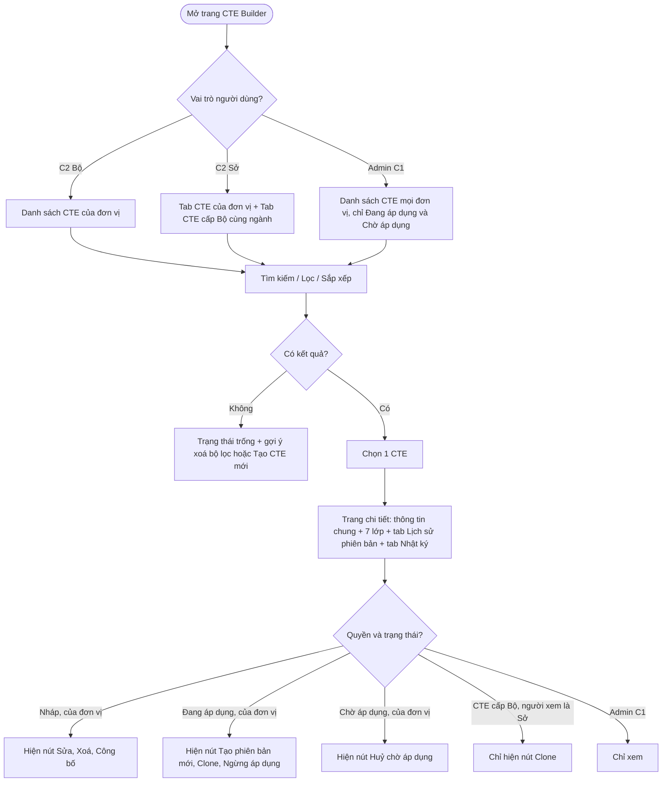

#### Acceptance Criteria
| AC | Kịch bản | Given | When | Then | Loại |
|---|---|---|---|---|---|
| AC-01 | Danh sách mặc định | C2 Bộ có 15 mã CTE | Mở trang | 15 dòng, sắp xếp cập nhật mới nhất; cột như bảng trên; badge màu theo trạng thái. | Happy |
| AC-02 | Lọc trạng thái | 15 CTE đủ 4 trạng thái | Lọc "Đang áp dụng" | Chỉ CTE có version Đang áp dụng. | Happy |
| AC-03 | Chi tiết 7 lớp | CTE "Xuất kho thuỷ sản" | Mở chi tiết | L1: ET-01 · L2: OBSERVE · L3: shipping · L4: in_transit · L5: desadv (tuỳ chọn) · L6: bảng KDE (5 bắt buộc, 3 tuỳ chọn) · L7: sensor 2–8°C, VietGAP. | Happy |
| AC-04 | Chi tiết ET-03 | CTE "Chế biến" ET-03 | Mở chi tiết | L2: "Không có trường action (TransformationEvent)". L6 tách KDE đầu vào / đầu ra; ilmd cho đầu ra. | Happy |
| AC-05 | Sở xem CTE Bộ | Sở KH&CN HN đăng nhập | Mở tab "CTE cấp Bộ" | Chỉ CTE Đang áp dụng của Bộ cùng ngành; read-only; chỉ có nút Clone. | Happy |
| AC-06 | Tìm theo tên | 15 CTE | Nhập "thu hoach" (không dấu) | Trả CTE có tên chứa "Thu hoạch". | Happy |
| AC-07 | Hiển thị Chờ áp dụng | v2 Chờ áp dụng từ 01/10/2026 | Xem danh sách | Badge vàng "Chờ áp dụng — 01/10/2026". | Happy |
| AC-08 | Hiển thị Ngừng áp dụng | v1 ngừng từ 15/09/2026 | Lọc "Ngừng áp dụng" | Badge xám "Ngừng áp dụng — 15/09/2026", "Thay thế bởi v2". | Happy |
| AC-09 | **[Bổ sung v5]** Admin C1 xem | Admin C1 đăng nhập | Mở danh sách | Thấy CTE mọi đơn vị; không thấy Nháp/Ngừng áp dụng; không có nút thao tác. | Happy |
| AC-10 | **[Bổ sung v5]** Cách ly đơn vị | Sở A và Sở B cùng cấp | Sở A mở danh sách | Không thấy CTE của Sở B. | Negative |
| AC-11 | **[Bổ sung v5]** Trạng thái trống | Đơn vị chưa có CTE | Mở trang | Minh hoạ trống + nút "Tạo CTE mới" và "Clone từ thư viện C1". | Happy |
| AC-12 | **[Bổ sung v5]** Cảnh báo thư viện | KDE "harvestDate" bị C1 vô hiệu hoá, CTE "Thu hoạch" đang dùng | Xem danh sách | Dòng CTE có biểu tượng cảnh báo; chi tiết ghi rõ trường bị ảnh hưởng (BR-M5-16). | Happy |

#### NFR
| ID | Yêu cầu |
|---|---|
| NFR-F2-01 | Danh sách tải < 2 giây với 500 bản ghi |
| NFR-F2-02 | Trang chi tiết 7 lớp tải < 2 giây |

#### DoR
- [ ] F-M5-F1 hoàn thành.
- [ ] Wireframe danh sách + chi tiết + tab Lịch sử/Nhật ký đã duyệt.
- [ ] IAM cung cấp được quan hệ Bộ → Sở theo ngành.

#### DoD
- [ ] Danh sách, tìm kiếm có/không dấu, lọc, sắp xếp, phân trang hoạt động.
- [ ] Chi tiết 7 lớp hiển thị đúng cho cả 5 ET.
- [ ] Hiển thị và nút thao tác đúng ma trận phân quyền mục 5.3.
- [ ] Toàn bộ AC F2 pass; NFR đạt.

---

### F-M5-F3: Sửa CTE (chỉ Nháp)

**Actor:** Cán bộ C2 · **Priority:** High

#### Mô tả
Sửa CTE ở trạng thái Nháp qua cùng giao diện wizard, mở sẵn tại lớp được chọn. Sửa được thông tin chung và lớp 2–7; lớp 1 (ET) chỉ đọc. CTE đã công bố không sửa trực tiếp — dùng "Tạo phiên bản mới" (F7). Nếu Nháp được clone từ CTE cấp Bộ, các ràng buộc AD-06 tiếp tục áp dụng khi sửa.

#### User Stories
- **US-F3-01:** Là Cán bộ tiêu chuẩn C2, tôi muốn sửa CTE Nháp để điều chỉnh cấu hình trước khi ban hành.
- **US-F3-02:** Là Cán bộ tiêu chuẩn C2, tôi muốn biết nếu đồng nghiệp đang sửa cùng CTE, để tránh ghi đè lẫn nhau.

#### Activity diagram
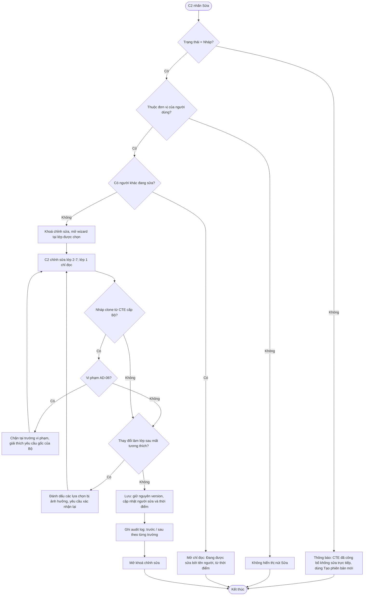

#### Acceptance Criteria
| AC | Kịch bản | Given | When | Then | Loại |
|---|---|---|---|---|---|
| AC-01 | Sửa lớp 3–7 | CTE "Thu hoạch rau" Nháp | Đổi bizStep harvesting → collecting, cập nhật disposition, Lưu | Cập nhật thành công, không tạo version mới. Audit log ghi giá trị trước/sau. | Happy |
| AC-02 | Chặn sửa ET | Nháp ET-01 | Cố đổi sang ET-02 | ET chỉ đọc: "Event Type không thể thay đổi." | Negative |
| AC-03 | Sửa mức KDE | readPoint = Optional | Đổi thành Required | Cập nhật thành công. | Happy |
| AC-04 | Chặn sửa CTE đã công bố | "Xuất kho" v1 Đang áp dụng | Nhấn "Sửa" | "CTE đã công bố không sửa trực tiếp. Sử dụng 'Tạo phiên bản mới'." | Negative |
| AC-05 | Sở không sửa CTE Bộ | Sở xem CTE Bộ | Xem chi tiết | Không có nút Sửa; chỉ Clone. | Negative |
| AC-06 | **[Bổ sung v5]** Sửa đồng thời | Cán bộ A đang sửa Nháp X | Cán bộ B mở sửa X | B mở chỉ đọc: "Đang được sửa bởi Nguyễn Văn A từ 09:15." Khoá tự nhả sau 30 phút không thao tác. | Negative |
| AC-07 | **[Bổ sung v5]** Sửa Nháp clone từ Bộ | Nháp Sở clone từ Bộ, readPoint Required ở gốc | Đổi readPoint → Optional | Chặn theo AD-06 như F5-AC-04. | Negative |
| AC-08 | **[Bổ sung v5]** Sửa Nháp đang nằm trong Template Nháp | Nháp X nằm trong CTE Template Nháp | Sửa và Lưu | Lưu thành công; hiển thị thông tin "CTE đang được dùng trong Template [tên] (Nháp)". | Happy |

#### DoR
- [ ] F-M5-F1 hoàn thành.
- [ ] Thống nhất thời gian tự nhả khoá chỉnh sửa (đề xuất 30 phút).

#### DoD
- [ ] Sửa thông tin chung + lớp 2–7; ET chỉ đọc.
- [ ] Chặn sửa CTE đã công bố, chặn Sở sửa CTE Bộ, áp AD-06 với Nháp clone.
- [ ] Khoá chỉnh sửa đồng thời hoạt động.
- [ ] Audit log trước/sau; toàn bộ AC F3 pass.

---

### F-M5-F4: Xoá CTE (chỉ Nháp)

**Actor:** Cán bộ C2 · **Priority:** Medium

#### Mô tả
Xoá vĩnh viễn CTE Nháp. Nếu Nháp là **version mới** (v2+) của một CTE đã công bố thì chỉ xoá version Nháp đó; các version khác giữ nguyên **[Bổ sung v5]**. Chặn xoá CTE đã công bố và Nháp đang được CTE Template tham chiếu.

#### User Story
- **US-F4-01:** Là Cán bộ tiêu chuẩn C2, tôi muốn xoá CTE Nháp không còn dùng, để danh sách gọn gàng và tránh nhầm lẫn.

#### Activity diagram
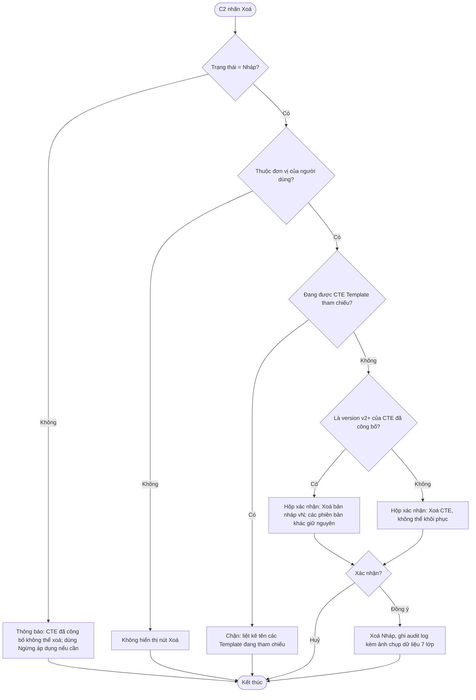

#### Acceptance Criteria
| AC | Kịch bản | Given | When | Then | Loại |
|---|---|---|---|---|---|
| AC-01 | Xoá thành công | Nháp v1, không tham chiếu | "Xoá" + xác nhận | CTE bị xoá, biến mất khỏi danh sách; audit log lưu ảnh chụp dữ liệu. | Happy |
| AC-02 | Chặn xoá CTE đã công bố | CTE Đang áp dụng | "Xoá" | "CTE đã công bố không thể xoá. Sử dụng 'Ngừng áp dụng' nếu cần." | Negative |
| AC-03 | Chặn xoá khi đang trong Template | Nháp nằm trong Template Nháp "Thuỷ sản tươi" | "Xoá" | Chặn: "CTE đang được tham chiếu bởi CTE Template: Thuỷ sản tươi." | Negative |
| AC-04 | Sở không xoá CTE Bộ | Sở xem CTE Bộ | Xem chi tiết | Không có nút Xoá. | Negative |
| AC-05 | **[Bổ sung v5]** Xoá Nháp v2 | v1 Đang áp dụng, v2 Nháp | Xoá v2 | Chỉ v2 bị xoá; v1 giữ nguyên Đang áp dụng; được phép tạo lại Nháp mới. | Happy |
| AC-06 | **[Bổ sung v5]** Huỷ xác nhận | Hộp xác nhận đang mở | "Huỷ" | Không thay đổi dữ liệu. | Happy |

#### DoR / DoD
- **DoR:** [ ] F-M5-F1 hoàn thành · [ ] F-M6 cung cấp API kiểm tra tham chiếu CTE → Template.
- **DoD:** [ ] Xoá Nháp v1 và Nháp v2+ đúng phạm vi · [ ] Chặn xoá CTE đã công bố / đang tham chiếu · [ ] Kiểm tra tham chiếu < 2 giây · [ ] Toàn bộ AC F4 pass.

---

### F-M5-F5: Clone CTE

**Actor:** Cán bộ C2 (chủ yếu cấp Sở) · **Priority:** High

#### Mô tả
Tạo CTE Nháp mới bằng cách sao chép toàn bộ 7 lớp từ một trong 3 nguồn:

| Nguồn | Điều kiện nguồn | Ràng buộc sau clone |
|---|---|---|
| Thư viện CTE C1 (F-M2) | CTE mẫu active | Sửa tự do lớp 2–7; ET khoá. Ghi nguồn = CLONED_FROM_C1. |
| CTE cấp Bộ (Sở clone) | Version Đang áp dụng của Bộ cùng ngành | **AD-06:** khoá ET, action, bizStep; chỉ thêm chặt. Ghi nguồn = CLONED_FROM_C2. |
| CTE của chính đơn vị | Version bất kỳ (trừ Nháp của người khác đang sửa) | Sửa tự do lớp 2–7; ET khoá. |

Khi clone, nếu nguồn có dữ liệu thư viện đã bị C1 vô hiệu hoá, Nháp mới vẫn được tạo nhưng đánh dấu lỗi tại các trường đó **[Bổ sung v5]**.

**Chi tiết "thêm chặt" và "bớt" theo AD-06**
| Được phép (thêm chặt) | Không được phép (bớt / đổi) |
|---|---|
| Thêm KDE mới (Required hoặc Optional) | Bỏ KDE Required của Bộ |
| Nâng KDE Optional → Required | Hạ KDE Required → Optional |
| Thêm trường ilmd, nâng ilmd lên Required | Bỏ ilmd Required của Bộ |
| Thêm bizTransactionType | Bỏ bizTransactionType Bộ đã chọn |
| Thu hẹp ngưỡng sensor (VD: 2–8°C → 3–6°C) | Nới ngưỡng sensor (VD: 2–8°C → 0–10°C) |
| Thêm chứng nhận / nâng chứng nhận lên Required | Bỏ chứng nhận Required của Bộ |
| Bổ sung ghi chú hướng dẫn, mô tả trigger | Đổi ET, action, bizStep |
| Bổ sung persistentDisposition **[Bổ sung v5]** | Đổi disposition hoặc bỏ persistentDisposition của Bộ **[Bổ sung v5]** |
| Đổi tên CTE cho phù hợp địa phương | — |

#### User Stories
- **US-F5-01:** Là Cán bộ C2, tôi muốn clone CTE mẫu từ Thư viện C1, để có điểm khởi đầu đúng chuẩn thay vì tạo từ đầu.
- **US-F5-02:** Là Cán bộ C2 cấp Sở, tôi muốn kế thừa CTE của Bộ và bổ sung yêu cầu địa phương, để tiêu chuẩn tỉnh luôn tuân thủ tiêu chuẩn Bộ.
- **US-F5-03:** Là Cán bộ C2 cấp Sở, tôi muốn hệ thống chặn ngay khi tôi vô tình nới lỏng yêu cầu của Bộ, để tránh ban hành tiêu chuẩn sai thẩm quyền.

#### Activity diagram
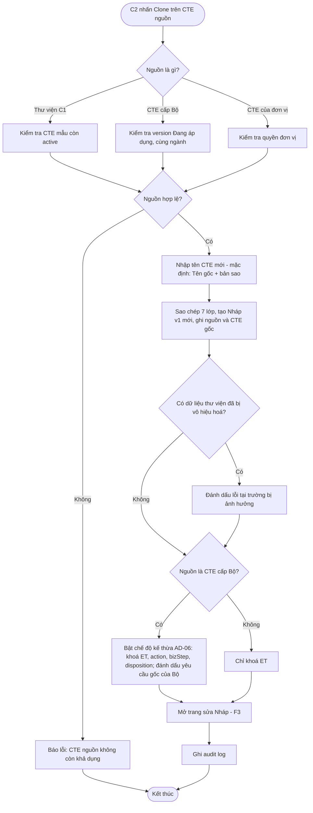

#### Acceptance Criteria
| AC | Kịch bản | Given | When | Then | Loại |
|---|---|---|---|---|---|
| AC-01 | Clone từ Thư viện C1 | Mở Thư viện CTE | Chọn CTE-13 (Xuất kho), "Clone" | Nháp mới sao chép 7 lớp; nguồn = CLONED_FROM_C1; CTE gốc = CTE-13. Sửa được mọi lớp trừ ET. | Happy |
| AC-02 | Sở clone CTE Bộ | Sở KH&CN HN xem "Xuất kho thuỷ sản" của Bộ NN&MT | "Clone" | Nháp tại Sở; nguồn = CLONED_FROM_C2; cấp = Sở. | Happy |
| AC-03 | Sở thêm chặt | Gốc có 5 KDE Required | Sở thêm 2 KDE Required + thu hẹp ngưỡng sensor | Lưu thành công. | Happy |
| AC-04 | Chặn bớt KDE Required | Gốc: readPoint Required | Sở đổi readPoint → Optional | Chặn: "KDE 'readPoint' là bắt buộc theo CTE cấp Bộ. Cấp Sở chỉ thêm, không bớt." | Negative |
| AC-05 | Chặn đổi ET/bizStep/action | Gốc: ET-01, shipping | Sở đổi bizStep → receiving | Chặn: "Không được thay đổi Event Type, action hoặc bizStep của CTE kế thừa từ Bộ." | Negative |
| AC-06 | Clone CTE của chính mình | Bộ có "Xuất kho" Đang áp dụng | "Clone" | Nháp mới, không áp AD-06; sửa mọi lớp trừ ET. | Happy |
| AC-07 | **[Bổ sung v5]** Chặn nới ngưỡng sensor | Gốc 2–8°C | Sở đặt 0–10°C | Chặn: "Ngưỡng cấp Sở phải nằm trong khoảng 2–8°C của CTE cấp Bộ." | Negative |
| AC-08 | **[Bổ sung v5]** Chặn bỏ chứng nhận bắt buộc | Gốc: VietGAP Required | Sở bỏ VietGAP | Chặn theo AD-06. | Negative |
| AC-09 | **[Bổ sung v5]** Nguồn có dữ liệu bị vô hiệu hoá | CTE-02 dùng KDE harvestDate đã bị vô hiệu hoá | Clone CTE-02 | Nháp tạo được; trường harvestDate đánh dấu lỗi "Dữ liệu đã bị C1 vô hiệu hoá — cần bỏ hoặc thay thế". | Negative |
| AC-10 | **[Bổ sung v5]** Đánh dấu yêu cầu gốc | Nháp clone từ Bộ | Mở lớp 6 | KDE gốc của Bộ có nhãn "Yêu cầu cấp Bộ"; KDE Sở thêm có nhãn "Bổ sung cấp Sở". | Happy |

#### DoR
- [ ] F-M5-F1, F-M5-F3, F-M2 hoàn thành.
- [ ] Bảng "được phép / không được phép" AD-06 đã được lãnh đạo dự án xác nhận.
- [ ] IAM xác định được quan hệ Bộ → Sở theo ngành.

#### DoD
- [ ] Clone từ 3 nguồn hoạt động, ghi đúng nguồn và CTE gốc.
- [ ] AD-06 chặn đúng toàn bộ các trường hợp "không được phép", cho phép toàn bộ trường hợp "được phép".
- [ ] Toàn bộ AC F5 pass.

---

### F-M5-F6: Công bố CTE (validate chéo + vòng đời áp dụng)

**Actor:** Cán bộ C2 có quyền "Công bố CTE"; Hệ thống (Scheduler) · **Priority:** Critical

#### Mô tả
Gồm 2 phần:
1. **Validate chéo** 7 lớp: chạy khi nhấn "Kiểm tra" hoặc "Công bố". Kết quả chia **Lỗi** (chặn công bố) và **Cảnh báo** (không chặn, phải xác nhận đã đọc).
2. **Vòng đời áp dụng:** v1 áp dụng ngay; v2+ bắt buộc chọn ngày áp dụng tương lai và nhập lý do thay đổi; tối đa 1 Đang áp dụng + 1 Chờ áp dụng.

**Danh mục quy tắc validate**
| Mã | Mức | Quy tắc | Thông báo |
|---|---|---|---|
| V-01 | Lỗi | ET ≠ ET-03 nhưng chưa có action | "Lớp 2 — chưa chọn action mặc định." |
| V-02 | Lỗi | ET-04 nhưng lớp 5 trống | "TransactionEvent yêu cầu chọn ≥1 loại giao dịch ở lớp 5." |
| V-03 | Lỗi | Thiếu KDE tự động bắt buộc theo ET (bảng 6.3) | VD: "ObjectEvent yêu cầu epcList hoặc quantityList." |
| V-04 | Lỗi | ilmd có dữ liệu khi không thuộc ET-01 ADD / ET-03 | "ilmd không được phép khi action = OBSERVE. Xoá cấu hình ilmd hoặc đổi action thành ADD." |
| V-05 | Lỗi | KDE bị cấm theo ET | "KDE 'parentID' không tương thích TransformationEvent." |
| V-06 | Lỗi | Không có KDE nào ngoài nhóm tự động | "Cần chọn ít nhất 1 KDE ngoài các trường tự động bắt buộc." |
| V-07 | Lỗi **[Bổ sung v5]** | Dữ liệu tham chiếu (ET/bizStep/disposition/KDE/bizTransactionType) đã bị C1 vô hiệu hoá | "Giá trị '[x]' ở lớp [n] đã bị C1 vô hiệu hoá." |
| V-08 | Lỗi **[Bổ sung v5]** | Nháp clone từ Bộ vi phạm AD-06 (kể cả khi Bộ đã có version mới chặt hơn) | "Cấu hình vi phạm yêu cầu cấp Bộ tại [trường]." |
| V-09 | Lỗi **[Bổ sung v5]** | Ngưỡng sensor min ≥ max hoặc thiếu đơn vị | "Ngưỡng sensor không hợp lệ." |
| V-10 | Cảnh báo | bizStep thuộc mức ⚠️ | "bizStep '[x]' ít dùng với [ET]." |
| V-11 | Cảnh báo | disposition ngoài danh sách gợi ý | "Disposition '[x]' không nằm trong gợi ý cho [bizStep]." |
| V-12 | Cảnh báo **[Bổ sung v5]** | KDE thiếu ghi chú hướng dẫn | "n KDE chưa có ghi chú hướng dẫn cho C3." |
| V-13 | Cảnh báo **[Bổ sung v5]** | v2+ không có thay đổi nào so với version Đang áp dụng | "Phiên bản này không khác phiên bản đang áp dụng." |

#### User Stories
- **US-F6-01:** Là Cán bộ tiêu chuẩn C2, tôi muốn hệ thống kiểm tra toàn bộ cấu hình và chỉ rõ lỗi ở lớp nào trước khi công bố, để không ban hành CTE sai chuẩn EPCIS.
- **US-F6-02:** Là Cán bộ tiêu chuẩn C2, tôi muốn đặt ngày áp dụng cho phiên bản mới, để doanh nghiệp có thời gian chuẩn bị trước khi tiêu chuẩn thay đổi.
- **US-F6-03:** Là Cán bộ tiêu chuẩn C2, tôi muốn huỷ phiên bản đang chờ áp dụng khi phát hiện sai sót, để không làm ảnh hưởng doanh nghiệp.
- **US-F6-04:** Là doanh nghiệp C3, tôi muốn được thông báo khi CTE tôi đang dùng sắp thay đổi, để kịp cập nhật hệ thống khai báo.

#### Activity diagram — Công bố
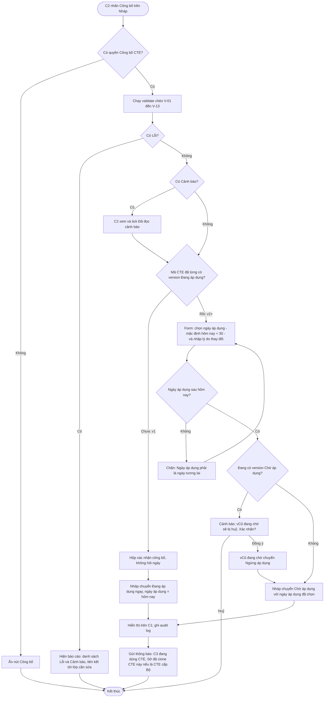

#### Activity diagram — Scheduler chuyển trạng thái
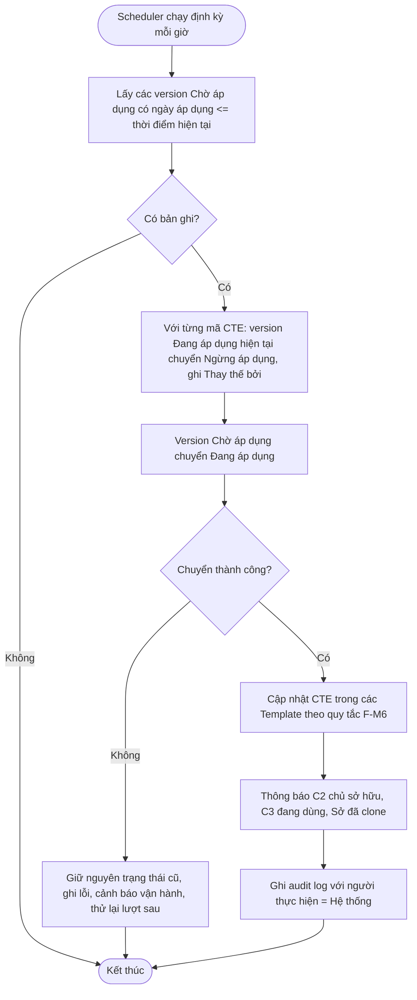

#### Activity diagram — Huỷ version Chờ áp dụng
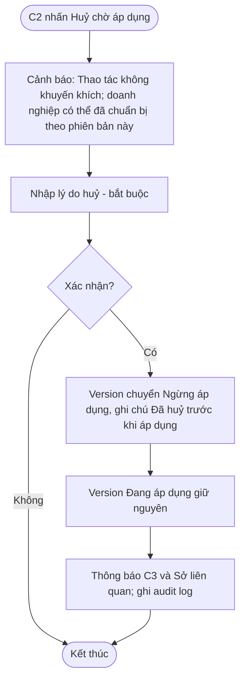

#### Acceptance Criteria

**Validate chéo**
| AC | Kịch bản | Given | When | Then | Loại |
|---|---|---|---|---|---|
| AC-01 | Công bố v1 | "Xuất kho" v1 Nháp, hợp lệ, chưa từng Đang áp dụng | "Công bố" + xác nhận | Không hỏi ngày; v1 → Đang áp dụng ngay; hiện trên C1; C3 lấy được; ghi audit log. | Happy |
| AC-02 | Thiếu action | Nháp ET-01, chưa có action | "Công bố" | Lỗi V-01. | Negative |
| AC-03 | ET-04 thiếu giao dịch | Nháp ET-04, lớp 5 trống | "Công bố" | Lỗi V-02. | Negative |
| AC-04 | ET-01 thiếu epcList/quantityList | Nháp ET-01 | "Công bố" | Lỗi V-03. | Negative |
| AC-05 | ilmd xung đột | ET-01, OBSERVE, có ilmd | "Công bố" | Lỗi V-04. | Negative |
| AC-06 | KDE bị cấm | ET-03 có parentID | "Công bố" | Lỗi V-05. | Negative |
| AC-07 | Báo cáo đầy đủ | 2 lỗi + 1 cảnh báo | "Công bố" | Báo cáo 2 Lỗi (chặn) + 1 Cảnh báo; mỗi dòng có liên kết "Đi tới lớp n". | Negative |
| AC-07a | **[Bổ sung v5]** Kiểm tra trước | Nháp bất kỳ | "Kiểm tra" | Chạy validate, hiện báo cáo, không đổi trạng thái. | Happy |
| AC-07b | **[Bổ sung v5]** Dữ liệu C1 bị vô hiệu hoá | Nháp dùng bizStep đã bị vô hiệu hoá | "Công bố" | Lỗi V-07. | Negative |
| AC-07c | **[Bổ sung v5]** Chỉ có cảnh báo | Nháp chỉ có cảnh báo V-10 | "Công bố" | Yêu cầu tick "Đã đọc cảnh báo" rồi mới cho tiếp. | Happy |
| AC-07d | **[Bổ sung v5]** Không có quyền | Cán bộ C2 không có quyền "Công bố CTE" | Xem chi tiết Nháp | Không có nút Công bố; có nút "Kiểm tra". | Negative |

**Vòng đời áp dụng**
| AC | Kịch bản | Given | When | Then | Loại |
|---|---|---|---|---|---|
| AC-08 | v2 yêu cầu ngày | v1 Đang áp dụng, v2 Nháp hợp lệ | "Công bố" | Form chọn ngày áp dụng + lý do thay đổi: "Phiên bản 1 đang áp dụng. Chọn ngày phiên bản 2 có hiệu lực để các bên kịp cập nhật." | Happy |
| AC-09 | v2 vào Chờ áp dụng | Như AC-08 | Chọn 01/10/2026, xác nhận | v2 Chờ áp dụng (01/10/2026); v1 vẫn Đang áp dụng; C1 hiển thị cả hai; thông báo C3; audit log. | Happy |
| AC-10 | Tới ngày áp dụng | v1 Đang áp dụng, v2 Chờ áp dụng 01/10; hôm nay 01/10 | Scheduler chạy | v2 Đang áp dụng; v1 Ngừng áp dụng (Thay thế bởi v2); C3 nhận v2 qua API; thông báo "CTE 'Xuất kho' đã cập nhật lên v2"; audit log. | Happy |
| AC-11 | v3 khi v2 đang chờ | v1 Đang áp dụng, v2 Chờ 01/10, v3 Nháp hợp lệ | Công bố v3, ngày 15/11, xác nhận cảnh báo | v2 Ngừng áp dụng; v3 Chờ áp dụng 15/11; v1 vẫn Đang áp dụng; thông báo C3 "Phiên bản 2 đã bị huỷ. Phiên bản 3 áp dụng từ 15/11." | Happy |
| AC-12 | Huỷ version đang chờ | v2 Chờ 01/10 | "Huỷ chờ áp dụng", nhập lý do, xác nhận | v2 Ngừng áp dụng; v1 vẫn Đang áp dụng; cảnh báo "Thao tác không khuyến khích"; audit log. | Happy |
| AC-13 | Thiếu ngày | v1 Đang áp dụng, v2 Nháp | Công bố không chọn ngày | Chặn: "CTE đã có phiên bản đang áp dụng. Vui lòng chọn ngày áp dụng cho phiên bản mới." | Negative |
| AC-14 | Ngày quá khứ / hôm nay | Hôm nay 05/08 | Chọn 01/08 hoặc 05/08 | Chặn: "Ngày áp dụng phải là ngày tương lai." | Negative |
| AC-15 | **[Bổ sung v5]** Thiếu lý do thay đổi | v2 Nháp | Công bố không nhập lý do | Chặn: "Vui lòng nhập lý do thay đổi." | Negative |
| AC-16 | **[Bổ sung v5]** Scheduler lỗi | Lỗi hệ thống khi chuyển trạng thái | Scheduler chạy | Không có trạng thái trung gian (v1 vẫn Đang áp dụng, v2 vẫn Chờ áp dụng); cảnh báo vận hành; lượt sau thử lại. | Negative |
| AC-17 | **[Bổ sung v5]** Thông báo Sở kế thừa | Sở A đã clone CTE Bộ X | Bộ công bố X v2 | Sở A nhận thông báo "CTE cấp Bộ 'X' có phiên bản 2 áp dụng từ [ngày]. Rà soát CTE kế thừa của đơn vị." | Happy |

#### NFR
| ID | Yêu cầu |
|---|---|
| NFR-F6-01 | Validate chéo < 2 giây |
| NFR-F6-02 | Scheduler chuyển trạng thái đúng ngày, sai lệch ≤ 1 giờ |
| NFR-F6-03 | Thông báo gửi trong vòng 5 phút sau khi công bố / chuyển trạng thái |
| NFR-F6-04 | Chuyển trạng thái là giao dịch nguyên tử: không tồn tại thời điểm có 0 hoặc 2 version Đang áp dụng |

#### DoR
- [ ] F-M5-F1 hoàn thành.
- [ ] Danh mục quy tắc V-01 → V-13 và câu chữ thông báo đã được chuyên gia nghiệp vụ duyệt.
- [ ] Hạ tầng scheduler và kênh thông báo (trong ứng dụng + email) sẵn sàng.
- [ ] IAM có quyền "Công bố CTE".
- [ ] Thống nhất giá trị mặc định ngày áp dụng (đề xuất +30 ngày).

#### DoD
- [ ] v1 áp dụng ngay; v2+ bắt buộc ngày tương lai + lý do.
- [ ] Validate chặn đúng toàn bộ Lỗi, hiển thị đúng Cảnh báo.
- [ ] Scheduler chuyển trạng thái đúng ngày, có xử lý lỗi và thử lại.
- [ ] Công bố version mới tự huỷ version đang chờ.
- [ ] Huỷ version đang chờ hoạt động.
- [ ] Thông báo C3 và Sở kế thừa gửi đúng.
- [ ] Toàn bộ AC F6 pass; NFR đạt.

---

### F-M5-F7: Quản lý phiên bản CTE

**Actor:** Cán bộ C2 · **Priority:** High

#### Mô tả
Tạo phiên bản mới từ CTE **Đang áp dụng** (hoặc Chờ áp dụng **[Bổ sung v5]**) khi cần điều chỉnh tiêu chuẩn. Version mới ở Nháp, sao chép 7 lớp từ version được chọn làm gốc. Chỉ 1 Nháp tại một thời điểm; ET không đổi qua các version. Tab "Lịch sử phiên bản" hiển thị đủ 4 trạng thái, cho phép xem chi tiết và **so sánh 2 phiên bản** **[Bổ sung v5]**.

#### User Stories
- **US-F7-01:** Là Cán bộ tiêu chuẩn C2, tôi muốn tạo phiên bản mới khi tiêu chuẩn cần điều chỉnh, mà không ảnh hưởng phiên bản đang có hiệu lực.
- **US-F7-02:** Là Cán bộ tiêu chuẩn C2, tôi muốn xem lịch sử và so sánh các phiên bản, để giải trình thay đổi khi được thanh tra, kiểm tra.

#### Activity diagram
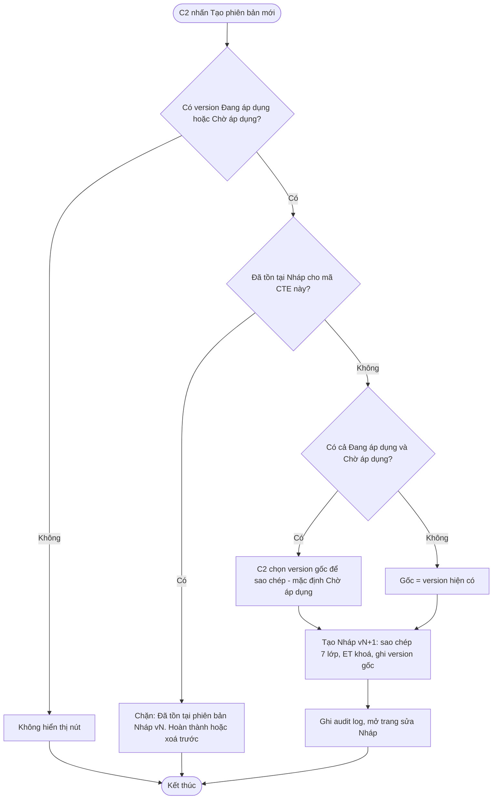

#### Acceptance Criteria
| AC | Kịch bản | Given | When | Then | Loại |
|---|---|---|---|---|---|
| AC-01 | Tạo version mới | "Xuất kho" v1 Đang áp dụng | "Tạo phiên bản mới" | v2 Nháp, sao chép 7 lớp từ v1; v1 vẫn Đang áp dụng. | Happy |
| AC-02 | Chỉ 1 Nháp | v1 Đang áp dụng, v2 Nháp | "Tạo phiên bản mới" lần nữa | Chặn: "Đã tồn tại phiên bản Nháp (v2). Hoàn thành hoặc xoá v2 trước." | Negative |
| AC-03 | ET không đổi | v1 ET-01 | Tạo v2 | v2 kế thừa ET-01, chỉ đọc. | Negative |
| AC-04 | Lịch sử đầy đủ | v1 Ngừng, v2 Đang áp dụng, v3 Chờ 15/11, v4 Nháp | Mở tab "Lịch sử phiên bản" | 4 dòng: trạng thái, ngày áp dụng, ngày ngừng, người công bố, lý do thay đổi; badge xanh/vàng/xám/trắng. | Happy |
| AC-05 | Xem version đã ngừng | v1 Ngừng áp dụng | Click v1 | Chi tiết 7 lớp chỉ đọc: "Phiên bản này đã ngừng áp dụng từ [ngày]. Thay thế bởi v2." | Happy |
| AC-06 | Xem version bị huỷ | v2 bị huỷ do công bố v3 | Click v2 | Chỉ đọc: "Phiên bản này đã bị huỷ trước khi áp dụng. Thay thế bởi v3." | Happy |
| AC-07 | **[Bổ sung v5]** Tạo từ version Chờ áp dụng | v1 Đang áp dụng, v2 Chờ áp dụng | "Tạo phiên bản mới" | Hỏi chọn gốc (mặc định v2); tạo v3 Nháp từ gốc đã chọn. | Happy |
| AC-08 | **[Bổ sung v5]** So sánh 2 phiên bản | Có v1, v2 | Chọn v1 và v2, "So sánh" | Hiển thị theo từng lớp: trường thêm (xanh), bớt (đỏ), đổi (vàng). | Happy |
| AC-09 | **[Bổ sung v5]** Đánh số liên tục | v2 Nháp bị xoá | Tạo phiên bản mới | Version mới được đánh số v2 (tái sử dụng số của Nháp đã xoá vì chưa từng công bố), đảm bảo dãy version đã công bố liên tục. | Happy |

#### DoR
- [ ] F-M5-F1, F-M5-F6 hoàn thành.
- [ ] Wireframe tab Lịch sử phiên bản và màn hình So sánh đã duyệt.

#### DoD
- [ ] Tạo version mới từ Đang áp dụng / Chờ áp dụng; chỉ 1 Nháp; ET chỉ đọc.
- [ ] Lịch sử hiển thị đủ 4 trạng thái, ngày, lý do; version cũ xem được (chỉ đọc).
- [ ] So sánh 2 phiên bản hoạt động.
- [ ] Toàn bộ AC F7 pass.

---

### F-M5-F8: [Bổ sung v5] Ngừng áp dụng CTE & xử lý thay đổi từ thư viện C1

**Actor:** Cán bộ C2 có quyền "Công bố CTE"; Hệ thống · **Priority:** High

#### Mô tả
Bản v4 có thông báo "Vô hiệu hoá nếu cần" (F4-AC-02) nhưng chưa có feature tương ứng. F8 khép kín vòng đời:
1. **Ngừng áp dụng chủ động:** C2 chấm dứt hiệu lực một CTE (VD: bước nghiệp vụ không còn bắt buộc theo văn bản mới) mà không có version thay thế. Áp dụng ngay hoặc theo ngày tương lai.
2. **Phản ứng khi thư viện C1 thay đổi:** khi C1 vô hiệu hoá dữ liệu tham chiếu, hệ thống gắn cảnh báo cho CTE bị ảnh hưởng (BR-M5-16), **không tự động** thay đổi CTE đã công bố.

#### User Stories
- **US-F8-01:** Là Cán bộ tiêu chuẩn C2, tôi muốn ngừng áp dụng một CTE không còn phù hợp, để doanh nghiệp không phải khai báo sự kiện thừa.
- **US-F8-02:** Là Cán bộ tiêu chuẩn C2, tôi muốn được cảnh báo khi dữ liệu chuẩn mà CTE của tôi đang dùng bị C1 vô hiệu hoá, để chủ động tạo phiên bản thay thế.

#### Activity diagram — Ngừng áp dụng chủ động
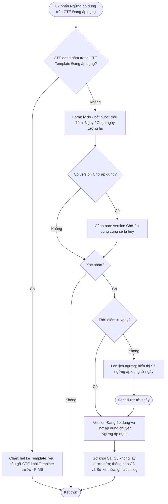

#### Activity diagram — Thư viện C1 vô hiệu hoá dữ liệu
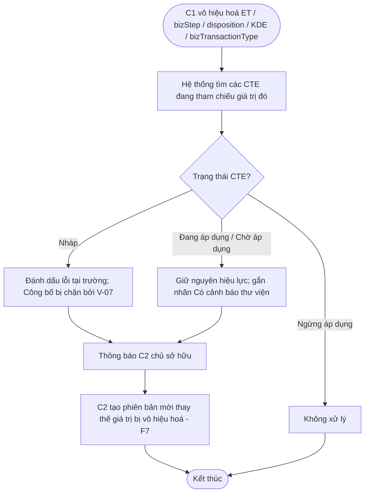

#### Acceptance Criteria
| AC | Kịch bản | Given | When | Then | Loại |
|---|---|---|---|---|---|
| AC-01 | Ngừng ngay | CTE X Đang áp dụng, không trong Template hiệu lực | "Ngừng áp dụng", lý do, "Ngay", xác nhận | X → Ngừng áp dụng; gỡ khỏi C1; C3 không lấy được; thông báo; audit log. | Happy |
| AC-02 | Ngừng theo ngày | Như AC-01 | Chọn 01/12/2026 | Hiển thị "Sẽ ngừng áp dụng từ 01/12/2026"; tới ngày Scheduler chuyển trạng thái. | Happy |
| AC-03 | Chặn khi trong Template hiệu lực | X nằm trong Template "Thuỷ sản tươi" Đang áp dụng | "Ngừng áp dụng" | Chặn: "CTE đang thuộc CTE Template 'Thuỷ sản tươi'. Gỡ CTE khỏi Template trước." | Negative |
| AC-04 | Huỷ kèm version đang chờ | X v1 Đang áp dụng, v2 Chờ áp dụng | Ngừng ngay | Cảnh báo v2 bị huỷ; sau xác nhận cả v1, v2 → Ngừng áp dụng. | Happy |
| AC-05 | Thiếu lý do | Form ngừng | Xác nhận không nhập lý do | Chặn: "Vui lòng nhập lý do ngừng áp dụng." | Negative |
| AC-06 | C1 vô hiệu hoá KDE — CTE Đang áp dụng | X Đang áp dụng dùng harvestDate | C1 vô hiệu hoá harvestDate | X vẫn Đang áp dụng; gắn nhãn cảnh báo; C2 nhận thông báo. | Happy |
| AC-07 | C1 vô hiệu hoá KDE — CTE Nháp | Nháp Y dùng harvestDate | C1 vô hiệu hoá harvestDate | Y đánh dấu lỗi tại lớp 6; Công bố bị chặn (V-07). | Negative |
| AC-08 | Sở nhận thông báo Bộ ngừng | Sở A đã clone CTE Bộ X | Bộ ngừng áp dụng X | Sở A nhận thông báo; CTE của Sở A **không** bị tự động ngừng. | Happy |

#### DoR
- [ ] F-M5-F6, F-M5-F7 hoàn thành.
- [ ] F-M6 cung cấp API kiểm tra CTE thuộc Template Đang áp dụng.
- [ ] F-M1/F-M3/F-M4 phát sự kiện khi vô hiệu hoá bản ghi.
- [ ] Lãnh đạo dự án xác nhận nguyên tắc "không tự động thay đổi CTE đã công bố".

#### DoD
- [ ] Ngừng áp dụng ngay / theo ngày hoạt động, có chặn theo Template.
- [ ] Gắn cảnh báo / lỗi đúng khi C1 vô hiệu hoá dữ liệu.
- [ ] Thông báo C3, C2, Sở kế thừa đúng.
- [ ] Toàn bộ AC F8 pass.

---

## 9. Danh mục thông báo hệ thống

| Mã | Ngữ cảnh | Nội dung | Loại |
|---|---|---|---|
| MSG-01 | ET bất biến | Event Type không thể thay đổi. Tạo CTE mới nếu cần Event Type khác. | Thông tin |
| MSG-02 | ET-03 lớp 2 | TransformationEvent không có trường action — bỏ qua bước này. | Thông tin |
| MSG-03 | ET-04 | TransactionEvent yêu cầu chọn ≥1 loại giao dịch. | Lỗi |
| MSG-04 | ilmd khoá | ilmd chỉ áp dụng khi action = ADD. Action hiện tại: [x]. | Thông tin |
| MSG-05 | Thiếu KDE | Cần chọn ít nhất 1 KDE ngoài các trường tự động bắt buộc. | Lỗi |
| MSG-06 | Trùng tên | Tên CTE đã tồn tại trong đơn vị. Vui lòng đặt tên khác. | Lỗi |
| MSG-07 | Sửa CTE đã công bố | CTE đã công bố không sửa trực tiếp. Sử dụng "Tạo phiên bản mới". | Lỗi |
| MSG-08 | Xoá CTE đã công bố | CTE đã công bố không thể xoá. Sử dụng "Ngừng áp dụng" nếu cần. | Lỗi |
| MSG-09 | Xoá khi tham chiếu | CTE đang được tham chiếu bởi CTE Template: [danh sách]. | Lỗi |
| MSG-10 | AD-06 bớt KDE | KDE '[x]' là bắt buộc theo CTE cấp Bộ. Cấp Sở chỉ thêm, không bớt. | Lỗi |
| MSG-11 | AD-06 đổi lõi | Không được thay đổi Event Type, action, bizStep hoặc disposition của CTE kế thừa từ Bộ. | Lỗi |
| MSG-12 | Thiếu ngày v2+ | CTE đã có phiên bản đang áp dụng. Vui lòng chọn ngày áp dụng cho phiên bản mới. | Lỗi |
| MSG-13 | Ngày quá khứ | Ngày áp dụng phải là ngày tương lai. | Lỗi |
| MSG-14 | Huỷ version chờ | Thao tác này không khuyến khích. Bạn có chắc muốn huỷ áp dụng phiên bản [n]? | Cảnh báo |
| MSG-15 | Đã có Nháp | Đã tồn tại phiên bản Nháp (v[n]). Hoàn thành hoặc xoá v[n] trước. | Lỗi |
| MSG-16 | Đang được sửa | CTE đang được sửa bởi [tên] từ [giờ]. Bạn đang xem ở chế độ chỉ đọc. | Thông tin |
| MSG-17 | Thông báo C3 — version mới | CTE '[tên]' có phiên bản [n] áp dụng từ [ngày]. | Thông báo |
| MSG-18 | Thông báo C3 — đã áp dụng | CTE '[tên]' đã cập nhật lên phiên bản [n]. | Thông báo |
| MSG-19 | Thông báo Sở kế thừa | CTE cấp Bộ '[tên]' có thay đổi: [nội dung]. Rà soát CTE kế thừa của đơn vị. | Thông báo |
| MSG-20 | Thư viện C1 thay đổi | Giá trị '[x]' mà CTE '[tên]' đang dùng đã bị C1 vô hiệu hoá. Tạo phiên bản mới để thay thế. | Cảnh báo |

---

## 10. Nhật ký thao tác (Audit log)

| Thao tác | Dữ liệu ghi |
|---|---|
| Tạo / Clone | Người thực hiện, đơn vị, cấp, thời điểm, nguồn, CTE gốc |
| Sửa Nháp | Trường thay đổi, giá trị trước / sau |
| Xoá Nháp | Ảnh chụp toàn bộ dữ liệu 7 lớp tại thời điểm xoá |
| Công bố | Version, trạng thái đích, ngày áp dụng, lý do thay đổi, danh sách cảnh báo đã xác nhận |
| Huỷ chờ áp dụng / Ngừng áp dụng | Lý do, thời điểm |
| Chuyển trạng thái tự động | Người thực hiện = Hệ thống, version trước / sau |

Nhật ký lưu vĩnh viễn, không sửa/xoá được; hiển thị ở tab "Nhật ký" trang chi tiết CTE.

---

## 11. Yêu cầu phi chức năng (NFR)

| ID | Nhóm | Yêu cầu |
|---|---|---|
| NFR-01 | Hiệu năng | Dropdown cascade < 500ms/bước; gợi ý disposition < 500ms |
| NFR-02 | Hiệu năng | Danh sách < 2 giây / 500 bản ghi; chi tiết < 2 giây; wizard mở < 3 giây |
| NFR-03 | Hiệu năng | Validate chéo < 2 giây; kiểm tra tham chiếu chéo module < 2 giây |
| NFR-04 | Độ tin cậy | Scheduler sai lệch ≤ 1 giờ; chuyển trạng thái nguyên tử; tự thử lại khi lỗi |
| NFR-05 | Toàn vẹn | Version đã công bố bất biến; lịch sử lưu vĩnh viễn |
| NFR-06 | Bảo mật | Phân quyền theo đơn vị và cấp (mục 5.3); kiểm tra quyền ở cả giao diện và máy chủ |
| NFR-07 | Tương thích chuẩn | URI của bizStep/disposition/bizTransactionType xuất đồng thời dạng URN và Web URI theo CBV 2.0 |
| NFR-08 | Thông báo | Gửi trong 5 phút sau sự kiện |
| NFR-09 | Khả dụng | Giao diện desktop ≥ 1280px; tiếng Việt có dấu đầy đủ |

---

## 12. Phụ thuộc

| Loại | Module / Hệ thống | Nội dung |
|---|---|---|
| Phụ thuộc dữ liệu | F-M1 — Event Type | Lớp 1 |
| Phụ thuộc dữ liệu | F-M4 — CBV | Lớp 3, 4, 5; bảng 3.3, 4.4 |
| Phụ thuộc dữ liệu | F-M3 — KDE / ILMD | Lớp 6 |
| Phụ thuộc dữ liệu | F-M2 — Thư viện CTE | Nguồn clone |
| Phụ thuộc sự kiện | F-M1/F-M3/F-M4 | Phát sự kiện khi vô hiệu hoá bản ghi (F8) |
| Hai chiều | F-M6 — CTE Template | F-M6 dùng CTE Đang áp dụng; F-M5 hỏi F-M6 về tham chiếu (F4, F8) |
| Phân quyền | IAM | Cấp Bộ/Sở, quan hệ Bộ → Sở theo ngành, quyền "Công bố CTE" |
| Hạ tầng | Scheduler, Notification | F6, F8 |
| Tiêu thụ | C3 / Agent Platform, Domain E (VC-SUBMIT) | Lấy CTE Đang áp dụng qua API |
| Tham chiếu | SRS CTE NDATrace CMS (TRACE-609 → 615) | Đã đáp ứng một phần, cần đối chiếu |

---

## 13. Rủi ro và biện pháp giảm thiểu

| # | Rủi ro | Ảnh hưởng | Biện pháp |
|---|---|---|---|
| R1 | Bảng 3.3 / 4.4 chưa chuẩn xác | Gợi ý sai → CTE sai nghiệp vụ dù đúng cú pháp | Chuyên gia nghiệp vụ duyệt là điều kiện DoR; gợi ý không chặn nên C2 vẫn sửa được |
| R2 | Cán bộ C2 không quen thuật ngữ EPCIS | Bỏ dở wizard, cấu hình sai | Tên tiếng Việt + tooltip + ví dụ cho mọi giá trị; thanh "Tóm tắt CTE" bằng câu tự nhiên; khuyến khích Clone từ thư viện C1 |
| R3 | Scheduler lỗi đúng ngày áp dụng | C3 khai báo theo version sai | Giao dịch nguyên tử, thử lại mỗi giờ, cảnh báo vận hành |
| R4 | Sở nhiều, Bộ thay đổi thường xuyên | CTE Sở lệch chuẩn Bộ | Thông báo kế thừa (BR-M5-17); V-08 kiểm tra lại AD-06 khi Sở công bố |
| R5 | C1 vô hiệu hoá dữ liệu đang dùng | CTE đang hiệu lực bị "gãy" | Không tự động thay đổi CTE đã công bố; gắn cảnh báo, yêu cầu version mới |
| R6 | Huỷ version chờ khi C3 đã chuẩn bị | Lãng phí chi phí doanh nghiệp | Bắt buộc lý do, cảnh báo, thông báo C3 ngay |

---

## 14. Definition of Ready (DoR) — cấp Module

Một feature thuộc F-M5 được đưa vào Sprint khi:
- [ ] User story, luồng nghiệp vụ, activity diagram và AC của feature đã được PO duyệt và team hiểu thống nhất trong buổi refinement.
- [ ] Các module phụ thuộc đã sẵn sàng trên môi trường dev (theo DoR từng feature).
- [ ] Bảng tham chiếu nghiệp vụ liên quan (3.3, 4.4, 6.3, AD-06) đã được chuyên gia duyệt.
- [ ] Wireframe / UI trên Figma đã duyệt, có đủ trạng thái: mặc định, trống, đang tải, lỗi, chỉ đọc.
- [ ] Câu chữ thông báo (mục 9) đã chốt.
- [ ] Đặc tả API liên quan đã có.
- [ ] Feature đã được ước lượng và vừa với 1 Sprint (F1 tách theo Scenario S0–S7 nếu cần).
- [ ] Dữ liệu kiểm thử (CTE mẫu cho 5 ET, tài khoản Bộ / Sở / C1) đã chuẩn bị.

## 15. Definition of Done (DoD) — cấp Module

Một feature thuộc F-M5 được coi là hoàn thành khi:
- [ ] Toàn bộ AC (bao gồm Happy và Negative) pass trên môi trường staging.
- [ ] Mọi luồng thay thế và ngoại lệ trong activity diagram được kiểm thử.
- [ ] Phân quyền đúng ma trận mục 5.3, kiểm tra cả phía máy chủ.
- [ ] Audit log ghi đúng mục 10.
- [ ] NFR liên quan đạt trên dữ liệu seed đầy đủ.
- [ ] Code review xong, kiểm thử tự động cho các quy tắc validate và chuyển trạng thái.
- [ ] Không còn lỗi mức Critical / High.
- [ ] Giao diện khớp thiết kế Figma đã duyệt.
- [ ] Tài liệu hướng dẫn sử dụng cho Cán bộ C2 được cập nhật.
- [ ] PO nghiệm thu trong Sprint Review.

---

## Phụ lục A — Tổng hợp số lượng AC

| Feature | AC bản v4 | AC bổ sung v5 | Tổng |
|---|---|---|---|
| F-M5-F1 | 36 | 9 | 45 |
| F-M5-F2 | 8 | 4 | 12 |
| F-M5-F3 | 5 | 3 | 8 |
| F-M5-F4 | 4 | 2 | 6 |
| F-M5-F5 | 6 | 4 | 10 |
| F-M5-F6 | 14 | 7 | 21 |
| F-M5-F7 | 6 | 3 | 9 |
| F-M5-F8 | — | 8 | 8 |
| **Tổng** | **79** | **40** | **119** |

## Phụ lục B — Thay đổi so với bản v4

1. Bổ sung **activity diagram** cho: cascade tổng quát, lưu nháp, tra cứu, sửa, xoá, clone, công bố, scheduler, huỷ chờ áp dụng, tạo phiên bản, ngừng áp dụng, phản ứng thay đổi thư viện C1.
2. Bổ sung **mô hình dữ liệu nghiệp vụ** CTE, **ma trận phân quyền**, **sơ đồ trạng thái**.
3. Bổ sung **bảng ràng buộc cứng theo ET** (6.3) và bảng **AD-06 được phép / không được phép**.
4. Bổ sung BR-M5-14 → BR-M5-18; quy tắc validate V-07 → V-09, V-12, V-13.
5. Bổ sung feature **F-M5-F8** (Ngừng áp dụng & xử lý thay đổi thư viện C1).
6. Bổ sung luồng thay thế / ngoại lệ, danh mục thông báo, audit log, DoR/DoD cấp module.
7. Lược bỏ theo yêu cầu: mục câu hỏi mở và chỉ số mục tiêu dự án.
