# Tài liệu yêu cầu sản phẩm — Quản lý Sự kiện trọng yếu

| Thông tin | Nội dung |
|---|---|
| Sản phẩm | NDATrace — Nền tảng quốc gia truy xuất nguồn gốc |
| Phân hệ | Quản lý Sự kiện trọng yếu |
| Chức năng tương ứng trong Khung chức năng nghiệp vụ (Quyển 3) | Ban hành và quản lý sự kiện trọng yếu và trường thông tin chuyên ngành — chủ thể Cấp 2 |
| Khung nghiệp vụ tương ứng (Quyển 2) | Khung quản lý sự kiện trọng yếu và dữ liệu truy xuất nguồn gốc; Khung yêu cầu nghiệp vụ theo ngành hàng và thị trường |
| Tài liệu liên quan | Tài liệu yêu cầu sản phẩm — Quy trình tiêu chuẩn truy xuất nguồn gốc (viết riêng) |
| Đối tượng sử dụng chính | Cơ quan quản lý nhà nước chuyên ngành ở trung ương (nhóm 2A) và ở địa phương (nhóm 2B) |
| Phiên bản tài liệu | 7.1 |
| Người soạn | Nguyễn Hà Cương — Quản lý sản phẩm |
| Trạng thái | Bản nháp, chờ rà soát |
| Căn cứ | Nghị định 37/2025/NĐ-CP; NDATrace Quyển 2 — Khung nghiệp vụ dùng chung (bản 4.2.0); NDATrace Quyển 3 — Khung chức năng nghiệp vụ (bản 4.3.2); chuẩn sự kiện truy xuất quốc tế GS1 EPCIS 2.0 và bộ từ vựng nghiệp vụ CBV 2.0 |

> **Quy ước đánh dấu:**
> - **[Bổ sung]**: nội dung nhóm phát triển sản phẩm đề xuất thêm để khép kín nghiệp vụ.
> - **[Theo Quyển 2/3]**: nội dung được điều chỉnh để thống nhất với Quyển 2 (Khung nghiệp vụ dùng chung) và Quyển 3 (Khung chức năng nghiệp vụ).
>
> Cả hai loại nội dung đều cần được xác nhận trong buổi rà soát.

---

## 0. Thuật ngữ và đối chiếu với kiến trúc nghiệp vụ

### 0.1. Thuật ngữ

Tài liệu dùng thuật ngữ theo Nghị định 37/2025/NĐ-CP. Quyển 2 và Quyển 3 dùng tên gọi "Mẫu CTE/KDE" cho cùng đối tượng mà tài liệu này gọi là **Sự kiện trọng yếu**. Từ phiên bản 7.0, tài liệu thống nhất như sau:

> **Ghi chú thuật ngữ theo Nghị định 37/2025/NĐ-CP:** Nghị định dùng tên **"Trường thông tin"** cho từng thông tin phải ghi nhận tại một sự kiện trọng yếu. Bản 4 của tài liệu, Quyển 2 và Quyển 3 gọi khái niệm này là "dữ liệu then chốt" (KDE). Từ phiên bản 7.1, tài liệu dùng thống nhất tên **Trường thông tin**.

| Thuật ngữ | Định nghĩa |
|---|---|
| **Sự kiện trọng yếu** | Bản quy định do cơ quan quản lý chuyên ngành ban hành cho **một loại sự kiện**, **chưa gắn với ngành hàng hay nhóm sản phẩm nào**, mà tổ chức, cá nhân sản xuất, kinh doanh bắt buộc phải ghi nhận trong chuỗi cung ứng, ví dụ "Thu hoạch tôm nuôi", "Xuất kho thuỷ sản tươi". Sự kiện trọng yếu quy định: sự kiện thuộc loại nào, đối tượng được tạo mới, ghi nhận hay kết thúc, công đoạn nghiệp vụ là gì, hàng hoá ở trạng thái nào sau sự kiện, cần gắn chứng từ nào, phải khai báo những trường thông tin nào, ở mức bắt buộc nào, và các yêu cầu kiểm soát đi kèm. Đây là đối tượng do phân hệ này quản lý. Một Sự kiện trọng yếu được dùng lại trong nhiều Quy trình tiêu chuẩn TXNG của nhiều ngành hàng khác nhau. |
| **Quy trình tiêu chuẩn truy xuất nguồn gốc** (gọi tắt: Quy trình tiêu chuẩn TXNG) | Tập hợp có thứ tự nhiều Sự kiện trọng yếu, do cơ quan quản lý ban hành thành yêu cầu khai báo cho cả một ngành hàng hoặc nhóm sản phẩm. Ví dụ: Quy trình tiêu chuẩn TXNG "Thuỷ sản tươi" gồm Thu hoạch → Sơ chế → Đóng gói → Xuất kho → Nhận hàng. Quy trình tiêu chuẩn TXNG được đặc tả trong tài liệu yêu cầu sản phẩm riêng. **Chỉ khi ghép các Sự kiện trọng yếu thành Quy trình tiêu chuẩn TXNG, cơ quan quản lý mới áp quy trình đó cho ngành hàng, nhóm sản phẩm cụ thể.** Phân hệ này chỉ cung cấp Sự kiện trọng yếu đang áp dụng để Quy trình tiêu chuẩn TXNG sử dụng. |
| **Bản ghi sự kiện** | Dữ liệu thực tế do tổ chức, cá nhân sản xuất, kinh doanh tạo ra khi sự kiện xảy ra, theo đúng phiên bản Sự kiện trọng yếu có hiệu lực tại thời điểm đó. Bản ghi sự kiện không thuộc phạm vi phân hệ này. |
| **Trường thông tin** (bản 4 và Quyển 2/3 gọi là "dữ liệu then chốt") | Từng thông tin bắt buộc hoặc bắt buộc có điều kiện trong bản ghi sự kiện, ví dụ thời điểm xảy ra, địa điểm, mã lô, ngày sản xuất. Bản ghi thiếu trường thông tin bắt buộc thì chưa hợp lệ. |
| **Thông tin lô / cá thể** | Nhóm trường thông tin mô tả đặc tính của một lô hàng hoặc một sản phẩm tại thời điểm được tạo ra: mã lô, ngày sản xuất, hạn sử dụng, ngày thu hoạch, xuất xứ. |
| **Bộ lõi quốc gia** | Tập danh mục và yêu cầu tối thiểu do Nền tảng quốc gia (Cấp 1) duy trì, áp dụng cho mọi ngành: loại sự kiện, bước nghiệp vụ, trạng thái hàng hoá, loại chứng từ, trường thông tin dùng chung, đơn vị đo và thư viện Sự kiện trọng yếu mẫu. |
| **Thư viện Sự kiện trọng yếu mẫu** | Bộ Sự kiện trọng yếu mẫu do Cấp 1 xây dựng sẵn (hiện có 28 mẫu), để cơ quan quản lý sao chép làm điểm khởi đầu. |
| **Chủ sở hữu nội dung** | Cơ quan có thẩm quyền chịu trách nhiệm về nội dung của Sự kiện trọng yếu. Đây là cơ quan ban hành, không phải cá nhân cán bộ soạn thảo. |
| **Căn cứ ban hành** | Văn bản quy phạm pháp luật, quyết định hoặc văn bản hành chính làm cơ sở để ban hành Sự kiện trọng yếu. |
| **Thời hạn chuyển tiếp** | Khoảng thời gian từ ngày công bố đến ngày áp dụng của một phiên bản mới. Trong khoảng này, đơn vị cung cấp giải pháp và doanh nghiệp chuẩn bị để khai báo theo phiên bản mới. |
| **Quy tắc chuyển tiếp** | Hướng dẫn xử lý các bản ghi sự kiện phát sinh quanh thời điểm chuyển phiên bản, và các trường hợp doanh nghiệp phải bổ sung dữ liệu. |
| **Kế thừa** | Việc cơ quan quản lý địa phương lấy Sự kiện trọng yếu của cơ quan quản lý trung ương cùng ngành làm gốc, rồi bổ sung yêu cầu riêng của địa phương. Cơ quan địa phương chỉ được thêm hoặc siết chặt yêu cầu, không được bớt hoặc nới lỏng. |

### 0.2. Đối chiếu với mô hình năm cấp của NDATrace

Bảng dưới đây quy đổi các ký hiệu C1, C2, C3 của bản 4 sang cách gọi chính thức trong Quyển 2 và Quyển 3. **[Theo Quyển 2/3]**

| Ký hiệu bản 4 | Cấp chính thức | Chủ thể | Vai trò đối với phân hệ này |
|---|---|---|---|
| C1 | **Cấp 1** | Nền tảng quốc gia và đơn vị vận hành | Duy trì bộ lõi quốc gia và thư viện Sự kiện trọng yếu mẫu. Tiếp nhận Sự kiện trọng yếu đã công bố vào danh mục tham chiếu quốc gia. Kiểm tra tính tương thích với bộ lõi. **Không phê duyệt nội dung chuyên ngành thay Cấp 2.** |
| C2 — cấp Bộ | **Cấp 2, nhóm 2A** | Cơ quan quản lý nhà nước trung ương theo ngành và các đơn vị trực thuộc được phân công, ví dụ Bộ Nông nghiệp và Môi trường, Bộ Công Thương, Bộ Y tế | Xây dựng, phê duyệt, công bố Sự kiện trọng yếu áp dụng toàn quốc cho ngành mình quản lý. Mức áp dụng: **bắt buộc**. |
| C2 — cấp Sở | **Cấp 2, nhóm 2B** | Uỷ ban nhân dân tỉnh, thành phố và cơ quan chuyên môn được phân công | Địa phương hoá Sự kiện trọng yếu của nhóm 2A **khi được uỷ quyền**, trong phạm vi địa bàn. Mức áp dụng: có điều kiện. |
| — | Cấp 2, nhóm 2C | Tổ chức đánh giá, chứng nhận | Dùng Sự kiện trọng yếu để ghi kết quả đánh giá, được đề xuất cải tiến, không ban hành yêu cầu bắt buộc của Nhà nước. Ngoài phạm vi giai đoạn này. |
| — | Cấp 2, nhóm 2D | Chủ sở hữu chương trình tự nguyện | Duy trì Sự kiện trọng yếu riêng của chương trình tự nguyện và ánh xạ với phần dùng chung. Ngoài phạm vi giai đoạn này. |
| (bản 4 ghi nhầm là C3) | **Cấp 3** | Đơn vị cung cấp giải pháp | Nhận phiên bản Sự kiện trọng yếu đã công bố, cấu hình công cụ theo đó, thông báo và hướng dẫn chuyển tiếp cho khách hàng. Không được tự sửa Sự kiện trọng yếu. |
| C3 | **Cấp 4** | Tổ chức, doanh nghiệp, hợp tác xã, hộ kinh doanh, cá nhân sản xuất, kinh doanh | Ghi nhận bản ghi sự kiện tại nguồn theo đúng phiên bản Sự kiện trọng yếu đang áp dụng, chịu trách nhiệm về nội dung đã ghi. |
| — | **Cấp 5** | Người tiêu dùng, công dân | Tra cứu hành trình sản phẩm đã công bố. Không tương tác với phân hệ này. |

### 0.3. Vị trí của phân hệ trong chuỗi chức năng

Theo Quyển 3, chức năng "Ban hành và quản lý sự kiện trọng yếu và trường thông tin chuyên ngành" của Cấp 2 có các mối liên hệ sau.

**Nhận đầu vào từ:**
- Quản lý bộ quy tắc ngành, chương trình và thị trường (Cấp 2): căn cứ và yêu cầu ngành.
- Quản lý địa điểm, cơ sở và điều kiện chuyên ngành (Cấp 2): loại địa điểm dùng trong trường thông tin.
- Quản lý danh mục, hồ sơ và ánh xạ chuyên ngành (Cấp 2): danh mục chuyên ngành đã ánh xạ với bộ lõi (bước nghiệp vụ, trạng thái, trường thông tin chuyên ngành).
- Quản lý danh mục tham chiếu sự kiện trọng yếu và trường thông tin (Cấp 1): bộ lõi quốc gia và thư viện mẫu.

**Cung cấp đầu ra cho:**
- Quản lý danh mục tham chiếu sự kiện trọng yếu và trường thông tin (Cấp 1): đăng ký phiên bản đã công bố.
- Quy trình tiêu chuẩn TXNG (Cấp 2): Sự kiện trọng yếu đang áp dụng.
- Tiếp nhận, trao đổi và đối soát dữ liệu chuyên ngành (Cấp 2).
- Cấu hình công cụ hỗ trợ định danh, sự kiện trọng yếu và bằng chứng (Cấp 3).
- Ghi nhận và đính chính sự kiện trọng yếu (Cấp 4).

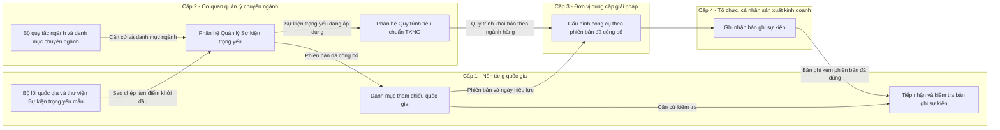

---

## 1. Tổng quan

### 1.1. Bối cảnh

Nghị định 37/2025/NĐ-CP yêu cầu tổ chức, cá nhân tham gia chuỗi cung ứng ghi nhận sự kiện trọng yếu kèm trường thông tin tại mỗi điểm trọng yếu. Tuy nhiên, Nghị định không quy định cho từng ngành hàng cụ thể: sự kiện nào là trọng yếu, dữ liệu nào là bắt buộc. Theo Quyển 2, việc quy định này thuộc thẩm quyền của **cơ quan quản lý chuyên ngành (Cấp 2)**. Cấp 2 xây dựng và phê duyệt nội dung Sự kiện trọng yếu theo thẩm quyền. Nền tảng quốc gia (Cấp 1) chỉ duy trì danh mục tham chiếu và kiểm tra tính tương thích.

NDATrace dùng chuẩn sự kiện truy xuất quốc tế GS1 EPCIS 2.0 làm hệ quy chiếu. Chuẩn này mô tả mỗi sự kiện qua năm câu hỏi: cái gì, khi nào, ở đâu, vì sao, như thế nào. Cấp 1 đã chuẩn hoá bộ lõi quốc gia gồm:
- 5 loại sự kiện;
- 28 Sự kiện trọng yếu mẫu;
- khoảng 64 trường thông tin;
- 43 bước nghiệp vụ;
- hơn 26 trạng thái hàng hoá;
- 9 loại chứng từ giao dịch.

### 1.2. Mục đích

Phân hệ giúp **cán bộ tiêu chuẩn của cơ quan quản lý chuyên ngành** tự xây dựng, trình duyệt, công bố và duy trì Sự kiện trọng yếu cho ngành hàng mình quản lý, không cần đội kỹ thuật hỗ trợ. Mỗi Sự kiện trọng yếu được ban hành qua phân hệ đáp ứng đủ yêu cầu của Quyển 2:
- có mã, tên;
- có chủ sở hữu nội dung;
- có căn cứ ban hành;
- có phiên bản, ngày hiệu lực, trạng thái;
- có thời hạn chuyển tiếp và quy tắc chuyển tiếp;
- có yêu cầu bằng chứng khi cần.

Mỗi Sự kiện trọng yếu được cấu hình qua **7 bước tuần tự**:

| Bước | Nội dung cán bộ lựa chọn | Câu hỏi được trả lời | Ý nghĩa nghiệp vụ |
|---|---|---|---|
| 1 | Loại sự kiện | Khung của sự kiện | Xác định sự kiện thuộc dạng nào: theo dõi đối tượng, đóng gói/gom hàng, chế biến, giao dịch hay liên kết. Loại sự kiện quyết định toàn bộ các bước sau. |
| 2 | Bước nghiệp vụ | Vì sao — đang làm gì | Xác định công đoạn: thu hoạch, đóng gói, xuất hàng, nhận hàng, kiểm tra… |
| 3 | Hành động | Vòng đời đối tượng | Xác định đối tượng được tạo mới, được ghi nhận lại, hay kết thúc vòng đời tại sự kiện. Hệ thống tự gợi ý hành động theo bước nghiệp vụ đã chọn. |
| 4 | Trạng thái hàng hoá | Vì sao — kết quả là gì | Xác định trạng thái hàng hoá sau sự kiện: đang vận chuyển, đang lưu hành, đạt, không đạt… |
| 5 | Loại chứng từ giao dịch | Vì sao — gắn giao dịch nào | Xác định chứng từ bắt buộc gắn kèm: đơn đặt hàng, hoá đơn, phiếu giao hàng… |
| 6 | Trường thông tin | Cái gì, khi nào, ở đâu, như thế nào | Xác định thông tin doanh nghiệp phải khai báo, mức bắt buộc và hướng dẫn điền. |
| 7 | Yêu cầu bổ sung | Như thế nào — điều kiện kiểm soát | Xác định ngưỡng cảm biến, chứng nhận, bằng chứng, và mô tả khi nào phải áp dụng sự kiện. |

### 1.3. Vấn đề cần giải quyết

| # | Vấn đề hiện tại | Hậu quả | Cách phân hệ giải quyết |
|---|---|---|---|
| 1 | Cán bộ tiêu chuẩn là chuyên gia ngành hàng, không phải chuyên gia chuẩn truy xuất quốc tế. | Cán bộ chọn sai tổ hợp. Ví dụ: sự kiện chế biến lại có hành động, sự kiện chỉ ghi nhận lại có thông tin lô. Dữ liệu doanh nghiệp gửi lên vì vậy không hợp chuẩn. | Mỗi bước chỉ hiển thị lựa chọn phù hợp với bước trước. Hệ thống kiểm tra tổng thể trước khi trình phê duyệt. |
| 2 | Mỗi đơn vị tự đặt tên bước, trạng thái theo thói quen. | Dữ liệu giữa các ngành, các địa phương không liên thông; không truy xuất xuyên chuỗi được. | Cán bộ chỉ được chọn từ bộ lõi quốc gia và danh mục chuyên ngành đã ánh xạ. |
| 3 | Tiêu chuẩn thay đổi theo thời gian. | Doanh nghiệp bị "đổi luật giữa chừng". Bản ghi cũ có thể bị coi là sai theo quy định mới. | Hệ thống quản lý phiên bản; phiên bản mới phải có ngày áp dụng tương lai; không hồi tố. |
| 4 | Địa phương cần yêu cầu chặt hơn trung ương. | Địa phương làm lại từ đầu, hoặc vô tình nới lỏng yêu cầu của trung ương. | Địa phương kế thừa và chỉ được thêm chặt. Hệ thống chặn mọi thay đổi làm suy giảm yêu cầu. |
| 5 | Sự kiện trọng yếu và Quy trình tiêu chuẩn TXNG đang gộp làm một. | Không dùng lại được Sự kiện trọng yếu giữa các ngành hàng. | Phân hệ này chỉ quản lý từng Sự kiện trọng yếu. Quy trình tiêu chuẩn TXNG được quản lý ở phân hệ riêng. |
| 6 | Sự kiện ban hành thiếu căn cứ, chủ sở hữu, phạm vi, thời hạn. **[Theo Quyển 2/3]** | Không xác định được hiệu lực pháp lý, trách nhiệm và đối tượng áp dụng. | Hệ thống bắt buộc khai báo đủ thông tin này trước khi trình phê duyệt. |
| 7 | Sự kiện trọng yếu bị gắn cứng với một ngành hàng ngay từ khi tạo. | Cùng một sự kiện (ví dụ "Xuất kho") phải tạo lặp lại cho từng ngành hàng; khó thống nhất và khó bảo trì. | Sự kiện trọng yếu không gắn ngành hàng. Ngành hàng, nhóm sản phẩm chỉ được xác định khi ghép vào Quy trình tiêu chuẩn TXNG. |

### 1.4. Nguyên tắc thiết kế

1. **Thẩm quyền và trách nhiệm rõ ràng.** Mỗi Sự kiện trọng yếu có một chủ sở hữu nội dung là cơ quan có thẩm quyền. Mỗi thao tác ghi nhận người thực hiện và đơn vị chịu trách nhiệm.
2. **Thống nhất hệ quy chiếu.** Mọi giá trị trong 7 bước lấy từ bộ lõi quốc gia hoặc danh mục chuyên ngành đã ánh xạ.
3. **Kiểm chứng được nguồn, trạng thái, hiệu lực và lịch sử.** Phiên bản đã công bố không bị sửa, không bị xoá. Lịch sử được lưu vĩnh viễn.
4. **Thay đổi có kiểm soát.** Mọi thay đổi được thực hiện bằng phiên bản mới, có thời hạn chuyển tiếp, không hồi tố.
5. **Bộ lõi thống nhất, mở rộng chỉ theo hướng chặt hơn.** Yêu cầu của ngành chỉ được bổ sung hoặc siết chặt so với bộ lõi. Yêu cầu của địa phương chỉ được bổ sung hoặc siết chặt so với trung ương.

---

## 2. Người dùng và vai trò

| Vai trò | Mô tả | Nhu cầu chính | Hành vi điển hình |
|---|---|---|---|
| **Cán bộ tiêu chuẩn cấp trung ương (2A)** | Chuyên viên Cục, Vụ thuộc Bộ quản lý ngành. Am hiểu ngành hàng, không quen thuật ngữ chuẩn truy xuất quốc tế. | Soạn Sự kiện trọng yếu áp dụng toàn quốc; làm nhanh, đúng chuẩn, giải trình được. | Sao chép từ thư viện mẫu rồi tinh chỉnh; làm theo đợt ban hành văn bản; cần lưu nháp để tham vấn. |
| **Cán bộ tiêu chuẩn cấp địa phương (2B)** | Chuyên viên Sở chuyên ngành hoặc cơ quan chuyên môn thuộc Uỷ ban nhân dân tỉnh, thành phố. | Triển khai Sự kiện trọng yếu của trung ương tại địa phương, bổ sung yêu cầu riêng. | Chủ yếu kế thừa; thêm chứng nhận, siết ngưỡng bảo quản. Chỉ được thực hiện khi đơn vị có văn bản uỷ quyền. **[Theo Quyển 2/3]** |
| **Lãnh đạo phê duyệt** **[Theo Quyển 2/3]** | Lãnh đạo phòng, Cục, Vụ hoặc Sở được giao thẩm quyền phê duyệt, công bố. | Xem nội dung, căn cứ, kết quả kiểm tra và thay đổi so với phiên bản trước; phê duyệt hoặc trả lại có ý kiến. | Xử lý theo đợt; cần màn hình so sánh thay đổi để quyết định nhanh. |
| **Quản trị nền tảng quốc gia (Cấp 1)** | Đơn vị vận hành bộ lõi quốc gia và thư viện mẫu. | Tiếp nhận Sự kiện trọng yếu đã công bố; giám sát; tra phiên bản có hiệu lực theo ngày. | Chỉ xem; không tạo, không sửa, không phê duyệt nội dung chuyên ngành. |
| **Đơn vị cung cấp giải pháp (Cấp 3)** | Doanh nghiệp công nghệ cung cấp phần mềm truy xuất. | Nhận phiên bản mới cùng ngày áp dụng và quy tắc chuyển tiếp để cấu hình công cụ. | Không thao tác trên phân hệ; nhận dữ liệu và thông báo. |
| **Tổ chức, cá nhân sản xuất, kinh doanh (Cấp 4)** | Doanh nghiệp, hợp tác xã, hộ kinh doanh, cá nhân. | Biết chính xác phải khai báo gì; được báo trước khi yêu cầu thay đổi. | Không thao tác trên phân hệ; nhận thông báo. |
| **Hệ thống** | Tác vụ tự động. | Chuyển trạng thái đúng ngày, gửi thông báo, phát hiện ảnh hưởng khi bộ lõi thay đổi. | Chạy định kỳ mỗi giờ. |

---

## 3. Phạm vi

### 3.1. Trong phạm vi
1. Cán bộ tiêu chuẩn tạo Sự kiện trọng yếu qua 7 bước tuần tự, lưu nháp, sửa và xoá bản nháp.
2. Cán bộ tiêu chuẩn khai báo thông tin thẩm quyền: căn cứ ban hành, vai trò chủ thể phải ghi nhận, văn bản uỷ quyền. **[Theo Quyển 2/3]**
3. Cán bộ tiêu chuẩn sao chép Sự kiện trọng yếu từ thư viện mẫu quốc gia, từ chính đơn vị; cán bộ nhóm 2B kế thừa Sự kiện trọng yếu của nhóm 2A.
4. Hệ thống kiểm tra tổng thể; cán bộ trình phê duyệt hoặc rút lại.
5. Lãnh đạo phê duyệt và công bố, hoặc trả lại. **[Theo Quyển 2/3]**
6. Hệ thống quản lý vòng đời 5 trạng thái: Nháp, Chờ phê duyệt, Chờ áp dụng, Đang áp dụng, Ngừng áp dụng.
7. Cán bộ tiêu chuẩn tạo phiên bản mới, xem lịch sử, so sánh hai phiên bản.
8. Lãnh đạo phê duyệt huỷ phiên bản chờ áp dụng, ngừng áp dụng Sự kiện trọng yếu.
9. Hệ thống đăng ký Sự kiện trọng yếu đã công bố vào danh mục tham chiếu quốc gia.
10. Hệ thống phát hiện và cảnh báo khi bộ lõi quốc gia ngừng sử dụng một giá trị đang được dùng.
11. Hệ thống gửi thông báo cho các bên liên quan và ghi nhật ký mọi thao tác.

### 3.2. Ngoài phạm vi
| Nội dung | Thuộc về |
|---|---|
| Ghép các Sự kiện trọng yếu thành Quy trình tiêu chuẩn TXNG; áp quy trình cho ngành hàng, nhóm sản phẩm; xác định cơ quan chủ trì, cơ quan phối hợp khi sản phẩm thuộc nhiều ngành quản lý | Tài liệu yêu cầu sản phẩm — Quy trình tiêu chuẩn TXNG |
| Quản lý bộ lõi quốc gia và thư viện Sự kiện trọng yếu mẫu | Các phân hệ quản lý danh mục của Cấp 1 |
| Quản lý bộ quy tắc ngành, danh mục chuyên ngành | Các phân hệ quản lý của Cấp 2 |
| Sự kiện trọng yếu do nhóm 2C, 2D ban hành | Giai đoạn sau |
| Giai đoạn đề xuất, tham vấn công khai, thí điểm trước ban hành | Giai đoạn sau |
| Phê duyệt nhiều cấp lãnh đạo; ký số văn bản | Phân hệ Quy trình phê duyệt; giai đoạn sau |
| Ghi nhận, tiếp nhận, lưu trữ bản ghi sự kiện | Phân hệ ghi nhận sự kiện (Cấp 4) và phân hệ tiếp nhận bản ghi (Cấp 1) |
| Giám sát cảm biến thời gian thực | Giai đoạn mở rộng |

---

## 4. Mô hình nghiệp vụ

### 4.1. Thông tin của một Sự kiện trọng yếu

| Nhóm | Thông tin | Bắt buộc | Quy định |
|---|---|---|---|
| Định danh | Mã sự kiện | Hệ thống sinh | Định dạng `{mã đơn vị}-SK-{4 chữ số}`. Giữ nguyên qua mọi phiên bản. |
| | Tên sự kiện | Có | Không trùng trong cùng đơn vị. |
| | Tên tiếng Anh, mô tả | Không | |
| Thẩm quyền **[Theo Quyển 2/3]** | Chủ sở hữu nội dung | Hệ thống điền | Cơ quan của người tạo. |
| | Nhóm chủ thể, phạm vi địa bàn | Hệ thống điền | 2A — toàn quốc; 2B — tỉnh, thành phố. |
| | Căn cứ ban hành | Có khi trình | Số hiệu, ngày ban hành, trích yếu, tệp đính kèm. |
| | Văn bản uỷ quyền | Có với 2B khi kế thừa | Hệ thống tự gắn từ hồ sơ thẩm quyền của đơn vị. |
| Phạm vi áp dụng | Ngành hàng, nhóm sản phẩm | **Không khai báo** | Sự kiện trọng yếu không gắn ngành hàng. Ngành hàng, nhóm sản phẩm được xác định khi ghép vào Quy trình tiêu chuẩn TXNG. |
| | Vai trò chủ thể phải ghi nhận | Có khi trình | Ví dụ: cơ sở nuôi trồng, cơ sở thu mua, đơn vị vận chuyển. |
| Phiên bản và hiệu lực | Số phiên bản, trạng thái | Hệ thống sinh | |
| | Ngày công bố, ngày áp dụng, ngày ngừng áp dụng | Hệ thống / lãnh đạo | |
| | Lý do thay đổi, quy tắc chuyển tiếp | Có từ phiên bản 2 | |
| | Thay thế cho / Được thay thế bởi | Hệ thống sinh | |
| Nguồn gốc | Nguồn tạo, sự kiện gốc | Hệ thống sinh | Tạo mới / Sao chép từ thư viện mẫu / Kế thừa từ trung ương / Sao chép trong đơn vị. |
| Trách nhiệm | Người soạn, người trình, người phê duyệt, thời điểm | Hệ thống sinh | |
| Nội dung | Cấu hình 7 bước | Có | Mục 5. |

### 4.2. Ba lớp đối tượng **[Theo Quyển 2/3]**

1. **Sự kiện trọng yếu**: bản quy định do cơ quan quản lý ban hành qua phân hệ này.
2. **Bản ghi sự kiện**: do Cấp 4 tạo khi sự kiện thực sự xảy ra. Mỗi bản ghi mang theo mã và phiên bản Sự kiện trọng yếu đã dùng. Trạng thái của bản ghi không làm thay đổi trạng thái của Sự kiện trọng yếu.
3. **Trường thông tin**: từng thông tin trong bản ghi, do Sự kiện trọng yếu quy định.

Hệ quả nghiệp vụ: khi phiên bản mới được ban hành, bản ghi đã tạo theo phiên bản cũ vẫn hợp lệ và tiếp tục được kiểm tra theo phiên bản cũ.

### 4.3. Vòng đời trạng thái

| Trạng thái | Ý nghĩa | Tương ứng Quyển 2 | Màu nhãn | Ai thấy | Cấp 3, Cấp 4 dùng được | Sửa / Xoá |
|---|---|---|---|---|---|---|
| Nháp | Đang soạn | Dự thảo | Trắng | Đơn vị sở hữu | Không | Có / Có |
| Chờ phê duyệt | Đã trình, chờ lãnh đạo | Dự thảo chờ phê duyệt | Tím | Đơn vị sở hữu | Không | Không / Không |
| Chờ áp dụng | Đã phê duyệt và công bố, chưa đến ngày hiệu lực | Đã công bố, chưa hiệu lực | Vàng | Đơn vị sở hữu, nhóm 2B cùng ngành, Cấp 1 | Nhận trước để chuẩn bị; chưa dùng để ghi nhận | Không / Chỉ huỷ |
| Đang áp dụng | Đang có hiệu lực | Có hiệu lực | Xanh lá | Đơn vị sở hữu, nhóm 2B cùng ngành, Cấp 1 | **Có** | Không / Không |
| Ngừng áp dụng | Hết hiệu lực, bị thay thế, bị huỷ | Hết hiệu lực / thay thế | Xám | Đơn vị sở hữu, Cấp 1 | Không dùng cho bản ghi mới; vẫn dùng để kiểm tra bản ghi cũ | Không / Không |

**Giới hạn đồng thời:** với mỗi mã sự kiện, tại một thời điểm, có tối đa:
- 1 phiên bản Đang áp dụng;
- 1 phiên bản Chờ áp dụng;
- 1 phiên bản đang soạn (Nháp hoặc Chờ phê duyệt).

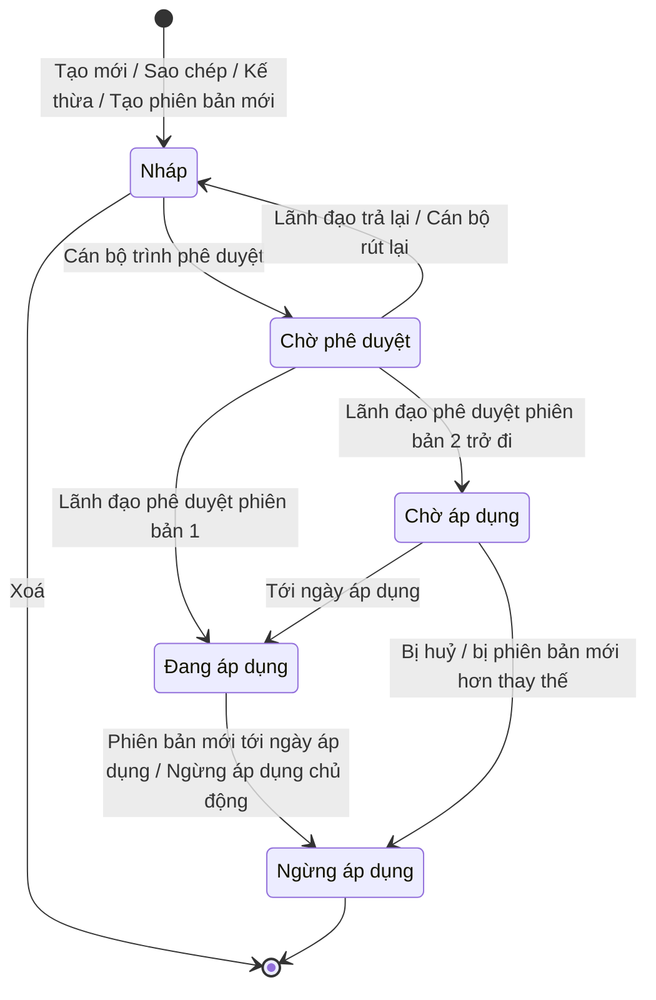

### 4.4. Phân quyền

| Thao tác | Cán bộ 2A | Cán bộ 2B — sự kiện của đơn vị | Cán bộ 2B — sự kiện của 2A cùng ngành | Lãnh đạo phê duyệt | Đơn vị khác cùng cấp | Quản trị Cấp 1 |
|---|---|---|---|---|---|---|
| Xem | ✅ | ✅ | ✅ Đang áp dụng, Chờ áp dụng | ✅ | ❌ | ✅ trạng thái đã công bố |
| Tạo mới, sao chép | ✅ | ✅ | ✅ kế thừa khi được uỷ quyền | ❌ | ❌ | ❌ |
| Sửa, xoá bản nháp | ✅ | ✅ | ❌ | ❌ | ❌ | ❌ |
| Trình phê duyệt, rút lại | ✅ | ✅ | ❌ | ❌ | ❌ | ❌ |
| Phê duyệt và công bố, trả lại | ❌ | ❌ | ❌ | ✅ (không tự duyệt bản mình soạn) | ❌ | ❌ |
| Huỷ chờ áp dụng, ngừng áp dụng | Đề xuất | Đề xuất | ❌ | ✅ | ❌ | ❌ |
| Tạo phiên bản mới | ✅ | ✅ | ❌ | ❌ | ❌ | ❌ |

---

## 5. Quy định cấu hình 7 bước

### 5.1. Nguyên tắc chung
1. **Tuần tự.** Hệ thống chỉ mở bước sau khi bước trước hợp lệ. Cán bộ được quay lại sửa các bước trước, trừ bước 1. Khi đó hệ thống đánh dấu những lựa chọn ở bước sau không còn phù hợp để cán bộ xác nhận lại.
2. **Loại sự kiện không đổi.** Sau khi cán bộ rời bước 1, hệ thống khoá loại sự kiện.
3. **Chỉ chọn từ danh mục.** Hệ thống chỉ hiển thị giá trị đang hiệu lực trong bộ lõi quốc gia và danh mục chuyên ngành đã ánh xạ, không có ô nhập tự do.
4. **Gợi ý, không ép buộc.** Hệ thống gợi ý và sắp xếp lựa chọn phù hợp, nhưng chấp nhận lựa chọn khác gợi ý. Hệ thống chỉ chặn khi vi phạm ràng buộc bắt buộc của chuẩn (mục 5.3).

### 5.2. Chi tiết từng bước

**Bước 1 — Loại sự kiện.**
- Hệ thống hiển thị các loại sự kiện đang hiệu lực, mỗi loại kèm mô tả và ví dụ.
- Cán bộ chọn một loại.
- Loại sự kiện quyết định: danh sách bước nghiệp vụ ở bước 2; bước 3 có xuất hiện không; trường thông tin nào bắt buộc, trường thông tin nào bị cấm ở bước 6.

**Bước 2 — Bước nghiệp vụ.**
- Hệ thống lọc danh sách theo loại sự kiện, chia ba mức:
  - **Khuyến nghị**: hiển thị đầu danh sách;
  - **Ít dùng**: hiển thị kèm cảnh báo, hỏi xác nhận khi chọn;
  - **Không phù hợp**: ẩn.
- Cán bộ chọn một bước nghiệp vụ.

**Bước 3 — Hành động (hệ thống tự gợi ý).**
- Hệ thống tự chọn sẵn hành động gợi ý theo cặp loại sự kiện + bước nghiệp vụ (bảng 5.4). Cán bộ giữ nguyên hoặc đổi sang Tạo mới, Ghi nhận hoặc Kết thúc.
- Với sự kiện chế biến, hệ thống bỏ qua bước này vì loại sự kiện chế biến không có hành động.
- Hành động quyết định phần thông tin lô / cá thể ở bước 6 có được mở hay không.
- Khi cán bộ quay lại đổi bước nghiệp vụ, hệ thống tính lại hành động gợi ý. Nếu hành động đang chọn khác gợi ý mới, hệ thống đánh dấu vàng để cán bộ xác nhận lại. **[Bổ sung]**

**Bước 4 — Trạng thái hàng hoá và trạng thái duy trì.**
- Hệ thống chọn sẵn trạng thái hàng hoá gợi ý theo loại sự kiện, bước nghiệp vụ và hành động; cán bộ giữ hoặc đổi.
- Cán bộ có thể chọn thêm trạng thái duy trì, tức trạng thái được giữ qua các sự kiện sau, ví dụ "đạt kiểm tra".

**Bước 5 — Loại chứng từ giao dịch.**
- Cán bộ chọn một hoặc nhiều loại trong 9 loại chứng từ chuẩn.
- Sự kiện giao dịch bắt buộc có ít nhất một loại. Với loại sự kiện khác, bước này là tuỳ chọn.

**Bước 6 — Trường thông tin và thông tin lô / cá thể.**
- Hệ thống lọc trường thông tin theo loại sự kiện, nhóm theo năm câu hỏi.
- Hệ thống khoá sẵn trường thông tin bắt buộc theo chuẩn và ẩn trường thông tin bị cấm.
- Với mỗi trường thông tin, cán bộ chọn mức Bắt buộc, Bắt buộc có điều kiện (kèm mô tả điều kiện) hoặc Tuỳ chọn, và viết hướng dẫn điền tối đa 500 ký tự.
- Phần thông tin lô / cá thể chỉ mở khi: sự kiện theo dõi đối tượng có hành động Tạo mới, hoặc sự kiện chế biến (cho đầu ra).
- Cán bộ phải chọn ít nhất một trường thông tin ngoài nhóm hệ thống tự bắt buộc.

**Bước 7 — Yêu cầu bổ sung (tuỳ chọn).**
- **Ngưỡng cảm biến**: chỉ mở khi cán bộ đã chọn trường thông tin cảm biến ở bước 6.
- **Yêu cầu chứng nhận**: chỉ mở khi cán bộ đã chọn trường thông tin chứng nhận.
- **Yêu cầu bằng chứng** (ảnh, phiếu kiểm nghiệm, biên bản giao nhận). **[Theo Quyển 2/3]**
- **Mô tả khi nào phải áp dụng sự kiện.**

### 5.3. Ràng buộc bắt buộc theo loại sự kiện

| Loại sự kiện | Dùng khi | Hành động | Trường thông tin hệ thống tự bắt buộc | Trường thông tin không được dùng | Thông tin lô / cá thể | Chứng từ giao dịch |
|---|---|---|---|---|---|---|
| Theo dõi đối tượng | Đối tượng, lô hàng được tạo, quan sát, kết thúc | Có | Thời điểm xảy ra, múi giờ, mã đối tượng **hoặc** số lượng theo lô | Mã bao bì chứa, hàng bên trong, đầu vào / đầu ra chế biến | Chỉ khi Tạo mới | Tuỳ chọn |
| Đóng gói / gom hàng | Gom vào thùng, pallet, container hoặc tháo ra | Có | Thời điểm, múi giờ, mã bao bì chứa (khi Tạo mới / Kết thúc), hàng bên trong | Đối tượng đơn lẻ, đầu vào / đầu ra | Không | Tuỳ chọn |
| Chế biến / biến đổi | Nguyên liệu thành sản phẩm | **Không có** | Thời điểm, múi giờ, đầu vào và/hoặc đầu ra | Mã bao bì chứa, đối tượng đơn lẻ | Có, cho đầu ra | Tuỳ chọn |
| Giao dịch | Gắn hàng hoá với giao dịch | Có | Thời điểm, múi giờ, **chứng từ giao dịch**, mã đối tượng hoặc số lượng | Đầu vào / đầu ra | Không | **Bắt buộc ≥ 1** |
| Liên kết | Gắn thiết bị, tài sản với nhau | Có | Thời điểm, múi giờ, đối tượng chính, đối tượng được gắn | Đối tượng đơn lẻ, đầu vào / đầu ra | Không | Tuỳ chọn |

### 5.4. Gợi ý hành động theo bước nghiệp vụ **[Bổ sung]**

Bảng dưới đây là quy tắc gợi ý mặc định. Hệ thống dùng bảng này để tự chọn sẵn hành động ở bước 3; cán bộ được đổi sang hành động khác. Bảng đầy đủ do phân hệ Quản lý danh mục Bước nghiệp vụ của Cấp 1 duy trì và cần chuyên gia nghiệp vụ duyệt.

| Bước nghiệp vụ (ví dụ) | Loại sự kiện | Hành động gợi ý | Lý do |
|---|---|---|---|
| Thu hoạch, Kích hoạt định danh, Mã hoá nhãn | Theo dõi đối tượng | Tạo mới | Đối tượng hoặc lô bắt đầu vòng đời tại sự kiện này |
| Xuất hàng, Nhận hàng, Vận chuyển, Lưu kho, Kiểm tra, Lấy mẫu | Theo dõi đối tượng | Ghi nhận | Đối tượng đã tồn tại, chỉ được quan sát lại |
| Tiêu huỷ, Huỷ kích hoạt, Bán lẻ cho người tiêu dùng | Theo dõi đối tượng | Kết thúc | Đối tượng kết thúc vòng đời |
| Đóng gói, Xếp lên phương tiện | Đóng gói / gom hàng | Tạo mới | Hình thành đơn vị chứa mới |
| Tháo dỡ, Dỡ khỏi phương tiện | Đóng gói / gom hàng | Kết thúc | Tách hàng khỏi đơn vị chứa |
| Xuất hàng, Nhận hàng (kèm chứng từ) | Giao dịch | Ghi nhận | Gắn chứng từ cho hàng đã tồn tại |
| Gắn cảm biến | Liên kết | Tạo mới | Hình thành liên kết mới |
| Biến đổi, Chế biến | Chế biến / biến đổi | Không áp dụng | Loại sự kiện chế biến không có hành động |

---

## 6. Quy tắc nghiệp vụ

Mỗi quy tắc được viết với đầy đủ chủ thể và hành động. Chủ thể chịu trách nhiệm hoặc chịu ràng buộc được in đậm.

### 6.1. Thẩm quyền và trách nhiệm

**QT-01. Chủ sở hữu nội dung.** **Hệ thống** ghi nhận cơ quan của người tạo làm chủ sở hữu nội dung ngay khi Sự kiện trọng yếu được lưu lần đầu. **Hệ thống** không cho phép bất kỳ người dùng nào thay đổi chủ sở hữu nội dung sau đó. Khi một Sự kiện trọng yếu được sao chép sang đơn vị khác, **hệ thống** gán chủ sở hữu nội dung của bản sao là đơn vị thực hiện sao chép. **[Theo Quyển 2/3]**

**QT-02. Cấp 1 không phê duyệt thay Cấp 2.** **Quản trị nền tảng quốc gia** chỉ tiếp nhận, kiểm tra tính tương thích với bộ lõi và đăng ký vào danh mục tham chiếu quốc gia các Sự kiện trọng yếu đã được Cấp 2 phê duyệt. **Quản trị nền tảng quốc gia** không được sửa, không được phê duyệt và không được từ chối nội dung chuyên ngành. **[Theo Quyển 2/3]**

**QT-03. Căn cứ ban hành.** **Cán bộ tiêu chuẩn** phải khai báo căn cứ ban hành và vai trò chủ thể phải ghi nhận trước khi trình phê duyệt. **Hệ thống** chặn thao tác trình phê duyệt khi thiếu bất kỳ thông tin nào trong số này. **[Theo Quyển 2/3]**

**QT-04. Địa phương phải được uỷ quyền.** **Cán bộ tiêu chuẩn nhóm 2B** chỉ được kế thừa Sự kiện trọng yếu của nhóm 2A khi đơn vị của mình có văn bản uỷ quyền còn hiệu lực cho ngành đó. **Hệ thống** ẩn nút Kế thừa khi đơn vị chưa được uỷ quyền, và hiển thị lý do khi cán bộ mở thẻ "Sự kiện cấp trung ương". **[Theo Quyển 2/3]**

**QT-05. Tách người soạn và người phê duyệt.** **Hệ thống** không cho phép một người dùng phê duyệt bản trình do chính mình soạn hoặc trình, kể cả khi người dùng đó được giao cả hai vai trò. **[Bổ sung]**

**QT-06. Sự kiện trọng yếu không gắn ngành hàng.** **Hệ thống** không yêu cầu và không cho phép cán bộ gắn ngành hàng hay nhóm sản phẩm vào Sự kiện trọng yếu. **Cán bộ tiêu chuẩn** chỉ xác định ngành hàng, nhóm sản phẩm áp dụng khi ghép Sự kiện trọng yếu vào một Quy trình tiêu chuẩn TXNG (phân hệ riêng). **Hệ thống** cho phép một Sự kiện trọng yếu đang áp dụng được dùng trong nhiều Quy trình tiêu chuẩn TXNG của nhiều ngành hàng.

### 6.2. Cấu hình

**QT-07. Loại sự kiện không đổi.** **Hệ thống** khoá loại sự kiện ngay khi cán bộ rời bước 1, và giữ nguyên loại sự kiện qua mọi lần sửa, sao chép, kế thừa và tạo phiên bản mới. Khi cần loại sự kiện khác, **cán bộ tiêu chuẩn** phải xoá bản nháp và tạo Sự kiện trọng yếu mới.

**QT-08. Chỉ chọn từ danh mục.** **Hệ thống** chỉ cho phép cán bộ chọn các giá trị đang hiệu lực trong bộ lõi quốc gia và danh mục chuyên ngành đã ánh xạ, cho các mục: loại sự kiện, bước nghiệp vụ, trạng thái hàng hoá, loại chứng từ, trường thông tin, đơn vị đo, loại chứng nhận, loại bằng chứng. **Hệ thống** không cung cấp ô nhập tự do cho các mục này.

**QT-09. Gợi ý không chặn.** **Hệ thống** chấp nhận bước nghiệp vụ ở mức "ít dùng" sau khi cán bộ xác nhận. **Hệ thống** tự chọn sẵn hành động theo bảng 5.4 và trạng thái hàng hoá theo bảng gợi ý; **cán bộ tiêu chuẩn** được đổi sang giá trị khác, **hệ thống** chấp nhận mà không chặn và ghi nhận cảnh báo "khác gợi ý" để hiển thị khi kiểm tra tổng thể.

**QT-10. Sự kiện giao dịch phải có chứng từ.** **Hệ thống** không cho phép cán bộ hoàn thành bước 5 của sự kiện giao dịch khi chưa chọn ít nhất một loại chứng từ.

**QT-11. Thông tin lô có điều kiện.** **Hệ thống** chỉ mở phần thông tin lô / cá thể cho sự kiện theo dõi đối tượng có hành động Tạo mới và cho sự kiện chế biến. Khi cán bộ đổi hành động từ Tạo mới sang hành động khác trong lúc đã cấu hình thông tin lô, **hệ thống** hỏi xác nhận, và chỉ xoá cấu hình thông tin lô sau khi cán bộ đồng ý.

**QT-12. Số trường thông tin tối thiểu.** **Hệ thống** không cho phép cán bộ lưu bản nháp hoàn thiện khi chưa có ít nhất một trường thông tin ngoài nhóm hệ thống tự bắt buộc.

**QT-13. Ngưỡng cảm biến hợp lệ.** **Hệ thống** không cho phép lưu ngưỡng cảm biến có giá trị nhỏ nhất lớn hơn hoặc bằng giá trị lớn nhất, hoặc thiếu đơn vị đo.

**QT-14. Tên không trùng.** **Hệ thống** không cho phép hai mã Sự kiện trọng yếu khác nhau trong cùng một đơn vị có tên trùng nhau. Hệ thống so sánh tên không phân biệt chữ hoa, chữ thường và bỏ qua khoảng trắng thừa. **[Bổ sung]**

### 6.3. Kế thừa giữa trung ương và địa phương

**QT-15. Địa phương chỉ thêm chặt hơn trung ương.** **Cán bộ tiêu chuẩn nhóm 2B** chỉ được thêm yêu cầu hoặc siết chặt yêu cầu so với Sự kiện trọng yếu kế thừa. **Hệ thống** chặn ngay tại ô nhập mọi thao tác làm suy giảm yêu cầu, gồm:
- đổi loại sự kiện, hành động, bước nghiệp vụ, trạng thái hàng hoá;
- bỏ hoặc hạ mức trường thông tin bắt buộc;
- bỏ loại chứng từ, chứng nhận, bằng chứng, trạng thái duy trì mà trung ương đã đặt;
- nới rộng ngưỡng cảm biến.

Mỗi lần chặn, **hệ thống** nêu rõ yêu cầu gốc của trung ương.

**QT-16. Ngành chỉ thêm chặt hơn bộ lõi.** **Hệ thống** chặn mọi cấu hình làm suy giảm yêu cầu tối thiểu của bộ lõi quốc gia. **[Theo Quyển 2/3]**

**QT-17. Phân biệt yêu cầu gốc và yêu cầu bổ sung.** **Hệ thống** gắn nhãn "Yêu cầu cấp trung ương" cho yêu cầu kế thừa, và nhãn "Bổ sung cấp địa phương" cho yêu cầu do nhóm 2B thêm. **[Bổ sung]**

**QT-18. Báo địa phương khi trung ương thay đổi.** Khi **lãnh đạo phê duyệt nhóm 2A** công bố phiên bản mới, huỷ phiên bản chờ áp dụng hoặc ngừng áp dụng một Sự kiện trọng yếu, **hệ thống** gửi thông báo cho mọi đơn vị nhóm 2B đã kế thừa sự kiện đó. **Hệ thống** không tự động thay đổi Sự kiện trọng yếu của nhóm 2B. **[Bổ sung]**

**QT-19. Kiểm tra lại khi địa phương trình.** Khi **cán bộ nhóm 2B** trình phê duyệt Sự kiện trọng yếu kế thừa, **hệ thống** đối chiếu QT-15 với phiên bản đang áp dụng mới nhất của sự kiện gốc. Nếu trung ương đã siết chặt hơn sau thời điểm kế thừa, hệ thống báo lỗi. **[Bổ sung]**

### 6.4. Sửa, xoá, kiểm tra

**QT-20. Chỉ bản nháp được sửa và xoá.** **Hệ thống** chỉ cho phép sửa và xoá Sự kiện trọng yếu ở trạng thái Nháp. Với bản Chờ phê duyệt, **cán bộ tiêu chuẩn** phải rút lại về Nháp trước khi sửa. Với bản đã công bố, **cán bộ tiêu chuẩn** phải tạo phiên bản mới.

**QT-21. Không xoá khi đang được dùng.** **Hệ thống** không cho phép xoá bản nháp đang nằm trong một Quy trình tiêu chuẩn TXNG, kể cả quy trình ở trạng thái nháp. **Hệ thống** liệt kê tên các quy trình đang chứa sự kiện đó.

**QT-22. Một người sửa tại một thời điểm.** Khi một **cán bộ tiêu chuẩn** đang sửa bản nháp, **hệ thống** mở bản nháp ở chế độ chỉ xem cho người khác, kèm tên người đang sửa và thời điểm bắt đầu. **Hệ thống** tự mở khoá sau 30 phút không thao tác. **[Bổ sung]**

**QT-23. Kiểm tra tổng thể trước khi trình.** **Hệ thống** chạy kiểm tra tổng thể mỗi khi cán bộ trình phê duyệt. **Hệ thống** chặn trình khi còn lỗi. **Hệ thống** chỉ cho trình khi còn cảnh báo nếu cán bộ đã xác nhận đã đọc cảnh báo.

### 6.5. Phê duyệt, công bố, hiệu lực

**QT-24. Giới hạn phiên bản đồng thời.** **Hệ thống** bảo đảm mỗi mã sự kiện, tại mọi thời điểm, có tối đa một phiên bản Đang áp dụng, một phiên bản Chờ áp dụng và một phiên bản đang soạn (Nháp hoặc Chờ phê duyệt).

**QT-25. Phiên bản 1 áp dụng ngay.** Khi **lãnh đạo phê duyệt** phê duyệt một Sự kiện trọng yếu chưa từng có phiên bản Đang áp dụng, **hệ thống** chuyển phiên bản đó sang Đang áp dụng ngay tại thời điểm phê duyệt.

**QT-26. Phiên bản 2 trở đi có ngày áp dụng tương lai.** Khi trình phiên bản 2 trở đi, **cán bộ tiêu chuẩn** phải đề xuất ngày áp dụng, lý do thay đổi và quy tắc chuyển tiếp. Ngày áp dụng phải từ ngày mai trở đi; **hệ thống** gợi ý mặc định là 30 ngày sau ngày trình. **Lãnh đạo phê duyệt** được điều chỉnh ngày áp dụng khi phê duyệt, với cùng điều kiện ngày tương lai. **[Bổ sung]**

**QT-27. Phiên bản mới thay bản đang chờ.** Khi **lãnh đạo phê duyệt** công bố phiên bản mới trong lúc đã có phiên bản Chờ áp dụng, **hệ thống** chuyển phiên bản Chờ áp dụng cũ sang Ngừng áp dụng, ghi chú "Bị thay thế trước khi áp dụng".

**QT-28. Không hồi tố.** **Hệ thống** không đánh giá lại bản ghi sự kiện phát sinh trước ngày áp dụng của phiên bản mới. **Hệ thống** cung cấp cho Cấp 1 và Cấp 3 đầy đủ các phiên bản cũ kèm khoảng thời gian hiệu lực. **[Theo Quyển 2/3]**

**QT-29. Đăng ký vào danh mục quốc gia.** Ngay khi một phiên bản chuyển sang Chờ áp dụng, Đang áp dụng hoặc Ngừng áp dụng, **hệ thống** gửi phiên bản đó vào danh mục tham chiếu quốc gia của Cấp 1, kèm chủ sở hữu nội dung, phạm vi, ngày áp dụng, ngày ngừng và quy tắc chuyển tiếp. **[Theo Quyển 2/3]**

**QT-30. Không ngừng áp dụng khi đang trong quy trình hiệu lực.** **Hệ thống** không cho phép ngừng áp dụng một Sự kiện trọng yếu đang nằm trong Quy trình tiêu chuẩn TXNG đang áp dụng. **Cán bộ tiêu chuẩn** phải gỡ sự kiện khỏi quy trình trước. **[Bổ sung]**

### 6.6. Thay đổi bộ lõi quốc gia

**QT-31. Bộ lõi ngừng sử dụng một giá trị.** Khi **quản trị nền tảng quốc gia** ngừng sử dụng một giá trị trong bộ lõi:
- **Hệ thống** đánh dấu lỗi trên mọi bản Nháp và Chờ phê duyệt đang dùng giá trị đó, và chặn trình, chặn phê duyệt.
- **Hệ thống** giữ nguyên hiệu lực của mọi phiên bản Đang áp dụng và Chờ áp dụng đang dùng giá trị đó, gắn nhãn cảnh báo và thông báo cho đơn vị sở hữu.
- **Hệ thống** không tự sửa nội dung của bất kỳ phiên bản đã công bố nào. **[Bổ sung]**

---

## 7. Đặc tả tính năng

Mỗi tính năng gồm:
- mô tả;
- câu chuyện người dùng;
- đặc tả luồng chính, luồng thay thế, luồng ngoại lệ — mỗi luồng có bảng mô tả: tác nhân, sự kiện kích hoạt, điều kiện trước, các bước hành động, điều kiện sau, quy tắc nghiệp vụ áp dụng;
- sơ đồ swimlane, chia làn theo tác nhân;
- wireframe vẽ bằng Wire DSL.

### 7.1. Tạo Sự kiện trọng yếu mới

**Mô tả.**
- Cán bộ tiêu chuẩn tạo một Sự kiện trọng yếu từ đầu, qua phần thông tin chung và 7 bước cấu hình.
- Màn hình gồm ba vùng:
  - danh sách bước bên trái, mỗi bước có trạng thái chưa mở / đang làm / xong / có lỗi / không áp dụng;
  - nội dung bước hiện tại ở giữa;
  - ô tóm tắt phía trên, diễn đạt Sự kiện trọng yếu bằng một câu tự nhiên.
- Cán bộ được lưu nháp ở bất kỳ bước nào sau khi đã chọn loại sự kiện. Bản nháp chưa đủ bước bắt buộc mang nhãn "Chưa hoàn thiện". **[Bổ sung]**

**Câu chuyện người dùng**
- Là cán bộ tiêu chuẩn, tôi muốn được dẫn dắt qua từng bước, mỗi bước chỉ hiển thị lựa chọn phù hợp, để tạo được Sự kiện trọng yếu đúng chuẩn mà không phải thuộc lòng chuẩn quốc tế.
- Là cán bộ tiêu chuẩn, tôi muốn hệ thống gợi ý sẵn trạng thái hàng hoá phù hợp với bước nghiệp vụ, để tiết kiệm thời gian và tránh chọn sai.
- Là cán bộ tiêu chuẩn, tôi muốn được cảnh báo khi chọn bước nghiệp vụ ít dùng, để cân nhắc lại trước khi tiếp tục.
- Là cán bộ tiêu chuẩn, tôi muốn đặt mức bắt buộc và viết hướng dẫn điền cho từng trường thông tin, để doanh nghiệp biết chính xác phải khai báo gì.
- Là cán bộ tiêu chuẩn, tôi muốn lưu nháp giữa chừng, để tham vấn chuyên môn rồi quay lại hoàn thiện.

#### Luồng chính — LC-01: Tạo và lưu nháp Sự kiện trọng yếu

| Thuộc tính | Nội dung |
|---|---|
| Tác nhân | Cán bộ tiêu chuẩn (2A hoặc 2B); Hệ thống |
| Sự kiện kích hoạt | Cán bộ chọn "Tạo Sự kiện trọng yếu" trên trang danh sách |
| Điều kiện trước | Cán bộ đã đăng nhập, có vai trò cán bộ tiêu chuẩn; bộ lõi quốc gia có ít nhất một loại sự kiện đang hiệu lực |
| Điều kiện sau | Một Sự kiện trọng yếu phiên bản 1, trạng thái Nháp, có mã do hệ thống sinh; chủ sở hữu nội dung là đơn vị của cán bộ; nhật ký ghi nhận thao tác tạo |
| Quy tắc nghiệp vụ | QT-01, QT-07, QT-08, QT-09, QT-10, QT-11, QT-12, QT-13, QT-14, QT-16 |

**Các bước**
1. Cán bộ nhập tên và mô tả.
2. Cán bộ chọn loại sự kiện ở bước 1. Hệ thống khoá loại sự kiện và mở bước 2 với danh sách bước nghiệp vụ đã lọc.
3. Cán bộ chọn bước nghiệp vụ ở mức khuyến nghị. Hệ thống mở bước 3 và tự chọn sẵn hành động gợi ý theo bảng 5.4.
4. Cán bộ giữ hoặc đổi hành động. Hệ thống mở bước 4, chọn sẵn trạng thái hàng hoá gợi ý.
5. Cán bộ giữ hoặc đổi trạng thái hàng hoá, chọn trạng thái duy trì nếu cần.
6. Cán bộ chọn loại chứng từ ở bước 5 (bắt buộc với sự kiện giao dịch).
7. Hệ thống mở bước 6 với trường thông tin đã lọc và khoá sẵn trường thông tin bắt buộc. Cán bộ chọn thêm trường thông tin, đặt mức và viết hướng dẫn điền.
8. Cán bộ khai báo yêu cầu bổ sung ở bước 7 nếu cần.
9. Cán bộ chọn "Lưu nháp".
10. Hệ thống kiểm tra tên và số trường thông tin tối thiểu, sinh mã, lưu bản nháp, ghi nhật ký, mở trang chi tiết.

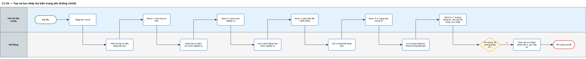

*Sơ đồ swimlane — tệp chỉnh sửa trên Draw.io: [swimlane/sl-01.drawio](swimlane/sl-01.drawio)*

#### Luồng thay thế

| Mã | Tên luồng | Tác nhân | Sự kiện kích hoạt | Điều kiện trước | Hành động | Điều kiện sau | Quy tắc |
|---|---|---|---|---|---|---|---|
| LT-01.1 | Sự kiện chế biến | Cán bộ, Hệ thống | Cán bộ chọn loại "Chế biến" ở bước 1 | Đang ở bước 1 | Sau khi cán bộ chọn bước nghiệp vụ, hệ thống bỏ qua bước 3, đánh dấu "Không áp dụng", thông báo TB-02, mở bước 4; ở bước 6, hệ thống mở thông tin lô cho đầu ra | Luồng tiếp tục từ bước 4 của LC-01 | QT-07, QT-11 |
| LT-01.2 | Chọn bước nghiệp vụ "ít dùng" | Cán bộ, Hệ thống | Cán bộ chọn bước nghiệp vụ có biểu tượng cảnh báo | Đang ở bước 2 | Hệ thống hỏi xác nhận; cán bộ chọn "Vẫn chọn" để tiếp tục hoặc "Chọn lại" để ở lại bước 2 | Bước nghiệp vụ được ghi nhận kèm cờ "ít dùng" để hiển thị cảnh báo khi kiểm tra tổng thể | QT-09 |
| LT-01.3 | Đổi hành động hoặc trạng thái khác gợi ý | Cán bộ | Cán bộ bỏ giá trị chọn sẵn ở bước 3 hoặc bước 4 | Đang ở bước 3 hoặc 4 | Cán bộ chọn giá trị khác; hệ thống chấp nhận, không chặn | Giá trị được lưu; kiểm tra tổng thể sẽ có cảnh báo "khác gợi ý" | QT-09 |
| LT-01.4 | Quay lại sửa bước trước **[Bổ sung]** | Cán bộ, Hệ thống | Cán bộ chọn một bước đã xong (2–6) trên danh sách bước | Đã đi qua bước được chọn | Cán bộ đổi lựa chọn; hệ thống tính lại gợi ý các bước sau, đánh dấu vàng lựa chọn khác gợi ý, đánh dấu đỏ trường thông tin không còn phù hợp | Các bước sau ở trạng thái "cần xác nhận lại" cho tới khi cán bộ xử lý xong | QT-07, QT-11 |
| LT-01.5 | Lưu nháp chưa hoàn thiện **[Bổ sung]** | Cán bộ, Hệ thống | Cán bộ nhấn "Lưu nháp" khi chưa xong bước 6 | Đã chọn loại sự kiện; tên hợp lệ | Hệ thống lưu bản nháp, gắn nhãn "Chưa hoàn thiện" | Bản nháp được lưu, không trình phê duyệt được | QT-12 |

#### Luồng ngoại lệ

| Mã | Tên luồng | Tác nhân | Sự kiện kích hoạt | Điều kiện trước | Hành động | Điều kiện sau | Quy tắc |
|---|---|---|---|---|---|---|---|
| NL-01.1 | Không có loại sự kiện khả dụng | Hệ thống | Mở màn hình tạo mới | Bộ lõi không còn loại sự kiện đang hiệu lực | Hệ thống hiển thị "Chưa có loại sự kiện khả dụng, đề nghị liên hệ quản trị nền tảng quốc gia", khoá nút Tiếp tục | Không có bản nháp nào được tạo | QT-08 |
| NL-01.2 | Trùng tên | Cán bộ, Hệ thống | Cán bộ nhấn "Lưu nháp" | Tên trùng với Sự kiện trọng yếu khác của đơn vị | Hệ thống báo TB-06 tại ô Tên, không lưu | Cán bộ ở lại màn hình để sửa tên | QT-14 |
| NL-01.3 | Thiếu trường thông tin | Cán bộ, Hệ thống | Cán bộ nhấn "Tiếp tục" ở bước 6 | Chỉ có trường thông tin hệ thống tự bắt buộc | Hệ thống báo TB-05, giữ cán bộ ở bước 6 | Bước 6 ở trạng thái "có lỗi" | QT-12 |
| NL-01.4 | Sự kiện giao dịch thiếu chứng từ | Cán bộ, Hệ thống | Cán bộ nhấn "Tiếp tục" ở bước 5 | Loại sự kiện là giao dịch, chưa chọn chứng từ | Hệ thống báo TB-03, giữ ở bước 5 | Bước 5 ở trạng thái "có lỗi" | QT-10 |
| NL-01.5 | Ngưỡng cảm biến sai | Cán bộ, Hệ thống | Cán bộ lưu ngưỡng ở bước 7 | Giá trị nhỏ nhất ≥ giá trị lớn nhất hoặc thiếu đơn vị | Hệ thống báo lỗi tại ô ngưỡng, không lưu | Ngưỡng không được lưu | QT-13 |
| NL-01.6 | Danh mục không tải được | Hệ thống | Mở một bước | Dịch vụ danh mục không phản hồi | Hệ thống báo lỗi tại bước, cung cấp nút "Thử lại", giữ nguyên dữ liệu đã nhập | Dữ liệu các bước khác không bị mất | — |
| NL-01.7 | Rời trang hoặc hết phiên khi chưa lưu **[Bổ sung]** | Cán bộ, Hệ thống | Cán bộ đóng trang hoặc phiên đăng nhập hết hạn | Có thay đổi chưa lưu | Hệ thống hỏi xác nhận rời trang; nếu hết phiên thì giữ bản tạm và hỏi khôi phục sau khi đăng nhập lại | Cán bộ không mất dữ liệu ngoài ý muốn | — |

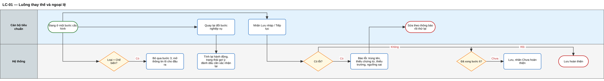

*Sơ đồ swimlane — tệp chỉnh sửa trên Draw.io: [swimlane/sl-02.drawio](swimlane/sl-02.drawio)*

#### Wireframe

Màn hình W-02 — Bước 1, chọn loại sự kiện:

```wire
project "Tạo Sự kiện trọng yếu - bước 1" {
  screen Buoc1 {
    layout split(left: 240, gap: none) {
      layout stack(padding: md) {
        component SidebarMenu items: "Tổng quan,Sự kiện trọng yếu,Quy trình tiêu chuẩn TXNG,Danh mục chuyên ngành,Nhật ký" icons: "home,layers,git-branch,book,clock" active: 1
      }
      layout stack(padding: lg, gap: md) {
        component Breadcrumbs items: "Sự kiện trọng yếu,Tạo mới"
        component Heading text: "Tạo Sự kiện trọng yếu" level: h2
        component Alert variant: info title: "Tóm tắt" text: "Theo dõi đối tượng · chưa chọn bước nghiệp vụ · hành động sẽ được gợi ý"
        layout split(left: 260, gap: lg) {
          layout card(padding: md, gap: sm, border: true) {
            component Label text: "Các bước cấu hình"
            component SidebarMenu items: "Thông tin chung,1. Loại sự kiện,2. Bước nghiệp vụ,3. Hành động (gợi ý),4. Trạng thái hàng hoá,5. Chứng từ giao dịch,6. Dữ liệu then chốt,7. Yêu cầu bổ sung" icons: "check-circle,edit,lock,lock,lock,lock,lock,lock" active: 1
          }
          layout stack(gap: md) {
            component Heading text: "Bước 1 — Chọn loại sự kiện" level: h4
            component Text text: "Loại sự kiện quyết định toàn bộ các bước sau và không thể thay đổi sau khi tiếp tục."
            layout card(padding: md, gap: xs, border: true) {
              component Radio label: "Theo dõi đối tượng — thu hoạch, xuất kho, nhận hàng" checked: true
            }
            layout card(padding: md, gap: xs, border: true) {
              component Radio label: "Đóng gói / gom hàng — đóng thùng, xếp pallet, tháo dỡ"
            }
            layout card(padding: md, gap: xs, border: true) {
              component Radio label: "Chế biến / biến đổi — nguyên liệu thành sản phẩm"
            }
            layout card(padding: md, gap: xs, border: true) {
              component Radio label: "Giao dịch — gắn hàng hoá với chứng từ mua bán"
            }
            layout card(padding: md, gap: xs, border: true) {
              component Radio label: "Liên kết — gắn cảm biến, thiết bị vào hàng hoá"
            }
            layout stack(direction: horizontal, justify: end, gap: sm) {
              component Button text: "Quay lại"
              component Button text: "Lưu nháp" icon: save
              component Button text: "Tiếp tục" variant: primary icon: "arrow-right" iconAlign: right
            }
          }
        }
      }
    }
  }
}
```

Màn hình W-03 — Bước 6, trường thông tin:

```wire
project "Tạo Sự kiện trọng yếu - bước 6" {
  mocks {
    du: "Thời điểm xảy ra,Múi giờ,Số lượng theo lô,Địa điểm nghiệp vụ,Mã lô,Ngày thu hoạch,Nhiệt độ bảo quản"
    nhom: "Khi nào,Khi nào,Cái gì,Ở đâu,Thông tin lô,Thông tin lô,Như thế nào"
    muc: "Bắt buộc (khoá),Bắt buộc (khoá),Bắt buộc (khoá),Bắt buộc,Bắt buộc,Bắt buộc có điều kiện,Tuỳ chọn"
    hd: "—,—,—,Điền mã địa điểm của kho xuất,Theo mã lô in trên bao bì,Khi sản phẩm xuất khẩu,Ghi theo nhiệt kế tại kho"
  }
  screen Buoc6 {
    layout split(left: 240, gap: none) {
      layout stack(padding: md) {
        component SidebarMenu items: "Tổng quan,Sự kiện trọng yếu,Quy trình tiêu chuẩn TXNG,Danh mục chuyên ngành,Nhật ký" icons: "home,layers,git-branch,book,clock" active: 1
      }
      layout stack(padding: lg, gap: md) {
        component Breadcrumbs items: "Sự kiện trọng yếu,Xuất kho thuỷ sản tươi,Sửa"
        component Heading text: "Bước 6 — Dữ liệu then chốt" level: h3
        component Alert variant: info title: "Tóm tắt" text: "Theo dõi đối tượng · Thu hoạch · Tạo mới (gợi ý) → Đang lưu hành · 5 dữ liệu bắt buộc"
        component Alert variant: warning title: "Lưu ý" text: "Dữ liệu có nhãn (khoá) do chuẩn yêu cầu, không bỏ được. Cần chọn ít nhất 1 dữ liệu khác."
        layout grid(columns: 4, gap: sm) {
          cell span: 2 { component Input label: "Tìm dữ liệu then chốt" placeholder: "Nhập tên dữ liệu" iconLeft: search }
          cell span: 1 { component Select label: "Nhóm câu hỏi" placeholder: "Tất cả" }
          cell span: 1 { component Button text: "Thêm dữ liệu" icon: plus labelSpace: true }
        }
        component Table columns: "Dữ liệu then chốt,Nhóm,Mức yêu cầu,Hướng dẫn điền" mock: "du,nhom,muc,hd" rows: 7 actions: "edit,trash-2"
        layout stack(direction: horizontal, justify: end, gap: sm) {
          component Button text: "Quay lại"
          component Button text: "Lưu nháp" icon: save
          component Button text: "Tiếp tục" variant: primary
        }
      }
    }
  }
}
```

---

### 7.2. Khai báo thông tin thẩm quyền và phạm vi **[Theo Quyển 2/3]**

**Mô tả.**
- Cán bộ khai báo các thông tin mà Quyển 2 yêu cầu với mọi Sự kiện trọng yếu:
  - căn cứ ban hành;
  - vai trò chủ thể phải ghi nhận;
  - văn bản uỷ quyền, với nhóm 2B khi kế thừa.
- Thông tin nằm ở thẻ "Thẩm quyền và phạm vi" trên trang chi tiết, độc lập với 7 bước. Cán bộ có thể cấu hình trước rồi bổ sung căn cứ sau.
- Hệ thống chỉ cho trình phê duyệt khi thẻ này đầy đủ.

**Câu chuyện người dùng**
- Là cán bộ tiêu chuẩn, tôi muốn gắn Sự kiện trọng yếu với văn bản làm căn cứ, để các bên biết sự kiện có hiệu lực pháp lý từ đâu.
- Là cán bộ tiêu chuẩn, tôi muốn chỉ rõ vai trò chủ thể nào trong chuỗi phải ghi nhận sự kiện, để doanh nghiệp không áp dụng nhầm khâu.

#### Luồng chính — LC-02: Khai báo thẩm quyền và phạm vi

| Thuộc tính | Nội dung |
|---|---|
| Tác nhân | Cán bộ tiêu chuẩn; Hệ thống |
| Sự kiện kích hoạt | Cán bộ mở thẻ "Thẩm quyền và phạm vi" trên bản nháp |
| Điều kiện trước | Sự kiện trọng yếu ở trạng thái Nháp, thuộc đơn vị của cán bộ, không có người khác đang sửa |
| Điều kiện sau | Thông tin thẩm quyền và phạm vi được lưu; thẻ được đánh dấu "Đầy đủ" hoặc "Chưa đầy đủ"; nhật ký ghi nhận |
| Quy tắc nghiệp vụ | QT-01, QT-03, QT-04, QT-06 |

**Các bước**
1. Hệ thống tự điền chủ sở hữu nội dung, nhóm chủ thể, phạm vi địa bàn.
2. Cán bộ nhập số hiệu, ngày, trích yếu văn bản căn cứ; đính kèm tệp văn bản.
3. Cán bộ chọn vai trò chủ thể phải ghi nhận.
4. Cán bộ nhấn "Lưu".
5. Hệ thống kiểm tra đủ thông tin bắt buộc, lưu, đánh dấu thẻ "Đầy đủ", ghi nhật ký.

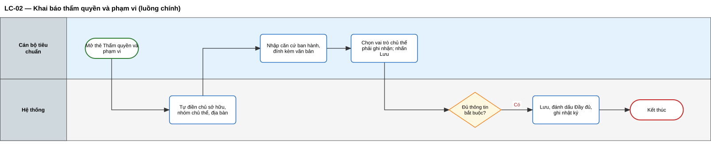

*Sơ đồ swimlane — tệp chỉnh sửa trên Draw.io: [swimlane/sl-03.drawio](swimlane/sl-03.drawio)*

#### Luồng thay thế và ngoại lệ

| Mã | Loại | Tên luồng | Tác nhân | Sự kiện kích hoạt | Điều kiện trước | Hành động | Điều kiện sau | Quy tắc |
|---|---|---|---|---|---|---|---|---|
| LT-02.2 | Thay thế | Bản nháp kế thừa | Hệ thống | Mở thẻ trên bản nháp kế thừa từ 2A | Đơn vị 2B có văn bản uỷ quyền còn hiệu lực | Hệ thống tự gắn văn bản uỷ quyền, chỉ đọc | Văn bản uỷ quyền là một phần thông tin thẩm quyền | QT-04 |
| NL-02.1 | Ngoại lệ | Văn bản uỷ quyền hết hiệu lực | Hệ thống | Mở thẻ hoặc trình phê duyệt | Văn bản uỷ quyền của đơn vị 2B đã hết hạn | Hệ thống đánh dấu lỗi "Văn bản uỷ quyền hết hiệu lực", chặn trình | Bản nháp không trình được tới khi đơn vị được uỷ quyền lại | QT-04 |
| NL-02.2 | Ngoại lệ | Thiếu thông tin bắt buộc | Hệ thống | Cán bộ nhấn "Lưu" | Thiếu căn cứ hoặc vai trò chủ thể | Hệ thống vẫn lưu phần đã nhập, đánh dấu ô còn thiếu, đánh dấu thẻ "Chưa đầy đủ" | Bản nháp chưa trình được | QT-03 |

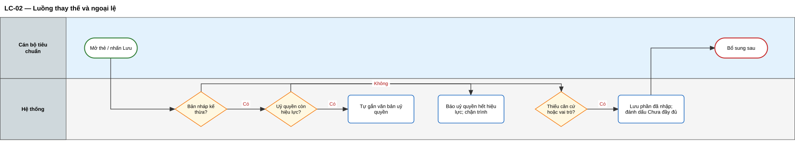

*Sơ đồ swimlane — tệp chỉnh sửa trên Draw.io: [swimlane/sl-04.drawio](swimlane/sl-04.drawio)*

#### Wireframe

Màn hình W-04 — Thẻ Thẩm quyền và phạm vi:

```wire
project "Thẩm quyền và phạm vi" {
  screen ThamQuyen {
    layout split(left: 240, gap: none) {
      layout stack(padding: md) {
        component SidebarMenu items: "Tổng quan,Sự kiện trọng yếu,Quy trình tiêu chuẩn TXNG,Danh mục chuyên ngành,Nhật ký" icons: "home,layers,git-branch,book,clock" active: 1
      }
      layout stack(padding: lg, gap: md) {
        component Breadcrumbs items: "Sự kiện trọng yếu,Xuất kho thuỷ sản tươi"
        layout stack(direction: horizontal, gap: sm) {
          component Heading text: "Xuất kho thuỷ sản tươi" level: h2
          component Badge text: "Nháp" variant: default
        }
        component Tabs items: "Cấu hình 7 bước,Thẩm quyền và phạm vi,Lịch sử phiên bản,Nhật ký,Đang dùng trong Quy trình" active: 1
        layout grid(columns: 2, gap: md) {
          cell span: 1 { component Input label: "Chủ sở hữu nội dung" placeholder: "Cục Quản lý chất lượng nông lâm sản và thuỷ sản" disabled: true }
          cell span: 1 { component Input label: "Nhóm chủ thể / Phạm vi địa bàn" placeholder: "2A — Toàn quốc" disabled: true }
          cell span: 1 { component Input label: "Căn cứ ban hành — số hiệu" placeholder: "Ví dụ: 1234/QĐ-BNNMT" }
          cell span: 1 { component Input label: "Ngày ban hành" placeholder: "dd/mm/yyyy" iconRight: calendar }
          cell span: 2 { component Textarea label: "Trích yếu văn bản" placeholder: "Về việc ban hành yêu cầu truy xuất nguồn gốc thuỷ sản" rows: 2 }
          cell span: 2 { component Select label: "Vai trò chủ thể phải ghi nhận" placeholder: "Cơ sở nuôi trồng; Cơ sở thu mua" }
          cell span: 2 { component Alert variant: info title: "Phạm vi áp dụng" text: "Sự kiện trọng yếu không gắn ngành hàng. Ngành hàng, nhóm sản phẩm được xác định khi ghép vào Quy trình tiêu chuẩn TXNG." }
          cell span: 2 { component Button text: "Đính kèm văn bản" icon: paperclip }
        }
        layout stack(direction: horizontal, justify: end, gap: sm) {
          component Button text: "Huỷ"
          component Button text: "Lưu" variant: primary icon: save
        }
      }
    }
  }
}
```

---

### 7.3. Xem và tra cứu Sự kiện trọng yếu

**Mô tả.**
- Danh sách hiển thị mỗi mã sự kiện một dòng, kèm phiên bản tiêu biểu theo thứ tự ưu tiên: Đang áp dụng → Chờ áp dụng → Chờ phê duyệt → Nháp → Ngừng áp dụng gần nhất.
- Cán bộ tìm theo tên (có hoặc không dấu) và mã; lọc theo loại sự kiện, bước nghiệp vụ, trạng thái, nguồn tạo, "đang dùng trong Quy trình tiêu chuẩn TXNG nào", nhãn "Có cảnh báo danh mục".
- Trang chi tiết có các thẻ:
  - Cấu hình 7 bước;
  - Thẩm quyền và phạm vi;
  - Lịch sử phiên bản;
  - Nhật ký;
  - Đang dùng trong Quy trình tiêu chuẩn TXNG.
- Cán bộ nhóm 2B có thêm thẻ "Sự kiện cấp trung ương". Quản trị Cấp 1 xem được Sự kiện trọng yếu đã công bố của mọi đơn vị.

**Câu chuyện người dùng**
- Là cán bộ tiêu chuẩn, tôi muốn tìm và lọc Sự kiện trọng yếu theo nhiều tiêu chí, để nhanh chóng tìm sự kiện cần rà soát.
- Là cán bộ tiêu chuẩn, tôi muốn biết Sự kiện trọng yếu đang nằm trong những Quy trình tiêu chuẩn TXNG nào, để đánh giá ảnh hưởng trước khi thay đổi.
- Là cán bộ cấp địa phương, tôi muốn xem Sự kiện trọng yếu đang áp dụng của trung ương cùng ngành, để chọn sự kiện kế thừa.
- Là quản trị nền tảng quốc gia, tôi muốn xem phiên bản có hiệu lực tại một ngày bất kỳ, để đối chiếu bản ghi sự kiện cũ.

#### Luồng chính — LC-03: Tra cứu và xem chi tiết

| Thuộc tính | Nội dung |
|---|---|
| Tác nhân | Cán bộ tiêu chuẩn, lãnh đạo phê duyệt, quản trị Cấp 1; Hệ thống |
| Sự kiện kích hoạt | Người dùng mở menu "Sự kiện trọng yếu" |
| Điều kiện trước | Người dùng đã đăng nhập và có quyền xem theo mục 4.4 |
| Điều kiện sau | Người dùng xem được danh sách và chi tiết trong phạm vi quyền; các nút thao tác hiển thị đúng quyền và trạng thái |
| Quy tắc nghiệp vụ | QT-02, QT-04, mục 4.4 |

**Các bước**
1. Hệ thống xác định vai trò, đơn vị và phạm vi xem của người dùng.
2. Hệ thống hiển thị danh sách theo phạm vi, sắp xếp theo cập nhật gần nhất.
3. Người dùng nhập từ khoá, chọn bộ lọc.
4. Hệ thống trả kết quả.
5. Người dùng chọn một Sự kiện trọng yếu.
6. Hệ thống hiển thị trang chi tiết và các nút thao tác phù hợp với quyền và trạng thái.

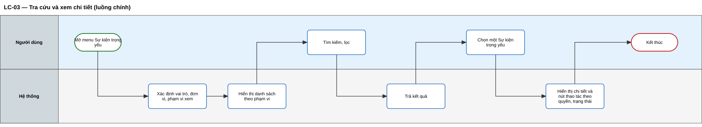

*Sơ đồ swimlane — tệp chỉnh sửa trên Draw.io: [swimlane/sl-05.drawio](swimlane/sl-05.drawio)*

#### Luồng thay thế và ngoại lệ

| Mã | Loại | Tên luồng | Tác nhân | Sự kiện kích hoạt | Điều kiện trước | Hành động | Điều kiện sau | Quy tắc |
|---|---|---|---|---|---|---|---|---|
| LT-03.1 | Thay thế | Xem sự kiện cấp trung ương | Cán bộ 2B, Hệ thống | Cán bộ mở thẻ "Sự kiện cấp trung ương" | Người dùng thuộc nhóm 2B | Hệ thống hiển thị Sự kiện trọng yếu Đang áp dụng và Chờ áp dụng của nhóm 2A cùng ngành, chỉ đọc; hiển thị nút "Kế thừa" nếu đơn vị có uỷ quyền | Cán bộ có thể chuyển sang luồng kế thừa (7.6) | QT-04 |
| LT-03.2 | Thay thế | Quản trị Cấp 1 tra theo ngày | Quản trị Cấp 1, Hệ thống | Quản trị chọn "Phiên bản có hiệu lực tại ngày" | Người dùng là quản trị Cấp 1 | Hệ thống trả về phiên bản có hiệu lực tại ngày được chọn của từng mã sự kiện | Quản trị đối chiếu được bản ghi cũ | QT-28 |
| NL-03.1 | Ngoại lệ | Không có kết quả | Hệ thống | Kết quả lọc rỗng | — | Hệ thống hiển thị màn hình trống, gợi ý xoá bộ lọc, tạo mới hoặc sao chép từ thư viện mẫu | — | — |
| NL-03.2 | Ngoại lệ | Truy cập sự kiện ngoài quyền | Hệ thống | Người dùng mở đường dẫn của Sự kiện trọng yếu thuộc đơn vị khác cùng cấp | Không có quyền xem | Hệ thống từ chối, hiển thị "Bạn không có quyền xem Sự kiện trọng yếu này" | Không lộ nội dung | Mục 4.4 |

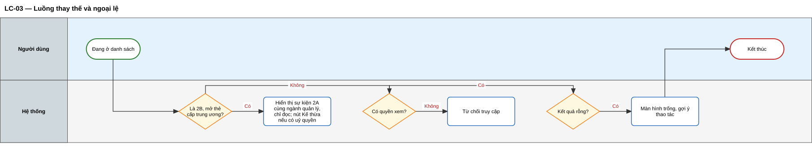

*Sơ đồ swimlane — tệp chỉnh sửa trên Draw.io: [swimlane/sl-06.drawio](swimlane/sl-06.drawio)*

#### Wireframe

Màn hình W-01 — Danh sách Sự kiện trọng yếu:

```wire
project "Danh sách Sự kiện trọng yếu" {
  mocks {
    ma: "BNNMT-SK-0012,BNNMT-SK-0011,BNNMT-SK-0010,BNNMT-SK-0009,BNNMT-SK-0008"
    ten: "Xuất kho thuỷ sản tươi,Thu hoạch tôm nuôi,Sơ chế thuỷ sản,Đóng gói thùng xuất khẩu,Nhận hàng tại cơ sở chế biến"
    loai: "Theo dõi đối tượng,Theo dõi đối tượng,Chế biến,Đóng gói / gom hàng,Theo dõi đối tượng"
    buoc: "Xuất hàng,Thu hoạch,Biến đổi,Đóng gói,Nhận hàng"
    trangthai: "Đang áp dụng,Chờ áp dụng 01/12/2026,Chờ phê duyệt,Nháp,Ngừng áp dụng 15/09/2026"
    pb: "2,1,1,3,1"
  }
  screen DanhSach {
    layout split(left: 240, gap: none) {
      layout stack(padding: md) {
        component SidebarMenu items: "Tổng quan,Sự kiện trọng yếu,Quy trình tiêu chuẩn TXNG,Danh mục chuyên ngành,Nhật ký" icons: "home,layers,git-branch,book,clock" active: 1
      }
      layout stack(padding: lg, gap: md) {
        component Breadcrumbs items: "Trang chủ,Sự kiện trọng yếu"
        layout stack(direction: horizontal, justify: spaceBetween) {
          component Heading text: "Sự kiện trọng yếu" level: h2
          layout stack(direction: horizontal, gap: sm) {
            component Button text: "Sao chép từ thư viện mẫu" icon: copy
            component Button text: "Tạo Sự kiện trọng yếu" variant: primary icon: plus
          }
        }
        component Tabs items: "Của đơn vị,Sự kiện cấp trung ương" active: 0
        layout grid(columns: 6, gap: sm) {
          cell span: 2 { component Input label: "Tìm kiếm" placeholder: "Tên hoặc mã sự kiện" iconLeft: search }
          cell span: 1 { component Select label: "Loại sự kiện" placeholder: "Tất cả" }
          cell span: 1 { component Select label: "Trạng thái" placeholder: "Tất cả" }
          cell span: 1 { component Select label: "Nguồn tạo" placeholder: "Tất cả" }
          cell span: 1 { component Checkbox label: "Có cảnh báo danh mục" }
        }
        component Table columns: "Mã,Tên,Loại sự kiện,Bước nghiệp vụ,Trạng thái,Phiên bản" mock: "ma,ten,loai,buoc,trangthai,pb" rows: 5 pagination: true actions: "eye,copy,more-vertical"
      }
    }
  }
}
```

---

### 7.4. Sửa bản nháp

**Mô tả.**
- Cán bộ sửa thông tin chung, thông tin thẩm quyền và phạm vi, và các bước 2–7 của bản nháp. Loại sự kiện chỉ xem.
- Bản đang Chờ phê duyệt phải được rút lại trước khi sửa.
- Bản đã công bố không sửa trực tiếp; cán bộ tạo phiên bản mới.
- Bản nháp kế thừa từ trung ương vẫn chịu quy tắc chỉ thêm chặt.
- Mỗi lần lưu, hệ thống ghi giá trị trước và sau.

**Câu chuyện người dùng**
- Là cán bộ tiêu chuẩn, tôi muốn sửa bản nháp theo ý kiến lãnh đạo và thấy ý kiến đó ngay trên màn hình sửa.
- Là cán bộ tiêu chuẩn, tôi muốn biết đồng nghiệp đang sửa cùng sự kiện, để tránh ghi đè lẫn nhau.
- Là cán bộ cấp địa phương, tôi muốn được chặn ngay khi vô tình nới lỏng yêu cầu của trung ương.

#### Luồng chính — LC-04: Sửa bản nháp

| Thuộc tính | Nội dung |
|---|---|
| Tác nhân | Cán bộ tiêu chuẩn; Hệ thống |
| Sự kiện kích hoạt | Cán bộ nhấn "Sửa" trên trang chi tiết |
| Điều kiện trước | Sự kiện trọng yếu ở trạng thái Nháp, thuộc đơn vị của cán bộ, không có người khác đang sửa |
| Điều kiện sau | Nội dung được cập nhật, số phiên bản giữ nguyên; nhật ký ghi giá trị trước / sau; quyền sửa được nhả |
| Quy tắc nghiệp vụ | QT-07, QT-15, QT-20, QT-22 |

**Các bước**
1. Hệ thống giữ quyền sửa cho cán bộ, mở màn hình cấu hình tại bước được chọn, hiển thị ý kiến trả lại gần nhất nếu có.
2. Cán bộ sửa nội dung.
3. Hệ thống kiểm tra tính phù hợp giữa các bước sau mỗi thay đổi.
4. Cán bộ nhấn "Lưu".
5. Hệ thống lưu, ghi nhật ký giá trị trước và sau, nhả quyền sửa.

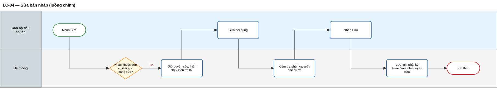

*Sơ đồ swimlane — tệp chỉnh sửa trên Draw.io: [swimlane/sl-07.drawio](swimlane/sl-07.drawio)*

#### Luồng thay thế và ngoại lệ

| Mã | Loại | Tên luồng | Tác nhân | Sự kiện kích hoạt | Điều kiện trước | Hành động | Điều kiện sau | Quy tắc |
|---|---|---|---|---|---|---|---|---|
| LT-04.1 | Thay thế | Sửa bản nháp kế thừa | Cán bộ 2B, Hệ thống | Cán bộ sửa một yêu cầu có nhãn "Yêu cầu cấp trung ương" | Bản nháp là kế thừa | Hệ thống cho phép thao tác thêm chặt; với thao tác làm suy giảm, chuyển sang NL-04.3 | Yêu cầu được siết chặt và ghi nhãn "Bổ sung cấp địa phương" | QT-15, QT-17 |
| NL-04.1 | Ngoại lệ | Sửa bản đã công bố | Hệ thống | Cán bộ nhấn "Sửa" | Trạng thái Chờ áp dụng, Đang áp dụng hoặc Ngừng áp dụng | Hệ thống báo TB-09, gợi ý "Tạo phiên bản mới" | Không có thay đổi | QT-20 |
| NL-04.2 | Ngoại lệ | Sửa bản đang trình | Hệ thống | Cán bộ nhấn "Sửa" | Trạng thái Chờ phê duyệt | Hệ thống báo TB-10, gợi ý "Rút lại" | Không có thay đổi | QT-20 |
| NL-04.3 | Ngoại lệ | Vi phạm chỉ thêm chặt | Hệ thống | Cán bộ 2B hạ mức, bỏ yêu cầu hoặc nới ngưỡng | Bản nháp là kế thừa | Hệ thống chặn tại ô, báo TB-13 / TB-14 / TB-15, khôi phục giá trị trước | Yêu cầu gốc được giữ nguyên | QT-15 |
| NL-04.4 | Ngoại lệ | Người khác đang sửa | Hệ thống | Cán bộ nhấn "Sửa" | Bản nháp đang bị khoá bởi người khác | Hệ thống mở chế độ chỉ xem, báo TB-19 | Không có thay đổi | QT-22 |

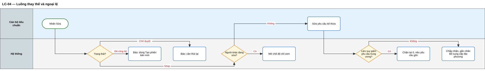

*Sơ đồ swimlane — tệp chỉnh sửa trên Draw.io: [swimlane/sl-08.drawio](swimlane/sl-08.drawio)*

#### Wireframe

Màn hình W-08 — Sửa bản nháp kế thừa, bị chặn vì hạ mức yêu cầu:

```wire
project "Kế thừa cấp trung ương" {
  mocks {
    du: "Thời điểm xảy ra,Số lượng theo lô,Địa điểm nghiệp vụ,Mã lô,Chứng nhận VietGAP"
    muc: "Bắt buộc (khoá),Bắt buộc (khoá),Bắt buộc,Bắt buộc,Bắt buộc"
    nguon: "Yêu cầu cấp trung ương,Yêu cầu cấp trung ương,Yêu cầu cấp trung ương,Yêu cầu cấp trung ương,Bổ sung cấp địa phương"
  }
  screen KeThua {
    layout split(left: 240, gap: none) {
      layout stack(padding: md) {
        component SidebarMenu items: "Tổng quan,Sự kiện trọng yếu,Quy trình tiêu chuẩn TXNG,Danh mục chuyên ngành,Nhật ký" icons: "home,layers,git-branch,book,clock" active: 1
      }
      layout stack(padding: lg, gap: md) {
        component Breadcrumbs items: "Sự kiện trọng yếu,Xuất kho thuỷ sản tươi — Hà Nội,Sửa"
        layout stack(direction: horizontal, gap: sm) {
          component Heading text: "Xuất kho thuỷ sản tươi — Hà Nội" level: h3
          component Badge text: "Kế thừa từ Bộ NN&MT — phiên bản 2" variant: indigo
        }
        component Alert variant: danger title: "Không được hạ mức yêu cầu" text: "Dữ liệu Địa điểm nghiệp vụ là bắt buộc theo yêu cầu cấp trung ương. Cấp địa phương chỉ được thêm, không được bớt."
        component Table columns: "Dữ liệu then chốt,Mức yêu cầu,Nguồn yêu cầu" mock: "du,muc,nguon" rows: 5 actions: "edit"
        layout card(padding: md, gap: sm, border: true) {
          component Label text: "Ngưỡng nhiệt độ bảo quản"
          layout grid(columns: 3, gap: sm) {
            cell span: 1 { component Input label: "Nhỏ nhất (cấp trung ương: 2)" placeholder: "3" }
            cell span: 1 { component Input label: "Lớn nhất (cấp trung ương: 8)" placeholder: "6" }
            cell span: 1 { component Select label: "Đơn vị" placeholder: "°C" disabled: true }
          }
        }
        layout stack(direction: horizontal, justify: end, gap: sm) {
          component Button text: "Lưu nháp" icon: save
          component Button text: "Kiểm tra" icon: "check-square"
        }
      }
    }
  }
}
```

---

### 7.5. Xoá bản nháp

**Mô tả.**
- Cán bộ xoá vĩnh viễn một bản nháp.
- Nếu bản nháp là phiên bản mới của Sự kiện trọng yếu đã công bố, hệ thống chỉ xoá bản nháp đó.
- Hệ thống không cho xoá bản đã trình, bản đã công bố, hoặc bản nháp đang nằm trong một Quy trình tiêu chuẩn TXNG.
- Toàn bộ nội dung bị xoá được lưu vào nhật ký để giải trình.

**Câu chuyện người dùng**
- Là cán bộ tiêu chuẩn, tôi muốn xoá bản nháp không còn dùng, để danh sách gọn gàng.
- Là cán bộ tiêu chuẩn, tôi muốn biết bản nháp đang nằm trong Quy trình tiêu chuẩn TXNG nào khi không xoá được, để xử lý đúng chỗ.

#### Luồng chính — LC-05: Xoá bản nháp

| Thuộc tính | Nội dung |
|---|---|
| Tác nhân | Cán bộ tiêu chuẩn; Hệ thống |
| Sự kiện kích hoạt | Cán bộ nhấn "Xoá" trên bản nháp |
| Điều kiện trước | Bản nháp thuộc đơn vị của cán bộ, không nằm trong Quy trình tiêu chuẩn TXNG nào |
| Điều kiện sau | Bản nháp bị xoá; nhật ký lưu toàn bộ nội dung đã xoá; nếu là phiên bản mới thì các phiên bản khác giữ nguyên, số phiên bản được dùng lại |
| Quy tắc nghiệp vụ | QT-20, QT-21 |

**Các bước**
1. Hệ thống kiểm tra trạng thái, quyền, tham chiếu từ Quy trình tiêu chuẩn TXNG.
2. Hệ thống hiển thị hộp xác nhận phù hợp: xoá cả Sự kiện trọng yếu, hoặc chỉ xoá bản nháp phiên bản n.
3. Cán bộ xác nhận.
4. Hệ thống xoá, ghi nhật ký, quay về danh sách.

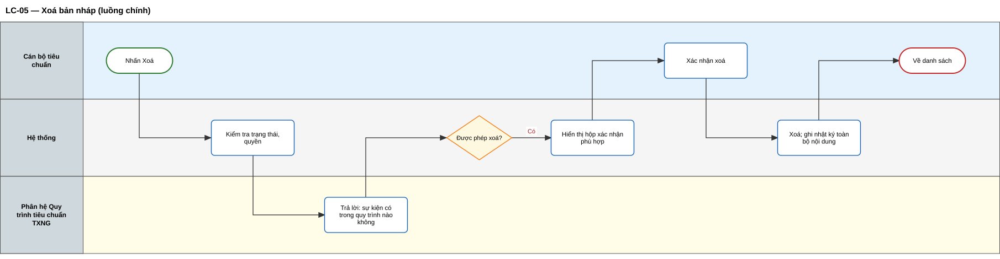

*Sơ đồ swimlane — tệp chỉnh sửa trên Draw.io: [swimlane/sl-09.drawio](swimlane/sl-09.drawio)*

#### Luồng thay thế và ngoại lệ

| Mã | Loại | Tên luồng | Tác nhân | Sự kiện kích hoạt | Điều kiện trước | Hành động | Điều kiện sau | Quy tắc |
|---|---|---|---|---|---|---|---|---|
| LT-05.1 | Thay thế | Xoá bản nháp phiên bản mới | Cán bộ, Hệ thống | Cán bộ nhấn "Xoá" | Bản nháp là phiên bản ≥ 2 | Hệ thống hỏi "Xoá bản nháp phiên bản n, các phiên bản khác giữ nguyên?"; cán bộ xác nhận | Chỉ bản nháp bị xoá; số phiên bản được dùng lại | QT-24 |
| LT-05.2 | Thay thế | Huỷ thao tác | Cán bộ | Cán bộ nhấn "Huỷ" ở hộp xác nhận | — | Hệ thống đóng hộp xác nhận | Không có thay đổi | — |
| NL-05.1 | Ngoại lệ | Đang nằm trong quy trình | Hệ thống | Cán bộ nhấn "Xoá" | Bản nháp nằm trong ít nhất một Quy trình tiêu chuẩn TXNG | Hệ thống chặn, báo TB-12 kèm danh sách quy trình | Không có thay đổi | QT-21 |
| NL-05.2 | Ngoại lệ | Không phải bản nháp | Hệ thống | Cán bộ thao tác xoá | Trạng thái khác Nháp | Hệ thống ẩn nút Xoá; nếu gọi trực tiếp thì báo TB-11 | Không có thay đổi | QT-20 |

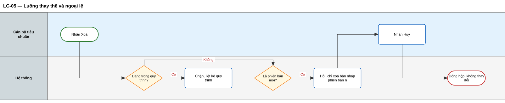

*Sơ đồ swimlane — tệp chỉnh sửa trên Draw.io: [swimlane/sl-10.drawio](swimlane/sl-10.drawio)*

---

### 7.6. Sao chép và kế thừa Sự kiện trọng yếu

**Mô tả.** Cán bộ tạo bản nháp mới bằng cách sao chép 7 bước từ một trong ba nguồn:

| Nguồn | Điều kiện nguồn | Sau khi sao chép |
|---|---|---|
| Thư viện Sự kiện trọng yếu mẫu (Cấp 1) | Mẫu đang hiệu lực | Sửa tự do bước 2–7; loại sự kiện khoá |
| Sự kiện trọng yếu của nhóm 2A cùng ngành (kế thừa, dành cho 2B) | Đang áp dụng; đơn vị 2B có uỷ quyền còn hiệu lực | Áp dụng quy tắc chỉ thêm chặt |
| Sự kiện trọng yếu của chính đơn vị | Bất kỳ phiên bản nào | Sửa tự do bước 2–7; loại sự kiện khoá |

- Thông tin thẩm quyền và phạm vi không được sao chép, vì căn cứ của nguồn không phải căn cứ của đơn vị sao chép. **[Theo Quyển 2/3]**
- Riêng khi kế thừa, hệ thống tự gắn văn bản uỷ quyền.

**Bảng "chỉ thêm chặt" khi 2B kế thừa 2A**

| Được phép | Không được phép |
|---|---|
| Thêm trường thông tin mới | Bỏ trường thông tin bắt buộc của trung ương |
| Nâng Tuỳ chọn lên Bắt buộc có điều kiện hoặc Bắt buộc | Hạ Bắt buộc xuống mức thấp hơn |
| Thêm loại chứng từ, chứng nhận, bằng chứng | Bỏ chứng từ, chứng nhận, bằng chứng trung ương đã yêu cầu |
| Thu hẹp ngưỡng cảm biến (2–8°C → 3–6°C) | Nới ngưỡng cảm biến (2–8°C → 0–10°C) |
| Thêm trạng thái duy trì | Đổi trạng thái hàng hoá, bỏ trạng thái duy trì của trung ương |
| Bổ sung hướng dẫn điền, mô tả áp dụng, đặt tên theo địa phương | Đổi loại sự kiện, hành động, bước nghiệp vụ |

**Câu chuyện người dùng**
- Là cán bộ tiêu chuẩn, tôi muốn sao chép Sự kiện trọng yếu mẫu từ thư viện quốc gia, để có điểm khởi đầu đúng chuẩn.
- Là cán bộ cấp địa phương được uỷ quyền, tôi muốn kế thừa Sự kiện trọng yếu của trung ương và bổ sung yêu cầu địa phương, để tiêu chuẩn tỉnh luôn tuân thủ tiêu chuẩn trung ương.
- Là cán bộ cấp địa phương, tôi muốn phân biệt yêu cầu của trung ương với phần địa phương bổ sung, để giải trình khi được hỏi.

#### Luồng chính — LC-06: Sao chép từ thư viện mẫu quốc gia

| Thuộc tính | Nội dung |
|---|---|
| Tác nhân | Cán bộ tiêu chuẩn; Hệ thống; Nền tảng quốc gia (cung cấp thư viện) |
| Sự kiện kích hoạt | Cán bộ nhấn "Sao chép từ thư viện mẫu", chọn một mẫu |
| Điều kiện trước | Mẫu đang hiệu lực trong thư viện |
| Điều kiện sau | Bản nháp phiên bản 1 với 7 bước được sao chép; nguồn tạo = Sao chép từ thư viện mẫu; thông tin thẩm quyền để trống; nhật ký ghi nhận |
| Quy tắc nghiệp vụ | QT-01, QT-07, QT-14, QT-31 |

**Các bước**
1. Hệ thống hiển thị thư viện Sự kiện trọng yếu mẫu đang hiệu lực.
2. Cán bộ chọn mẫu và nhấn "Sao chép".
3. Hệ thống đề xuất tên "tên mẫu + bản sao"; cán bộ sửa tên.
4. Hệ thống sao chép 7 bước, tạo bản nháp, khoá loại sự kiện, ghi nguồn, ghi nhật ký.
5. Hệ thống mở màn hình sửa bản nháp.

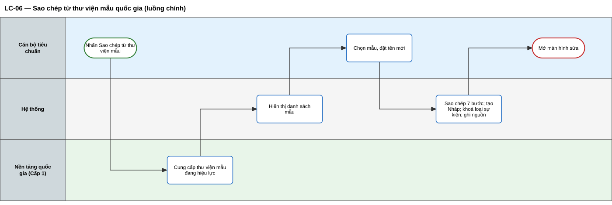

*Sơ đồ swimlane — tệp chỉnh sửa trên Draw.io: [swimlane/sl-11.drawio](swimlane/sl-11.drawio)*

#### Luồng thay thế và ngoại lệ

| Mã | Loại | Tên luồng | Tác nhân | Sự kiện kích hoạt | Điều kiện trước | Hành động | Điều kiện sau | Quy tắc |
|---|---|---|---|---|---|---|---|---|
| LT-06.1 | Thay thế | Kế thừa Sự kiện trọng yếu cấp trung ương | Cán bộ 2B, Hệ thống | Cán bộ nhấn "Kế thừa" trên sự kiện 2A | Sự kiện 2A Đang áp dụng, cùng ngành; đơn vị có uỷ quyền | Hệ thống sao chép 7 bước; khoá loại sự kiện, hành động, bước nghiệp vụ, trạng thái hàng hoá; gắn nhãn "Yêu cầu cấp trung ương"; tự gắn văn bản uỷ quyền | Bản nháp kế thừa; nguồn tạo = Kế thừa; ghi phiên bản gốc | QT-04, QT-15, QT-17 |
| LT-06.2 | Thay thế | Sao chép trong đơn vị | Cán bộ, Hệ thống | Cán bộ nhấn "Sao chép" trên sự kiện của đơn vị | Bất kỳ phiên bản nào | Như LC-06, nguồn tạo = Sao chép trong đơn vị | Bản nháp mới, độc lập với sự kiện gốc | QT-07 |
| NL-06.1 | Ngoại lệ | Chưa được uỷ quyền | Hệ thống | Cán bộ 2B mở thẻ sự kiện cấp trung ương | Đơn vị chưa có hoặc hết uỷ quyền | Hệ thống ẩn nút "Kế thừa", hiển thị TB-08 | Không tạo bản nháp | QT-04 |
| NL-06.2 | Ngoại lệ | Nguồn dùng giá trị đã ngừng sử dụng | Hệ thống | Hoàn tất sao chép | Nguồn có giá trị bộ lõi đã ngừng sử dụng | Hệ thống vẫn tạo bản nháp, đánh dấu lỗi tại các ô liên quan | Bản nháp có lỗi, phải sửa trước khi trình | QT-31 |
| NL-06.3 | Ngoại lệ | Nguồn không còn khả dụng | Hệ thống | Cán bộ nhấn "Sao chép" | Mẫu vừa bị ngừng, hoặc sự kiện 2A vừa ngừng áp dụng | Hệ thống báo "Sự kiện nguồn không còn khả dụng" | Không tạo bản nháp | — |

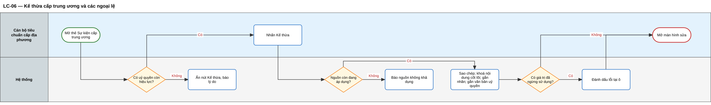

*Sơ đồ swimlane — tệp chỉnh sửa trên Draw.io: [swimlane/sl-12.drawio](swimlane/sl-12.drawio)*

---

### 7.7. Kiểm tra tổng thể và trình phê duyệt

**Mô tả.**
- Cán bộ chạy kiểm tra tổng thể bất kỳ lúc nào bằng nút "Kiểm tra"; hệ thống cũng tự chạy khi cán bộ trình.
- Kết quả chia theo lớp (cấu trúc, danh mục, thẩm quyền, phiên bản, nghiệp vụ) và theo mức:
  - **Lỗi**: chặn trình;
  - **Cảnh báo**: cho trình sau khi xác nhận đã đọc.
- Khi trình phiên bản 2 trở đi, cán bộ đề xuất ngày áp dụng, lý do thay đổi, quy tắc chuyển tiếp.
- Cán bộ chọn lãnh đạo phê duyệt.
- Cán bộ được rút lại bản đã trình.

| Lớp | Mức | Nội dung kiểm tra |
|---|---|---|
| Cấu trúc | Lỗi | Chưa chọn hành động (trừ chế biến); sự kiện giao dịch thiếu chứng từ; thiếu trường thông tin bắt buộc theo loại sự kiện; có thông tin lô không được phép; có trường thông tin bị cấm; không có trường thông tin ngoài nhóm tự bắt buộc; ngưỡng cảm biến sai |
| Danh mục | Lỗi | Có giá trị đã bị bộ lõi ngừng sử dụng |
| Thẩm quyền | Lỗi | Thiếu căn cứ, vai trò chủ thể; kế thừa thiếu hoặc hết uỷ quyền; kế thừa vi phạm chỉ thêm chặt so với phiên bản trung ương mới nhất |
| Phiên bản | Lỗi | Phiên bản 2 trở đi thiếu ngày áp dụng, lý do thay đổi, quy tắc chuyển tiếp |
| Nghiệp vụ | Cảnh báo | Bước nghiệp vụ ít dùng; hành động hoặc trạng thái khác gợi ý; trường thông tin chưa có hướng dẫn điền; phiên bản mới không khác phiên bản đang áp dụng; thời hạn chuyển tiếp dưới 30 ngày |

**Câu chuyện người dùng**
- Là cán bộ tiêu chuẩn, tôi muốn hệ thống chỉ rõ lỗi ở bước nào, để không trình lên lãnh đạo một bản sai chuẩn.
- Là cán bộ tiêu chuẩn, tôi muốn rút lại bản đã trình khi phát hiện sai sót.

#### Luồng chính — LC-07: Trình phê duyệt

| Thuộc tính | Nội dung |
|---|---|
| Tác nhân | Cán bộ tiêu chuẩn; Hệ thống; Lãnh đạo phê duyệt (nhận thông báo) |
| Sự kiện kích hoạt | Cán bộ nhấn "Trình phê duyệt" trên bản nháp |
| Điều kiện trước | Bản nháp hoàn thiện, thuộc đơn vị của cán bộ, thẻ thẩm quyền đầy đủ |
| Điều kiện sau | Trạng thái Chờ phê duyệt; bản trình bị khoá chỉnh sửa; lãnh đạo nhận thông báo TB-20; nhật ký ghi kết quả kiểm tra và các cảnh báo đã xác nhận |
| Quy tắc nghiệp vụ | QT-03, QT-04, QT-19, QT-23, QT-26, QT-31 |

**Các bước**
1. Hệ thống chạy kiểm tra tổng thể.
2. Hệ thống hiển thị kết quả: không có lỗi.
3. Cán bộ xác nhận đã đọc cảnh báo (nếu có).
4. Với phiên bản 2 trở đi, cán bộ nhập ngày áp dụng đề xuất, lý do thay đổi, quy tắc chuyển tiếp.
5. Cán bộ chọn lãnh đạo phê duyệt, nhập ghi chú trình, nhấn "Trình".
6. Hệ thống chuyển trạng thái Chờ phê duyệt, khoá chỉnh sửa, gửi thông báo cho lãnh đạo, ghi nhật ký.

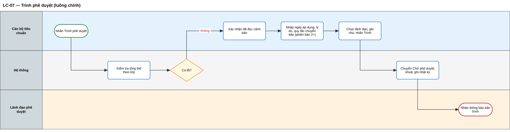

*Sơ đồ swimlane — tệp chỉnh sửa trên Draw.io: [swimlane/sl-13.drawio](swimlane/sl-13.drawio)*

#### Luồng thay thế và ngoại lệ

| Mã | Loại | Tên luồng | Tác nhân | Sự kiện kích hoạt | Điều kiện trước | Hành động | Điều kiện sau | Quy tắc |
|---|---|---|---|---|---|---|---|---|
| LT-07.1 | Thay thế | Chỉ kiểm tra, chưa trình | Cán bộ, Hệ thống | Cán bộ nhấn "Kiểm tra" | Bản nháp bất kỳ | Hệ thống chạy kiểm tra và hiển thị kết quả, không đổi trạng thái | Cán bộ biết danh sách lỗi, cảnh báo | QT-23 |
| LT-07.2 | Thay thế | Rút lại bản trình | Cán bộ, Hệ thống, Lãnh đạo | Cán bộ nhấn "Rút lại" | Trạng thái Chờ phê duyệt; người rút là cán bộ cùng đơn vị | Cán bộ nhập lý do; hệ thống chuyển về Nháp, mở khoá, thông báo cho lãnh đạo, ghi nhật ký | Trạng thái Nháp | QT-20 |
| NL-07.1 | Ngoại lệ | Còn lỗi | Hệ thống | Kết quả kiểm tra có lỗi | — | Hệ thống hiển thị danh sách lỗi theo lớp, liên kết tới chỗ cần sửa, khoá nút "Trình" | Vẫn ở Nháp | QT-23 |
| NL-07.2 | Ngoại lệ | Ngày áp dụng không hợp lệ | Hệ thống | Cán bộ nhập ngày | Ngày ≤ hôm nay | Hệ thống báo TB-17 | Chưa trình được | QT-26 |
| NL-07.3 | Ngoại lệ | Trung ương đã siết chặt sau khi kế thừa | Hệ thống | Kiểm tra bản kế thừa | Phiên bản trung ương mới nhất chặt hơn bản kế thừa | Hệ thống báo lỗi tại các yêu cầu cần nâng | Vẫn ở Nháp | QT-19 |

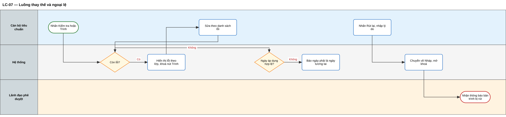

*Sơ đồ swimlane — tệp chỉnh sửa trên Draw.io: [swimlane/sl-14.drawio](swimlane/sl-14.drawio)*

#### Wireframe

Màn hình W-06 — Kiểm tra trước khi trình phê duyệt:

```wire
project "Kiểm tra và trình phê duyệt" {
  mocks {
    lop: "Thẩm quyền,Cấu trúc,Nghiệp vụ,Nghiệp vụ"
    muc: "Lỗi,Lỗi,Cảnh báo,Cảnh báo"
    nd: "Thiếu căn cứ ban hành,Sự kiện giao dịch chưa có loại chứng từ,Bước nghiệp vụ ít dùng với loại sự kiện,2 dữ liệu chưa có hướng dẫn điền"
    di: "Thẩm quyền và phạm vi,Bước 5,Bước 3,Bước 6"
  }
  screen TrinhDuyet {
    layout stack(padding: lg, gap: md) {
      component Heading text: "Xuất kho thuỷ sản tươi — phiên bản 3" level: h3
      layout modal(title: "Kiểm tra trước khi trình phê duyệt", visible: true, closable: true) {
        body {
          component Alert variant: danger title: "Còn 2 lỗi" text: "Cần sửa hết lỗi trước khi trình phê duyệt."
          component Table columns: "Lớp kiểm tra,Mức,Nội dung,Đi tới" mock: "lop,muc,nd,di" rows: 4
          component Checkbox label: "Tôi đã đọc các cảnh báo"
          component Input label: "Ngày áp dụng đề xuất" placeholder: "01/12/2026 (mặc định sau 30 ngày)" iconRight: calendar
          component Textarea label: "Lý do thay đổi" placeholder: "Siết ngưỡng nhiệt độ theo văn bản mới" rows: 2
          component Textarea label: "Quy tắc chuyển tiếp" placeholder: "Bản ghi xảy ra trước ngày áp dụng giữ theo phiên bản 2" rows: 2
          component Select label: "Lãnh đạo phê duyệt" placeholder: "Chọn lãnh đạo"
        }
        footer {
          component Button text: "Đóng"
          component Button text: "Trình phê duyệt" variant: primary disabled: true
        }
      }
    }
  }
}
```

---

### 7.8. Phê duyệt và công bố **[Theo Quyển 2/3]**

**Mô tả.** Lãnh đạo phê duyệt xem bản trình và quyết định:
- **Phê duyệt và công bố.**
  - Phiên bản 1 chuyển sang Đang áp dụng ngay.
  - Phiên bản 2 trở đi chuyển sang Chờ áp dụng theo ngày áp dụng; lãnh đạo được điều chỉnh ngày nhưng phải là ngày tương lai.
  - Sau khi công bố, hệ thống:
    - đăng ký phiên bản vào danh mục tham chiếu quốc gia;
    - thông báo cho Cấp 3, Cấp 4 đang áp dụng và các đơn vị 2B đã kế thừa.
- **Trả lại.** Lãnh đạo bắt buộc nhập ý kiến; hệ thống chuyển bản trình về Nháp.

Trang phê duyệt hiển thị:
- bảng thay đổi so với phiên bản đang áp dụng;
- cấu hình 7 bước;
- thẩm quyền và phạm vi;
- kết quả kiểm tra.

Phần này cũng mô tả luồng hệ thống tự chuyển trạng thái khi tới ngày áp dụng, và luồng lãnh đạo huỷ phiên bản chờ áp dụng.

**Câu chuyện người dùng**
- Là lãnh đạo phê duyệt, tôi muốn xem các thay đổi so với phiên bản đang áp dụng trên cùng màn hình, để quyết định nhanh và có cơ sở.
- Là lãnh đạo phê duyệt, tôi muốn điều chỉnh ngày áp dụng cho khớp ngày hiệu lực của văn bản.
- Là lãnh đạo phê duyệt, tôi muốn trả lại bản trình kèm ý kiến cụ thể.
- Là đơn vị cung cấp giải pháp, tôi muốn nhận phiên bản mới kèm ngày áp dụng và quy tắc chuyển tiếp ngay khi công bố.
- Là doanh nghiệp, tôi muốn được báo trước khi Sự kiện trọng yếu tôi đang khai báo sắp thay đổi.

#### Luồng chính — LC-08: Phê duyệt và công bố

| Thuộc tính | Nội dung |
|---|---|
| Tác nhân | Lãnh đạo phê duyệt; Hệ thống; Nền tảng quốc gia; Đơn vị cung cấp giải pháp và doanh nghiệp (nhận thông báo) |
| Sự kiện kích hoạt | Lãnh đạo mở bản Chờ phê duyệt và nhấn "Phê duyệt và công bố" |
| Điều kiện trước | Bản trình ở trạng thái Chờ phê duyệt; lãnh đạo có quyền phê duyệt của đơn vị; lãnh đạo không phải người soạn hoặc người trình |
| Điều kiện sau | Phiên bản ở trạng thái Đang áp dụng (phiên bản 1) hoặc Chờ áp dụng (phiên bản 2 trở đi); đã đăng ký vào danh mục quốc gia; thông báo đã gửi; nhật ký ghi nhận |
| Quy tắc nghiệp vụ | QT-02, QT-05, QT-18, QT-24, QT-25, QT-26, QT-27, QT-29 |

**Các bước**
1. Hệ thống hiển thị bản trình, bảng thay đổi và kết quả kiểm tra.
2. Lãnh đạo xem nội dung, giữ hoặc điều chỉnh ngày áp dụng.
3. Lãnh đạo nhấn "Phê duyệt và công bố".
4. Hệ thống chạy lại kiểm tra tổng thể; không có lỗi.
5. Hệ thống chuyển trạng thái theo QT-25 hoặc QT-26.
6. Hệ thống gửi phiên bản vào danh mục tham chiếu quốc gia.
7. Nền tảng quốc gia kiểm tra tương thích với bộ lõi và đăng ký phiên bản.
8. Hệ thống gửi thông báo TB-23 cho cán bộ soạn, TB-25 cho Cấp 3 và Cấp 4, TB-28 cho 2B đã kế thừa; ghi nhật ký.

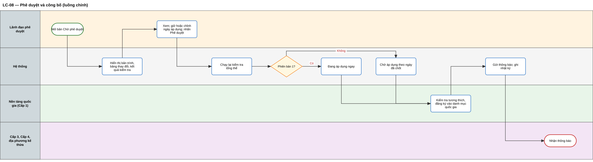

*Sơ đồ swimlane — tệp chỉnh sửa trên Draw.io: [swimlane/sl-15.drawio](swimlane/sl-15.drawio)*

#### Luồng thay thế

| Mã | Tên luồng | Tác nhân | Sự kiện kích hoạt | Điều kiện trước | Hành động | Điều kiện sau | Quy tắc |
|---|---|---|---|---|---|---|---|
| LT-08.1 | Trả lại bản trình | Lãnh đạo, Hệ thống, Cán bộ | Lãnh đạo nhấn "Trả lại" | Bản Chờ phê duyệt | Lãnh đạo nhập ý kiến (bắt buộc); hệ thống chuyển về Nháp, mở khoá, gửi TB-22 cho cán bộ, ghi nhật ký | Trạng thái Nháp; ý kiến hiển thị khi cán bộ mở sửa | QT-20 |
| LT-08.2 | Công bố khi đang có bản chờ áp dụng | Lãnh đạo, Hệ thống | Lãnh đạo phê duyệt phiên bản mới | Đã có một phiên bản Chờ áp dụng | Hệ thống hỏi xác nhận huỷ bản đang chờ; sau xác nhận, chuyển bản đang chờ sang Ngừng áp dụng ("Bị thay thế trước khi áp dụng") rồi tiếp tục LC-08 bước 5 | Chỉ còn một bản Chờ áp dụng mới | QT-24, QT-27 |
| LT-08.3 | Hệ thống tự chuyển trạng thái khi tới ngày áp dụng | Hệ thống, Nền tảng quốc gia | Lịch chạy định kỳ mỗi giờ | Có phiên bản Chờ áp dụng đã tới ngày | Hệ thống chuyển phiên bản Đang áp dụng hiện tại sang Ngừng áp dụng, chuyển bản Chờ áp dụng sang Đang áp dụng trong cùng một giao dịch; cập nhật danh mục quốc gia; cập nhật Quy trình tiêu chuẩn TXNG theo quy định của phân hệ đó; gửi TB-26; ghi nhật ký với người thực hiện là Hệ thống | Phiên bản mới có hiệu lực; phiên bản cũ ghi "Được thay thế bởi" | QT-24, QT-28, QT-29 |
| LT-08.4 | Huỷ phiên bản chờ áp dụng | Lãnh đạo, Hệ thống | Lãnh đạo nhấn "Huỷ chờ áp dụng" | Có phiên bản Chờ áp dụng | Hệ thống cảnh báo TB-24; lãnh đạo nhập lý do (bắt buộc) và xác nhận; hệ thống chuyển bản đang chờ sang Ngừng áp dụng ("Đã huỷ trước khi áp dụng"), cập nhật danh mục quốc gia, thông báo Cấp 3, Cấp 4, 2B đã kế thừa | Phiên bản Đang áp dụng giữ nguyên | QT-18, QT-29 |

#### Luồng ngoại lệ

| Mã | Tên luồng | Tác nhân | Sự kiện kích hoạt | Điều kiện trước | Hành động | Điều kiện sau | Quy tắc |
|---|---|---|---|---|---|---|---|
| NL-08.1 | Lãnh đạo tự phê duyệt | Hệ thống | Lãnh đạo mở bản trình | Lãnh đạo là người soạn hoặc người trình | Hệ thống ẩn nút phê duyệt, hiển thị TB-21 | Bản trình chờ lãnh đạo khác | QT-05 |
| NL-08.2 | Phát sinh lỗi trong lúc chờ duyệt | Hệ thống | Lãnh đạo nhấn phê duyệt | Bộ lõi vừa ngừng một giá trị, hoặc trung ương vừa siết chặt | Hệ thống báo lỗi, không cho phê duyệt, gợi ý trả lại | Vẫn ở Chờ phê duyệt | QT-19, QT-31 |
| NL-08.3 | Ngày áp dụng không hợp lệ | Hệ thống | Lãnh đạo chỉnh ngày | Ngày ≤ hôm nay | Hệ thống báo TB-17 | Chưa phê duyệt được | QT-26 |
| NL-08.4 | Chuyển trạng thái tự động thất bại | Hệ thống | Lịch chạy định kỳ | Lỗi trong giao dịch chuyển trạng thái | Hệ thống hoàn tác, giữ nguyên trạng thái cũ, báo bộ phận vận hành, thử lại lượt sau | Không có thời điểm nào có 0 hoặc 2 bản Đang áp dụng | QT-24 |
| NL-08.5 | Đăng ký danh mục quốc gia thất bại | Hệ thống, Nền tảng quốc gia | Gửi phiên bản sang Cấp 1 | Cấp 1 không phản hồi hoặc báo không tương thích | Hệ thống giữ trạng thái đã công bố, đánh dấu "Chưa đồng bộ danh mục quốc gia", thử gửi lại; nếu không tương thích thì thông báo cho cán bộ soạn và lãnh đạo | Phiên bản không bị huỷ; cần xử lý đồng bộ | QT-02, QT-29 |

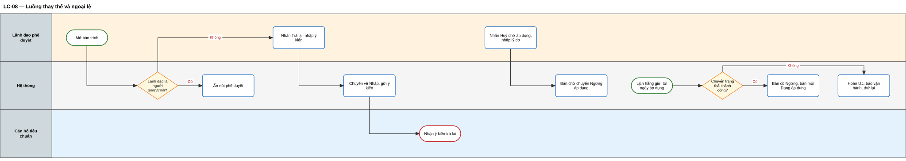

*Sơ đồ swimlane — tệp chỉnh sửa trên Draw.io: [swimlane/sl-16.drawio](swimlane/sl-16.drawio)*

#### Wireframe

Màn hình W-07 — Phê duyệt và công bố:

```wire
project "Phê duyệt" {
  mocks {
    buoc: "Bước 4,Bước 6,Bước 6,Bước 7"
    nd: "Trạng thái duy trì,Mã lô,Nhiệt độ bảo quản,Ngưỡng nhiệt độ"
    cu: "—,Tuỳ chọn,Không có,2–8°C"
    moi: "Đạt kiểm tra,Bắt buộc,Bắt buộc,2–6°C"
    kieu: "Thêm,Thay đổi,Thêm,Thay đổi"
  }
  screen PheDuyet {
    layout split(left: 240, gap: none) {
      layout stack(padding: md) {
        component SidebarMenu items: "Tổng quan,Sự kiện trọng yếu,Quy trình tiêu chuẩn TXNG,Danh mục chuyên ngành,Nhật ký" icons: "home,layers,git-branch,book,clock" active: 1
      }
      layout stack(padding: lg, gap: md) {
        component Breadcrumbs items: "Chờ phê duyệt,Xuất kho thuỷ sản tươi"
        layout stack(direction: horizontal, gap: sm) {
          component Heading text: "Phê duyệt: Xuất kho thuỷ sản tươi — phiên bản 3" level: h3
          component Badge text: "Chờ phê duyệt" variant: purple
        }
        layout grid(columns: 3, gap: md) {
          cell span: 1 { component Stat title: "Người trình" value: "Nguyễn Văn A" }
          cell span: 1 { component Stat title: "Ngày áp dụng đề xuất" value: "01/12/2026" }
          cell span: 1 { component Stat title: "Kết quả kiểm tra" value: "0 lỗi · 1 cảnh báo" }
        }
        component Tabs items: "Thay đổi so với bản đang áp dụng,Cấu hình 7 bước,Thẩm quyền và phạm vi,Kết quả kiểm tra" active: 0
        component Table columns: "Bước,Nội dung,Đang áp dụng,Phiên bản trình,Loại thay đổi" mock: "buoc,nd,cu,moi,kieu" rows: 4
        layout grid(columns: 2, gap: md) {
          cell span: 1 { component Input label: "Ngày áp dụng chốt" placeholder: "01/12/2026" iconRight: calendar }
          cell span: 1 { component Textarea label: "Ý kiến (bắt buộc khi trả lại)" rows: 2 }
        }
        layout stack(direction: horizontal, justify: end, gap: sm) {
          component Button text: "Trả lại" variant: warning icon: "corner-up-left"
          component Button text: "Phê duyệt và công bố" variant: success icon: check
        }
      }
    }
  }
}
```

---

### 7.9. Quản lý phiên bản

**Mô tả.**
- Cán bộ tạo phiên bản mới từ bản Đang áp dụng hoặc Chờ áp dụng khi tiêu chuẩn cần điều chỉnh.
- Phiên bản mới ở trạng thái Nháp, sao chép 7 bước và thông tin thẩm quyền từ bản gốc.
- Với mỗi mã sự kiện, chỉ có một bản đang soạn tại một thời điểm.
- Thẻ "Lịch sử phiên bản" hiển thị trạng thái, ngày áp dụng, ngày ngừng, căn cứ, lý do thay đổi của từng phiên bản.
- Cán bộ được xem chi tiết phiên bản cũ và so sánh hai phiên bản. **[Bổ sung]**

**Câu chuyện người dùng**
- Là cán bộ tiêu chuẩn, tôi muốn tạo phiên bản mới khi tiêu chuẩn cần điều chỉnh mà không ảnh hưởng phiên bản đang có hiệu lực.
- Là cán bộ tiêu chuẩn, tôi muốn so sánh hai phiên bản, để giải trình thay đổi khi được thanh tra, kiểm tra.

#### Luồng chính — LC-09: Tạo phiên bản mới

| Thuộc tính | Nội dung |
|---|---|
| Tác nhân | Cán bộ tiêu chuẩn; Hệ thống |
| Sự kiện kích hoạt | Cán bộ nhấn "Tạo phiên bản mới" |
| Điều kiện trước | Mã sự kiện có bản Đang áp dụng hoặc Chờ áp dụng; chưa có bản Nháp hoặc Chờ phê duyệt |
| Điều kiện sau | Bản nháp phiên bản n+1 được tạo từ bản gốc; loại sự kiện khoá; nhật ký ghi phiên bản gốc |
| Quy tắc nghiệp vụ | QT-07, QT-24 |

**Các bước**
1. Hệ thống kiểm tra điều kiện tạo phiên bản.
2. Hệ thống xác định bản gốc (bản hiện có).
3. Hệ thống tạo bản nháp phiên bản mới, sao chép 7 bước và thông tin thẩm quyền.
4. Hệ thống ghi nhật ký, mở màn hình sửa bản nháp.

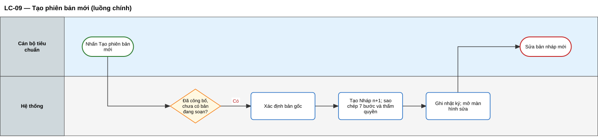

*Sơ đồ swimlane — tệp chỉnh sửa trên Draw.io: [swimlane/sl-17.drawio](swimlane/sl-17.drawio)*

#### Luồng thay thế và ngoại lệ

| Mã | Loại | Tên luồng | Tác nhân | Sự kiện kích hoạt | Điều kiện trước | Hành động | Điều kiện sau | Quy tắc |
|---|---|---|---|---|---|---|---|---|
| LT-09.1 | Thay thế | Chọn bản gốc khi có cả bản đang áp dụng và bản chờ áp dụng | Cán bộ, Hệ thống | Nhấn "Tạo phiên bản mới" | Có cả hai bản | Hệ thống hỏi chọn bản gốc, mặc định bản Chờ áp dụng | Bản nháp mới sao chép từ bản được chọn | QT-24 |
| LT-09.2 | Thay thế | So sánh hai phiên bản | Cán bộ, Hệ thống | Cán bộ chọn hai phiên bản, nhấn "So sánh" | Có ít nhất hai phiên bản | Hệ thống hiển thị khác biệt theo từng bước: thêm (xanh), bớt (đỏ), thay đổi (vàng) | — | — |
| LT-09.3 | Thay thế | Xem phiên bản đã ngừng | Cán bộ, quản trị Cấp 1 | Chọn một phiên bản Ngừng áp dụng | — | Hệ thống hiển thị chi tiết chỉ đọc, kèm thông tin "Ngừng áp dụng từ [ngày], thay thế bởi phiên bản [n]" hoặc "Đã huỷ trước khi áp dụng" | — | QT-28 |
| NL-09.1 | Ngoại lệ | Đã có bản đang soạn | Hệ thống | Nhấn "Tạo phiên bản mới" | Đã có bản Nháp hoặc Chờ phê duyệt | Hệ thống báo TB-18 | Không tạo bản mới | QT-24 |

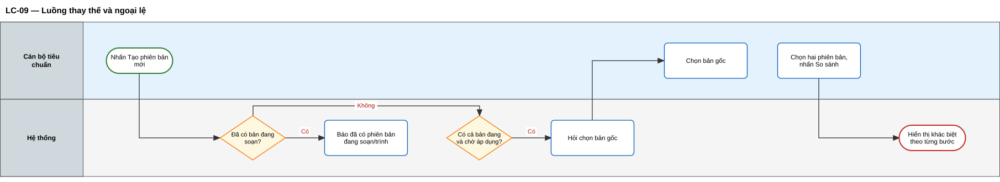

*Sơ đồ swimlane — tệp chỉnh sửa trên Draw.io: [swimlane/sl-18.drawio](swimlane/sl-18.drawio)*

#### Wireframe

Màn hình W-05 — Lịch sử phiên bản:

```wire
project "Lịch sử phiên bản" {
  mocks {
    pb: "4,3,2,1"
    tt: "Nháp,Chờ áp dụng,Đang áp dụng,Ngừng áp dụng"
    ad: "—,01/12/2026,01/08/2026,15/03/2026"
    ng: "—,—,—,01/08/2026"
    cc: "—,1234/QĐ-BNNMT,0987/QĐ-BNNMT,0456/QĐ-BNNMT"
    ly: "Bổ sung nhiệt độ,Siết ngưỡng 2-6°C,Thêm mã lô bắt buộc,Ban hành lần đầu"
  }
  screen LichSu {
    layout split(left: 240, gap: none) {
      layout stack(padding: md) {
        component SidebarMenu items: "Tổng quan,Sự kiện trọng yếu,Quy trình tiêu chuẩn TXNG,Danh mục chuyên ngành,Nhật ký" icons: "home,layers,git-branch,book,clock" active: 1
      }
      layout stack(padding: lg, gap: md) {
        component Breadcrumbs items: "Sự kiện trọng yếu,Xuất kho thuỷ sản tươi"
        layout stack(direction: horizontal, justify: spaceBetween) {
          layout stack(direction: horizontal, gap: sm) {
            component Heading text: "Xuất kho thuỷ sản tươi" level: h2
            component Badge text: "Đang áp dụng — phiên bản 2" variant: success
          }
          layout stack(direction: horizontal, gap: sm) {
            component Button text: "Sao chép" icon: copy
            component Button text: "Ngừng áp dụng" variant: danger
            component Button text: "Tạo phiên bản mới" variant: primary icon: "git-branch"
          }
        }
        component Tabs items: "Cấu hình 7 bước,Thẩm quyền và phạm vi,Lịch sử phiên bản,Nhật ký,Đang dùng trong Quy trình" active: 2
        layout stack(direction: horizontal, gap: sm) {
          component Select label: "So sánh phiên bản" placeholder: "Phiên bản 2"
          component Select label: "với" placeholder: "Phiên bản 3"
          component Button text: "So sánh" icon: columns labelSpace: true
        }
        component Table columns: "Phiên bản,Trạng thái,Ngày áp dụng,Ngày ngừng,Căn cứ ban hành,Lý do thay đổi" mock: "pb,tt,ad,ng,cc,ly" rows: 4 actions: "eye"
      }
    }
  }
}
```

---

### 7.10. Ngừng áp dụng và xử lý thay đổi bộ lõi quốc gia **[Bổ sung]**

**Mô tả.**
- **Ngừng áp dụng chủ động.** Lãnh đạo chấm dứt hiệu lực một Sự kiện trọng yếu mà không có phiên bản thay thế.
  - Lãnh đạo chọn ngừng ngay hoặc theo ngày tương lai; bắt buộc có lý do và căn cứ.
  - Hệ thống không cho thực hiện khi sự kiện đang nằm trong Quy trình tiêu chuẩn TXNG đang áp dụng.
  - Phiên bản chờ áp dụng, nếu có, bị huỷ theo.
- **Bộ lõi ngừng sử dụng một giá trị.** Hệ thống phát hiện các Sự kiện trọng yếu bị ảnh hưởng và xử lý theo QT-31.
- **Trung ương ngừng áp dụng.** Các đơn vị 2B đã kế thừa được thông báo; sự kiện của 2B không bị tự động ngừng.

**Câu chuyện người dùng**
- Là lãnh đạo phê duyệt, tôi muốn ngừng áp dụng một Sự kiện trọng yếu không còn phù hợp, và hẹn ngày ngừng cho khớp văn bản.
- Là cán bộ tiêu chuẩn, tôi muốn được cảnh báo khi bộ lõi ngừng sử dụng giá trị mà Sự kiện trọng yếu của tôi đang dùng.
- Là cán bộ cấp địa phương, tôi muốn được báo khi trung ương ngừng áp dụng sự kiện mà địa phương đang kế thừa.

#### Luồng chính — LC-10: Ngừng áp dụng chủ động

| Thuộc tính | Nội dung |
|---|---|
| Tác nhân | Lãnh đạo phê duyệt; Hệ thống; Nền tảng quốc gia; Cấp 3, Cấp 4, 2B đã kế thừa (nhận thông báo) |
| Sự kiện kích hoạt | Lãnh đạo nhấn "Ngừng áp dụng" trên Sự kiện trọng yếu Đang áp dụng |
| Điều kiện trước | Sự kiện không nằm trong Quy trình tiêu chuẩn TXNG đang áp dụng |
| Điều kiện sau | Phiên bản Đang áp dụng (và Chờ áp dụng nếu có) chuyển Ngừng áp dụng tại thời điểm đã chọn; danh mục quốc gia được cập nhật; thông báo TB-27, TB-28 đã gửi; nhật ký ghi nhận |
| Quy tắc nghiệp vụ | QT-18, QT-29, QT-30 |

**Các bước**
1. Hệ thống kiểm tra sự kiện có nằm trong Quy trình tiêu chuẩn TXNG đang áp dụng không.
2. Hệ thống hiển thị hộp ngừng áp dụng.
3. Lãnh đạo chọn "Ngừng ngay", nhập căn cứ và lý do, xác nhận.
4. Hệ thống chuyển trạng thái, cập nhật danh mục quốc gia, gửi thông báo, ghi nhật ký.

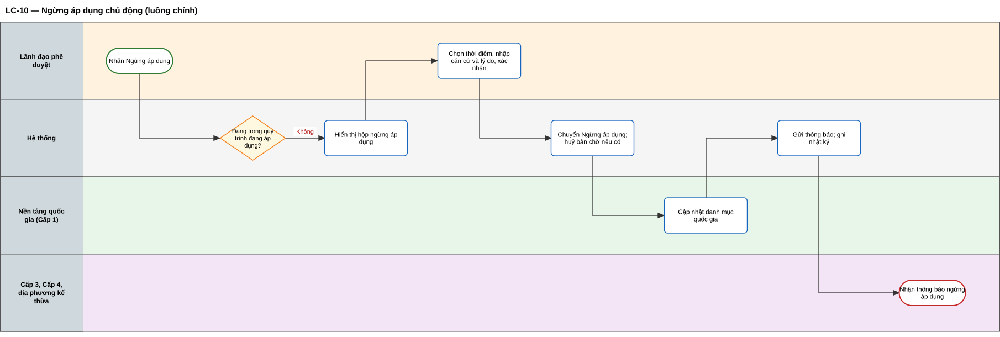

*Sơ đồ swimlane — tệp chỉnh sửa trên Draw.io: [swimlane/sl-19.drawio](swimlane/sl-19.drawio)*

#### Luồng thay thế và ngoại lệ

| Mã | Loại | Tên luồng | Tác nhân | Sự kiện kích hoạt | Điều kiện trước | Hành động | Điều kiện sau | Quy tắc |
|---|---|---|---|---|---|---|---|---|
| LT-10.1 | Thay thế | Hẹn ngày ngừng áp dụng | Lãnh đạo, Hệ thống | Lãnh đạo chọn "Ngừng từ ngày" | Ngày ở tương lai | Hệ thống ghi lịch, hiển thị nhãn "Sẽ ngừng áp dụng từ [ngày]"; tới ngày, hệ thống tự chuyển trạng thái như LC-10 bước 4 | Sự kiện vẫn Đang áp dụng tới ngày hẹn | QT-29 |
| LT-10.2 | Thay thế | Có phiên bản chờ áp dụng | Lãnh đạo, Hệ thống | Xác nhận ngừng | Có bản Chờ áp dụng | Hệ thống cảnh báo bản chờ sẽ bị huỷ theo; sau xác nhận, chuyển cả hai bản sang Ngừng áp dụng | Không còn phiên bản hiệu lực | QT-24 |
| LT-10.3 | Thay thế | Cán bộ đề xuất ngừng áp dụng | Cán bộ, Lãnh đạo | Cán bộ nhấn "Đề xuất ngừng áp dụng" | Cán bộ thuộc đơn vị sở hữu | Cán bộ nhập lý do; hệ thống gửi đề xuất cho lãnh đạo | Lãnh đạo tiếp tục LC-10 | — |
| LT-10.4 | Thay thế | Bộ lõi ngừng sử dụng một giá trị | Quản trị Cấp 1, Hệ thống, Cán bộ | Quản trị Cấp 1 ngừng sử dụng một giá trị | Có Sự kiện trọng yếu đang dùng giá trị đó | Hệ thống tìm sự kiện bị ảnh hưởng; đánh dấu lỗi bản Nháp, Chờ phê duyệt; gắn nhãn cảnh báo bản đã công bố; gửi TB-30 | Bản đã công bố giữ hiệu lực; đơn vị tạo phiên bản thay thế | QT-31 |
| LT-10.5 | Thay thế | Trung ương ngừng áp dụng | Hệ thống, Cán bộ 2B | Sự kiện 2A chuyển Ngừng áp dụng | Có đơn vị 2B đã kế thừa | Hệ thống gửi TB-28 cho đơn vị 2B; không thay đổi sự kiện của 2B | Đơn vị 2B tự quyết định | QT-18 |
| NL-10.1 | Ngoại lệ | Đang trong quy trình hiệu lực | Hệ thống | Lãnh đạo nhấn "Ngừng áp dụng" | Sự kiện nằm trong Quy trình tiêu chuẩn TXNG đang áp dụng | Hệ thống chặn, liệt kê các quy trình, yêu cầu gỡ khỏi quy trình trước | Không có thay đổi | QT-30 |
| NL-10.2 | Ngoại lệ | Thiếu lý do hoặc căn cứ | Hệ thống | Lãnh đạo xác nhận | Ô lý do hoặc căn cứ trống | Hệ thống báo lỗi tại ô | Chưa thực hiện | — |

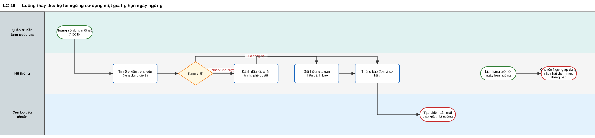

*Sơ đồ swimlane — tệp chỉnh sửa trên Draw.io: [swimlane/sl-20.drawio](swimlane/sl-20.drawio)*

#### Wireframe

Màn hình W-09 — Ngừng áp dụng:

```wire
project "Ngừng áp dụng" {
  screen Ngung {
    layout stack(padding: lg, gap: md) {
      component Heading text: "Xuất kho thuỷ sản tươi — Đang áp dụng phiên bản 2" level: h3
      layout modal(title: "Ngừng áp dụng Sự kiện trọng yếu", visible: true, closable: true) {
        body {
          component Alert variant: warning title: "Ảnh hưởng" text: "Phiên bản 3 đang chờ áp dụng sẽ bị huỷ theo. Doanh nghiệp không thể ghi nhận sự kiện này sau ngày ngừng."
          component Radio label: "Ngừng ngay" checked: true
          component Radio label: "Ngừng từ ngày"
          component Input label: "Ngày ngừng áp dụng" placeholder: "dd/mm/yyyy" iconRight: calendar disabled: true
          component Input label: "Căn cứ" placeholder: "Số hiệu văn bản"
          component Textarea label: "Lý do (bắt buộc)" rows: 3
        }
        footer {
          component Button text: "Huỷ"
          component Button text: "Xác nhận ngừng áp dụng" variant: danger
        }
      }
    }
  }
}
```

---

## 8. Danh mục thông báo

| Mã | Tình huống | Người nhận | Nội dung |
|---|---|---|---|
| TB-01 | Cố đổi loại sự kiện | Cán bộ | Loại sự kiện không thể thay đổi. Hãy tạo Sự kiện trọng yếu mới nếu cần loại khác. |
| TB-02 | Sự kiện chế biến ở bước 3 | Cán bộ | Sự kiện chế biến không có hành động — bỏ qua bước này. |
| TB-03 | Sự kiện giao dịch thiếu chứng từ | Cán bộ | Sự kiện giao dịch cần chọn ít nhất 1 loại chứng từ. |
| TB-04 | Thông tin lô bị khoá | Cán bộ | Thông tin lô chỉ áp dụng khi hành động là Tạo mới. Hành động hiện tại: [x]. |
| TB-05 | Thiếu trường thông tin | Cán bộ | Cần chọn ít nhất 1 trường thông tin ngoài các trường thông tin hệ thống tự bắt buộc. |
| TB-06 | Trùng tên | Cán bộ | Tên Sự kiện trọng yếu đã tồn tại trong đơn vị. Vui lòng đặt tên khác. |
| TB-07 | Thiếu căn cứ | Cán bộ | Vui lòng khai báo căn cứ ban hành và vai trò chủ thể trước khi trình phê duyệt. |
| TB-08 | Chưa được uỷ quyền | Cán bộ 2B | Đơn vị chưa được uỷ quyền triển khai Sự kiện trọng yếu của ngành [x]. |
| TB-09 | Sửa bản đã công bố | Cán bộ | Sự kiện trọng yếu đã công bố không sửa trực tiếp. Hãy dùng "Tạo phiên bản mới". |
| TB-10 | Sửa bản đang trình | Cán bộ | Bản này đang chờ phê duyệt. Hãy rút lại về Nháp trước khi sửa. |
| TB-11 | Xoá bản không phải nháp | Cán bộ | Chỉ bản nháp được xoá. |
| TB-12 | Xoá khi đang trong quy trình | Cán bộ | Sự kiện trọng yếu đang nằm trong Quy trình tiêu chuẩn TXNG: [danh sách]. |
| TB-13 | Địa phương bớt trường thông tin | Cán bộ 2B | Trường thông tin "[x]" là bắt buộc theo yêu cầu cấp trung ương. Cấp địa phương chỉ được thêm, không được bớt. |
| TB-14 | Địa phương đổi nội dung cốt lõi | Cán bộ 2B | Không được thay đổi loại sự kiện, hành động, bước nghiệp vụ hoặc trạng thái hàng hoá của Sự kiện trọng yếu kế thừa. |
| TB-15 | Địa phương nới ngưỡng | Cán bộ 2B | Ngưỡng cấp địa phương phải nằm trong khoảng [a–b] của yêu cầu cấp trung ương. |
| TB-16 | Thiếu ngày áp dụng | Cán bộ | Vui lòng đề xuất ngày áp dụng, lý do thay đổi và quy tắc chuyển tiếp. |
| TB-17 | Ngày không hợp lệ | Cán bộ, lãnh đạo | Ngày áp dụng phải là ngày trong tương lai. |
| TB-18 | Đã có bản đang soạn | Cán bộ | Đã có phiên bản [n] đang soạn hoặc đang trình. |
| TB-19 | Đang có người sửa | Cán bộ | Sự kiện trọng yếu đang được sửa bởi [tên] từ [giờ]. |
| TB-20 | Có bản trình mới | Lãnh đạo | [Tên cán bộ] trình phê duyệt Sự kiện trọng yếu "[tên]" phiên bản [n]. |
| TB-21 | Tự phê duyệt | Lãnh đạo | Bạn là người soạn hoặc trình bản này nên không thể tự phê duyệt. |
| TB-22 | Bị trả lại | Cán bộ | Sự kiện trọng yếu "[tên]" bị trả lại. Ý kiến: [nội dung]. |
| TB-23 | Được phê duyệt | Cán bộ | Sự kiện trọng yếu "[tên]" phiên bản [n] đã được phê duyệt, áp dụng từ [ngày]. |
| TB-24 | Huỷ bản đang chờ | Lãnh đạo | Thao tác không khuyến khích. Bạn có chắc muốn huỷ áp dụng phiên bản [n]? |
| TB-25 | Sắp thay đổi | Cấp 3, Cấp 4 | Sự kiện trọng yếu "[tên]" có phiên bản [n] áp dụng từ [ngày]. Quy tắc chuyển tiếp: [nội dung]. |
| TB-26 | Đã thay đổi | Cấp 3, Cấp 4 | Sự kiện trọng yếu "[tên]" đã chuyển sang phiên bản [n] từ hôm nay. |
| TB-27 | Ngừng áp dụng | Cấp 3, Cấp 4 | Sự kiện trọng yếu "[tên]" ngừng áp dụng từ [ngày]. Lý do: [nội dung]. |
| TB-28 | Báo địa phương kế thừa | Cán bộ 2B | Sự kiện trọng yếu cấp trung ương "[tên]" có thay đổi: [nội dung]. Đề nghị rà soát sự kiện kế thừa. |
| TB-30 | Bộ lõi thay đổi | Cán bộ | Giá trị "[x]" mà Sự kiện trọng yếu "[tên]" đang dùng đã bị ngừng sử dụng. Hãy tạo phiên bản mới để thay thế. |

## 9. Nhật ký thao tác

Hệ thống ghi nhật ký mọi thao tác; nhật ký lưu vĩnh viễn, không người dùng nào được sửa hay xoá.

| Thao tác | Thông tin được ghi |
|---|---|
| Tạo mới, sao chép, kế thừa | Người thực hiện, đơn vị, nhóm chủ thể, thời điểm, nguồn tạo, sự kiện gốc và phiên bản gốc |
| Sửa bản nháp, khai báo thẩm quyền | Từng nội dung thay đổi, giá trị trước và sau |
| Xoá bản nháp | Toàn bộ nội dung tại thời điểm xoá |
| Trình, rút lại | Người trình, lãnh đạo được trình, kết quả kiểm tra, cảnh báo đã xác nhận, lý do rút lại |
| Phê duyệt, trả lại | Lãnh đạo, quyết định, ý kiến, ngày áp dụng đã chốt |
| Huỷ chờ áp dụng, ngừng áp dụng | Lãnh đạo, lý do, căn cứ, thời điểm |
| Tự chuyển trạng thái, đồng bộ danh mục quốc gia | Người thực hiện là Hệ thống, phiên bản trước và sau, kết quả đồng bộ |
| Gửi thông báo | Loại thông báo, người nhận, thời điểm |

## 10. Phụ thuộc

| Quan hệ | Chức năng / phân hệ | Cấp | Nội dung |
|---|---|---|---|
| Cần dữ liệu từ | Quản lý danh mục tham chiếu sự kiện trọng yếu và trường thông tin | Cấp 1 | Thư viện Sự kiện trọng yếu mẫu; nơi đăng ký phiên bản đã công bố |
| Cần dữ liệu từ | Duy trì danh mục, từ điển dữ liệu và quan hệ ánh xạ dùng chung | Cấp 1 | Loại sự kiện, bước nghiệp vụ, trạng thái hàng hoá, loại chứng từ, trường thông tin, đơn vị đo, bảng gợi ý |
| Cần dữ liệu từ | Quản lý danh mục, hồ sơ và ánh xạ chuyên ngành | Cấp 2 | Danh mục chuyên ngành đã ánh xạ với bộ lõi |
| Cần dữ liệu từ | Quản lý bộ quy tắc ngành, chương trình và thị trường | Cấp 2 | Căn cứ, yêu cầu ngành |
| Cần dữ liệu từ | Quản lý địa điểm, cơ sở và điều kiện chuyên ngành | Cấp 2 | Loại địa điểm |
| Cần dữ liệu từ | Quản lý phạm vi thẩm quyền, vai trò và tư cách chuyên ngành | Cấp 2 | Nhóm 2A / 2B, quan hệ trung ương – địa phương, văn bản uỷ quyền, quyền phê duyệt |
| Cần được báo từ | Ngừng sử dụng giá trị trong bộ lõi | Cấp 1 | Gắn lỗi, cảnh báo |
| Hai chiều | Quy trình tiêu chuẩn TXNG | Cấp 2 | Quy trình dùng Sự kiện trọng yếu đang áp dụng; phân hệ này hỏi quy trình trước khi xoá, ngừng áp dụng |
| Cung cấp đầu ra cho | Cấu hình công cụ hỗ trợ định danh, sự kiện trọng yếu và bằng chứng | Cấp 3 | Phiên bản, ngày áp dụng, quy tắc chuyển tiếp |
| Cung cấp đầu ra cho | Ghi nhận và đính chính sự kiện trọng yếu | Cấp 4 | Yêu cầu khai báo, hướng dẫn điền |
| Cung cấp đầu ra cho (gián tiếp) | Tiếp nhận, kiểm tra và duy trì bản ghi sự kiện trọng yếu | Cấp 1 | Căn cứ kiểm tra bản ghi theo phiên bản có hiệu lực |

## 11. Điều kiện sẵn sàng (DoR)

- [ ] Quản lý sản phẩm đã duyệt câu chuyện người dùng, bảng đặc tả luồng, sơ đồ swimlane và wireframe của tính năng.
- [ ] Đơn vị chủ trì dự án đã xác nhận các nội dung **[Theo Quyển 2/3]** và **[Bổ sung]** liên quan.
- [ ] Chuyên gia nghiệp vụ đã duyệt bảng gợi ý, bảng ràng buộc theo loại sự kiện (5.3) và bảng chỉ thêm chặt (7.6).
- [ ] Chức năng phụ thuộc (mục 10) đã sẵn sàng hoặc có dữ liệu giả lập thống nhất.
- [ ] Giao diện chi tiết trên Figma đã duyệt, dựa trên wireframe.
- [ ] Nội dung thông báo (mục 8) liên quan đã chốt.
- [ ] Đã có dữ liệu và tài khoản kiểm thử: cán bộ và lãnh đạo nhóm 2A, 2B (có và không có uỷ quyền), quản trị Cấp 1.

## 12. Điều kiện hoàn thành (DoD)

- [ ] Luồng chính, mọi luồng thay thế và luồng ngoại lệ của tính năng chạy đúng trên môi trường kiểm thử, đạt điều kiện sau đã mô tả.
- [ ] Mỗi quy tắc nghiệp vụ liên quan có ít nhất một kịch bản kiểm thử chứng minh.
- [ ] Phân quyền đúng mục 4.4, kiểm tra ở cả giao diện và phía máy chủ.
- [ ] Nhật ký và thông báo đúng mục 8, 9.
- [ ] Không còn lỗi mức nghiêm trọng hoặc cao.
- [ ] Quản lý sản phẩm nghiệm thu trong Sprint Review.
