# Tài liệu yêu cầu sản phẩm — Xây dựng Sự kiện trọng yếu

| Thông tin | Nội dung |
|---|---|
| Sản phẩm | NDATrace — Nền tảng quốc gia truy xuất nguồn gốc |
| Phân hệ | Xây dựng Sự kiện trọng yếu |
| Chức năng tương ứng trong Khung chức năng nghiệp vụ (Quyển 3) | Ban hành và quản lý Sự kiện trọng yếu và dữ liệu then chốt chuyên ngành — chủ thể Cấp 2 |
| Khung nghiệp vụ tương ứng (Quyển 2) | Khung Sự kiện trọng yếu và dữ liệu truy xuất nguồn gốc; Khung Yêu cầu nghiệp vụ theo ngành hàng và thị trường |
| Đối tượng sử dụng chính | Cơ quan quản lý nhà nước chuyên ngành ở trung ương (nhóm 2A) và ở địa phương (nhóm 2B) |
| Phiên bản tài liệu | 6.1 |
| Người soạn | Nguyễn Hà Cương — Quản lý sản phẩm |
| Trạng thái | Bản nháp, chờ rà soát |
| Căn cứ | Nghị định 37/2025/NĐ-CP; NDATrace Quyển 2 — Khung nghiệp vụ dùng chung (bản 4.2.0); NDATrace Quyển 3 — Khung chức năng nghiệp vụ (bản 4.3.2); chuẩn sự kiện truy xuất quốc tế GS1 EPCIS 2.0 và bộ từ vựng nghiệp vụ CBV 2.0 |

> **Quy ước đánh dấu:**
> - **[Bổ sung]** — nội dung do nhóm sản phẩm đề xuất thêm so với bản 4, để khép kín nghiệp vụ.
> - **[Theo Quyển 2/3]** — nội dung được điều chỉnh để thống nhất với Quyển 2 (Khung nghiệp vụ dùng chung) và Quyển 3 (Khung chức năng nghiệp vụ).
>
> Cả hai loại nội dung trên đều cần được xác nhận trong buổi rà soát tài liệu.

---

## 0. Thuật ngữ và đối chiếu với kiến trúc nghiệp vụ

### 0.1. Thuật ngữ dùng trong tài liệu

| Thuật ngữ | Định nghĩa trong tài liệu này |
|---|---|
| **Sự kiện trọng yếu** | Một thời điểm trong chuỗi cung ứng mà tại đó tổ chức, cá nhân sản xuất, kinh doanh bắt buộc phải ghi nhận dữ liệu để bảo đảm truy xuất được nguồn gốc, ví dụ thu hoạch, đóng gói, xuất kho, nhận hàng, chế biến. Thuật ngữ này tương ứng với thuật ngữ pháp lý "sự kiện theo dõi trọng yếu". Trong phân hệ này, "Sự kiện trọng yếu" là **bản cấu hình do cơ quan quản lý ban hành**: nó quy định một loại sự kiện phải có những thành phần nào, dữ liệu nào là bắt buộc, điều kiện hợp lệ ra sao. Quyển 2 và Quyển 3 gọi bản cấu hình này là "Mẫu CTE/KDE"; tài liệu này dùng tên chính thức theo Nghị định là **Sự kiện trọng yếu**. |
| **Bản ghi sự kiện** | Dữ liệu thực tế do tổ chức, cá nhân sản xuất, kinh doanh tạo ra khi một sự kiện xảy ra, theo đúng phiên bản Sự kiện trọng yếu đang áp dụng tại thời điểm đó. Bản ghi sự kiện **không** thuộc phạm vi phân hệ này. |
| **Dữ liệu then chốt** | Từng thông tin cụ thể phải có trong bản ghi sự kiện, ví dụ thời gian, địa điểm, mã lô, ngày sản xuất. Dữ liệu then chốt có thể bắt buộc hoặc bắt buộc có điều kiện. Một bản ghi sự kiện thiếu dữ liệu then chốt bắt buộc thì chưa hợp lệ. |
| **Thông tin lô / cá thể** | Nhóm dữ liệu then chốt mô tả đặc tính của một lô hàng hoặc một sản phẩm cá thể tại thời điểm nó được tạo ra: mã lô, ngày sản xuất, hạn sử dụng, ngày thu hoạch, xuất xứ. |
| **Quy trình truy xuất tiêu chuẩn** | Bộ gồm nhiều Sự kiện trọng yếu, được cơ quan quản lý gom lại thành yêu cầu khai báo cho một ngành hàng. Ví dụ: Quy trình "Thuỷ sản tươi" gồm các sự kiện Thu hoạch, Sơ chế, Đóng gói, Xuất kho, Nhận hàng. Quy trình được quản lý ở phân hệ riêng. Quy trình này tương ứng với khái niệm "Bộ quy tắc áp dụng nghiệp vụ" của Quyển 2. |
| **Bộ lõi quốc gia** | Tập yêu cầu tối thiểu áp dụng cho mọi ngành, do Nền tảng quốc gia (Cấp 1) duy trì. Bao gồm danh mục loại sự kiện, bước nghiệp vụ, trạng thái hàng hoá, loại chứng từ, dữ liệu then chốt dùng chung và thư viện sự kiện mẫu. |
| **Chủ sở hữu nội dung** | Cơ quan có thẩm quyền chuyên ngành chịu trách nhiệm về nội dung của một Sự kiện trọng yếu. Đây là cơ quan ban hành, không phải cá nhân cán bộ soạn thảo. |
| **Căn cứ ban hành** | Văn bản quy phạm pháp luật, quyết định hoặc văn bản hành chính làm cơ sở để cơ quan ban hành Sự kiện trọng yếu. |
| **Thời hạn chuyển tiếp** | Khoảng thời gian từ khi phiên bản mới được công bố đến khi phiên bản mới có hiệu lực. Trong khoảng này, tổ chức, cá nhân sản xuất, kinh doanh chuẩn bị để khai báo theo phiên bản mới. |
| **Kế thừa** | Việc cơ quan quản lý ở địa phương lấy Sự kiện trọng yếu của cơ quan quản lý trung ương cùng ngành làm gốc, rồi bổ sung yêu cầu riêng của địa phương. Cơ quan địa phương chỉ được thêm yêu cầu hoặc siết chặt yêu cầu, không được bớt hoặc nới lỏng. |

### 0.2. Đối chiếu với mô hình năm cấp của NDATrace

Tài liệu này dùng mô hình năm cấp và bốn nhóm chủ thể Cấp 2 theo Quyển 2 và Quyển 3. Bản 4 của tài liệu dùng các ký hiệu C1, C2, C3; bảng dưới đây quy đổi các ký hiệu đó sang cách gọi chính thức. **[Theo Quyển 2/3]**

| Ký hiệu bản 4 | Cấp chính thức | Chủ thể | Vai trò đối với phân hệ này |
|---|---|---|---|
| C1 | **Cấp 1** | Nền tảng quốc gia và đơn vị vận hành | Duy trì bộ lõi quốc gia và thư viện sự kiện mẫu. Tiếp nhận các Sự kiện trọng yếu đã công bố vào danh mục tham chiếu quốc gia. Kiểm tra tính tương thích với bộ lõi. **Không phê duyệt nội dung chuyên ngành thay Cấp 2.** |
| C2 — cấp Bộ | **Cấp 2, nhóm 2A** | Cơ quan quản lý nhà nước trung ương theo ngành, ví dụ Bộ Nông nghiệp và Môi trường, Bộ Công Thương, Bộ Y tế và các đơn vị trực thuộc được phân công | Xây dựng, phê duyệt, công bố Sự kiện trọng yếu áp dụng toàn quốc cho ngành mình quản lý. Mức áp dụng: **bắt buộc**. |
| C2 — cấp Sở | **Cấp 2, nhóm 2B** | Uỷ ban nhân dân tỉnh, thành phố và cơ quan chuyên môn được phân công | Địa phương hoá hoặc triển khai Sự kiện trọng yếu của nhóm 2A **khi được uỷ quyền**, trong phạm vi địa bàn. Mức áp dụng: có điều kiện. |
| — | Cấp 2, nhóm 2C | Tổ chức đánh giá, chứng nhận, ví dụ QUACERT trong vai trò chứng nhận VietGAP | Sử dụng Sự kiện trọng yếu để ghi kết quả đánh giá; được đề xuất cải tiến nhưng **không ban hành yêu cầu bắt buộc của Nhà nước**. Ngoài phạm vi giai đoạn này. |
| — | Cấp 2, nhóm 2D | Chủ sở hữu chương trình tự nguyện, ví dụ GLOBALG.A.P. | Duy trì mẫu riêng của chương trình tự nguyện và ánh xạ với phần dùng chung. Ngoài phạm vi giai đoạn này. |
| (bản 4 ghi nhầm là C3) | **Cấp 3** | Đơn vị cung cấp giải pháp | Tiếp nhận phiên bản Sự kiện trọng yếu, cấu hình công cụ của mình theo đó, thông báo và hướng dẫn chuyển tiếp cho khách hàng. **Không được tự sửa** Sự kiện trọng yếu. |
| C3 | **Cấp 4** | Tổ chức, doanh nghiệp, hợp tác xã, hộ kinh doanh, cá nhân sản xuất, kinh doanh | Ghi nhận bản ghi sự kiện tại nguồn theo đúng phiên bản Sự kiện trọng yếu đang áp dụng; chịu trách nhiệm về nội dung đã ghi. |
| — | **Cấp 5** | Người tiêu dùng, công dân | Tra cứu hành trình sản phẩm đã được công bố. Không tương tác với phân hệ này. |

### 0.3. Vị trí của phân hệ trong chuỗi chức năng

Theo Quyển 3, phân hệ này hiện thực hoá chức năng **"Ban hành và quản lý Sự kiện trọng yếu và dữ liệu then chốt chuyên ngành"** của chủ thể Cấp 2. Chức năng này nằm trong chuỗi liên kết sau:

- **Nhận đầu vào từ:**
  - Quản lý bộ quy tắc ngành, chương trình và thị trường (Cấp 2).
  - Quản lý địa điểm, cơ sở chuyên ngành (Cấp 2).
  - Quản lý danh mục, hồ sơ và ánh xạ chuyên ngành (Cấp 2).
  - Quản lý danh mục tham chiếu Sự kiện trọng yếu và dữ liệu then chốt (Cấp 1) — nguồn của thư viện sự kiện mẫu và bộ lõi quốc gia.
- **Cung cấp đầu ra cho:**
  - Quản lý danh mục tham chiếu Sự kiện trọng yếu và dữ liệu then chốt (Cấp 1) — đăng ký phiên bản đã công bố vào danh mục quốc gia.
  - Tiếp nhận, trao đổi và đối soát dữ liệu chuyên ngành (Cấp 2).
  - Cấu hình công cụ hỗ trợ định danh, mẫu sự kiện và bằng chứng (Cấp 3).
  - Ghi nhận và đính chính sự kiện trọng yếu (Cấp 4).
  - Tiếp nhận, kiểm tra và duy trì bản ghi sự kiện trọng yếu (Cấp 1) — gián tiếp: Cấp 1 dùng phiên bản đã công bố để kiểm tra bản ghi do Cấp 4 gửi lên.

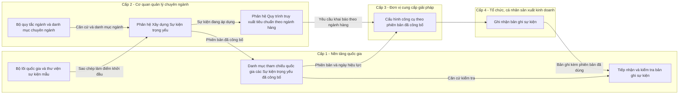

---

## 1. Tổng quan

### 1.1. Bối cảnh

Nghị định 37/2025/NĐ-CP yêu cầu tổ chức, cá nhân tham gia chuỗi cung ứng ghi nhận sự kiện theo dõi trọng yếu kèm dữ liệu then chốt tại mỗi điểm trọng yếu. Tuy nhiên, Nghị định không quy định cụ thể với từng ngành hàng thì sự kiện nào là trọng yếu, dữ liệu nào là bắt buộc. Theo Quyển 2, việc quy định này thuộc thẩm quyền của **cơ quan quản lý chuyên ngành (Cấp 2)**. Cấp 2 xây dựng và phê duyệt nội dung Sự kiện trọng yếu theo thẩm quyền. Nền tảng quốc gia (Cấp 1) chỉ duy trì danh mục tham chiếu và kiểm tra tính tương thích, không phê duyệt nội dung chuyên ngành thay Cấp 2.

NDATrace chọn chuẩn sự kiện truy xuất quốc tế GS1 EPCIS 2.0 làm hệ quy chiếu kỹ thuật. Chuẩn này mô tả mỗi sự kiện qua năm câu hỏi: cái gì, khi nào, ở đâu, vì sao, như thế nào. Nó cũng tương thích với các chương trình quốc tế về an toàn thực phẩm của Hoa Kỳ, chuỗi dược phẩm và truy xuất thuỷ sản. Cấp 1 đã chuẩn hoá bộ lõi quốc gia gồm:
- 5 loại sự kiện;
- 28 sự kiện mẫu;
- khoảng 64 dữ liệu then chốt;
- 43 bước nghiệp vụ;
- hơn 26 trạng thái hàng hoá;
- 9 loại chứng từ giao dịch.

### 1.2. Mục đích

Phân hệ này giúp **cán bộ tiêu chuẩn của cơ quan quản lý chuyên ngành** tự xây dựng, phê duyệt, công bố và duy trì các Sự kiện trọng yếu cho ngành hàng mình quản lý, mà không cần đội kỹ thuật hỗ trợ. Một Sự kiện trọng yếu được ban hành qua phân hệ phải đáp ứng đầy đủ yêu cầu của Quyển 2 với một Sự kiện trọng yếu, gồm:
- có mã, tên;
- có chủ sở hữu nội dung;
- có căn cứ ban hành;
- có phạm vi ngành, phạm vi sản phẩm;
- có phiên bản, ngày hiệu lực, trạng thái;
- có thời hạn cập nhật;
- có quy tắc chuyển tiếp.

Mỗi Sự kiện trọng yếu được cấu hình qua **7 bước tuần tự**:

| Bước | Nội dung cán bộ lựa chọn | Câu hỏi được trả lời | Ý nghĩa nghiệp vụ |
|---|---|---|---|
| 1 | Loại sự kiện | Khung của sự kiện | Xác định sự kiện thuộc dạng nào: theo dõi một đối tượng, đóng gói hoặc gom hàng, chế biến, giao dịch, hay liên kết. Loại sự kiện quyết định toàn bộ các bước sau. |
| 2 | Hành động | Vòng đời đối tượng | Xác định tại sự kiện này đối tượng được tạo mới, được ghi nhận lại, hay kết thúc vòng đời. |
| 3 | Bước nghiệp vụ | Vì sao — đang làm gì | Xác định công đoạn nghiệp vụ: thu hoạch, đóng gói, xuất hàng, nhận hàng, kiểm tra… |
| 4 | Trạng thái hàng hoá | Vì sao — kết quả là gì | Xác định trạng thái của hàng hoá sau sự kiện: đang vận chuyển, đang lưu hành, đạt, không đạt… |
| 5 | Loại chứng từ giao dịch | Vì sao — gắn với giao dịch nào | Xác định sự kiện phải gắn với chứng từ nào: đơn đặt hàng, hoá đơn, phiếu giao hàng… |
| 6 | Dữ liệu then chốt | Cái gì, khi nào, ở đâu, như thế nào | Xác định tổ chức, cá nhân sản xuất, kinh doanh phải khai báo những thông tin nào, ở mức bắt buộc hay tuỳ chọn, điền như thế nào. |
| 7 | Yêu cầu bổ sung | Như thế nào — điều kiện kiểm soát | Xác định ngưỡng cảm biến, chứng nhận yêu cầu, bằng chứng đi kèm, và mô tả khi nào phải áp dụng sự kiện. |

### 1.3. Vấn đề cần giải quyết

| # | Vấn đề hiện tại | Hậu quả | Cách phân hệ giải quyết |
|---|---|---|---|
| 1 | Cán bộ tiêu chuẩn là chuyên gia ngành hàng, không phải chuyên gia chuẩn truy xuất quốc tế. | Cán bộ chọn sai tổ hợp. Ví dụ: sự kiện chế biến lại có hành động, hoặc sự kiện chỉ ghi nhận lại có thông tin lô. Hậu quả là dữ liệu doanh nghiệp gửi lên không hợp chuẩn, Cấp 1 không kiểm tra được. | Ở mỗi bước, hệ thống chỉ hiển thị các lựa chọn phù hợp với bước trước. Trước khi trình phê duyệt, hệ thống kiểm tra tổng thể cấu hình. |
| 2 | Mỗi đơn vị tự đặt tên bước nghiệp vụ, trạng thái theo thói quen. | Dữ liệu giữa các ngành, các địa phương không liên thông; không truy xuất xuyên chuỗi được. | Cán bộ chỉ được chọn giá trị từ bộ lõi quốc gia và danh mục chuyên ngành đã ánh xạ, không được nhập tự do. |
| 3 | Tiêu chuẩn thay đổi theo thời gian. | Doanh nghiệp bị "đổi luật giữa chừng". Bản ghi cũ có thể bị coi là sai theo quy định mới. | Hệ thống quản lý phiên bản và bắt buộc ngày áp dụng trong tương lai cho phiên bản mới. Phiên bản mới không có hiệu lực hồi tố: bản ghi cũ vẫn được đánh giá theo phiên bản có hiệu lực tại thời điểm sự kiện xảy ra. |
| 4 | Địa phương cần yêu cầu chặt hơn trung ương. | Địa phương làm lại từ đầu, hoặc vô tình nới lỏng yêu cầu của trung ương. | Cơ quan địa phương kế thừa Sự kiện trọng yếu của trung ương và chỉ được thêm chặt, không được bớt. Hệ thống tự động chặn mọi thay đổi làm suy giảm yêu cầu. |
| 5 | Sự kiện trọng yếu và Quy trình truy xuất tiêu chuẩn đang gộp làm một. | Không dùng lại được Sự kiện trọng yếu giữa các ngành hàng. | Phân hệ này chỉ xây dựng từng Sự kiện trọng yếu. Việc gom thành Quy trình theo ngành hàng do phân hệ riêng đảm nhiệm. |
| 6 | Sự kiện ban hành thiếu thông tin về căn cứ, chủ sở hữu, phạm vi, thời hạn. **[Theo Quyển 2/3]** | Cấp 1 và doanh nghiệp không xác định được sự kiện có hiệu lực pháp lý không, ai chịu trách nhiệm, áp dụng cho sản phẩm nào. | Hệ thống bắt buộc nhập đủ các thông tin này trước khi trình phê duyệt. |

### 1.4. Nguyên tắc thiết kế

Phân hệ tuân thủ các nguyên tắc nền tảng của Quyển 2:

1. **Nghiệp vụ dẫn dắt; thẩm quyền và trách nhiệm rõ ràng.** Mỗi Sự kiện trọng yếu có một chủ sở hữu nội dung là cơ quan có thẩm quyền. Mỗi thao tác đều ghi nhận người thực hiện và đơn vị chịu trách nhiệm.
2. **Thống nhất hệ quy chiếu.** Mọi giá trị được chọn trong 7 bước đều lấy từ bộ lõi quốc gia hoặc danh mục chuyên ngành đã ánh xạ với bộ lõi.
3. **Nguồn, trạng thái, hiệu lực và lịch sử phải kiểm chứng được.** Phiên bản đã công bố không bị sửa, không bị xoá. Lịch sử được lưu vĩnh viễn.
4. **Liên thông theo chuẩn, duy trì được qua thay đổi.** Thay đổi được thực hiện bằng phiên bản mới, có thời hạn chuyển tiếp, không hồi tố.
5. **Bộ lõi thống nhất, mở rộng có kiểm soát.** Yêu cầu của ngành chỉ được bổ sung hoặc siết chặt so với bộ lõi quốc gia. Yêu cầu của địa phương chỉ được bổ sung hoặc siết chặt so với yêu cầu của trung ương.

---

## 2. Người dùng và vai trò

### 2.1. Cán bộ tiêu chuẩn cấp trung ương (nhóm 2A)
- **Mô tả:** Chuyên viên thuộc Cục, Vụ của Bộ quản lý ngành, ví dụ Cục Quản lý chất lượng nông lâm sản và thuỷ sản thuộc Bộ Nông nghiệp và Môi trường. Họ là chuyên gia về ngành hàng, am hiểu quy trình sản xuất và quy định chuyên ngành, nhưng thường không quen thuật ngữ của chuẩn truy xuất quốc tế.
- **Nhu cầu:** Soạn thảo các Sự kiện trọng yếu áp dụng toàn quốc cho ngành, gắn với văn bản ban hành của Bộ. Họ cần làm nhanh, đúng chuẩn, và giải trình được khi bị kiểm tra.
- **Hành vi điển hình:**
  - Thường sao chép từ thư viện sự kiện mẫu quốc gia rồi tinh chỉnh, hiếm khi tạo từ đầu.
  - Làm theo đợt, gắn với kế hoạch ban hành văn bản.
  - Thường cần tham vấn chuyên môn giữa chừng nên cần lưu nháp.

### 2.2. Cán bộ tiêu chuẩn cấp địa phương (nhóm 2B)
- **Mô tả:** Chuyên viên của Sở chuyên ngành hoặc cơ quan chuyên môn thuộc Uỷ ban nhân dân tỉnh, thành phố.
- **Nhu cầu:** Triển khai Sự kiện trọng yếu của Bộ tại địa phương, bổ sung yêu cầu riêng. Ví dụ: thêm yêu cầu chứng nhận VietGAP cấp tỉnh, siết ngưỡng nhiệt độ bảo quản.
- **Điều kiện:** Theo Quyển 3, nhóm 2B chỉ được địa phương hoá Sự kiện trọng yếu khi **có uỷ quyền**. Hệ thống phân quyền phải ghi nhận đơn vị đã được uỷ quyền trong ngành nào, phạm vi địa bàn nào, đến thời hạn nào. **[Theo Quyển 2/3]**

### 2.3. Lãnh đạo phê duyệt **[Theo Quyển 2/3]**
- **Mô tả:** Lãnh đạo phòng, Cục, Vụ hoặc Sở được giao thẩm quyền phê duyệt và công bố Sự kiện trọng yếu thay mặt cơ quan.
- **Nhu cầu:**
  - Xem toàn bộ nội dung bản trình, kết quả kiểm tra tự động, căn cứ ban hành và các thay đổi so với phiên bản trước.
  - Phê duyệt và công bố, hoặc trả lại để chỉnh sửa kèm ý kiến.
- **Lý do bổ sung vai trò:** Quyển 3 quy định chức năng của Cấp 2 bao gồm "xây dựng, phê duyệt, công bố, lập phiên bản và theo dõi hiệu lực". Bản 4 gộp phê duyệt vào công bố; bản này tách riêng để bảo đảm nguyên tắc người soạn không tự công bố.

### 2.4. Quản trị nền tảng quốc gia (Cấp 1)
- **Mô tả:** Đơn vị vận hành Nền tảng quốc gia, quản lý bộ lõi quốc gia và thư viện sự kiện mẫu.
- **Nhu cầu:**
  - Tiếp nhận các Sự kiện trọng yếu đã công bố vào danh mục tham chiếu quốc gia.
  - Giám sát các sự kiện đang và sắp áp dụng của mọi cơ quan.
  - Phát hiện sự kiện dùng giá trị đã ngừng sử dụng trong bộ lõi.
- **Giới hạn:** Không tạo, không sửa, không phê duyệt nội dung chuyên ngành.

### 2.5. Đơn vị cung cấp giải pháp (Cấp 3)
- **Mô tả:** Doanh nghiệp công nghệ cung cấp phần mềm truy xuất cho tổ chức, cá nhân sản xuất, kinh doanh.
- **Nhu cầu:**
  - Nhận phiên bản Sự kiện trọng yếu đã công bố và ngày hiệu lực.
  - Cấu hình công cụ của mình theo đó, kiểm thử.
  - Thông báo, hướng dẫn chuyển tiếp cho khách hàng trước ngày hiệu lực.
- **Giới hạn:** Không thao tác trực tiếp trên phân hệ này. Không được tự sửa Sự kiện trọng yếu.

### 2.6. Tổ chức, cá nhân sản xuất, kinh doanh (Cấp 4)
- **Mô tả:** Doanh nghiệp, hợp tác xã, hộ kinh doanh, cá nhân trực tiếp ghi nhận sự kiện.
- **Nhu cầu:**
  - Biết chính xác sự kiện nào phải khai báo, dữ liệu nào bắt buộc, điền thế nào.
  - Được báo trước khi yêu cầu thay đổi, có đủ thời gian chuẩn bị.
- **Giới hạn:** Không thao tác trên phân hệ này. Không được chọn yêu cầu thấp hơn để né nghĩa vụ.

### 2.7. Hệ thống tự động
- Chuyển trạng thái đúng ngày áp dụng và ngày ngừng áp dụng.
- Gửi thông báo.
- Phát hiện ảnh hưởng khi bộ lõi quốc gia thay đổi.

---

## 3. Phạm vi

### 3.1. Trong phạm vi
1. Cán bộ tiêu chuẩn nhóm 2A và 2B tạo Sự kiện trọng yếu qua 7 bước tuần tự; lưu nháp; sửa, xoá bản nháp.
2. Cán bộ tiêu chuẩn sao chép Sự kiện trọng yếu từ ba nguồn:
   - thư viện sự kiện mẫu quốc gia;
   - Sự kiện trọng yếu của cơ quan trung ương cùng ngành (dành cho cơ quan địa phương được uỷ quyền);
   - Sự kiện trọng yếu của chính đơn vị.
3. Cán bộ tiêu chuẩn khai báo thông tin pháp lý của Sự kiện trọng yếu: căn cứ ban hành, chủ sở hữu nội dung, phạm vi ngành và sản phẩm, thời hạn chuyển tiếp. **[Theo Quyển 2/3]**
4. Hệ thống kiểm tra tổng thể cấu hình, phân biệt lỗi (chặn) và cảnh báo (không chặn).
5. Cán bộ tiêu chuẩn trình phê duyệt; lãnh đạo phê duyệt và công bố, hoặc trả lại. **[Theo Quyển 2/3]**
6. Hệ thống quản lý vòng đời 5 trạng thái: Nháp, Chờ phê duyệt, Chờ áp dụng, Đang áp dụng, Ngừng áp dụng.
7. Cán bộ tiêu chuẩn tạo phiên bản mới, xem lịch sử, so sánh hai phiên bản.
8. Lãnh đạo phê duyệt ngừng áp dụng Sự kiện trọng yếu chủ động.
9. Hệ thống gửi Sự kiện trọng yếu đã công bố vào danh mục tham chiếu quốc gia của Cấp 1.
10. Hệ thống cảnh báo khi bộ lõi quốc gia ngừng sử dụng một giá trị mà Sự kiện trọng yếu đang dùng.
11. Hệ thống thông báo cho Cấp 3, Cấp 4 và cơ quan địa phương kế thừa khi Sự kiện trọng yếu thay đổi.
12. Hệ thống ghi nhật ký mọi thao tác.

### 3.2. Ngoài phạm vi
| Nội dung | Thuộc về |
|---|---|
| Gom Sự kiện trọng yếu thành Quy trình truy xuất tiêu chuẩn theo ngành hàng | Phân hệ Quản lý Quy trình truy xuất tiêu chuẩn |
| Quản lý bộ lõi quốc gia: loại sự kiện, thư viện sự kiện mẫu, dữ liệu then chốt, bước nghiệp vụ, trạng thái hàng hoá, loại chứng từ | Các phân hệ quản lý danh mục của Cấp 1 |
| Quản lý bộ quy tắc ngành, danh mục chuyên ngành | Các phân hệ quản lý của Cấp 2 |
| Sự kiện trọng yếu do tổ chức chứng nhận (nhóm 2C) và chương trình tự nguyện (nhóm 2D) ban hành | Giai đoạn sau |
| Giai đoạn đề xuất, tham vấn công khai và thí điểm trước khi ban hành (Quyển 2 có mô tả) | Giai đoạn sau |
| Quy trình phê duyệt nhiều cấp (từ hai cấp lãnh đạo trở lên) | Phân hệ Quy trình phê duyệt |
| Ký số văn bản ban hành | Giai đoạn sau |
| Ghi nhận bản ghi sự kiện của Cấp 4 | Phân hệ Ghi nhận và đính chính sự kiện trọng yếu |
| Tiếp nhận, kiểm tra, lưu trữ bản ghi sự kiện | Phân hệ Tiếp nhận và duy trì bản ghi sự kiện của Cấp 1 |
| Giám sát cảm biến thời gian thực | Giai đoạn mở rộng |

---

## 4. Mô hình nghiệp vụ

### 4.1. Thông tin của một Sự kiện trọng yếu

Theo Quyển 2, mỗi Sự kiện trọng yếu phải có mã, tên, chủ sở hữu nội dung, nguồn thẩm quyền, phạm vi ngành và sản phẩm, phiên bản, ngày hiệu lực, trạng thái, thời hạn cập nhật và quy tắc chuyển tiếp. Phân hệ quản lý các thông tin sau:

| Nhóm | Thông tin | Bắt buộc | Mô tả và quy định |
|---|---|---|---|
| Định danh | Mã sự kiện | Hệ thống tự sinh | Hệ thống sinh mã khi lưu lần đầu. Mã giữ nguyên qua mọi phiên bản. |
| | Tên sự kiện | Có | Ví dụ "Xuất kho thuỷ sản tươi". Tên không được trùng với tên Sự kiện trọng yếu khác trong cùng đơn vị. |
| | Tên tiếng Anh | Không | Phục vụ trao đổi quốc tế. |
| | Mô tả | Không | Mục đích, bối cảnh áp dụng. |
| Thẩm quyền **[Theo Quyển 2/3]** | Chủ sở hữu nội dung | Hệ thống tự điền | Cơ quan của người tạo, ví dụ "Cục Quản lý chất lượng nông lâm sản và thuỷ sản". |
| | Nhóm chủ thể | Hệ thống tự điền | 2A hoặc 2B. |
| | Căn cứ ban hành | Có khi trình phê duyệt | Số hiệu, ngày, trích yếu văn bản làm căn cứ. Cho phép đính kèm tệp văn bản. |
| | Văn bản uỷ quyền | Có với nhóm 2B khi kế thừa | Văn bản cơ quan trung ương uỷ quyền cho địa phương triển khai. |
| Phạm vi **[Theo Quyển 2/3]** | Ngành hàng | Có | Chọn từ danh mục ngành của bộ lõi. |
| | Nhóm sản phẩm áp dụng | Có khi trình phê duyệt | Chọn từ danh mục sản phẩm chuyên ngành. |
| | Phạm vi địa bàn | Hệ thống tự điền | Toàn quốc (2A) hoặc tỉnh, thành phố (2B). |
| | Vai trò chủ thể phải ghi nhận | Có khi trình phê duyệt | Vai trò nào trong chuỗi phải ghi nhận sự kiện: người trồng trọt, cơ sở sơ chế, đơn vị vận chuyển… |
| Phiên bản và hiệu lực | Số phiên bản | Hệ thống tự sinh | Phiên bản 1, 2, 3… |
| | Trạng thái | Hệ thống tự sinh | Nháp / Chờ phê duyệt / Chờ áp dụng / Đang áp dụng / Ngừng áp dụng. |
| | Ngày công bố, ngày áp dụng, ngày ngừng áp dụng | Hệ thống / cán bộ | |
| | Thời hạn chuyển tiếp **[Theo Quyển 2/3]** | Có từ phiên bản 2 | Số ngày từ ngày công bố đến ngày áp dụng. |
| | Quy tắc chuyển tiếp **[Theo Quyển 2/3]** | Có từ phiên bản 2 | Hướng dẫn xử lý bản ghi phát sinh gần thời điểm chuyển đổi và các trường hợp phải bổ sung dữ liệu. |
| | Lý do thay đổi | Có từ phiên bản 2 | |
| | Thay thế cho / Được thay thế bởi | Hệ thống tự sinh | Liên kết giữa các phiên bản. |
| Nguồn gốc | Nguồn tạo | Hệ thống tự sinh | Tạo mới / Sao chép từ thư viện mẫu quốc gia / Kế thừa từ cơ quan trung ương / Sao chép trong đơn vị. |
| | Sự kiện gốc | Hệ thống tự sinh | Mã và phiên bản của sự kiện được sao chép. |
| Trách nhiệm | Người soạn, người phê duyệt, thời điểm tương ứng | Hệ thống tự sinh | |
| Nội dung | Cấu hình 7 bước | Có | Mục 5. |

### 4.2. Ba lớp đối tượng cần phân biệt **[Theo Quyển 2/3]**

Quyển 2 tách ba lớp đối tượng. Phân hệ này chỉ quản lý lớp thứ nhất.

1. **Sự kiện trọng yếu (bản cấu hình)** — do cơ quan quản lý ban hành qua phân hệ này. Quy định một loại sự kiện phải có những thành phần nào.
2. **Bản ghi sự kiện** — do tổ chức, cá nhân sản xuất, kinh doanh tạo ra mỗi khi sự kiện thực sự xảy ra. Mỗi bản ghi mang theo mã và phiên bản Sự kiện trọng yếu được dùng. Trạng thái của bản ghi không làm thay đổi trạng thái của Sự kiện trọng yếu.
3. **Dữ liệu then chốt** — từng thông tin trong bản ghi. Danh sách dữ liệu then chốt và mức bắt buộc do bản cấu hình quy định.

Hệ quả nghiệp vụ: khi cơ quan quản lý ban hành phiên bản mới, các bản ghi đã tạo theo phiên bản cũ **vẫn hợp lệ** và tiếp tục được đánh giá theo phiên bản cũ. Phiên bản mới chỉ áp dụng cho bản ghi có thời điểm xảy ra từ ngày áp dụng trở đi.

### 4.3. Vòng đời trạng thái

| Trạng thái | Ý nghĩa | Màu nhãn | Đơn vị sở hữu thấy | Cấp 1 thấy | Cấp 3, Cấp 4 dùng được | Được sửa | Được xoá |
|---|---|---|---|---|---|---|---|
| Nháp | Đang soạn thảo | Trắng | Có | Không | Không | Có | Có |
| Chờ phê duyệt **[Theo Quyển 2/3]** | Đã trình, chờ lãnh đạo xem xét | Tím | Có | Không | Không | Không — phải rút lại hoặc chờ trả lại | Không |
| Chờ áp dụng | Đã phê duyệt, công bố; chưa đến ngày hiệu lực. Tương ứng trạng thái "đã công bố, chưa hiệu lực" của Quyển 2 | Vàng | Có | Có | Không dùng để ghi nhận; được nhận trước để chuẩn bị | Không | Không — chỉ huỷ |
| Đang áp dụng | Đang có hiệu lực. Tương ứng "có hiệu lực" | Xanh lá | Có | Có | **Có** | Không | Không |
| Ngừng áp dụng | Hết hiệu lực, bị thay thế hoặc bị huỷ. Tương ứng "hết hiệu lực / thay thế" | Xám | Có (lịch sử) | Có (lịch sử) **[Theo Quyển 2/3]** | Không dùng cho bản ghi mới; vẫn dùng để kiểm tra bản ghi cũ | Không | Không |

Ghi chú về Cấp 1: bản 4 quy định Cấp 1 không thấy trạng thái Ngừng áp dụng. Bản này điều chỉnh để Cấp 1 thấy được Ngừng áp dụng. Lý do: Cấp 1 cần đối chiếu bản ghi cũ với phiên bản có hiệu lực tại thời điểm sự kiện xảy ra.

**Giới hạn đồng thời:** với cùng một mã sự kiện, tại một thời điểm, hệ thống cho phép tồn tại tối đa:
- 1 phiên bản Đang áp dụng;
- 1 phiên bản Chờ áp dụng;
- 1 phiên bản ở trạng thái Nháp hoặc Chờ phê duyệt.

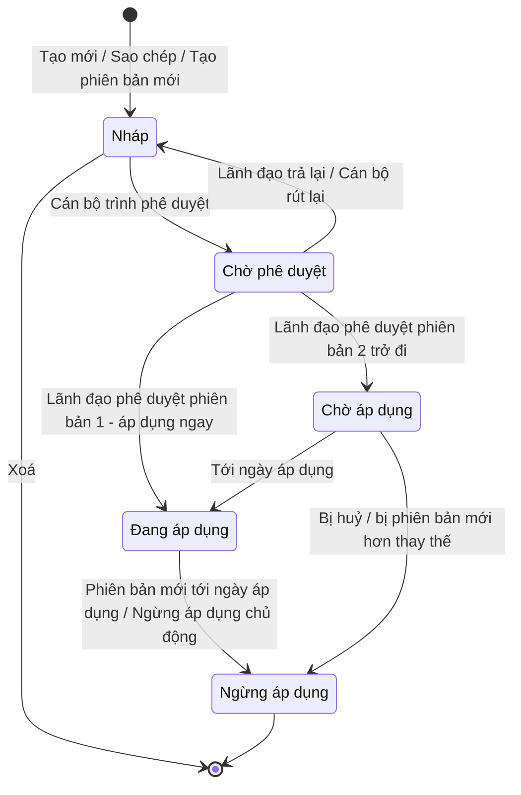

### 4.4. Phân quyền

| Thao tác | Cán bộ 2A — sự kiện của đơn vị | Cán bộ 2B — sự kiện của đơn vị | Cán bộ 2B — sự kiện của 2A cùng ngành | Lãnh đạo phê duyệt — sự kiện của đơn vị | Đơn vị khác cùng cấp | Quản trị Cấp 1 |
|---|---|---|---|---|---|---|
| Xem | ✅ | ✅ | ✅ chỉ bản Đang áp dụng và Chờ áp dụng | ✅ | ❌ | ✅ Chờ áp dụng, Đang áp dụng, Ngừng áp dụng |
| Tạo mới, sao chép | ✅ | ✅ | ✅ kế thừa, khi được uỷ quyền | ❌ | ❌ | ❌ |
| Sửa, xoá bản nháp | ✅ | ✅ | ❌ | ❌ | ❌ | ❌ |
| Trình phê duyệt, rút lại | ✅ | ✅ | ❌ | ❌ | ❌ | ❌ |
| Phê duyệt và công bố, trả lại | ❌ | ❌ | ❌ | ✅ | ❌ | ❌ |
| Huỷ bản Chờ áp dụng, ngừng áp dụng | Đề xuất | Đề xuất | ❌ | ✅ | ❌ | ❌ |
| Tạo phiên bản mới | ✅ | ✅ | ❌ | ❌ | ❌ | ❌ |

Quy định bổ sung về phân quyền:
- Một người có thể được giao đồng thời vai trò cán bộ tiêu chuẩn và lãnh đạo phê duyệt. Tuy vậy, hệ thống không cho phép người đó phê duyệt chính bản trình do mình soạn. **[Bổ sung]**
- Hệ thống xác định quan hệ trung ương – địa phương theo **cùng ngành quản lý** và **văn bản uỷ quyền còn hiệu lực**. Các thông tin này do phân hệ Quản lý phạm vi thẩm quyền, vai trò và tư cách chuyên ngành cung cấp.

---

## 5. Quy định cấu hình 7 bước

### 5.1. Nguyên tắc chung
1. **Tuần tự:** Hệ thống chỉ mở bước sau khi bước trước đã hợp lệ.
   - Cán bộ được quay lại sửa các bước trước, trừ bước 1.
   - Khi cán bộ sửa một bước trước, hệ thống đánh dấu các lựa chọn ở bước sau không còn phù hợp và yêu cầu cán bộ xác nhận lại. **[Bổ sung]**
2. **Loại sự kiện không đổi:** Sau khi cán bộ rời bước 1, hệ thống khoá loại sự kiện. Muốn đổi loại sự kiện, cán bộ phải xoá bản nháp và tạo Sự kiện trọng yếu mới.
3. **Chỉ chọn từ danh mục:** Hệ thống chỉ hiển thị giá trị đang hiệu lực trong bộ lõi quốc gia và danh mục chuyên ngành đã ánh xạ; không có ô nhập tự do. Khi thiếu giá trị cần dùng, cán bộ đề nghị cơ quan quản lý danh mục bổ sung trước.
4. **Gợi ý, không ép buộc:** Hệ thống sắp xếp và gợi ý lựa chọn phù hợp, nhưng vẫn chấp nhận lựa chọn khác với gợi ý. Hệ thống chỉ chặn khi lựa chọn vi phạm ràng buộc bắt buộc của chuẩn (mục 5.3).

### 5.2. Chi tiết từng bước

**Bước 1 — Loại sự kiện**
- Hệ thống hiển thị các loại sự kiện đang hiệu lực trong bộ lõi quốc gia.
- Mỗi loại sự kiện kèm tên tiếng Việt, mô tả ngắn và ví dụ nghiệp vụ.
- Cán bộ chọn đúng một loại.
- Loại sự kiện quyết định: bước 2 có hiển thị không; danh sách bước nghiệp vụ ở bước 3; dữ liệu then chốt nào bắt buộc, dữ liệu nào bị cấm ở bước 6.

**Bước 2 — Hành động**
- Cán bộ chọn một trong ba hành động: **Tạo mới** (đối tượng bắt đầu vòng đời), **Ghi nhận** (đối tượng đã tồn tại, được quan sát lại), **Kết thúc** (đối tượng kết thúc vòng đời hoặc bị tách khỏi nhóm).
- Với sự kiện chế biến, hệ thống bỏ qua bước này vì loại sự kiện chế biến không có hành động.
- Hành động quyết định phần thông tin lô / cá thể ở bước 6 có được mở hay không.

**Bước 3 — Bước nghiệp vụ**
- Hệ thống lọc danh sách bước nghiệp vụ theo loại sự kiện, chia ba mức:
  - **Khuyến nghị:** hiển thị đầu danh sách.
  - **Ít dùng:** hiển thị kèm biểu tượng cảnh báo; khi cán bộ chọn, hệ thống hỏi xác nhận.
  - **Không phù hợp:** hệ thống ẩn.
- Cán bộ chọn đúng một bước nghiệp vụ.

**Bước 4 — Trạng thái hàng hoá và trạng thái duy trì**
- Hệ thống tự chọn sẵn trạng thái hàng hoá được gợi ý theo cặp loại sự kiện và bước nghiệp vụ. Cán bộ giữ nguyên hoặc chọn trạng thái khác.
- Cùng một bước nghiệp vụ, nếu loại sự kiện khác nhau thì gợi ý có thể khác nhau. Ví dụ, bước Đóng gói:
  - với sự kiện theo dõi đối tượng, hệ thống gợi ý "đang lưu hành";
  - với sự kiện đóng gói / gom hàng, hệ thống gợi ý "đang xử lý".
- Cán bộ có thể chọn thêm **trạng thái duy trì**, tức trạng thái được giữ qua các sự kiện sau, ví dụ "đạt kiểm tra". Hệ thống chỉ hiển thị các giá trị cho phép duy trì.

**Bước 5 — Loại chứng từ giao dịch**
- Hệ thống hiển thị 9 loại chứng từ chuẩn; cán bộ được chọn nhiều loại.
- Với sự kiện giao dịch, cán bộ bắt buộc chọn ít nhất một loại.
- Với các loại sự kiện khác, bước này là tuỳ chọn. Cán bộ dùng bước này khi muốn bắt buộc doanh nghiệp gắn chứng từ.

**Bước 6 — Dữ liệu then chốt và thông tin lô / cá thể**
- Hệ thống lọc danh sách dữ liệu then chốt theo loại sự kiện, nhóm theo năm câu hỏi: cái gì, khi nào, ở đâu, vì sao, như thế nào.
- Hệ thống khoá sẵn ở mức Bắt buộc những dữ liệu mà chuẩn yêu cầu (mục 5.3), và ẩn những dữ liệu bị cấm với loại sự kiện đã chọn.
- Với mỗi dữ liệu then chốt, cán bộ chọn mức **Bắt buộc**, **Bắt buộc có điều kiện** **[Theo Quyển 2/3]** hoặc **Tuỳ chọn**, và viết hướng dẫn điền tối đa 500 ký tự. Hướng dẫn được hiển thị cho doanh nghiệp khi khai báo.
- Với mức Bắt buộc có điều kiện, cán bộ mô tả điều kiện, ví dụ "Bắt buộc khi sản phẩm xuất khẩu".
- Hệ thống chỉ mở phần thông tin lô / cá thể khi:
  - sự kiện theo dõi đối tượng có hành động Tạo mới; hoặc
  - sự kiện chế biến (khi đó thông tin lô áp dụng cho sản phẩm đầu ra).
- Cán bộ phải chọn ít nhất một dữ liệu then chốt ngoài nhóm dữ liệu do hệ thống tự bắt buộc.

**Bước 7 — Yêu cầu bổ sung**
- **Ngưỡng cảm biến:** chỉ mở khi cán bộ đã chọn dữ liệu cảm biến ở bước 6. Cán bộ khai báo loại đại lượng (ví dụ nhiệt độ), giá trị nhỏ nhất, giá trị lớn nhất, đơn vị đo (lấy từ danh mục đơn vị đo dùng chung) và cách xử lý khi vượt ngưỡng.
- **Yêu cầu chứng nhận:** chỉ mở khi cán bộ đã chọn dữ liệu chứng nhận ở bước 6. Cán bộ chọn loại chứng nhận (VietGAP, HACCP…) và mức bắt buộc / tuỳ chọn.
- **Yêu cầu bằng chứng:** **[Theo Quyển 2/3]** Cán bộ chọn loại bằng chứng phải đính kèm, ví dụ ảnh chụp, phiếu kết quả kiểm nghiệm, biên bản giao nhận.
- **Mô tả khi nào áp dụng:** Cán bộ mô tả bằng lời tình huống mà doanh nghiệp phải ghi nhận sự kiện này, ví dụ "Khi lô thuỷ sản tươi rời kho của cơ sở".
- Toàn bộ bước 7 là tuỳ chọn.

### 5.3. Ràng buộc bắt buộc theo loại sự kiện

| Loại sự kiện | Dùng khi | Hành động | Dữ liệu hệ thống tự bắt buộc | Dữ liệu không được dùng | Thông tin lô / cá thể | Chứng từ giao dịch |
|---|---|---|---|---|---|---|
| Theo dõi đối tượng | Một hoặc nhiều đối tượng, lô hàng được tạo, quan sát, kết thúc (thu hoạch, xuất kho, nhận hàng…) | Có | Thời điểm xảy ra, múi giờ, danh sách mã đối tượng **hoặc** số lượng theo lô | Mã bao bì chứa, danh sách hàng bên trong, đầu vào / đầu ra chế biến | Chỉ khi hành động là Tạo mới | Tuỳ chọn |
| Đóng gói / gom hàng | Gom hàng vào thùng, pallet, container hoặc tháo ra | Có | Thời điểm xảy ra, múi giờ, mã bao bì chứa (khi Tạo mới hoặc Kết thúc), danh sách hoặc số lượng hàng bên trong | Danh sách đối tượng đơn lẻ, đầu vào / đầu ra chế biến | Không | Tuỳ chọn |
| Chế biến / biến đổi | Nguyên liệu đầu vào biến thành sản phẩm đầu ra | **Không có** | Thời điểm xảy ra, múi giờ, đầu vào và/hoặc đầu ra | Mã bao bì chứa, danh sách đối tượng đơn lẻ | Có, cho đầu ra | Tuỳ chọn |
| Giao dịch | Gắn hàng hoá với giao dịch mua bán, giao nhận | Có | Thời điểm xảy ra, múi giờ, **chứng từ giao dịch**, mã đối tượng hoặc số lượng | Đầu vào / đầu ra chế biến | Không | **Bắt buộc ít nhất 1** |
| Liên kết | Gắn thiết bị, tài sản với nhau, ví dụ gắn cảm biến vào thùng hàng | Có | Thời điểm xảy ra, múi giờ, đối tượng chính, đối tượng được gắn | Danh sách đối tượng đơn lẻ, đầu vào / đầu ra chế biến | Không | Tuỳ chọn |

Ghi chú theo Quyển 2:
- **Thời gian:** Hệ thống phân biệt "thời điểm sự kiện xảy ra" và "thời điểm ghi nhận vào hệ thống". Thời điểm ghi nhận do hệ thống tự gắn, không thuộc cấu hình.
- **Địa điểm:** Hệ thống không mặc định "địa điểm đọc dữ liệu" và "địa điểm nghiệp vụ" là một. Cán bộ quyết định có bắt buộc từng loại địa điểm hay không.

Bảng gợi ý "Bước nghiệp vụ theo loại sự kiện" và bảng "Trạng thái hàng hoá theo bước nghiệp vụ và loại sự kiện" được lấy từ phân hệ Quản lý danh mục Bước nghiệp vụ và Trạng thái hàng hoá của Cấp 1.

---

## 6. Quy tắc nghiệp vụ

Mỗi quy tắc dưới đây được viết với đầy đủ chủ thể và hành động. Tên in đậm là chủ thể chịu trách nhiệm thực hiện hoặc chịu ràng buộc.

### 6.1. Nhóm quy tắc về thẩm quyền và trách nhiệm

**QT-01. Chủ sở hữu nội dung.** **Hệ thống** ghi nhận cơ quan của người tạo làm chủ sở hữu nội dung của Sự kiện trọng yếu ngay khi lưu lần đầu. **Hệ thống** không cho phép bất kỳ người dùng nào thay đổi chủ sở hữu nội dung sau đó. Khi Sự kiện trọng yếu được sao chép sang đơn vị khác, **hệ thống** gán chủ sở hữu nội dung của bản sao là đơn vị thực hiện sao chép. **[Theo Quyển 2/3]**

**QT-02. Cấp 1 không phê duyệt thay Cấp 2.** **Quản trị nền tảng quốc gia (Cấp 1)** chỉ tiếp nhận, kiểm tra tính tương thích với bộ lõi quốc gia và đăng ký vào danh mục tham chiếu quốc gia các Sự kiện trọng yếu đã được Cấp 2 phê duyệt. **Quản trị Cấp 1** không được sửa nội dung chuyên ngành, không được phê duyệt hay từ chối nội dung chuyên ngành thay Cấp 2. **[Theo Quyển 2/3]**

**QT-03. Căn cứ ban hành.** **Cán bộ tiêu chuẩn** phải khai báo căn cứ ban hành (số hiệu, ngày, trích yếu văn bản) và nhóm sản phẩm áp dụng trước khi trình phê duyệt. **Hệ thống** chặn thao tác trình phê duyệt nếu thiếu một trong hai thông tin này. **[Theo Quyển 2/3]**

**QT-04. Địa phương phải được uỷ quyền.** **Cán bộ tiêu chuẩn nhóm 2B** chỉ được kế thừa Sự kiện trọng yếu của nhóm 2A khi đơn vị của mình có văn bản uỷ quyền còn hiệu lực cho ngành đó. **Hệ thống** ẩn chức năng kế thừa nếu đơn vị chưa được uỷ quyền, và nêu rõ lý do khi cán bộ tìm cách truy cập. **[Theo Quyển 2/3]**

**QT-05. Tách người soạn và người phê duyệt.** **Hệ thống** không cho phép một người dùng phê duyệt bản trình do chính mình soạn, kể cả khi người dùng đó được giao cả hai vai trò. **[Bổ sung]**

**QT-06. Sự kiện liên quan nhiều ngành.** Khi một nhóm sản phẩm thuộc phạm vi quản lý của nhiều ngành, **cán bộ tiêu chuẩn** phải chọn cơ quan chủ trì và các cơ quan phối hợp trong phần thông tin thẩm quyền. **Hệ thống** gửi thông báo cho các cơ quan phối hợp khi bản trình được phê duyệt. **[Theo Quyển 2/3]**

### 6.2. Nhóm quy tắc về cấu hình

**QT-07. Loại sự kiện không đổi.** **Hệ thống** khoá loại sự kiện ngay khi cán bộ rời bước 1. **Hệ thống** giữ nguyên loại sự kiện qua mọi lần sửa, sao chép, kế thừa và tạo phiên bản mới. Nếu cán bộ cần loại sự kiện khác, **cán bộ** phải xoá bản nháp và tạo Sự kiện trọng yếu mới.

**QT-08. Chỉ chọn từ danh mục.** **Hệ thống** chỉ cho phép cán bộ chọn các giá trị đang hiệu lực trong bộ lõi quốc gia và danh mục chuyên ngành đã ánh xạ, cho các mục: loại sự kiện, bước nghiệp vụ, trạng thái hàng hoá, loại chứng từ, dữ liệu then chốt, đơn vị đo, loại chứng nhận. **Hệ thống** không cung cấp ô nhập tự do cho các mục này.

**QT-09. Gợi ý không chặn.** **Hệ thống** chấp nhận lựa chọn bước nghiệp vụ "ít dùng" sau khi cán bộ xác nhận. **Hệ thống** chấp nhận trạng thái hàng hoá khác với gợi ý mà không yêu cầu xác nhận.

**QT-10. Sự kiện giao dịch phải có chứng từ.** **Hệ thống** không cho phép cán bộ hoàn thành bước 5 của sự kiện giao dịch khi chưa chọn ít nhất một loại chứng từ giao dịch.

**QT-11. Thông tin lô có điều kiện.** **Hệ thống** chỉ mở phần thông tin lô / cá thể khi loại sự kiện là theo dõi đối tượng với hành động Tạo mới, hoặc khi loại sự kiện là chế biến. Nếu cán bộ đổi hành động từ Tạo mới sang hành động khác khi đã cấu hình thông tin lô, **hệ thống** hỏi xác nhận và xoá cấu hình thông tin lô sau khi cán bộ đồng ý.

**QT-12. Số dữ liệu tối thiểu.** **Hệ thống** không cho phép cán bộ lưu bản nháp hoàn thiện khi chưa có ít nhất một dữ liệu then chốt ngoài nhóm dữ liệu do hệ thống tự bắt buộc.

**QT-13. Ngưỡng cảm biến hợp lệ.** **Hệ thống** không cho phép cán bộ lưu ngưỡng cảm biến có giá trị nhỏ nhất lớn hơn hoặc bằng giá trị lớn nhất, hoặc thiếu đơn vị đo.

**QT-14. Tên không trùng.** **Hệ thống** không cho phép hai mã Sự kiện trọng yếu khác nhau trong cùng một đơn vị có tên trùng nhau. Hệ thống so sánh tên không phân biệt chữ hoa, chữ thường và khoảng trắng thừa. **[Bổ sung]**

### 6.3. Nhóm quy tắc về kế thừa giữa trung ương và địa phương

**QT-15. Địa phương chỉ thêm chặt hơn trung ương.** Khi kế thừa Sự kiện trọng yếu của nhóm 2A:
- **Cán bộ tiêu chuẩn nhóm 2B** chỉ được thêm yêu cầu hoặc siết chặt yêu cầu.
- **Hệ thống** chặn ngay tại ô nhập mọi thao tác làm suy giảm yêu cầu của trung ương:
  - đổi loại sự kiện, hành động, bước nghiệp vụ, trạng thái hàng hoá;
  - bỏ dữ liệu then chốt bắt buộc;
  - hạ dữ liệu từ Bắt buộc xuống Tuỳ chọn;
  - bỏ loại chứng từ, chứng nhận, bằng chứng mà trung ương đã yêu cầu;
  - bỏ trạng thái duy trì mà trung ương đã đặt;
  - nới rộng ngưỡng cảm biến ra ngoài khoảng trung ương đã đặt.

  Mỗi lần chặn, hệ thống nêu rõ yêu cầu gốc của trung ương.

**QT-16. Ngành chỉ thêm chặt hơn bộ lõi.** **Hệ thống** chặn mọi cấu hình làm suy giảm yêu cầu tối thiểu của bộ lõi quốc gia: bỏ dữ liệu mà chuẩn yêu cầu, dùng dữ liệu mà chuẩn cấm. **[Theo Quyển 2/3]**

**QT-17. Phân biệt yêu cầu gốc và yêu cầu bổ sung.** **Hệ thống** gắn nhãn "Yêu cầu cấp trung ương" cho mọi yêu cầu kế thừa từ nhóm 2A, và gắn nhãn "Bổ sung cấp địa phương" cho mọi yêu cầu do nhóm 2B thêm. **[Bổ sung]**

**QT-18. Báo địa phương khi trung ương thay đổi.** Khi **lãnh đạo phê duyệt nhóm 2A** công bố phiên bản mới, huỷ bản chờ áp dụng hoặc ngừng áp dụng một Sự kiện trọng yếu, **hệ thống** gửi thông báo cho mọi đơn vị nhóm 2B đã kế thừa sự kiện đó. **Hệ thống** không tự động thay đổi Sự kiện trọng yếu của nhóm 2B. **[Bổ sung]**

**QT-19. Kiểm tra lại khi địa phương công bố.** Khi **cán bộ nhóm 2B** trình phê duyệt một Sự kiện trọng yếu kế thừa, **hệ thống** kiểm tra lại quy tắc QT-15 với phiên bản **đang áp dụng mới nhất** của sự kiện gốc. Nếu trung ương đã siết chặt hơn sau thời điểm kế thừa, hệ thống báo lỗi. **[Bổ sung]**

### 6.4. Nhóm quy tắc về sửa, xoá và kiểm tra

**QT-20. Chỉ bản nháp được sửa và xoá.** **Hệ thống** chỉ cho phép sửa và xoá Sự kiện trọng yếu ở trạng thái Nháp. Với Sự kiện trọng yếu ở trạng thái Chờ phê duyệt, **cán bộ tiêu chuẩn** phải rút lại về Nháp trước khi sửa. Với Sự kiện trọng yếu đã công bố, **cán bộ tiêu chuẩn** phải tạo phiên bản mới.

**QT-21. Không xoá khi đang được dùng.** **Hệ thống** không cho phép xoá bản nháp đang nằm trong một Quy trình truy xuất tiêu chuẩn, kể cả Quy trình ở trạng thái nháp. **Hệ thống** liệt kê tên các Quy trình đang chứa sự kiện đó.

**QT-22. Một người sửa tại một thời điểm.** Khi một **cán bộ tiêu chuẩn** đang sửa bản nháp, **hệ thống** mở bản nháp ở chế độ chỉ xem cho người khác, kèm tên người đang sửa và thời điểm bắt đầu. **Hệ thống** tự mở khoá sau 30 phút không có thao tác. **[Bổ sung]**

**QT-23. Kiểm tra tổng thể trước khi trình.** **Hệ thống** chạy kiểm tra tổng thể (mục 7.6) mỗi khi cán bộ trình phê duyệt. **Hệ thống** chặn thao tác trình nếu còn lỗi. **Hệ thống** chỉ cho phép trình khi còn cảnh báo nếu cán bộ đã xác nhận đã đọc cảnh báo.

### 6.5. Nhóm quy tắc về phê duyệt, công bố và hiệu lực

**QT-24. Giới hạn phiên bản đồng thời.** **Hệ thống** bảo đảm với mỗi mã sự kiện, tại mọi thời điểm, có tối đa một phiên bản Đang áp dụng, một phiên bản Chờ áp dụng, và một phiên bản ở trạng thái Nháp hoặc Chờ phê duyệt.

**QT-25. Phiên bản 1 áp dụng ngay.** Khi **lãnh đạo phê duyệt** phê duyệt một Sự kiện trọng yếu chưa từng có phiên bản Đang áp dụng, **hệ thống** chuyển phiên bản đó sang Đang áp dụng ngay tại thời điểm phê duyệt.

**QT-26. Phiên bản 2 trở đi phải có ngày áp dụng tương lai.** Khi trình phê duyệt phiên bản 2 trở đi, **cán bộ tiêu chuẩn** phải đề xuất ngày áp dụng, lý do thay đổi và quy tắc chuyển tiếp. Ngày áp dụng phải từ ngày mai trở đi. **Hệ thống** gợi ý mặc định ngày áp dụng là 30 ngày sau ngày trình. **Lãnh đạo phê duyệt** được điều chỉnh ngày áp dụng khi phê duyệt. **[Bổ sung]**

**QT-27. Phiên bản mới thay bản đang chờ.** Khi **lãnh đạo phê duyệt** công bố một phiên bản mới trong lúc đã có phiên bản Chờ áp dụng, **hệ thống** chuyển phiên bản Chờ áp dụng cũ sang Ngừng áp dụng, ghi chú "Bị thay thế trước khi áp dụng".

**QT-28. Không hồi tố.** **Hệ thống** không đánh giá lại bản ghi sự kiện đã phát sinh trước ngày áp dụng của phiên bản mới. **Hệ thống** cung cấp cho Cấp 1 và Cấp 3 đầy đủ các phiên bản cũ kèm khoảng thời gian hiệu lực, để họ kiểm tra bản ghi theo phiên bản có hiệu lực tại thời điểm sự kiện xảy ra. **[Theo Quyển 2/3]**

**QT-29. Đăng ký vào danh mục quốc gia.** Ngay khi một phiên bản chuyển sang Chờ áp dụng hoặc Đang áp dụng, **hệ thống** gửi phiên bản đó, kèm chủ sở hữu nội dung, phạm vi, ngày áp dụng và quy tắc chuyển tiếp, vào danh mục tham chiếu quốc gia của Cấp 1. **[Theo Quyển 2/3]**

**QT-30. Không ngừng áp dụng khi đang trong Quy trình hiệu lực.** **Hệ thống** không cho phép ngừng áp dụng một Sự kiện trọng yếu đang nằm trong Quy trình truy xuất tiêu chuẩn đang áp dụng. **Cán bộ tiêu chuẩn** phải gỡ sự kiện khỏi Quy trình trước. **[Bổ sung]**

### 6.6. Nhóm quy tắc về thay đổi bộ lõi quốc gia

**QT-31. Bộ lõi ngừng sử dụng một giá trị.** Khi **quản trị Cấp 1** ngừng sử dụng một giá trị trong bộ lõi quốc gia (loại sự kiện, bước nghiệp vụ, trạng thái hàng hoá, dữ liệu then chốt, loại chứng từ):
- **Hệ thống** đánh dấu lỗi trên mọi bản nháp và bản Chờ phê duyệt đang dùng giá trị đó, và chặn trình phê duyệt.
- **Hệ thống** giữ nguyên hiệu lực của mọi phiên bản Đang áp dụng và Chờ áp dụng đang dùng giá trị đó; chỉ gắn nhãn cảnh báo và thông báo cho đơn vị sở hữu để tạo phiên bản thay thế.
- **Hệ thống** không tự ý thay đổi nội dung của bất kỳ phiên bản đã công bố nào. **[Bổ sung]**

---

## 7. Đặc tả tính năng

### 7.1. Tạo Sự kiện trọng yếu mới

**Mô tả.** Tính năng cho phép cán bộ tiêu chuẩn tạo một Sự kiện trọng yếu mới hoàn toàn, không dựa trên sự kiện có sẵn. Màn hình dẫn dắt cán bộ qua phần thông tin chung và 7 bước cấu hình.

Bố cục màn hình:
- **Bên trái:** thanh tiến trình. Mỗi bước có một trong năm trạng thái: chưa mở, đang làm, đã xong, có lỗi, không áp dụng.
- **Bên phải:** nội dung của bước hiện tại.
- **Phía trên:** ô **tóm tắt** mô tả Sự kiện trọng yếu bằng câu tự nhiên và tự cập nhật theo lựa chọn. Ví dụ: *"Theo dõi đối tượng · Ghi nhận · Xuất hàng → Đang vận chuyển · 5 dữ liệu bắt buộc · Ngưỡng nhiệt độ 2–8°C"*.
- **Phía dưới:** các nút Quay lại, Lưu nháp, Tiếp tục.

Lưu nháp:
- Cán bộ được lưu nháp giữa chừng ở bất kỳ bước nào sau khi đã chọn loại sự kiện.
- Bản nháp chưa đủ các bước bắt buộc mang nhãn "Chưa hoàn thiện" và chưa trình phê duyệt được. **[Bổ sung]**

**Điều kiện trước:**
- Người dùng có vai trò cán bộ tiêu chuẩn nhóm 2A hoặc 2B.
- Bộ lõi quốc gia có ít nhất một loại sự kiện đang hiệu lực.

**Kết quả:**
- Một Sự kiện trọng yếu phiên bản 1, trạng thái Nháp, có mã do hệ thống sinh.
- Chủ sở hữu nội dung là đơn vị của cán bộ.

**Câu chuyện người dùng**
- Là cán bộ tiêu chuẩn, tôi muốn được dẫn dắt qua từng bước, mỗi bước chỉ hiển thị lựa chọn phù hợp với bước trước, để tạo được Sự kiện trọng yếu đúng chuẩn mà không phải thuộc lòng chuẩn quốc tế.
- Là cán bộ tiêu chuẩn, tôi muốn hệ thống gợi ý sẵn trạng thái hàng hoá phù hợp với bước nghiệp vụ, để tiết kiệm thời gian và tránh chọn sai.
- Là cán bộ tiêu chuẩn, tôi muốn được cảnh báo khi chọn bước nghiệp vụ ít dùng với loại sự kiện, để cân nhắc lại trước khi tiếp tục.
- Là cán bộ tiêu chuẩn, tôi muốn đánh dấu từng dữ liệu then chốt là bắt buộc, bắt buộc có điều kiện hay tuỳ chọn, và viết hướng dẫn điền, để doanh nghiệp biết chính xác phải khai báo gì và khai báo thế nào.
- Là cán bộ tiêu chuẩn, tôi muốn đặt ngưỡng cảm biến, chứng nhận và bằng chứng yêu cầu, để kiểm soát điều kiện bảo quản và chất lượng tại sự kiện.
- Là cán bộ tiêu chuẩn, tôi muốn thấy một câu tóm tắt Sự kiện trọng yếu đang cấu hình, để kiểm tra nhanh mình đã chọn đúng chưa.
- Là cán bộ tiêu chuẩn, tôi muốn lưu nháp giữa chừng, để tham vấn chuyên môn rồi quay lại hoàn thiện.

**Luồng chính**
1. Cán bộ tiêu chuẩn chọn "Tạo Sự kiện trọng yếu mới".
2. Hệ thống hiển thị phần thông tin chung. Cán bộ nhập tên, chọn ngành hàng, nhập mô tả.
3. Hệ thống hiển thị bước 1. Cán bộ chọn loại sự kiện.
4. Hệ thống khoá loại sự kiện và mở bước 2. Cán bộ chọn hành động.
5. Hệ thống mở bước 3 với danh sách bước nghiệp vụ đã lọc. Cán bộ chọn bước nghiệp vụ.
6. Hệ thống mở bước 4, chọn sẵn trạng thái hàng hoá gợi ý. Cán bộ giữ hoặc đổi, và chọn trạng thái duy trì nếu cần.
7. Hệ thống mở bước 5. Cán bộ chọn loại chứng từ (bắt buộc với sự kiện giao dịch).
8. Hệ thống mở bước 6 với danh sách dữ liệu then chốt đã lọc, dữ liệu bắt buộc theo chuẩn đã được khoá sẵn. Cán bộ chọn dữ liệu, đặt mức và viết hướng dẫn điền.
9. Hệ thống mở bước 7. Cán bộ khai báo yêu cầu bổ sung nếu cần.
10. Cán bộ chọn "Lưu nháp".
11. Hệ thống kiểm tra, sinh mã, lưu bản nháp phiên bản 1, ghi nhật ký và mở trang chi tiết.

**Luồng thay thế và ngoại lệ**
| Tình huống | Xử lý của hệ thống |
|---|---|
| Cán bộ chọn sự kiện chế biến | Hệ thống bỏ qua bước 2, đánh dấu bước 2 là "Không áp dụng", thông báo "Sự kiện chế biến không có hành động". |
| Cán bộ chọn bước nghiệp vụ "ít dùng" | Hệ thống hỏi xác nhận. Cán bộ chọn "Vẫn chọn" để tiếp tục hoặc "Chọn lại" để ở lại bước 3. |
| Cán bộ quay lại đổi bước nghiệp vụ khi đã làm bước 4–6 **[Bổ sung]** | Hệ thống tính lại gợi ý trạng thái hàng hoá. Hệ thống giữ lựa chọn cũ nhưng hiển thị cảnh báo vàng. Hệ thống đánh dấu đỏ các dữ liệu then chốt không còn phù hợp và yêu cầu cán bộ bỏ. |
| Cán bộ đổi hành động từ Tạo mới sang Ghi nhận khi đã cấu hình thông tin lô **[Bổ sung]** | Hệ thống hỏi "Cấu hình thông tin lô (n trường) sẽ bị xoá. Tiếp tục?". Cán bộ đồng ý thì hệ thống xoá; cán bộ huỷ thì hệ thống giữ hành động Tạo mới. |
| Bộ lõi không còn loại sự kiện nào đang hiệu lực | Hệ thống hiển thị "Chưa có loại sự kiện khả dụng, đề nghị liên hệ quản trị nền tảng quốc gia" và khoá nút Tiếp tục. |
| Danh mục không tải được | Hệ thống báo lỗi tại bước đó, cung cấp nút "Thử lại", giữ nguyên dữ liệu đã nhập ở các bước khác. |
| Tên trùng với Sự kiện trọng yếu khác trong đơn vị | Hệ thống báo lỗi tại ô Tên và không lưu. |
| Cán bộ rời trang khi chưa lưu | Hệ thống hỏi xác nhận trước khi rời. |
| Phiên đăng nhập hết hạn khi đang nhập **[Bổ sung]** | Hệ thống giữ bản tạm trên trình duyệt. Sau khi cán bộ đăng nhập lại, hệ thống hỏi có khôi phục không. |

**Sơ đồ luồng — Tạo Sự kiện trọng yếu qua 7 bước**
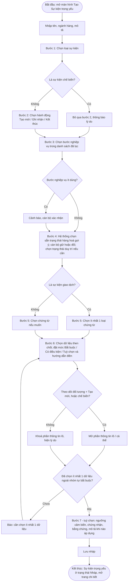

**Sơ đồ luồng — Lưu nháp**
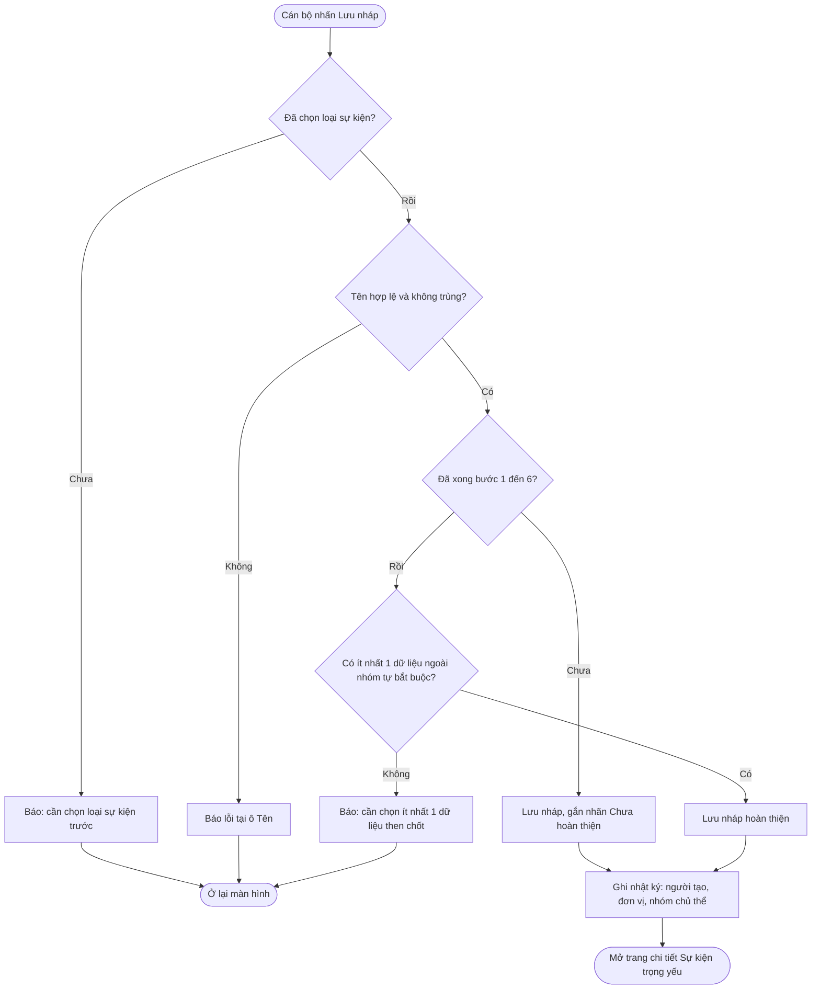

---

### 7.2. Khai báo thông tin thẩm quyền và phạm vi **[Theo Quyển 2/3]**

**Mô tả.** Tính năng cho phép cán bộ tiêu chuẩn khai báo các thông tin mà Quyển 2 yêu cầu với mọi Sự kiện trọng yếu: căn cứ ban hành, nhóm sản phẩm áp dụng, vai trò chủ thể phải ghi nhận, cơ quan chủ trì và cơ quan phối hợp (nếu liên ngành), văn bản uỷ quyền (với nhóm 2B khi kế thừa). Thông tin này nằm ở thẻ "Thẩm quyền và phạm vi" trên trang chi tiết bản nháp. Thẻ này độc lập với 7 bước cấu hình, nên cán bộ có thể cấu hình trước rồi bổ sung căn cứ sau. Hệ thống bắt buộc thẻ này phải đầy đủ trước khi cho trình phê duyệt.

**Câu chuyện người dùng**
- Là cán bộ tiêu chuẩn, tôi muốn gắn Sự kiện trọng yếu với văn bản làm căn cứ, để doanh nghiệp và các cơ quan khác biết sự kiện này có hiệu lực pháp lý từ đâu.
- Là cán bộ tiêu chuẩn, tôi muốn chỉ rõ nhóm sản phẩm và vai trò chủ thể phải ghi nhận, để doanh nghiệp không áp dụng nhầm sang sản phẩm hoặc khâu khác.
- Là cán bộ tiêu chuẩn của cơ quan chủ trì, tôi muốn khai báo các cơ quan phối hợp khi sản phẩm thuộc nhiều ngành, để các cơ quan này được thông báo và không ban hành chồng chéo.
- Là cán bộ tiêu chuẩn cấp địa phương, tôi muốn hệ thống tự gắn văn bản uỷ quyền của đơn vị khi kế thừa, để bản trình có đủ căn cứ thẩm quyền.

**Sơ đồ luồng**
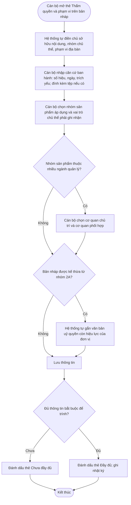

---

### 7.3. Xem và tra cứu Sự kiện trọng yếu

**Mô tả.** Trang danh sách hiển thị mỗi mã sự kiện trên một dòng, kèm phiên bản tiêu biểu chọn theo thứ tự ưu tiên: Đang áp dụng → Chờ áp dụng → Chờ phê duyệt → Nháp → Ngừng áp dụng gần nhất. **[Bổ sung]**

Tìm kiếm và lọc:
- Cán bộ tìm theo tên (có dấu hoặc không dấu) và theo mã.
- Cán bộ lọc theo: loại sự kiện, bước nghiệp vụ, trạng thái, ngành hàng, nhóm sản phẩm, nhóm chủ thể, nguồn tạo, căn cứ ban hành, nhãn "Có cảnh báo danh mục".

Trang chi tiết:
- Thể hiện 7 bước bằng ngôn ngữ dễ đọc.
- Có các thẻ: "Thẩm quyền và phạm vi", "Lịch sử phiên bản", "Nhật ký", "Đang được dùng trong Quy trình".

Theo nhóm người dùng:
- Cán bộ nhóm 2B có thêm thẻ "Sự kiện cấp trung ương" ở chế độ chỉ xem.
- Quản trị Cấp 1 thấy danh sách của mọi đơn vị, chỉ gồm các trạng thái đã công bố.

**Câu chuyện người dùng**
- Là cán bộ tiêu chuẩn, tôi muốn tìm và lọc Sự kiện trọng yếu theo nhiều tiêu chí, để nhanh chóng tìm sự kiện cần rà soát.
- Là cán bộ tiêu chuẩn, tôi muốn xem chi tiết 7 bước của một Sự kiện trọng yếu bằng ngôn ngữ dễ hiểu, để kiểm tra trước khi trình.
- Là cán bộ tiêu chuẩn, tôi muốn thấy rõ trạng thái kèm ngày áp dụng và ngày ngừng, để biết phiên bản nào đang có hiệu lực.
- Là cán bộ tiêu chuẩn, tôi muốn biết Sự kiện trọng yếu đang nằm trong những Quy trình nào, để đánh giá ảnh hưởng trước khi thay đổi.
- Là cán bộ cấp địa phương, tôi muốn xem các Sự kiện trọng yếu đang áp dụng của trung ương cùng ngành, để chọn sự kiện kế thừa.
- Là quản trị nền tảng quốc gia, tôi muốn xem các Sự kiện trọng yếu đã công bố của mọi cơ quan, để giám sát việc áp dụng và đối chiếu bản ghi cũ.

**Sơ đồ luồng**
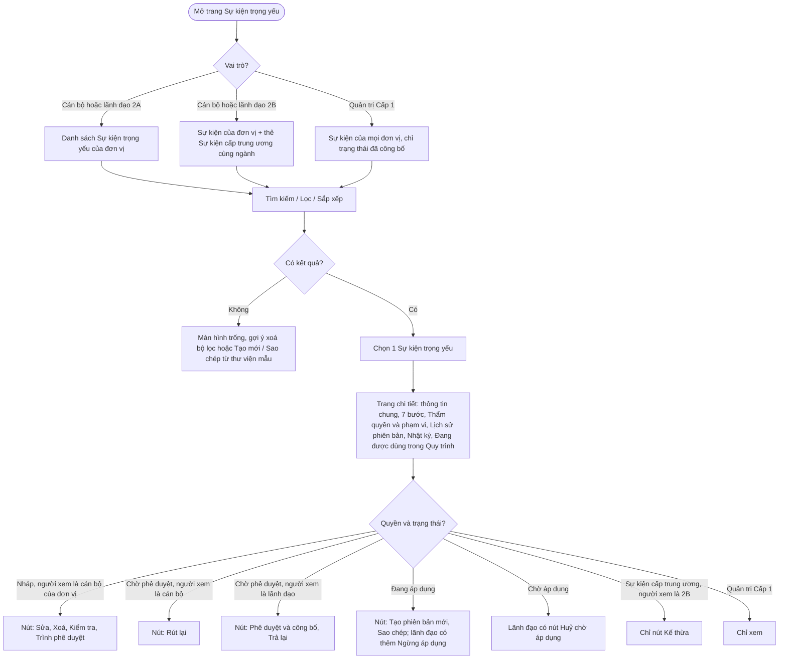

---

### 7.4. Sửa bản nháp

**Mô tả.** Tính năng cho phép cán bộ tiêu chuẩn sửa thông tin chung, thông tin thẩm quyền và phạm vi, và bước 2–7 của bản nháp. Loại sự kiện chỉ xem.
- Bản Chờ phê duyệt: cán bộ phải rút lại về Nháp trước khi sửa.
- Bản đã công bố: không sửa trực tiếp; cán bộ tạo phiên bản mới.
- Bản nháp kế thừa từ cấp trung ương: vẫn chịu quy tắc chỉ thêm chặt.
- Mỗi lần cán bộ lưu, hệ thống ghi lại giá trị trước và sau của từng nội dung thay đổi.

**Câu chuyện người dùng**
- Là cán bộ tiêu chuẩn, tôi muốn sửa bản nháp để điều chỉnh cấu hình trước khi trình phê duyệt.
- Là cán bộ tiêu chuẩn, tôi muốn sửa theo ý kiến lãnh đạo sau khi bản trình bị trả lại, và thấy ý kiến đó ngay trên màn hình sửa.
- Là cán bộ tiêu chuẩn, tôi muốn biết đồng nghiệp đang sửa cùng Sự kiện trọng yếu, để tránh ghi đè lẫn nhau.
- Là cán bộ cấp địa phương, tôi muốn được chặn ngay khi vô tình nới lỏng yêu cầu của trung ương trong lúc sửa, để không ban hành sai thẩm quyền.

**Sơ đồ luồng**
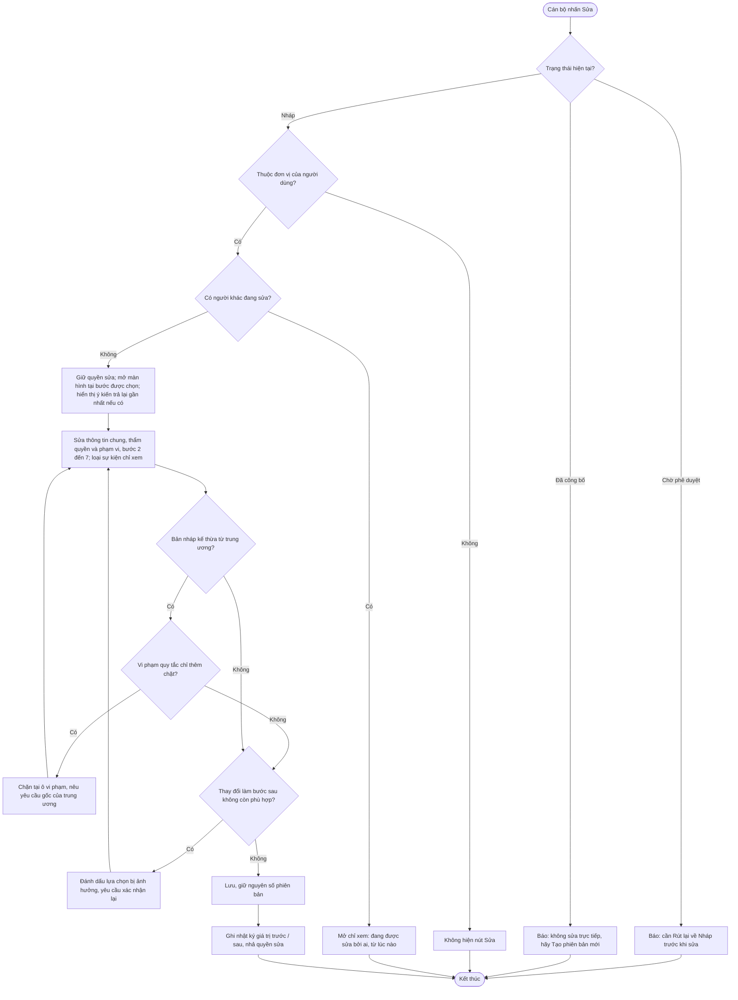

---

### 7.5. Xoá bản nháp

**Mô tả.** Tính năng cho phép cán bộ tiêu chuẩn xoá vĩnh viễn một bản nháp.
- Nếu bản nháp là phiên bản mới của một Sự kiện trọng yếu đã công bố, hệ thống chỉ xoá bản nháp đó và giữ nguyên các phiên bản khác. **[Bổ sung]**
- Hệ thống không cho xoá bản đã trình, bản đã công bố, và bản nháp đang nằm trong một Quy trình truy xuất tiêu chuẩn.
- Hệ thống lưu toàn bộ nội dung của bản đã xoá vào nhật ký, phục vụ giải trình.

**Câu chuyện người dùng**
- Là cán bộ tiêu chuẩn, tôi muốn xoá bản nháp không còn dùng, để danh sách gọn gàng, tránh nhầm lẫn.
- Là cán bộ tiêu chuẩn, tôi muốn biết bản nháp đang nằm trong Quy trình nào khi không xoá được, để xử lý đúng chỗ.

**Sơ đồ luồng**
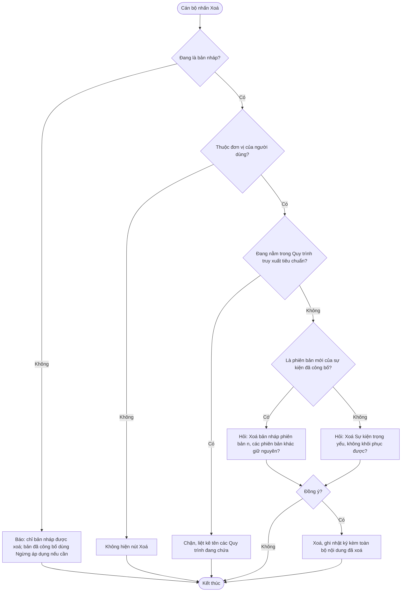

---

### 7.6. Sao chép và kế thừa Sự kiện trọng yếu

**Mô tả.** Tính năng cho phép cán bộ tiêu chuẩn tạo bản nháp mới bằng cách sao chép toàn bộ 7 bước từ một trong ba nguồn:

| Nguồn | Điều kiện nguồn | Ràng buộc sau khi sao chép |
|---|---|---|
| Thư viện sự kiện mẫu quốc gia (Cấp 1) | Sự kiện mẫu đang hiệu lực | Cán bộ sửa tự do bước 2–7; loại sự kiện bị khoá. |
| Sự kiện trọng yếu của nhóm 2A cùng ngành (**kế thừa**, dành cho nhóm 2B) | Phiên bản Đang áp dụng; đơn vị 2B có văn bản uỷ quyền còn hiệu lực | Áp dụng quy tắc **chỉ thêm chặt**. |
| Sự kiện trọng yếu của chính đơn vị | Bất kỳ phiên bản nào | Cán bộ sửa tự do bước 2–7; loại sự kiện bị khoá. |

Phần thông tin thẩm quyền và phạm vi **không** được sao chép. Lý do: căn cứ ban hành của nguồn không phải căn cứ của đơn vị sao chép. Cán bộ phải khai báo lại phần này. **[Theo Quyển 2/3]**

Nếu sự kiện nguồn dùng giá trị đã bị bộ lõi ngừng sử dụng, hệ thống vẫn tạo bản nháp mới nhưng đánh dấu lỗi tại các ô đó. **[Bổ sung]**

**Bảng "chỉ thêm chặt" khi nhóm 2B kế thừa nhóm 2A**
| Được phép | Không được phép |
|---|---|
| Thêm dữ liệu then chốt mới | Bỏ dữ liệu then chốt bắt buộc của trung ương |
| Nâng dữ liệu Tuỳ chọn lên Bắt buộc có điều kiện hoặc Bắt buộc | Hạ dữ liệu Bắt buộc xuống Bắt buộc có điều kiện hoặc Tuỳ chọn |
| Thêm thông tin lô, nâng lên bắt buộc | Bỏ thông tin lô bắt buộc của trung ương |
| Thêm loại chứng từ | Bỏ loại chứng từ trung ương đã chọn |
| Thu hẹp ngưỡng cảm biến (2–8°C → 3–6°C) | Nới ngưỡng cảm biến (2–8°C → 0–10°C) |
| Thêm chứng nhận, bằng chứng; nâng chứng nhận lên bắt buộc | Bỏ chứng nhận, bằng chứng bắt buộc của trung ương |
| Thêm trạng thái duy trì | Đổi trạng thái hàng hoá; bỏ trạng thái duy trì của trung ương |
| Bổ sung hướng dẫn điền, mô tả khi nào áp dụng; đặt tên phù hợp địa phương | Đổi loại sự kiện, hành động, bước nghiệp vụ |

**Câu chuyện người dùng**
- Là cán bộ tiêu chuẩn, tôi muốn sao chép sự kiện mẫu từ thư viện quốc gia, để có điểm khởi đầu đúng chuẩn thay vì tạo từ đầu.
- Là cán bộ cấp địa phương được uỷ quyền, tôi muốn kế thừa Sự kiện trọng yếu của trung ương và bổ sung yêu cầu của địa phương, để tiêu chuẩn tỉnh luôn tuân thủ tiêu chuẩn trung ương.
- Là cán bộ cấp địa phương, tôi muốn phân biệt rõ đâu là yêu cầu của trung ương, đâu là phần địa phương bổ sung, để giải trình khi được hỏi.
- Là cán bộ tiêu chuẩn, tôi muốn sao chép Sự kiện trọng yếu của chính đơn vị, để tạo nhanh sự kiện tương tự cho ngành hàng khác.

**Sơ đồ luồng**
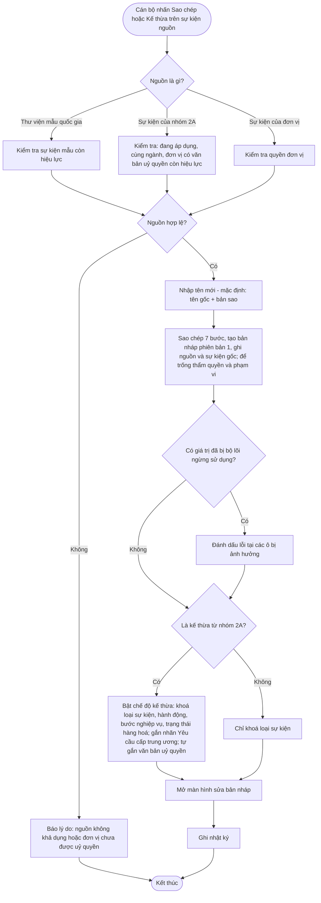

---

### 7.7. Kiểm tra tổng thể và trình phê duyệt

**Mô tả.** Tính năng cho phép cán bộ tiêu chuẩn kiểm tra toàn bộ cấu hình và trình lãnh đạo phê duyệt.
- Cán bộ chạy kiểm tra tổng thể bất kỳ lúc nào bằng nút "Kiểm tra". Hệ thống cũng tự chạy kiểm tra khi cán bộ trình phê duyệt.
- Kết quả kiểm tra chia hai mức:
  - **Lỗi:** cán bộ phải sửa mới trình được.
  - **Cảnh báo:** cán bộ được trình sau khi xác nhận đã đọc.
- Mỗi dòng kết quả có liên kết "Đi tới bước n".
- Theo Quyển 2, kiểm tra cấu trúc và kiểm tra nghiệp vụ là các lớp độc lập. Hệ thống trình bày kết quả theo từng lớp.

| Lớp | Mức | Nội dung kiểm tra |
|---|---|---|
| Cấu trúc | Lỗi | Chưa chọn hành động (trừ sự kiện chế biến). |
| Cấu trúc | Lỗi | Sự kiện giao dịch chưa có loại chứng từ. |
| Cấu trúc | Lỗi | Thiếu dữ liệu mà loại sự kiện bắt buộc phải có (mục 5.3). |
| Cấu trúc | Lỗi | Có thông tin lô trong khi loại sự kiện hoặc hành động không cho phép. |
| Cấu trúc | Lỗi | Có dữ liệu không được dùng với loại sự kiện. |
| Cấu trúc | Lỗi | Chưa có dữ liệu nào ngoài nhóm hệ thống tự bắt buộc. |
| Cấu trúc | Lỗi | Ngưỡng cảm biến không hợp lệ. |
| Danh mục | Lỗi **[Bổ sung]** | Có giá trị đã bị bộ lõi quốc gia ngừng sử dụng. |
| Thẩm quyền | Lỗi **[Theo Quyển 2/3]** | Thiếu căn cứ ban hành, nhóm sản phẩm hoặc vai trò chủ thể phải ghi nhận. |
| Thẩm quyền | Lỗi **[Theo Quyển 2/3]** | Bản kế thừa thiếu văn bản uỷ quyền còn hiệu lực. |
| Thẩm quyền | Lỗi **[Bổ sung]** | Bản kế thừa vi phạm quy tắc "chỉ thêm chặt" so với phiên bản đang áp dụng mới nhất của trung ương. |
| Phiên bản | Lỗi | Phiên bản 2 trở đi thiếu ngày áp dụng đề xuất, lý do thay đổi hoặc quy tắc chuyển tiếp. |
| Nghiệp vụ | Cảnh báo | Bước nghiệp vụ thuộc mức "ít dùng". |
| Nghiệp vụ | Cảnh báo | Trạng thái hàng hoá khác gợi ý. |
| Nghiệp vụ | Cảnh báo **[Bổ sung]** | Có dữ liệu then chốt chưa có hướng dẫn điền. |
| Phiên bản | Cảnh báo **[Bổ sung]** | Phiên bản mới không khác gì phiên bản đang áp dụng. |
| Phiên bản | Cảnh báo **[Bổ sung]** | Thời hạn chuyển tiếp ngắn hơn 30 ngày. |

**Câu chuyện người dùng**
- Là cán bộ tiêu chuẩn, tôi muốn hệ thống kiểm tra toàn bộ cấu hình và chỉ rõ lỗi ở bước nào, để không trình lên lãnh đạo một bản sai chuẩn.
- Là cán bộ tiêu chuẩn, tôi muốn tự kiểm tra trước khi trình, để chuẩn bị hồ sơ đầy đủ.
- Là cán bộ tiêu chuẩn, tôi muốn rút lại bản đã trình khi phát hiện sai sót, để sửa mà không phải chờ lãnh đạo trả lại.

**Sơ đồ luồng**
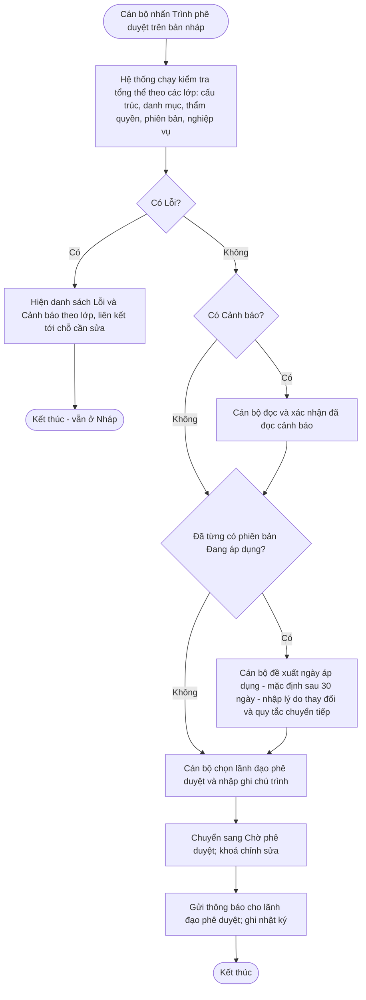

**Sơ đồ luồng — Rút lại bản trình**
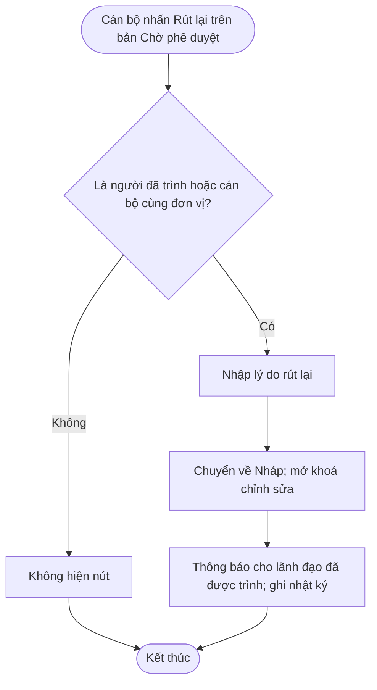

---

### 7.8. Phê duyệt và công bố **[Theo Quyển 2/3]**

**Mô tả.** Tính năng cho phép lãnh đạo phê duyệt xem bản trình và quyết định một trong hai hướng:

- **Phê duyệt và công bố.**
  - Phiên bản 1: hệ thống chuyển sang Đang áp dụng ngay.
  - Phiên bản 2 trở đi: hệ thống chuyển sang Chờ áp dụng theo ngày áp dụng. Lãnh đạo được giữ ngày cán bộ đề xuất hoặc điều chỉnh, nhưng ngày áp dụng phải từ ngày mai trở đi.
  - Nếu đang có phiên bản Chờ áp dụng khác, hệ thống huỷ phiên bản đó sau khi lãnh đạo xác nhận.
  - Sau khi công bố, hệ thống gửi phiên bản vào danh mục tham chiếu quốc gia của Cấp 1. Hệ thống thông báo cho đơn vị cung cấp giải pháp (Cấp 3), tổ chức, cá nhân sản xuất, kinh doanh (Cấp 4) đang áp dụng, các đơn vị nhóm 2B đã kế thừa, và các cơ quan phối hợp nếu có.
- **Trả lại.** Lãnh đạo bắt buộc nhập ý kiến. Hệ thống chuyển bản trình về Nháp và thông báo cho cán bộ đã trình.

Trang phê duyệt hiển thị:
- toàn bộ 7 bước;
- thẻ thẩm quyền và phạm vi;
- kết quả kiểm tra tổng thể và các cảnh báo cán bộ đã xác nhận;
- với phiên bản 2 trở đi: **bảng so sánh với phiên bản đang áp dụng**.

Khi tới ngày áp dụng, hệ thống tự chuyển trạng thái và thông báo cho các bên.

**Câu chuyện người dùng**
- Là lãnh đạo phê duyệt, tôi muốn xem đầy đủ nội dung, căn cứ và các thay đổi so với phiên bản đang áp dụng trên cùng một màn hình, để quyết định nhanh và có cơ sở.
- Là lãnh đạo phê duyệt, tôi muốn điều chỉnh ngày áp dụng khi phê duyệt, để khớp với ngày hiệu lực của văn bản ban hành.
- Là lãnh đạo phê duyệt, tôi muốn trả lại bản trình kèm ý kiến cụ thể, để cán bộ biết chính xác phải sửa gì.
- Là đơn vị cung cấp giải pháp, tôi muốn nhận được phiên bản mới cùng ngày áp dụng và quy tắc chuyển tiếp ngay khi công bố, để kịp cập nhật công cụ cho khách hàng.
- Là doanh nghiệp, tôi muốn được báo trước khi Sự kiện trọng yếu tôi đang khai báo sắp thay đổi, để kịp điều chỉnh cách khai báo.
- Là cán bộ cấp địa phương, tôi muốn được báo khi trung ương thay đổi Sự kiện trọng yếu mà địa phương đang kế thừa, để rà soát lại tiêu chuẩn địa phương.

**Sơ đồ luồng — Phê duyệt và công bố**
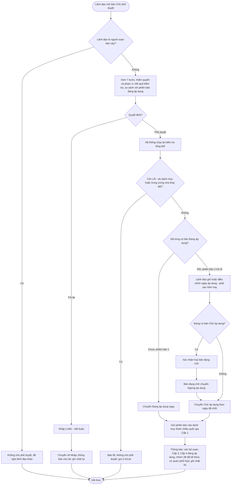

**Sơ đồ luồng — Hệ thống tự chuyển trạng thái khi tới ngày áp dụng**
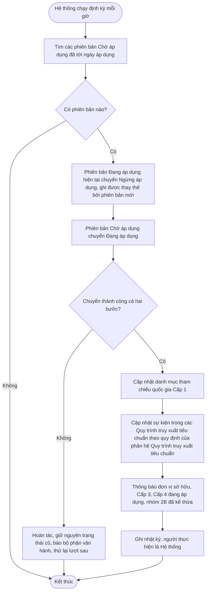

**Sơ đồ luồng — Huỷ phiên bản Chờ áp dụng**
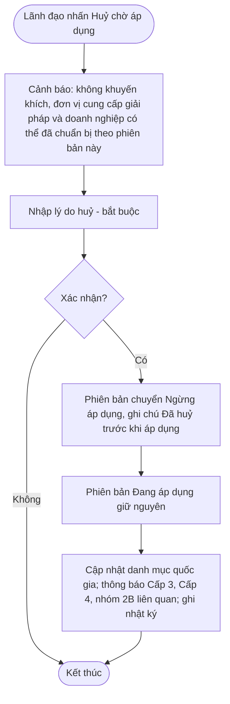

---

### 7.9. Quản lý phiên bản

**Mô tả.** Tính năng cho phép cán bộ tiêu chuẩn tạo phiên bản mới từ phiên bản Đang áp dụng (hoặc Chờ áp dụng **[Bổ sung]**) khi tiêu chuẩn cần điều chỉnh.
- Phiên bản mới ở trạng thái Nháp và sao chép cả 7 bước lẫn thông tin thẩm quyền và phạm vi từ phiên bản gốc. Cán bộ cập nhật căn cứ ban hành nếu có văn bản mới.
- Với mỗi mã sự kiện, hệ thống chỉ cho phép một bản ở trạng thái Nháp hoặc Chờ phê duyệt tại một thời điểm. Loại sự kiện không đổi qua các phiên bản.
- Thẻ "Lịch sử phiên bản" hiển thị với mỗi phiên bản: trạng thái, ngày công bố, ngày áp dụng, ngày ngừng, người soạn, người phê duyệt, căn cứ ban hành, lý do thay đổi.
- Cán bộ được xem chi tiết từng phiên bản cũ và **so sánh hai phiên bản** theo từng bước (thêm, bớt, thay đổi). **[Bổ sung]**
- Khi cán bộ xoá một bản nháp chưa từng được công bố, hệ thống dùng lại số phiên bản đó, để dãy phiên bản đã công bố luôn liên tục. **[Bổ sung]**

**Câu chuyện người dùng**
- Là cán bộ tiêu chuẩn, tôi muốn tạo phiên bản mới khi tiêu chuẩn cần điều chỉnh, mà không ảnh hưởng phiên bản đang có hiệu lực.
- Là cán bộ tiêu chuẩn, tôi muốn xem lại nội dung các phiên bản cũ, để biết tại một thời điểm doanh nghiệp phải khai báo theo yêu cầu nào.
- Là cán bộ tiêu chuẩn, tôi muốn so sánh hai phiên bản, để giải trình thay đổi khi được thanh tra, kiểm tra.
- Là quản trị nền tảng quốc gia, tôi muốn tra được phiên bản có hiệu lực tại một ngày bất kỳ, để kiểm tra bản ghi sự kiện cũ đúng quy định tại thời điểm đó.

**Sơ đồ luồng**
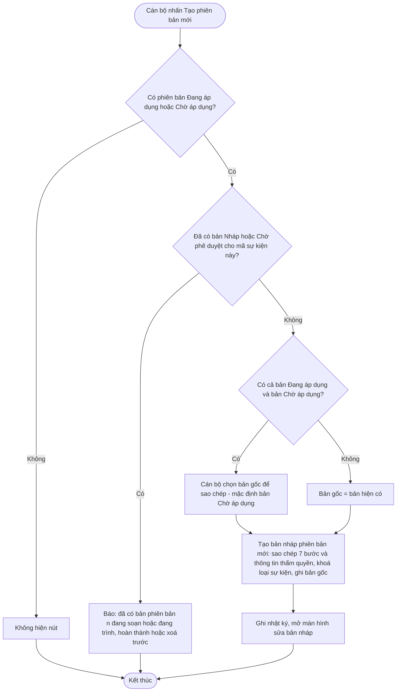

---

### 7.10. Ngừng áp dụng và xử lý thay đổi bộ lõi quốc gia **[Bổ sung]**

**Mô tả.** Tính năng gồm ba phần.

1. **Ngừng áp dụng chủ động.** Lãnh đạo phê duyệt chấm dứt hiệu lực một Sự kiện trọng yếu mà không có phiên bản thay thế, ví dụ khi văn bản mới bỏ yêu cầu ghi nhận công đoạn này.
   - Lãnh đạo chọn ngừng ngay hoặc theo một ngày trong tương lai, và bắt buộc nêu lý do cùng căn cứ.
   - Hệ thống không cho thực hiện khi Sự kiện trọng yếu đang nằm trong Quy trình truy xuất tiêu chuẩn đang áp dụng.
   - Hệ thống huỷ theo phiên bản Chờ áp dụng, nếu có.
   - Cán bộ tiêu chuẩn được đề xuất ngừng áp dụng; lãnh đạo là người quyết định.
2. **Khi bộ lõi quốc gia ngừng sử dụng một giá trị.** Hệ thống xử lý theo quy tắc QT-31: bản nháp và bản chờ phê duyệt bị đánh dấu lỗi; bản đã công bố giữ nguyên hiệu lực, chỉ bị gắn cảnh báo.
3. **Khi trung ương ngừng áp dụng một Sự kiện trọng yếu.** Hệ thống thông báo cho các đơn vị nhóm 2B đã kế thừa. Sự kiện của nhóm 2B **không** bị tự động ngừng; mỗi đơn vị tự quyết định.

**Câu chuyện người dùng**
- Là lãnh đạo phê duyệt, tôi muốn ngừng áp dụng một Sự kiện trọng yếu không còn phù hợp, để doanh nghiệp không phải khai báo thừa.
- Là lãnh đạo phê duyệt, tôi muốn hẹn ngày ngừng áp dụng, để khớp với ngày hiệu lực của văn bản.
- Là cán bộ tiêu chuẩn, tôi muốn được cảnh báo khi bộ lõi quốc gia ngừng sử dụng giá trị mà Sự kiện trọng yếu của tôi đang dùng, để chủ động tạo phiên bản thay thế.
- Là cán bộ cấp địa phương, tôi muốn được báo khi trung ương ngừng áp dụng Sự kiện trọng yếu mà địa phương đang kế thừa, để quyết định có ngừng theo hay không.

**Sơ đồ luồng — Ngừng áp dụng chủ động**
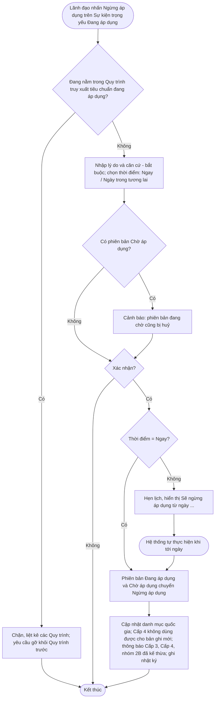

**Sơ đồ luồng — Bộ lõi quốc gia ngừng sử dụng một giá trị**
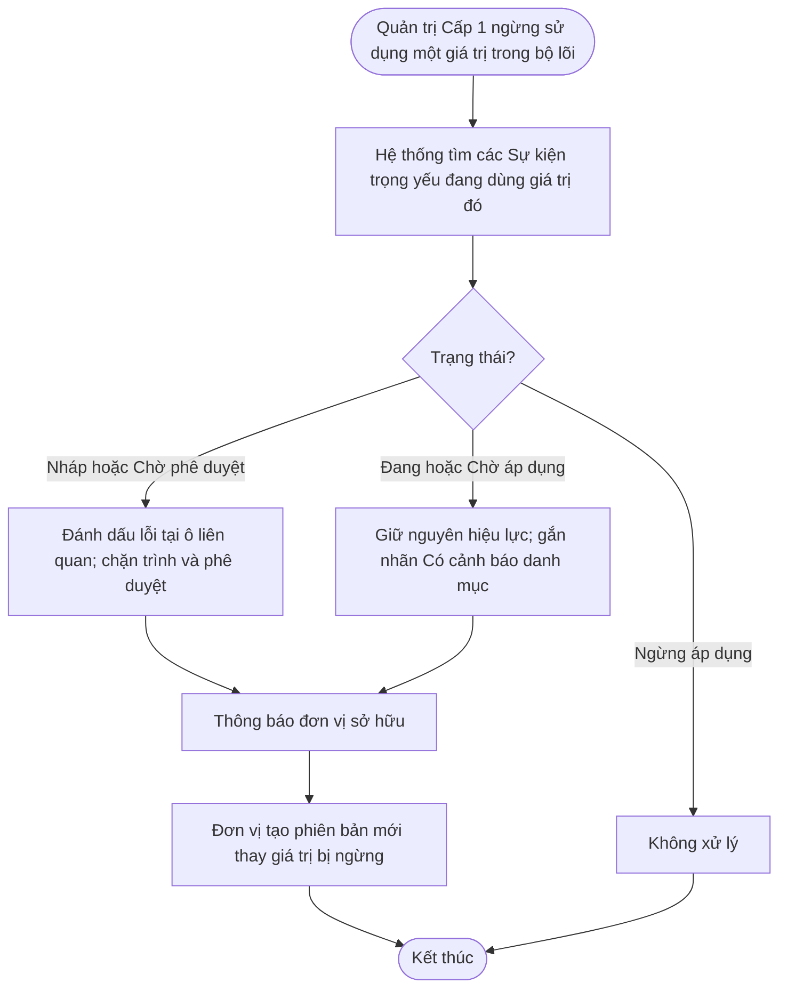

---

## 8. Danh mục thông báo

| Mã | Tình huống | Người nhận | Nội dung hiển thị |
|---|---|---|---|
| TB-01 | Cán bộ cố đổi loại sự kiện | Cán bộ | Loại sự kiện không thể thay đổi. Hãy tạo Sự kiện trọng yếu mới nếu cần loại khác. |
| TB-02 | Sự kiện chế biến ở bước 2 | Cán bộ | Sự kiện chế biến không có hành động — bỏ qua bước này. |
| TB-03 | Sự kiện giao dịch thiếu chứng từ | Cán bộ | Sự kiện giao dịch cần chọn ít nhất 1 loại chứng từ. |
| TB-04 | Thông tin lô bị khoá | Cán bộ | Thông tin lô chỉ áp dụng khi hành động là Tạo mới. Hành động hiện tại: [x]. |
| TB-05 | Thiếu dữ liệu then chốt | Cán bộ | Cần chọn ít nhất 1 dữ liệu ngoài các dữ liệu hệ thống tự bắt buộc. |
| TB-06 | Trùng tên | Cán bộ | Tên Sự kiện trọng yếu đã tồn tại trong đơn vị. Vui lòng đặt tên khác. |
| TB-07 | Thiếu căn cứ ban hành | Cán bộ | Vui lòng khai báo căn cứ ban hành và nhóm sản phẩm áp dụng trước khi trình phê duyệt. |
| TB-08 | Đơn vị chưa được uỷ quyền | Cán bộ 2B | Đơn vị chưa được uỷ quyền triển khai Sự kiện trọng yếu của ngành [x]. Đề nghị liên hệ cơ quan trung ương. |
| TB-09 | Sửa bản đã công bố | Cán bộ | Sự kiện trọng yếu đã công bố không sửa trực tiếp. Hãy dùng "Tạo phiên bản mới". |
| TB-10 | Sửa bản đang trình | Cán bộ | Bản này đang chờ phê duyệt. Hãy rút lại về Nháp trước khi sửa. |
| TB-11 | Xoá bản không phải nháp | Cán bộ | Chỉ bản nháp được xoá. Sự kiện trọng yếu đã công bố có thể được đề xuất ngừng áp dụng. |
| TB-12 | Xoá khi đang trong Quy trình | Cán bộ | Sự kiện trọng yếu đang nằm trong Quy trình truy xuất tiêu chuẩn: [danh sách]. |
| TB-13 | Địa phương bớt dữ liệu bắt buộc | Cán bộ 2B | Dữ liệu "[x]" là bắt buộc theo yêu cầu cấp trung ương. Cấp địa phương chỉ được thêm, không được bớt. |
| TB-14 | Địa phương đổi nội dung cốt lõi | Cán bộ 2B | Không được thay đổi loại sự kiện, hành động, bước nghiệp vụ hoặc trạng thái hàng hoá của Sự kiện trọng yếu kế thừa từ trung ương. |
| TB-15 | Địa phương nới ngưỡng cảm biến | Cán bộ 2B | Ngưỡng cấp địa phương phải nằm trong khoảng [a–b] của yêu cầu cấp trung ương. |
| TB-16 | Thiếu ngày áp dụng | Cán bộ | Sự kiện trọng yếu đã có phiên bản đang áp dụng. Vui lòng đề xuất ngày áp dụng, lý do thay đổi và quy tắc chuyển tiếp. |
| TB-17 | Ngày không hợp lệ | Cán bộ, lãnh đạo | Ngày áp dụng phải là ngày trong tương lai. |
| TB-18 | Đã có bản đang soạn | Cán bộ | Đã có phiên bản [n] đang soạn hoặc đang trình. Hoàn thành hoặc xoá trước khi tạo phiên bản mới. |
| TB-19 | Đang có người sửa | Cán bộ | Sự kiện trọng yếu đang được sửa bởi [tên] từ [giờ]. Bạn đang xem ở chế độ chỉ xem. |
| TB-20 | Có bản trình mới | Lãnh đạo | [Tên cán bộ] trình phê duyệt Sự kiện trọng yếu "[tên]" phiên bản [n]. |
| TB-21 | Lãnh đạo tự phê duyệt | Lãnh đạo | Bạn là người soạn bản này nên không thể tự phê duyệt. Đề nghị lãnh đạo khác phê duyệt. |
| TB-22 | Bản trình bị trả lại | Cán bộ | Sự kiện trọng yếu "[tên]" bị trả lại. Ý kiến: [nội dung]. |
| TB-23 | Bản trình được phê duyệt | Cán bộ | Sự kiện trọng yếu "[tên]" phiên bản [n] đã được phê duyệt, áp dụng từ [ngày]. |
| TB-24 | Huỷ bản đang chờ | Lãnh đạo | Thao tác này không khuyến khích. Bạn có chắc muốn huỷ áp dụng phiên bản [n]? |
| TB-25 | Báo Cấp 3, Cấp 4 — sắp thay đổi | Cấp 3, Cấp 4 | Sự kiện trọng yếu "[tên]" có phiên bản [n] áp dụng từ [ngày]. Quy tắc chuyển tiếp: [nội dung]. |
| TB-26 | Báo Cấp 3, Cấp 4 — đã thay đổi | Cấp 3, Cấp 4 | Sự kiện trọng yếu "[tên]" đã chuyển sang phiên bản [n] từ hôm nay. |
| TB-27 | Báo Cấp 3, Cấp 4 — ngừng áp dụng | Cấp 3, Cấp 4 | Sự kiện trọng yếu "[tên]" ngừng áp dụng từ [ngày]. Lý do: [nội dung]. |
| TB-28 | Báo địa phương kế thừa | Cán bộ 2B | Sự kiện trọng yếu cấp trung ương "[tên]" có thay đổi: [nội dung]. Đề nghị rà soát Sự kiện trọng yếu kế thừa của đơn vị. |
| TB-29 | Báo cơ quan phối hợp | Cơ quan phối hợp | [Cơ quan chủ trì] đã ban hành Sự kiện trọng yếu "[tên]" cho nhóm sản phẩm [x], áp dụng từ [ngày]. |
| TB-30 | Bộ lõi thay đổi | Cán bộ | Giá trị "[x]" mà Sự kiện trọng yếu "[tên]" đang dùng đã bị ngừng sử dụng trong bộ lõi quốc gia. Hãy tạo phiên bản mới để thay thế. |

---

## 9. Nhật ký thao tác

Hệ thống ghi nhật ký mọi thao tác trên Sự kiện trọng yếu. Nhật ký được lưu vĩnh viễn; không người dùng nào được sửa hay xoá. Cán bộ và lãnh đạo xem nhật ký tại thẻ "Nhật ký" trên trang chi tiết.

| Thao tác | Thông tin được ghi |
|---|---|
| Tạo mới, sao chép, kế thừa | Người thực hiện, đơn vị, nhóm chủ thể, thời điểm, nguồn tạo, sự kiện gốc và phiên bản gốc |
| Sửa bản nháp | Từng nội dung thay đổi, giá trị trước và sau |
| Khai báo thẩm quyền và phạm vi | Căn cứ ban hành, nhóm sản phẩm, cơ quan phối hợp, văn bản uỷ quyền |
| Xoá bản nháp | Toàn bộ nội dung 7 bước và thông tin thẩm quyền tại thời điểm xoá |
| Trình phê duyệt, rút lại | Người trình, lãnh đạo được trình, ghi chú, kết quả kiểm tra, các cảnh báo đã xác nhận, lý do rút lại |
| Phê duyệt, trả lại | Lãnh đạo, quyết định, ý kiến, ngày áp dụng đã chốt |
| Huỷ chờ áp dụng, ngừng áp dụng | Lãnh đạo, lý do, căn cứ, thời điểm |
| Hệ thống tự chuyển trạng thái | Người thực hiện là Hệ thống, phiên bản trước và sau, kết quả gửi danh mục quốc gia |
| Gửi thông báo | Loại thông báo, danh sách người nhận, thời điểm gửi |

---

## 10. Phụ thuộc

| Quan hệ | Chức năng / phân hệ liên quan | Cấp | Nội dung |
|---|---|---|---|
| Cần dữ liệu từ | Quản lý danh mục tham chiếu Sự kiện trọng yếu và dữ liệu then chốt | Cấp 1 | Thư viện sự kiện mẫu quốc gia để sao chép; danh mục tham chiếu quốc gia để đăng ký phiên bản đã công bố |
| Cần dữ liệu từ | Duy trì danh mục, từ điển dữ liệu và quan hệ ánh xạ dùng chung | Cấp 1 | Loại sự kiện, bước nghiệp vụ, trạng thái hàng hoá, loại chứng từ, dữ liệu then chốt, đơn vị đo, bảng gợi ý |
| Cần dữ liệu từ | Quản lý danh mục, hồ sơ và ánh xạ chuyên ngành | Cấp 2 | Danh mục ngành hàng, nhóm sản phẩm chuyên ngành đã ánh xạ với bộ lõi |
| Cần dữ liệu từ | Quản lý bộ quy tắc ngành, chương trình và thị trường | Cấp 2 | Căn cứ ban hành, yêu cầu ngành làm cơ sở cấu hình |
| Cần dữ liệu từ | Quản lý địa điểm, cơ sở chuyên ngành | Cấp 2 | Loại địa điểm áp dụng cho dữ liệu then chốt về địa điểm |
| Cần dữ liệu từ | Quản lý phạm vi thẩm quyền, vai trò và tư cách chuyên ngành | Cấp 2 | Nhóm chủ thể 2A, 2B; quan hệ trung ương – địa phương theo ngành; văn bản uỷ quyền; quyền phê duyệt |
| Cần dữ liệu từ | Quản lý vai trò, uỷ quyền và trạng thái tham gia | Cấp 1 | Tài khoản, vai trò cán bộ tiêu chuẩn, lãnh đạo phê duyệt |
| Cần được báo từ | Ngừng sử dụng giá trị trong các danh mục trên | Cấp 1 | Để gắn lỗi, cảnh báo (mục 7.10) |
| Hai chiều | Quản lý Quy trình truy xuất tiêu chuẩn theo ngành hàng | Cấp 2 | Quy trình chỉ gom Sự kiện trọng yếu Đang áp dụng; phân hệ này hỏi Quy trình để biết sự kiện có đang nằm trong Quy trình không trước khi xoá, ngừng áp dụng |
| Cung cấp đầu ra cho | Quản lý danh mục tham chiếu Sự kiện trọng yếu và dữ liệu then chốt | Cấp 1 | Phiên bản đã công bố kèm chủ sở hữu, phạm vi, ngày áp dụng, quy tắc chuyển tiếp |
| Cung cấp đầu ra cho | Tiếp nhận, trao đổi và đối soát dữ liệu chuyên ngành | Cấp 2 | Sự kiện trọng yếu đang áp dụng để đối soát dữ liệu ngành |
| Cung cấp đầu ra cho | Cấu hình công cụ hỗ trợ định danh, mẫu sự kiện và bằng chứng | Cấp 3 | Phiên bản, ngày áp dụng, quy tắc chuyển tiếp để đơn vị cung cấp giải pháp cấu hình công cụ |
| Cung cấp đầu ra cho | Ghi nhận và đính chính sự kiện trọng yếu | Cấp 4 | Yêu cầu khai báo, hướng dẫn điền |
| Cung cấp đầu ra cho (gián tiếp) | Tiếp nhận, kiểm tra và duy trì bản ghi sự kiện trọng yếu | Cấp 1 | Căn cứ để kiểm tra bản ghi theo đúng phiên bản có hiệu lực tại thời điểm sự kiện |
| Cần hạ tầng | Lịch tự động và gửi thông báo | — | Tự chuyển trạng thái theo ngày; gửi thông báo trong hệ thống và thư điện tử |

---

## 11. Điều kiện sẵn sàng (DoR)

Một tính năng được đưa vào Sprint khi đáp ứng đủ các điều kiện sau:
- [ ] Quản lý sản phẩm đã duyệt câu chuyện người dùng và sơ đồ luồng của tính năng. Cả nhóm phát triển đã hiểu thống nhất trong buổi làm rõ yêu cầu.
- [ ] Các chức năng, phân hệ phụ thuộc (mục 10) đã sẵn sàng trên môi trường phát triển, hoặc đã có dữ liệu giả lập thống nhất.
- [ ] Chuyên gia nghiệp vụ đã duyệt: bảng gợi ý bước nghiệp vụ theo loại sự kiện, bảng gợi ý trạng thái hàng hoá, bảng ràng buộc theo loại sự kiện (mục 5.3), bảng "chỉ thêm chặt" (mục 7.6).
- [ ] Đơn vị chủ trì dự án đã xác nhận các nội dung đánh dấu **[Theo Quyển 2/3]** và **[Bổ sung]** liên quan tới tính năng.
- [ ] Giao diện trên Figma đã duyệt, đủ các trạng thái: bình thường, trống, đang tải, lỗi, chỉ xem.
- [ ] Nội dung thông báo (mục 8) liên quan đã chốt câu chữ.
- [ ] Nhóm đã ước lượng và tính năng vừa với 1 Sprint. Tính năng Tạo Sự kiện trọng yếu được chia nhỏ theo từng bước nếu cần.
- [ ] Đã có dữ liệu và tài khoản kiểm thử: sự kiện mẫu cho cả 5 loại sự kiện; tài khoản cán bộ và lãnh đạo nhóm 2A, nhóm 2B (có và không có văn bản uỷ quyền); tài khoản quản trị Cấp 1.

## 12. Điều kiện hoàn thành (DoD)

Một tính năng được coi là hoàn thành khi đáp ứng đủ các điều kiện sau:
- [ ] Mọi nhánh trong sơ đồ luồng của tính năng (luồng chính, luồng thay thế, ngoại lệ) chạy đúng trên môi trường kiểm thử.
- [ ] Mọi quy tắc nghiệp vụ (mục 6) liên quan được tuân thủ; mỗi quy tắc có ít nhất một kịch bản kiểm thử chứng minh.
- [ ] Phân quyền đúng mục 4.4, được kiểm tra ở cả giao diện và phía máy chủ.
- [ ] Nhật ký thao tác ghi đúng mục 9; thông báo hiển thị và gửi đúng người nhận theo mục 8.
- [ ] Dữ liệu gửi vào danh mục tham chiếu quốc gia Cấp 1 đúng và đủ thông tin theo quy tắc QT-29.
- [ ] Giao diện khớp thiết kế Figma đã duyệt.
- [ ] Không còn lỗi mức nghiêm trọng hoặc cao.
- [ ] Tài liệu hướng dẫn sử dụng cho cán bộ tiêu chuẩn và lãnh đạo phê duyệt được cập nhật.
- [ ] Quản lý sản phẩm nghiệm thu trong buổi Sprint Review.
