# Tài liệu yêu cầu sản phẩm — Xây dựng Sự kiện trọng yếu

| Thông tin | Nội dung |
|---|---|
| Sản phẩm | NDATrace — Nhóm nghiệp vụ Chuẩn sự kiện truy xuất và Mẫu sự kiện trọng yếu |
| Phân hệ | Xây dựng Sự kiện trọng yếu |
| Đối tượng sử dụng | Cơ quan ban hành tiêu chuẩn truy xuất nguồn gốc (Bộ, Sở) |
| Phiên bản tài liệu | 5.1 |
| Ngày | 30/10/2026 |
| Người soạn | Nguyễn Hà Cương — Quản lý sản phẩm |
| Trạng thái | Bản nháp, chờ rà soát |
| Căn cứ | Nghị định 37/2025/NĐ-CP; chuẩn sự kiện truy xuất quốc tế GS1 EPCIS 2.0 và bộ từ vựng nghiệp vụ đi kèm (CBV 2.0) |

> Nội dung đánh dấu **[Bổ sung]** là phần mới so với bản trước, đưa vào để khép kín nghiệp vụ, cần được xác nhận khi rà soát.

---

## 1. Tổng quan

### 1.1. Mục đích
Phân hệ cho phép **cán bộ tiêu chuẩn của Bộ, Sở** tự xây dựng các **Sự kiện trọng yếu** — những thời điểm bắt buộc phải ghi nhận dữ liệu trong chuỗi cung ứng (thu hoạch, đóng gói, xuất kho, nhận hàng, chế biến…) — cho ngành hàng mình quản lý, mà không cần đội kỹ thuật hỗ trợ.

Mỗi Sự kiện trọng yếu trả lời đầy đủ các câu hỏi: **cái gì, khi nào, ở đâu, vì sao, như thế nào** và được cấu hình qua **7 bước tuần tự**:

| Bước | Nội dung cán bộ chọn | Ý nghĩa |
|---|---|---|
| 1 | Loại sự kiện | Khung của sự kiện: theo dõi đối tượng, đóng gói/gom hàng, chế biến, giao dịch hay liên kết. Quyết định toàn bộ các bước sau. |
| 2 | Hành động | Đối tượng được **tạo mới**, **ghi nhận** hay **kết thúc vòng đời** tại sự kiện này. |
| 3 | Bước nghiệp vụ | Đang làm gì: thu hoạch, đóng gói, xuất hàng, nhận hàng, kiểm tra… |
| 4 | Trạng thái hàng hoá | Hàng hoá ở trạng thái nào sau sự kiện: đang vận chuyển, đang lưu hành, đạt / không đạt… |
| 5 | Loại chứng từ giao dịch | Sự kiện gắn với chứng từ nào: đơn đặt hàng, hoá đơn, phiếu giao hàng… |
| 6 | Dữ liệu then chốt | Thông tin doanh nghiệp phải khai báo (thời gian, địa điểm, mã lô, ngày sản xuất…), mức bắt buộc / tuỳ chọn và hướng dẫn điền. |
| 7 | Yêu cầu bổ sung | Ngưỡng cảm biến (VD: nhiệt độ 2–8°C), chứng nhận yêu cầu (VietGAP, HACCP…), mô tả khi nào áp dụng sự kiện. |

Sự kiện trọng yếu là **"viên gạch"**. Mẫu sự kiện trọng yếu (phân hệ riêng) gom nhiều Sự kiện trọng yếu thành **"bức tường"** — bộ yêu cầu khai báo cho cả một ngành hàng. Chỉ Sự kiện trọng yếu **đang áp dụng** mới được đưa vào Mẫu và được doanh nghiệp sử dụng.

### 1.2. Vấn đề cần giải quyết
| Vấn đề hiện tại | Hậu quả | Cách phân hệ giải quyết |
|---|---|---|
| Cán bộ tiêu chuẩn là chuyên gia ngành hàng, không phải chuyên gia chuẩn truy xuất quốc tế. | Chọn sai tổ hợp (VD: sự kiện chế biến lại khai báo hành động; sự kiện chỉ ghi nhận lại khai báo thông tin lô) → dữ liệu doanh nghiệp gửi lên không hợp chuẩn. | Mỗi bước chỉ hiện lựa chọn phù hợp với bước trước; hệ thống kiểm tra tổng thể trước khi công bố. |
| Mỗi đơn vị tự đặt tên bước, trạng thái theo thói quen. | Không liên thông, không truy xuất xuyên chuỗi được. | Chỉ chọn từ danh mục chuẩn quốc gia, không nhập tự do. |
| Tiêu chuẩn thay đổi theo thời gian. | Doanh nghiệp bị "đổi luật giữa chừng". | Quản lý phiên bản; phiên bản mới phải có ngày áp dụng trong tương lai; lưu lịch sử vĩnh viễn. |
| Sở cần yêu cầu chặt hơn Bộ cho địa phương. | Sở làm lại từ đầu, hoặc nới lỏng yêu cầu của Bộ. | Sở sao chép Sự kiện trọng yếu của Bộ và chỉ được **thêm chặt**, không được **bớt**. |
| Sự kiện và Mẫu sự kiện đang gộp làm một. | Không dùng lại được Sự kiện giữa các ngành hàng. | Tách riêng việc xây dựng Sự kiện và việc gom thành Mẫu. |

---

## 2. Người dùng và vai trò

| Vai trò | Mô tả | Nhu cầu chính |
|---|---|---|
| **Cán bộ tiêu chuẩn cấp Bộ** | Chuyên viên Cục/Vụ thuộc Bộ Nông nghiệp và Môi trường, Bộ Công Thương, Bộ Y tế… | Ban hành Sự kiện trọng yếu chuẩn cho toàn quốc theo ngành. Thường sao chép từ thư viện mẫu quốc gia rồi tinh chỉnh. |
| **Cán bộ tiêu chuẩn cấp Sở** | Chuyên viên Sở chuyên ngành tỉnh/thành phố. | Kế thừa Sự kiện trọng yếu của Bộ, bổ sung yêu cầu riêng của địa phương. |
| **Cán bộ có quyền công bố** | Cán bộ tiêu chuẩn được giao quyền công bố. | Công bố, huỷ chờ áp dụng, ngừng áp dụng. |
| **Quản trị chuẩn quốc gia (C1)** | Đơn vị quản lý danh mục chuẩn và thư viện mẫu. | Giám sát các Sự kiện trọng yếu đang và sắp áp dụng của mọi đơn vị. Không tạo, không sửa. |
| **Doanh nghiệp / hệ thống khai báo (C3)** | Doanh nghiệp, hợp tác xã, nền tảng hỗ trợ khai báo. | Biết chính xác sự kiện nào phải khai báo, thông tin nào bắt buộc; được báo trước khi tiêu chuẩn thay đổi. Không thao tác trực tiếp trên phân hệ này. |
| **Hệ thống tự động** | Tác vụ chạy định kỳ. | Chuyển trạng thái đúng ngày áp dụng / ngày ngừng. |

---

## 3. Phạm vi

### 3.1. Trong phạm vi
- Tạo Sự kiện trọng yếu qua 7 bước tuần tự; lưu nháp; sửa, xoá bản nháp.
- Sao chép từ thư viện mẫu quốc gia, từ Sự kiện trọng yếu của Bộ (dành cho Sở) và từ Sự kiện của chính đơn vị.
- Kiểm tra tổng thể trước khi công bố; phân biệt lỗi (chặn) và cảnh báo (không chặn).
- Vòng đời 4 trạng thái: Nháp → Đang áp dụng / Chờ áp dụng → Ngừng áp dụng.
- Quản lý phiên bản, xem lịch sử, so sánh phiên bản **[Bổ sung]**.
- Ngừng áp dụng chủ động **[Bổ sung]**.
- Cảnh báo khi danh mục chuẩn quốc gia ngừng sử dụng một giá trị mà Sự kiện đang dùng **[Bổ sung]**.
- Thông báo cho doanh nghiệp và cho Sở kế thừa khi Sự kiện thay đổi.
- Ghi nhật ký mọi thao tác.

### 3.2. Ngoài phạm vi
| Nội dung | Thuộc về |
|---|---|
| Gom Sự kiện thành Mẫu sự kiện trọng yếu theo ngành hàng | Phân hệ Quản lý Mẫu sự kiện trọng yếu |
| Quản lý danh mục Loại sự kiện, thư viện Sự kiện mẫu, Dữ liệu then chốt, Bước nghiệp vụ / Trạng thái hàng hoá / Loại chứng từ | Các phân hệ quản lý danh mục chuẩn quốc gia |
| Doanh nghiệp khai báo sự kiện thực tế | Nền tảng khai báo sự kiện |
| Lưu trữ, tra cứu, truy vết sự kiện đã khai báo | Kho sự kiện quốc gia |
| Quy trình trình duyệt nhiều cấp trước khi công bố | Phân hệ Phân quyền / Quy trình phê duyệt |
| Giám sát cảm biến thời gian thực, cảnh báo chuỗi lạnh | Giai đoạn mở rộng |

---

## 4. Mô hình nghiệp vụ

### 4.1. Thông tin của một Sự kiện trọng yếu

| Nhóm | Thông tin | Ghi chú |
|---|---|---|
| Định danh | Mã sự kiện | Hệ thống tự sinh, giữ nguyên qua mọi phiên bản. |
| | Tên sự kiện | VD: "Xuất kho thuỷ sản tươi". Không trùng trong cùng đơn vị. |
| | Tên tiếng Anh, mô tả | Tuỳ chọn. |
| | Ngành hàng áp dụng | Bắt buộc, dùng để lọc khi gom vào Mẫu. |
| Phiên bản | Số phiên bản | Phiên bản 1, 2, 3… |
| | Trạng thái | Nháp / Đang áp dụng / Chờ áp dụng / Ngừng áp dụng. |
| | Ngày áp dụng, ngày ngừng áp dụng | |
| | Lý do thay đổi | Bắt buộc từ phiên bản 2 **[Bổ sung]**. |
| | Thay thế cho / Được thay thế bởi | Liên kết giữa các phiên bản. |
| Nguồn gốc | Nguồn tạo | Tạo mới / Sao chép từ thư viện mẫu quốc gia / Sao chép từ cấp Bộ / Sao chép trong đơn vị. |
| | Sự kiện gốc | Khi sao chép. |
| Chủ sở hữu | Cấp (Bộ / Sở), đơn vị, người tạo, người công bố, thời điểm | |
| Nội dung | Cấu hình 7 bước | Mục 5. |

### 4.2. Vòng đời trạng thái

| Trạng thái | Màu nhãn | Đơn vị sở hữu thấy | Quản trị chuẩn quốc gia thấy | Doanh nghiệp dùng được | Được sửa | Được xoá |
|---|---|---|---|---|---|---|
| Nháp | Trắng | Có | Không | Không | Có | Có |
| Đang áp dụng | Xanh lá | Có | Có | **Có** | Không | Không |
| Chờ áp dụng (kèm ngày) | Vàng | Có | Có | Không — chỉ được báo trước | Không | Không (chỉ huỷ) |
| Ngừng áp dụng (kèm ngày) | Xám | Có (lịch sử) | Không | Không | Không | Không |

Với cùng một mã sự kiện, tại một thời điểm có tối đa **1 bản Đang áp dụng + 1 bản Chờ áp dụng + 1 bản Nháp**.

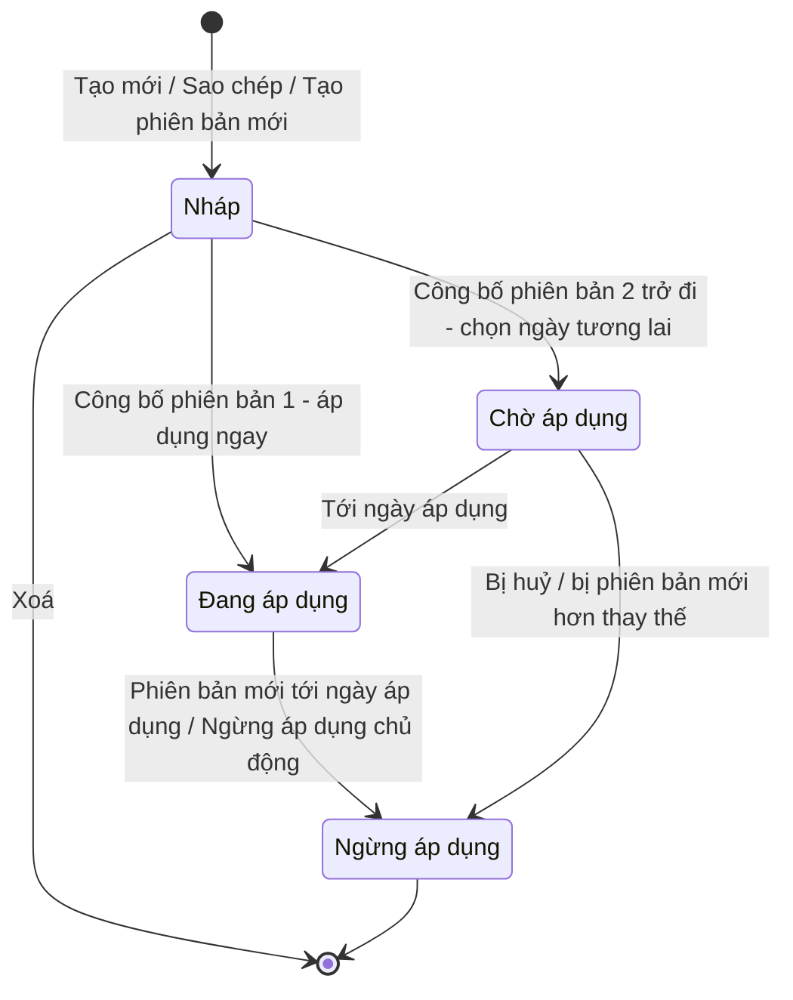

### 4.3. Phân quyền

| Thao tác | Cấp Bộ — sự kiện của đơn vị | Cấp Sở — sự kiện của đơn vị | Cấp Sở — sự kiện của Bộ | Đơn vị khác cùng cấp | Quản trị chuẩn quốc gia |
|---|---|---|---|---|---|
| Xem | ✅ | ✅ | ✅ chỉ bản Đang áp dụng, cùng ngành | ❌ | ✅ chỉ Đang / Chờ áp dụng |
| Tạo mới | ✅ | ✅ | — | — | ❌ |
| Sửa, xoá bản nháp | ✅ | ✅ | ❌ | ❌ | ❌ |
| Sao chép | ✅ | ✅ | ✅ theo quy tắc "chỉ thêm chặt" | ❌ | ❌ |
| Công bố, huỷ chờ áp dụng, ngừng áp dụng | ✅ khi có quyền công bố | ✅ khi có quyền công bố | ❌ | ❌ | ❌ |
| Tạo phiên bản mới | ✅ | ✅ | ❌ | ❌ | ❌ |

Quan hệ Bộ → Sở xác định theo **cùng ngành quản lý** (VD: Sở Nông nghiệp và Môi trường Hà Nội kế thừa từ Bộ Nông nghiệp và Môi trường).

---

## 5. Quy định cấu hình 7 bước

### 5.1. Nguyên tắc chung
1. **Tuần tự:** bước sau chỉ mở khi bước trước hợp lệ. Được quay lại sửa bước trước (trừ bước 1); lựa chọn ở bước sau không còn phù hợp sẽ được đánh dấu để cán bộ xác nhận lại **[Bổ sung]**.
2. **Loại sự kiện không đổi:** sau bước 1 không được đổi loại sự kiện. Muốn đổi → xoá bản nháp và tạo mới.
3. **Chỉ chọn từ danh mục chuẩn quốc gia:** mọi lựa chọn lấy từ danh mục đang hiệu lực, không có ô nhập tự do. Thiếu giá trị → đề nghị quản trị chuẩn quốc gia bổ sung.
4. **Gợi ý, không ép buộc:** hệ thống sắp xếp và gợi ý lựa chọn phù hợp; chọn khác gợi ý vẫn được chấp nhận. Chỉ các ràng buộc bắt buộc của chuẩn (mục 5.3) mới chặn.

### 5.2. Chi tiết từng bước

| Bước | Nội dung | Bắt buộc | Cách chọn | Quy định |
|---|---|---|---|---|
| 1 | Loại sự kiện | Có | Chọn 1 | Quyết định toàn bộ bước sau, không đổi được. |
| 2 | Hành động: Tạo mới / Ghi nhận / Kết thúc | Có, trừ sự kiện chế biến | Chọn 1 | Sự kiện chế biến bỏ qua bước này. Hành động ảnh hưởng tới thông tin lô ở bước 6. |
| 3 | Bước nghiệp vụ | Có | Chọn 1 | 3 mức: **khuyến nghị** (đầu danh sách), **ít dùng** (cảnh báo khi chọn), **không phù hợp** (ẩn). |
| 4 | Trạng thái hàng hoá | Có | Chọn 1 | Hệ thống chọn sẵn giá trị gợi ý theo loại sự kiện + bước nghiệp vụ; cán bộ giữ hoặc đổi. |
| 4 | Trạng thái duy trì | Không | Chọn nhiều | Trạng thái được giữ qua các sự kiện sau (VD: "đạt kiểm tra"). Chỉ hiện giá trị cho phép duy trì. |
| 5 | Loại chứng từ giao dịch | Sự kiện giao dịch: ít nhất 1; loại khác: tuỳ chọn | Chọn nhiều | 9 loại chứng từ chuẩn. |
| 6 | Dữ liệu then chốt | Ít nhất 1 dữ liệu ngoài nhóm hệ thống tự bắt buộc | Chọn nhiều; mỗi dữ liệu gắn Bắt buộc / Tuỳ chọn + hướng dẫn điền | Dữ liệu không phù hợp loại sự kiện bị ẩn; dữ liệu bắt buộc theo chuẩn được khoá sẵn. |
| 6 | Thông tin lô / cá thể (mã lô, ngày sản xuất, hạn dùng, ngày thu hoạch, xuất xứ…) | Tuỳ chọn | Chọn nhiều + Bắt buộc / Tuỳ chọn | Chỉ mở khi: sự kiện theo dõi đối tượng với hành động **Tạo mới**, hoặc sự kiện **chế biến** (cho sản phẩm đầu ra). |
| 7 | Yêu cầu bổ sung | Tuỳ chọn | Nhập theo mẫu | Ngưỡng cảm biến chỉ mở khi đã chọn dữ liệu cảm biến ở bước 6; yêu cầu chứng nhận chỉ mở khi đã chọn dữ liệu chứng nhận. |

### 5.3. Ràng buộc bắt buộc theo Loại sự kiện

| Loại sự kiện | Dùng khi | Hành động | Dữ liệu hệ thống tự bắt buộc | Dữ liệu không được dùng | Thông tin lô / cá thể | Chứng từ giao dịch |
|---|---|---|---|---|---|---|
| Theo dõi đối tượng | Đối tượng/lô được tạo, quan sát, kết thúc (thu hoạch, xuất kho, nhận hàng…) | Có | Thời gian, múi giờ, danh sách mã đối tượng **hoặc** số lượng theo lô | Mã bao bì chứa, danh sách hàng bên trong, đầu vào / đầu ra chế biến | Chỉ khi hành động = Tạo mới | Tuỳ chọn |
| Đóng gói / gom hàng | Gom hàng vào thùng, pallet, container hoặc tháo ra | Có | Thời gian, múi giờ, mã bao bì chứa (khi Tạo mới / Kết thúc), danh sách hoặc số lượng hàng bên trong | Danh sách đối tượng đơn lẻ, đầu vào / đầu ra chế biến | Không | Tuỳ chọn |
| Chế biến / biến đổi | Nguyên liệu đầu vào biến thành sản phẩm đầu ra | **Không có** | Thời gian, múi giờ, đầu vào và/hoặc đầu ra | Mã bao bì chứa, danh sách đối tượng đơn lẻ | Có (cho đầu ra) | Tuỳ chọn |
| Giao dịch | Gắn hàng hoá với giao dịch mua bán, giao nhận | Có | Thời gian, múi giờ, **chứng từ giao dịch**, mã đối tượng hoặc số lượng | Đầu vào / đầu ra chế biến | Không | **Bắt buộc ít nhất 1** |
| Liên kết | Gắn thiết bị/tài sản với nhau (VD: gắn cảm biến vào thùng) | Có | Thời gian, múi giờ, đối tượng chính, đối tượng được gắn | Danh sách đối tượng đơn lẻ, đầu vào / đầu ra chế biến | Không | Tuỳ chọn |

Bảng gợi ý "Bước nghiệp vụ theo Loại sự kiện" và "Trạng thái hàng hoá theo Bước nghiệp vụ và Loại sự kiện" sử dụng theo phân hệ Quản lý danh mục Bước nghiệp vụ / Trạng thái hàng hoá.

---

## 6. Quy tắc nghiệp vụ

| Mã | Quy tắc | Nội dung |
|---|---|---|
| QT-01 | Loại sự kiện không đổi | Không đổi sau bước 1, qua mọi lần sửa, sao chép, tạo phiên bản. |
| QT-02 | Kiểm tra tổng thể trước khi công bố | Kiểm tra sự phù hợp giữa loại sự kiện – dữ liệu then chốt, hành động – thông tin lô, sự kiện giao dịch – chứng từ, số dữ liệu tối thiểu, giá trị danh mục còn hiệu lực. |
| QT-03 | Chỉ bản nháp được sửa, xoá | Bản đã công bố không sửa, không xoá. |
| QT-04 | Sở chỉ thêm chặt hơn Bộ | Khi kế thừa từ Bộ: không đổi loại sự kiện, hành động, bước nghiệp vụ, trạng thái hàng hoá; không hạ dữ liệu bắt buộc thành tuỳ chọn; không bỏ dữ liệu, chứng từ, chứng nhận bắt buộc; không nới ngưỡng cảm biến. |
| QT-05 | Gợi ý không chặn | Chọn khác gợi ý vẫn hợp lệ. |
| QT-06 | Sự kiện giao dịch phải có chứng từ | Ít nhất 1 loại chứng từ giao dịch. |
| QT-07 | Thông tin lô có điều kiện | Chỉ với sự kiện theo dõi đối tượng + Tạo mới, hoặc sự kiện chế biến. |
| QT-08 | Không xoá khi đang được dùng | Bản nháp đang nằm trong một Mẫu sự kiện trọng yếu (kể cả Mẫu nháp) → không xoá được. |
| QT-09 | Giới hạn phiên bản đồng thời | Tối đa 1 Đang áp dụng + 1 Chờ áp dụng + 1 Nháp trên một mã sự kiện. |
| QT-10 | Phiên bản 1 áp dụng ngay | Chưa từng có bản Đang áp dụng → công bố là áp dụng luôn. |
| QT-11 | Phiên bản 2 trở đi phải có ngày tương lai | Ngày áp dụng từ ngày mai trở đi. **[Bổ sung]** Mặc định gợi ý hôm nay + 30 ngày. |
| QT-12 | Phiên bản mới thay bản đang chờ | Công bố bản mới khi đã có bản Chờ áp dụng → bản đang chờ chuyển Ngừng áp dụng. |
| QT-13 | Quản trị chuẩn quốc gia chỉ thấy bản Đang / Chờ áp dụng | |
| QT-14 | **[Bổ sung]** Tên không trùng | Trong cùng đơn vị, không phân biệt chữ hoa / thường. |
| QT-15 | **[Bổ sung]** Không ngừng áp dụng khi đang trong Mẫu hiệu lực | Phải gỡ khỏi Mẫu sự kiện trọng yếu đang áp dụng trước. |
| QT-16 | **[Bổ sung]** Danh mục chuẩn ngừng sử dụng một giá trị | Bản nháp đang dùng → báo lỗi, chặn công bố. Bản Đang / Chờ áp dụng → **giữ nguyên hiệu lực**, gắn cảnh báo để đơn vị tạo phiên bản thay thế. |
| QT-17 | **[Bổ sung]** Báo Sở khi Bộ thay đổi | Bộ công bố phiên bản mới hoặc ngừng áp dụng → báo các Sở đã kế thừa. Không tự động thay đổi sự kiện của Sở. |
| QT-18 | **[Bổ sung]** Một người sửa tại một thời điểm | Người thứ hai mở bản nháp ở chế độ chỉ xem, thấy ai đang sửa. Tự mở khoá sau 30 phút không thao tác. |

---

## 7. Đặc tả tính năng

### 7.1. Tạo Sự kiện trọng yếu mới

**Mô tả:** Màn hình dẫn dắt theo 7 bước, kèm thanh tiến trình thể hiện trạng thái từng bước (chưa mở / đang làm / xong / có lỗi / không áp dụng) và ô **tóm tắt** mô tả sự kiện bằng câu tự nhiên, VD: *"Theo dõi đối tượng · Ghi nhận · Xuất hàng → Đang vận chuyển · 5 dữ liệu bắt buộc"*. Được lưu nháp giữa chừng sau khi đã chọn loại sự kiện; bản nháp chưa đủ bước bắt buộc mang nhãn "Chưa hoàn thiện" **[Bổ sung]**.

**Câu chuyện người dùng**
- Là cán bộ tiêu chuẩn, tôi muốn được dẫn dắt qua từng bước, mỗi bước chỉ hiện lựa chọn phù hợp với bước trước, để tạo được sự kiện đúng chuẩn mà không phải thuộc lòng chuẩn quốc tế.
- Là cán bộ tiêu chuẩn, tôi muốn hệ thống gợi ý sẵn trạng thái hàng hoá phù hợp với bước nghiệp vụ, để tiết kiệm thời gian và tránh chọn sai.
- Là cán bộ tiêu chuẩn, tôi muốn được cảnh báo khi chọn bước nghiệp vụ ít dùng với loại sự kiện, để cân nhắc lại trước khi tiếp tục.
- Là cán bộ tiêu chuẩn, tôi muốn đánh dấu từng dữ liệu là bắt buộc hay tuỳ chọn và viết hướng dẫn điền, để doanh nghiệp biết chính xác phải khai báo gì, khai báo thế nào.
- Là cán bộ tiêu chuẩn, tôi muốn đặt ngưỡng cảm biến và chứng nhận yêu cầu, để kiểm soát điều kiện bảo quản và chất lượng tại sự kiện.
- Là cán bộ tiêu chuẩn, tôi muốn lưu nháp giữa chừng, để tham vấn chuyên môn rồi quay lại hoàn thiện.

**Luồng thay thế và ngoại lệ**
| Tình huống | Xử lý |
|---|---|
| Chọn sự kiện chế biến | Bỏ qua bước 2, thông báo "Sự kiện chế biến không có hành động". |
| Chọn bước nghiệp vụ "ít dùng" | Hỏi xác nhận; cán bộ chọn "Vẫn chọn" hoặc "Chọn lại". |
| Quay lại đổi bước nghiệp vụ khi đã làm bước 4–6 **[Bổ sung]** | Gợi ý trạng thái hàng hoá được tính lại; lựa chọn cũ giữ nguyên nhưng có cảnh báo; dữ liệu không còn phù hợp được đánh dấu đỏ. |
| Đổi hành động từ Tạo mới sang Ghi nhận khi đã cấu hình thông tin lô **[Bổ sung]** | Hỏi xác nhận: "Cấu hình thông tin lô sẽ bị xoá. Tiếp tục?" |
| Không còn loại sự kiện nào đang hiệu lực | Báo "Chưa có loại sự kiện khả dụng, liên hệ quản trị chuẩn quốc gia", không cho tiếp tục. |
| Danh mục không tải được | Báo lỗi tại bước đó, có nút "Thử lại"; dữ liệu đã nhập giữ nguyên. |
| Trùng tên | Báo tại ô Tên, không cho lưu. |
| Rời trang khi chưa lưu | Hỏi xác nhận trước khi rời. |
| Hết phiên đăng nhập khi đang nhập **[Bổ sung]** | Giữ bản tạm; đăng nhập lại thì hỏi có khôi phục không. |

**Sơ đồ luồng — Tạo sự kiện qua 7 bước**
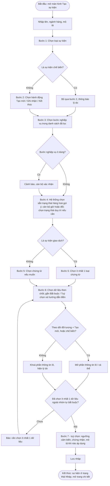

**Sơ đồ luồng — Lưu nháp**
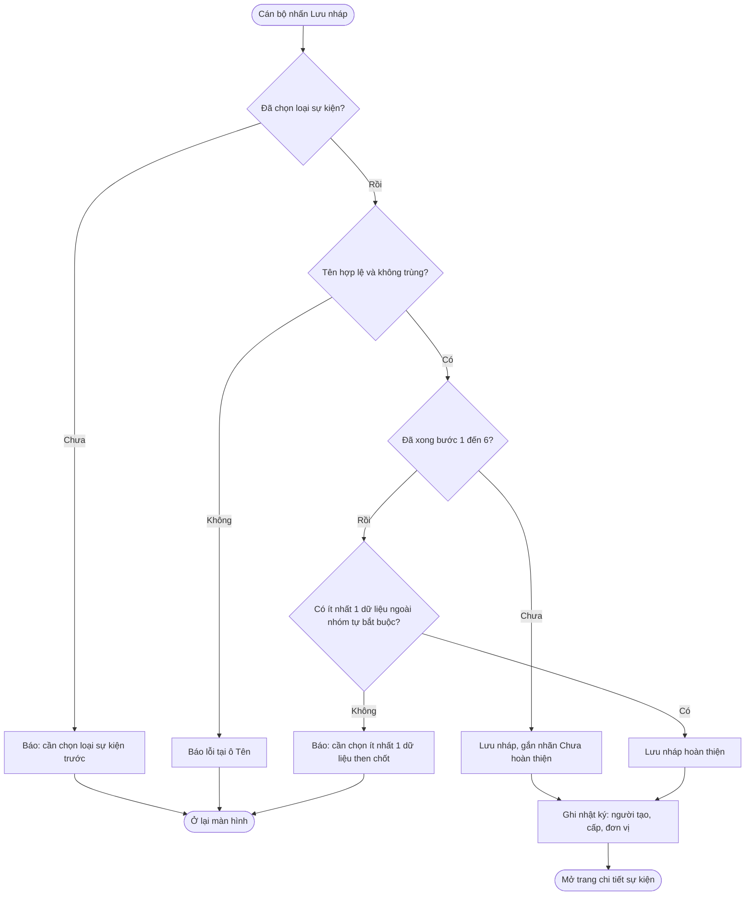

---

### 7.2. Xem và tra cứu Sự kiện trọng yếu

**Mô tả:** Danh sách mỗi mã sự kiện một dòng, hiển thị phiên bản tiêu biểu theo thứ tự ưu tiên: Đang áp dụng → Chờ áp dụng → Nháp → Ngừng áp dụng gần nhất **[Bổ sung]**. Tìm theo tên (có hoặc không dấu), mã; lọc theo loại sự kiện, bước nghiệp vụ, trạng thái, ngành hàng, cấp, nguồn tạo, "có cảnh báo danh mục" **[Bổ sung]**. Trang chi tiết thể hiện 7 bước dễ đọc, kèm thẻ "Lịch sử phiên bản" và "Nhật ký". Cấp Sở có thêm thẻ "Sự kiện cấp Bộ" chỉ xem.

**Câu chuyện người dùng**
- Là cán bộ tiêu chuẩn, tôi muốn tìm và lọc sự kiện theo nhiều tiêu chí, để nhanh chóng tìm sự kiện cần rà soát.
- Là cán bộ tiêu chuẩn, tôi muốn xem chi tiết 7 bước của một sự kiện bằng ngôn ngữ dễ hiểu, để kiểm tra trước khi công bố.
- Là cán bộ tiêu chuẩn, tôi muốn thấy rõ trạng thái kèm ngày áp dụng / ngày ngừng, để biết phiên bản nào đang có hiệu lực.
- Là cán bộ cấp Sở, tôi muốn xem các sự kiện đang áp dụng của Bộ cùng ngành, để chọn sự kiện kế thừa.
- Là quản trị chuẩn quốc gia, tôi muốn xem các sự kiện đang và sắp áp dụng của mọi đơn vị, để giám sát việc áp dụng chuẩn.

**Sơ đồ luồng**
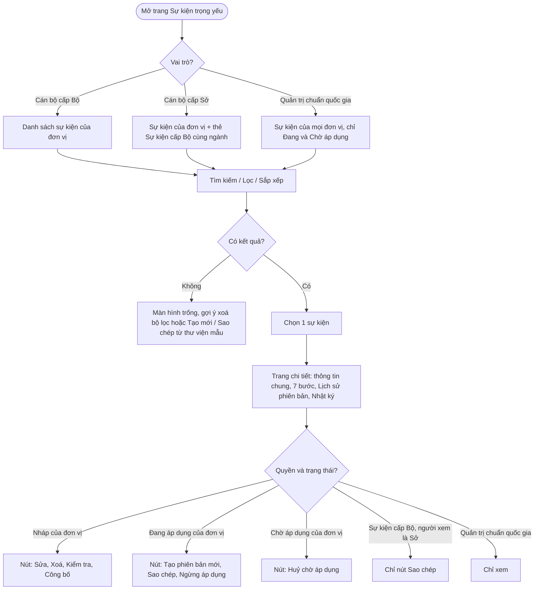

---

### 7.3. Sửa bản nháp

**Mô tả:** Sửa thông tin chung và bước 2–7 của bản nháp; loại sự kiện chỉ xem. Bản đã công bố không sửa trực tiếp mà tạo phiên bản mới. Bản nháp sao chép từ cấp Bộ vẫn chịu quy tắc "chỉ thêm chặt". Mỗi lần lưu ghi lại giá trị trước và sau.

**Câu chuyện người dùng**
- Là cán bộ tiêu chuẩn, tôi muốn sửa bản nháp để điều chỉnh cấu hình trước khi ban hành.
- Là cán bộ tiêu chuẩn, tôi muốn biết đồng nghiệp đang sửa cùng sự kiện, để tránh ghi đè lẫn nhau.
- Là cán bộ cấp Sở, tôi muốn được chặn ngay khi vô tình nới lỏng yêu cầu của Bộ trong lúc sửa, để không ban hành sai thẩm quyền.

**Sơ đồ luồng**
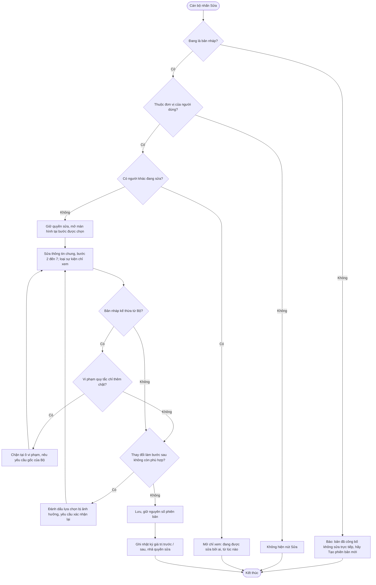

---

### 7.4. Xoá bản nháp

**Mô tả:** Xoá vĩnh viễn bản nháp. Nếu bản nháp là phiên bản mới của sự kiện đã công bố thì chỉ xoá bản nháp đó, các phiên bản khác giữ nguyên **[Bổ sung]**. Không xoá được bản đã công bố hoặc bản nháp đang nằm trong một Mẫu sự kiện trọng yếu.

**Câu chuyện người dùng**
- Là cán bộ tiêu chuẩn, tôi muốn xoá bản nháp không còn dùng, để danh sách gọn gàng, tránh nhầm lẫn.
- Là cán bộ tiêu chuẩn, tôi muốn biết bản nháp đang nằm trong Mẫu nào khi không xoá được, để xử lý đúng chỗ.

**Sơ đồ luồng**
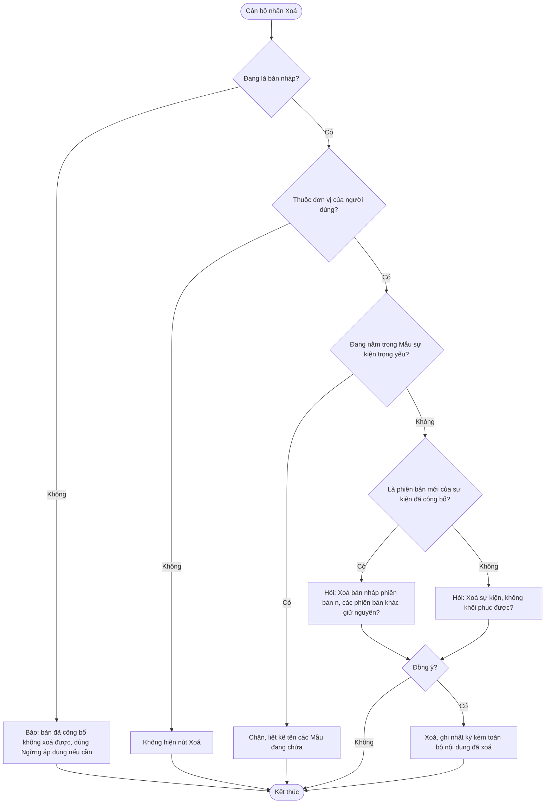

---

### 7.5. Sao chép Sự kiện trọng yếu

**Mô tả:** Tạo bản nháp mới bằng cách sao chép toàn bộ 7 bước từ một trong ba nguồn:

| Nguồn | Điều kiện | Sau khi sao chép |
|---|---|---|
| Thư viện sự kiện mẫu quốc gia | Sự kiện mẫu còn hiệu lực | Sửa tự do bước 2–7; loại sự kiện khoá. |
| Sự kiện của Bộ (Sở sao chép) | Bản Đang áp dụng, cùng ngành | Áp dụng quy tắc **chỉ thêm chặt**. |
| Sự kiện của chính đơn vị | Bất kỳ phiên bản nào | Sửa tự do bước 2–7; loại sự kiện khoá. |

Nếu sự kiện nguồn có giá trị đã bị danh mục chuẩn ngừng sử dụng, bản nháp mới vẫn được tạo nhưng đánh dấu lỗi tại các ô đó **[Bổ sung]**. Dữ liệu kế thừa từ Bộ gắn nhãn "Yêu cầu cấp Bộ", dữ liệu Sở thêm gắn nhãn "Bổ sung cấp Sở" **[Bổ sung]**.

**Quy tắc "chỉ thêm chặt" khi Sở kế thừa từ Bộ**
| Được phép | Không được phép |
|---|---|
| Thêm dữ liệu then chốt mới | Bỏ dữ liệu bắt buộc của Bộ |
| Nâng dữ liệu tuỳ chọn thành bắt buộc | Hạ dữ liệu bắt buộc thành tuỳ chọn |
| Thêm thông tin lô, nâng lên bắt buộc | Bỏ thông tin lô bắt buộc của Bộ |
| Thêm loại chứng từ | Bỏ loại chứng từ Bộ đã chọn |
| Thu hẹp ngưỡng cảm biến (2–8°C → 3–6°C) | Nới ngưỡng cảm biến (2–8°C → 0–10°C) |
| Thêm chứng nhận, nâng chứng nhận lên bắt buộc | Bỏ chứng nhận bắt buộc của Bộ |
| Thêm trạng thái duy trì **[Bổ sung]** | Đổi trạng thái hàng hoá, bỏ trạng thái duy trì của Bộ **[Bổ sung]** |
| Bổ sung hướng dẫn điền, mô tả khi nào áp dụng, đổi tên cho phù hợp địa phương | Đổi loại sự kiện, hành động, bước nghiệp vụ |

**Câu chuyện người dùng**
- Là cán bộ tiêu chuẩn, tôi muốn sao chép sự kiện mẫu từ thư viện quốc gia, để có điểm khởi đầu đúng chuẩn thay vì tạo từ đầu.
- Là cán bộ cấp Sở, tôi muốn kế thừa sự kiện của Bộ và bổ sung yêu cầu địa phương, để tiêu chuẩn tỉnh luôn tuân thủ tiêu chuẩn Bộ.
- Là cán bộ cấp Sở, tôi muốn phân biệt rõ đâu là yêu cầu của Bộ, đâu là phần Sở bổ sung, để giải trình khi được hỏi.
- Là cán bộ tiêu chuẩn, tôi muốn sao chép sự kiện của chính đơn vị, để tạo nhanh sự kiện tương tự cho ngành hàng khác.

**Sơ đồ luồng**
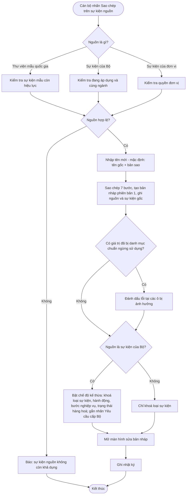

---

### 7.6. Công bố Sự kiện trọng yếu

**Mô tả:** Gồm hai phần:

**a) Kiểm tra tổng thể** — chạy khi nhấn "Kiểm tra" hoặc "Công bố". Kết quả chia **Lỗi** (phải sửa mới công bố được) và **Cảnh báo** (được công bố sau khi xác nhận đã đọc). Mỗi dòng có liên kết "Đi tới bước n".

| Mức | Nội dung kiểm tra |
|---|---|
| Lỗi | Chưa chọn hành động (trừ sự kiện chế biến). |
| Lỗi | Sự kiện giao dịch chưa có loại chứng từ. |
| Lỗi | Thiếu dữ liệu mà loại sự kiện bắt buộc phải có (mục 5.3). |
| Lỗi | Có thông tin lô trong khi loại sự kiện / hành động không cho phép. |
| Lỗi | Có dữ liệu không được dùng với loại sự kiện. |
| Lỗi | Chưa có dữ liệu nào ngoài nhóm hệ thống tự bắt buộc. |
| Lỗi **[Bổ sung]** | Có giá trị đã bị danh mục chuẩn ngừng sử dụng. |
| Lỗi **[Bổ sung]** | Bản kế thừa từ Bộ vi phạm quy tắc "chỉ thêm chặt". |
| Lỗi **[Bổ sung]** | Ngưỡng cảm biến không hợp lệ (nhỏ nhất ≥ lớn nhất, thiếu đơn vị đo). |
| Cảnh báo | Bước nghiệp vụ thuộc mức "ít dùng". |
| Cảnh báo | Trạng thái hàng hoá khác gợi ý. |
| Cảnh báo **[Bổ sung]** | Có dữ liệu chưa có hướng dẫn điền cho doanh nghiệp. |
| Cảnh báo **[Bổ sung]** | Phiên bản mới không khác gì phiên bản đang áp dụng. |

**b) Áp dụng theo thời gian**
- Phiên bản 1: công bố là **áp dụng ngay**.
- Phiên bản 2 trở đi: bắt buộc chọn **ngày áp dụng trong tương lai** và nhập **lý do thay đổi**; trong thời gian chờ, phiên bản cũ vẫn có hiệu lực.
- Công bố phiên bản mới khi đang có bản chờ → bản chờ bị huỷ.
- Cán bộ được huỷ bản đang chờ (không khuyến khích), phải nêu lý do.
- Đến ngày áp dụng, hệ thống tự chuyển trạng thái và báo cho các bên.

**Câu chuyện người dùng**
- Là cán bộ tiêu chuẩn, tôi muốn hệ thống kiểm tra toàn bộ cấu hình và chỉ rõ lỗi ở bước nào trước khi công bố, để không ban hành sự kiện sai chuẩn.
- Là cán bộ tiêu chuẩn, tôi muốn tự kiểm tra trước mà chưa công bố, để chuẩn bị hồ sơ trình lãnh đạo.
- Là cán bộ tiêu chuẩn, tôi muốn đặt ngày áp dụng cho phiên bản mới, để doanh nghiệp có thời gian chuẩn bị.
- Là cán bộ tiêu chuẩn, tôi muốn huỷ phiên bản đang chờ khi phát hiện sai sót, để không ảnh hưởng doanh nghiệp.
- Là doanh nghiệp, tôi muốn được báo trước khi sự kiện tôi đang khai báo sắp thay đổi, để kịp cập nhật cách khai báo.
- Là cán bộ cấp Sở, tôi muốn được báo khi Bộ thay đổi sự kiện mà Sở đang kế thừa, để rà soát lại tiêu chuẩn địa phương.

**Sơ đồ luồng — Công bố**
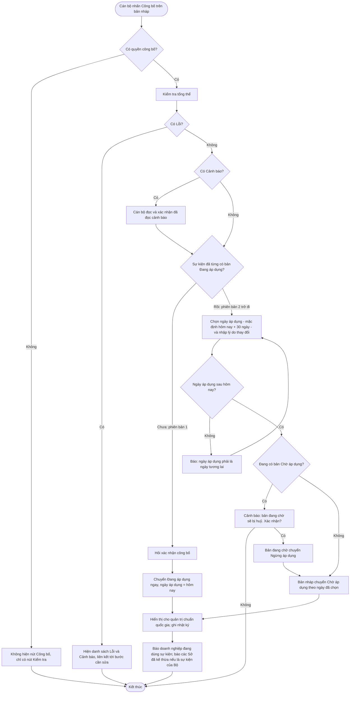

**Sơ đồ luồng — Hệ thống tự chuyển trạng thái khi tới ngày áp dụng**
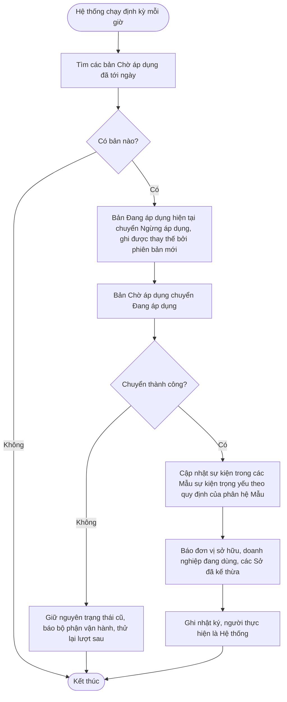

**Sơ đồ luồng — Huỷ bản đang chờ áp dụng**
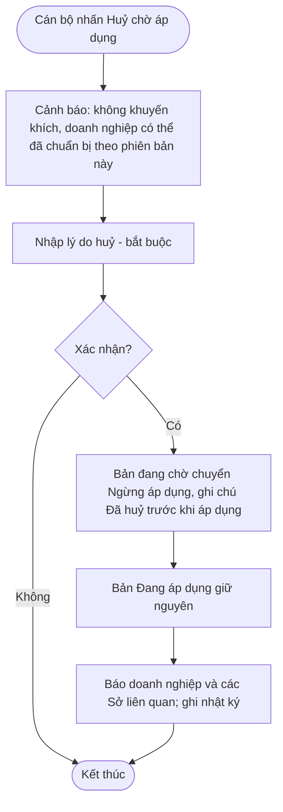

---

### 7.7. Quản lý phiên bản

**Mô tả:** Tạo phiên bản mới từ bản Đang áp dụng (hoặc Chờ áp dụng **[Bổ sung]**) khi cần điều chỉnh tiêu chuẩn. Phiên bản mới ở trạng thái Nháp, sao chép 7 bước từ bản gốc. Chỉ có 1 bản nháp tại một thời điểm; loại sự kiện không đổi qua các phiên bản. Thẻ "Lịch sử phiên bản" hiển thị trạng thái, ngày áp dụng, ngày ngừng, người công bố, lý do thay đổi; cho phép xem chi tiết từng phiên bản cũ và **so sánh hai phiên bản** theo từng bước (thêm / bớt / thay đổi) **[Bổ sung]**. Xoá bản nháp chưa từng công bố thì số phiên bản đó được dùng lại, để dãy phiên bản đã công bố luôn liên tục **[Bổ sung]**.

**Câu chuyện người dùng**
- Là cán bộ tiêu chuẩn, tôi muốn tạo phiên bản mới khi tiêu chuẩn cần điều chỉnh, mà không ảnh hưởng phiên bản đang có hiệu lực.
- Là cán bộ tiêu chuẩn, tôi muốn xem lại nội dung các phiên bản cũ, để biết tại một thời điểm doanh nghiệp phải khai báo theo yêu cầu nào.
- Là cán bộ tiêu chuẩn, tôi muốn so sánh hai phiên bản, để giải trình thay đổi khi được thanh tra, kiểm tra.

**Sơ đồ luồng**
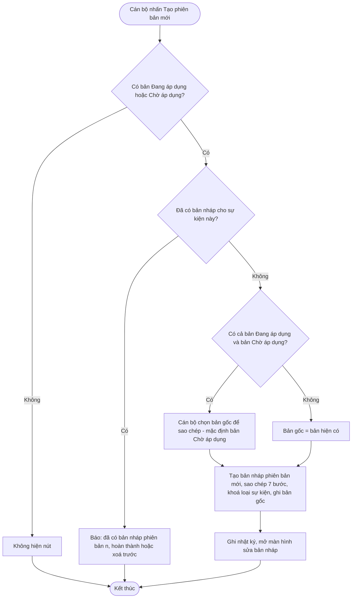

---

### 7.8. Ngừng áp dụng và xử lý thay đổi danh mục chuẩn [Bổ sung]

**Mô tả:**
1. **Ngừng áp dụng chủ động:** chấm dứt hiệu lực một sự kiện mà không có phiên bản thay thế (VD: văn bản mới bỏ yêu cầu ghi nhận bước này). Áp dụng ngay hoặc theo ngày trong tương lai; bắt buộc nêu lý do; không thực hiện được khi sự kiện đang nằm trong Mẫu sự kiện trọng yếu đang áp dụng. Bản Chờ áp dụng (nếu có) bị huỷ theo.
2. **Khi danh mục chuẩn quốc gia ngừng sử dụng một giá trị** (loại sự kiện, bước nghiệp vụ, trạng thái hàng hoá, dữ liệu then chốt, loại chứng từ): bản nháp đang dùng bị đánh dấu lỗi và không công bố được; bản đã công bố **vẫn giữ hiệu lực**, chỉ gắn cảnh báo để đơn vị tạo phiên bản thay thế. Hệ thống không tự ý thay đổi sự kiện đã công bố.
3. Khi Bộ ngừng áp dụng một sự kiện, các Sở đã kế thừa được báo; sự kiện của Sở **không** bị tự động ngừng.

**Câu chuyện người dùng**
- Là cán bộ tiêu chuẩn, tôi muốn ngừng áp dụng một sự kiện không còn phù hợp, để doanh nghiệp không phải khai báo thừa.
- Là cán bộ tiêu chuẩn, tôi muốn hẹn ngày ngừng áp dụng, để khớp với ngày hiệu lực của văn bản.
- Là cán bộ tiêu chuẩn, tôi muốn được cảnh báo khi danh mục chuẩn ngừng sử dụng giá trị mà sự kiện của tôi đang dùng, để chủ động tạo phiên bản thay thế.
- Là cán bộ cấp Sở, tôi muốn được báo khi Bộ ngừng áp dụng sự kiện Sở đang kế thừa, để quyết định có ngừng theo hay không.

**Sơ đồ luồng — Ngừng áp dụng chủ động**
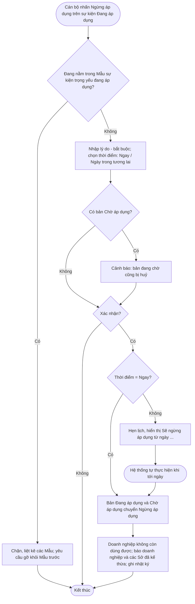

**Sơ đồ luồng — Danh mục chuẩn ngừng sử dụng một giá trị**
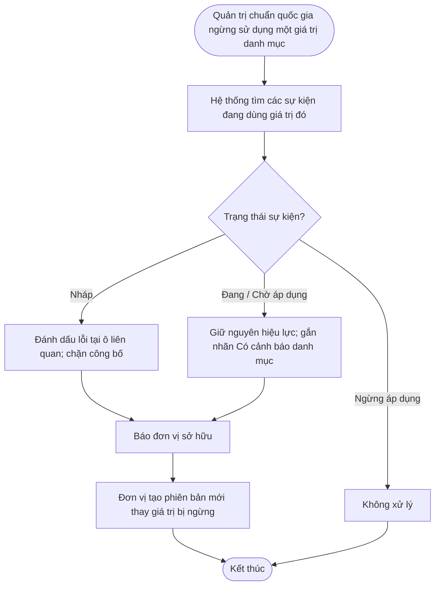

---

## 8. Danh mục thông báo

| Mã | Tình huống | Nội dung hiển thị |
|---|---|---|
| TB-01 | Loại sự kiện không đổi | Loại sự kiện không thể thay đổi. Tạo sự kiện mới nếu cần loại khác. |
| TB-02 | Sự kiện chế biến ở bước 2 | Sự kiện chế biến không có hành động — bỏ qua bước này. |
| TB-03 | Sự kiện giao dịch thiếu chứng từ | Sự kiện giao dịch cần chọn ít nhất 1 loại chứng từ. |
| TB-04 | Thông tin lô bị khoá | Thông tin lô chỉ áp dụng khi hành động là Tạo mới. Hành động hiện tại: [x]. |
| TB-05 | Thiếu dữ liệu then chốt | Cần chọn ít nhất 1 dữ liệu ngoài các dữ liệu hệ thống tự bắt buộc. |
| TB-06 | Trùng tên | Tên sự kiện đã tồn tại trong đơn vị. Vui lòng đặt tên khác. |
| TB-07 | Sửa bản đã công bố | Sự kiện đã công bố không sửa trực tiếp. Hãy dùng "Tạo phiên bản mới". |
| TB-08 | Xoá bản đã công bố | Sự kiện đã công bố không thể xoá. Hãy dùng "Ngừng áp dụng" nếu cần. |
| TB-09 | Xoá khi đang trong Mẫu | Sự kiện đang nằm trong Mẫu sự kiện trọng yếu: [danh sách]. |
| TB-10 | Sở bớt dữ liệu bắt buộc | Dữ liệu "[x]" là bắt buộc theo yêu cầu cấp Bộ. Cấp Sở chỉ được thêm, không được bớt. |
| TB-11 | Sở đổi nội dung cốt lõi | Không được thay đổi loại sự kiện, hành động, bước nghiệp vụ hoặc trạng thái hàng hoá của sự kiện kế thừa từ Bộ. |
| TB-12 | Sở nới ngưỡng cảm biến | Ngưỡng cấp Sở phải nằm trong khoảng [a–b] của yêu cầu cấp Bộ. |
| TB-13 | Thiếu ngày áp dụng | Sự kiện đã có phiên bản đang áp dụng. Vui lòng chọn ngày áp dụng cho phiên bản mới. |
| TB-14 | Ngày không hợp lệ | Ngày áp dụng phải là ngày trong tương lai. |
| TB-15 | Huỷ bản đang chờ | Thao tác này không khuyến khích. Bạn có chắc muốn huỷ áp dụng phiên bản [n]? |
| TB-16 | Đã có bản nháp | Đã có bản nháp phiên bản [n]. Hoàn thành hoặc xoá trước khi tạo phiên bản mới. |
| TB-17 | Đang có người sửa | Sự kiện đang được sửa bởi [tên] từ [giờ]. Bạn đang xem ở chế độ chỉ xem. |
| TB-18 | Báo doanh nghiệp — sắp thay đổi | Sự kiện "[tên]" có phiên bản [n] áp dụng từ [ngày]. |
| TB-19 | Báo doanh nghiệp — đã thay đổi | Sự kiện "[tên]" đã cập nhật lên phiên bản [n]. |
| TB-20 | Báo Sở kế thừa | Sự kiện cấp Bộ "[tên]" có thay đổi: [nội dung]. Đề nghị rà soát sự kiện kế thừa của đơn vị. |
| TB-21 | Danh mục chuẩn thay đổi | Giá trị "[x]" mà sự kiện "[tên]" đang dùng đã bị ngừng sử dụng. Hãy tạo phiên bản mới để thay thế. |

---

## 9. Nhật ký thao tác

| Thao tác | Thông tin được ghi |
|---|---|
| Tạo mới, sao chép | Người thực hiện, đơn vị, cấp, thời điểm, nguồn, sự kiện gốc |
| Sửa bản nháp | Nội dung thay đổi: giá trị trước và sau |
| Xoá bản nháp | Toàn bộ nội dung 7 bước tại thời điểm xoá |
| Công bố | Phiên bản, trạng thái sau công bố, ngày áp dụng, lý do thay đổi, các cảnh báo đã xác nhận |
| Huỷ chờ áp dụng, ngừng áp dụng | Lý do, thời điểm |
| Hệ thống tự chuyển trạng thái | Người thực hiện là Hệ thống, phiên bản trước và sau |

Nhật ký lưu vĩnh viễn, không sửa, không xoá; xem tại thẻ "Nhật ký" trên trang chi tiết sự kiện.

---

## 10. Phụ thuộc

| Quan hệ | Tính năng / phân hệ liên quan | Nội dung |
|---|---|---|
| Cần dữ liệu từ | Quản lý danh mục Loại sự kiện | Danh sách loại sự kiện đang hiệu lực cho bước 1 |
| Cần dữ liệu từ | Quản lý danh mục Bước nghiệp vụ | Danh sách và mức phù hợp theo loại sự kiện cho bước 3 |
| Cần dữ liệu từ | Quản lý danh mục Trạng thái hàng hoá | Danh sách và gợi ý theo loại sự kiện + bước nghiệp vụ cho bước 4 |
| Cần dữ liệu từ | Quản lý danh mục Loại chứng từ giao dịch | 9 loại chứng từ cho bước 5 |
| Cần dữ liệu từ | Quản lý Thư viện dữ liệu then chốt | Dữ liệu then chốt và thông tin lô / cá thể cho bước 6 |
| Cần dữ liệu từ | Quản lý Thư viện sự kiện mẫu quốc gia | Nguồn để sao chép |
| Cần được báo từ | Vô hiệu hoá giá trị trong các danh mục trên | Để gắn lỗi / cảnh báo (mục 7.8) |
| Hai chiều | Quản lý Mẫu sự kiện trọng yếu | Mẫu chỉ gom sự kiện Đang áp dụng; phân hệ này hỏi Mẫu để biết sự kiện có đang nằm trong Mẫu không trước khi xoá / ngừng áp dụng |
| Cần dữ liệu từ | Quản lý người dùng và phân quyền | Cấp Bộ / Sở, quan hệ Bộ → Sở theo ngành, quyền công bố |
| Cần hạ tầng | Lịch tự động và gửi thông báo | Tự chuyển trạng thái theo ngày; gửi thông báo trong hệ thống và thư điện tử |
| Được sử dụng bởi | Nền tảng khai báo sự kiện của doanh nghiệp; Chứng nhận dữ liệu khai báo | Lấy sự kiện Đang áp dụng để hướng dẫn và kiểm tra khai báo |

---

## 11. Điều kiện sẵn sàng (DoR)

Một tính năng được đưa vào Sprint khi:
- [ ] Câu chuyện người dùng và sơ đồ luồng đã được Quản lý sản phẩm duyệt, cả nhóm hiểu thống nhất trong buổi làm rõ yêu cầu.
- [ ] Các tính năng / phân hệ phụ thuộc (mục 10) đã sẵn sàng trên môi trường phát triển.
- [ ] Bảng gợi ý Bước nghiệp vụ theo Loại sự kiện, Trạng thái hàng hoá theo Bước nghiệp vụ, bảng ràng buộc theo Loại sự kiện (mục 5.3) và quy tắc "chỉ thêm chặt" đã được chuyên gia nghiệp vụ duyệt.
- [ ] Giao diện trên Figma đã duyệt, đủ các trạng thái: bình thường, trống, đang tải, lỗi, chỉ xem.
- [ ] Nội dung thông báo (mục 8) đã chốt.
- [ ] Đã ước lượng và vừa với 1 Sprint (tính năng Tạo sự kiện được chia nhỏ theo từng bước nếu cần).
- [ ] Đã có dữ liệu và tài khoản kiểm thử: sự kiện mẫu cho cả 5 loại, tài khoản cấp Bộ, cấp Sở, quản trị chuẩn quốc gia.

## 12. Điều kiện hoàn thành (DoD)

Một tính năng được coi là hoàn thành khi:
- [ ] Mọi nhánh trong sơ đồ luồng (luồng chính, luồng thay thế, ngoại lệ) chạy đúng trên môi trường kiểm thử.
- [ ] Quy tắc nghiệp vụ (mục 6) liên quan được tuân thủ.
- [ ] Phân quyền đúng mục 4.3.
- [ ] Nhật ký thao tác ghi đúng mục 9; thông báo hiển thị đúng mục 8.
- [ ] Giao diện khớp thiết kế Figma đã duyệt.
- [ ] Không còn lỗi mức nghiêm trọng / cao.
- [ ] Tài liệu hướng dẫn sử dụng cho cán bộ tiêu chuẩn được cập nhật.
- [ ] Quản lý sản phẩm nghiệm thu trong buổi Sprint Review.
