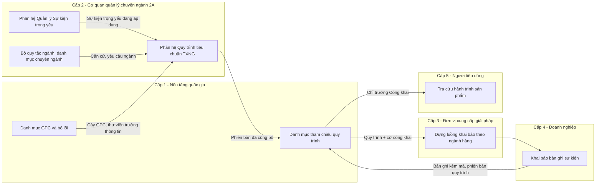
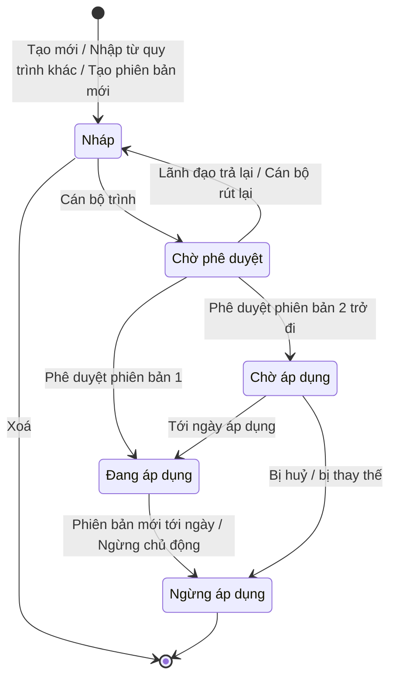

| Thông tin | Nội dung |
| --- | --- |
| Sản phẩm | NDATrace — Nền tảng quốc gia truy xuất nguồn gốc |
| Phân hệ | Quy trình tiêu chuẩn truy xuất nguồn gốc (Quy trình tiêu chuẩn TXNG) |
| Chức năng tương ứng trong Khung chức năng nghiệp vụ (Quyển 3) | L2-BQT-001 Quản lý bộ quy tắc ngành, chương trình và thị trường (phần danh mục sự kiện trọng yếu theo ngành — KH12-QT-04); phối hợp L2-MCT-001 Ban hành và quản lý Mẫu CTE/KDE chuyên ngành — chủ thể Cấp 2 |
| Khung nghiệp vụ tương ứng (Quyển 2) | KH-12 Yêu cầu nghiệp vụ theo ngành hàng và thị trường; KH-05 Sự kiện trọng yếu và dữ liệu truy xuất; KH-02 Danh mục và phân loại; KH-10 Công bố thông tin cho người tiêu dùng |
| Tài liệu liên quan | Tài liệu yêu cầu sản phẩm — Quản lý Sự kiện trọng yếu; Đặc tả F-M6 Quản lý Mẫu sự kiện trọng yếu (CTE Template) v3 |
| Đối tượng sử dụng chính | Cơ quan quản lý nhà nước chuyên ngành ở trung ương (nhóm 2A) |
| Phiên bản tài liệu | 0.1 — bản dự thảo |
| Người soạn | Nguyễn Hà Cương — Quản lý sản phẩm |
| Trạng thái | Dự thảo, chờ rà soát |
| Căn cứ | Nghị định 37/2025/NĐ-CP; NDATrace Quyển 2 — Khung nghiệp vụ dùng chung (bản 4.2.0); NDATrace Quyển 3 — Khung chức năng nghiệp vụ (bản 4.3.2); GS1 EPCIS 2.0, CBV 2.0; GS1 GPC (phân loại sản phẩm toàn cầu) |

### Mục lục

| Mục | Nội dung |
| --- | --- |
| 0 | Thuật ngữ và đối chiếu — 0.1 Thuật ngữ · 0.2 Đối chiếu mô hình năm cấp · 0.3 Vị trí phân hệ · 0.4 Đối chiếu với đặc tả F-M6 |
| 1 | Tổng quan — 1.1 Bối cảnh · 1.2 Mục đích · 1.3 Vấn đề cần giải quyết · 1.4 Nguyên tắc thiết kế |
| 2 | Người dùng và vai trò |
| 3 | Phạm vi |
| 4 | Mô hình nghiệp vụ — 4.1 Thông tin Quy trình · 4.2 Thành phần trong quy trình · 4.3 Vòng đời · 4.4 Phân quyền |
| 5 | Quy định cấu hình quy trình — 5.1 Ngành hàng · 5.2 Danh sách sự kiện · 5.3 Trường thông tin và mức công khai |
| 6 | Quy tắc nghiệp vụ (QQ-01 → QQ-30) |
| 7 | Đặc tả tính năng (7.1 → 7.9) |
| 8 | Danh mục thông báo |
| 9 | Nhật ký thao tác |
| 10 | Phụ thuộc |
| 11 | Vấn đề mở cần chốt |
| 12 | DoR · 13 DoD |

> Sơ đồ swimlane vẽ bằng Mermaid, mỗi làn là một tác nhân, theo cùng quy ước với tài liệu Quản lý Sự kiện trọng yếu. Tệp `.drawio` sẽ được bổ sung vào `docs/prd/swimlane/` sau khi nội dung được duyệt.

---

## 0. Thuật ngữ và đối chiếu

### 0.1. Thuật ngữ

| Thuật ngữ | Định nghĩa |
| --- | --- |
| **Quy trình tiêu chuẩn TXNG** | Tập hợp **có thứ tự** các Sự kiện trọng yếu đang áp dụng, do cơ quan quản lý chuyên ngành ban hành thành yêu cầu khai báo cho **một ngành hàng / nhóm sản phẩm** cụ thể. Quy trình quy định: gồm những sự kiện nào, thứ tự trong chuỗi, sự kiện nào bắt buộc / tuỳ chọn, trường thông tin nào được bổ sung theo ngành, trường thông tin nào được công khai cho người tiêu dùng. Bản F-M6 gọi là "Mẫu sự kiện trọng yếu (CTE Template)". Quyển 2 xếp nội dung này vào "danh mục CTE/KDE theo ngành, được quản lý thông qua bộ quy tắc áp dụng" (KH12-QT-04). |
| **Sự kiện trọng yếu** | Bản quy định cho một loại sự kiện, không gắn ngành hàng, do phân hệ Quản lý Sự kiện trọng yếu quản lý. Là "viên gạch"; Quy trình tiêu chuẩn TXNG là "bức tường". |
| **Sự kiện trong quy trình** | Một Sự kiện trọng yếu được gắn vào quy trình, **cố định theo một phiên bản**, kèm cấu hình riêng của quy trình: vị trí, mức bắt buộc, trường thông tin bổ sung, mức công khai. Cấu hình này không làm thay đổi Sự kiện trọng yếu gốc. |
| **Trường thông tin gốc** | Trường thông tin do Sự kiện trọng yếu gốc quy định (gồm trường hệ thống tự bắt buộc theo chuẩn và trường do cơ quan ban hành đặt). |
| **Trường thông tin bổ sung ngành** | Trường thông tin cán bộ thêm vào sự kiện trong phạm vi một quy trình, để phục vụ yêu cầu đặc thù của ngành hàng, ví dụ "Mã vùng trồng", "Ngày kiểm dịch". |
| **Mức công khai** | Thuộc tính của từng trường thông tin trong quy trình: **Công khai** (người tiêu dùng thấy khi tra cứu) hoặc **Chỉ phục vụ quản lý** (vẫn bắt buộc ghi nhận và gửi lên Nền tảng quốc gia, nhưng không hiển thị cho người tiêu dùng). Bản F-M6 gọi là "KDE visibility / consumer_visible". |
| **Ngành hàng (theo GPC Class)** | Ngành hàng mà quy trình áp dụng, xác định bằng mức **Class** của bộ phân loại sản phẩm toàn cầu GS1 GPC (Segment → Family → Class → Brick). Mức Class là mức mà chuỗi cung ứng bắt đầu phân nhánh sự kiện khác nhau. |
| **Bộ lõi quốc gia, Chủ sở hữu nội dung, Căn cứ ban hành, Thời hạn chuyển tiếp, Quy tắc chuyển tiếp** | Dùng nguyên định nghĩa trong tài liệu Quản lý Sự kiện trọng yếu, mục 0.1. |

### 0.2. Đối chiếu với mô hình năm cấp

| Ký hiệu F-M6 | Cấp chính thức | Chủ thể | Vai trò đối với phân hệ này |
| --- | --- | --- | --- |
| C1 | **Cấp 1** | Nền tảng quốc gia | Tiếp nhận quy trình đã công bố vào danh mục tham chiếu; cung cấp cho Cấp 3, Cấp 4 theo phiên bản và ngày hiệu lực. Không phê duyệt nội dung chuyên ngành. |
| C2 cấp Bộ | **Cấp 2, nhóm 2A** | Bộ, Cục, Vụ quản lý ngành | Xây dựng, phê duyệt, công bố quy trình cho ngành hàng mình quản lý. **Duy nhất nhóm được thao tác trong giai đoạn này.** |
| C2 cấp Sở | Cấp 2, nhóm 2B | UBND tỉnh, Sở chuyên ngành | Chỉ xem quy trình đang áp dụng của ngành mình. Chưa được tạo / kế thừa quy trình (giai đoạn sau). |
| — | Cấp 2, nhóm 2C, 2D | Tổ chức chứng nhận, chương trình tự nguyện | Ngoài phạm vi. |
| (F-M6 gọi C3) | **Cấp 3** | Đơn vị cung cấp giải pháp | Nhận quy trình qua Nền tảng quốc gia để dựng luồng khai báo trong phần mềm. Không được tự sửa. |
| C3 | **Cấp 4** | Doanh nghiệp, hợp tác xã, hộ kinh doanh | Khai báo theo quy trình đang áp dụng của ngành hàng mình. |
| C5 | **Cấp 5** | Người tiêu dùng | Thấy các trường thông tin được đặt mức Công khai khi quét mã truy xuất. |

### 0.3. Vị trí của phân hệ



### 0.4. Đối chiếu với đặc tả F-M6 v3

Tài liệu này kế thừa toàn bộ 7 feature và 44 tiêu chí chấp nhận của F-M6, đồng thời **điều chỉnh để thống nhất với tài liệu Quản lý Sự kiện trọng yếu** đã chốt. Các điểm khác biệt:

| # | F-M6 v3 | Tài liệu này | Lý do |
| --- | --- | --- | --- |
| 1 | 4 trạng thái, cán bộ bấm "Publish" là công bố | **5 trạng thái**, thêm **Chờ phê duyệt**; lãnh đạo phê duyệt mới công bố | Quyển 2 yêu cầu "phê duyệt" trước "công bố"; thống nhất với Sự kiện trọng yếu (QT-05 tách người soạn và người duyệt). |
| 2 | F7 cho phép "Kích hoạt lại" Template Ngừng áp dụng | **Bỏ** kích hoạt lại. Muốn dùng lại thì tạo phiên bản mới từ bản đã ngừng | Phiên bản đã ngừng không được hồi sinh (nguyên tắc kiểm chứng lịch sử, không hồi tố). Xem Vấn đề mở VĐ-02. |
| 3 | Tạo CTE inline → CTE tự động v1 Đang áp dụng | Sự kiện tạo inline ở trạng thái **Nháp**, đi qua phê duyệt của phân hệ Sự kiện trọng yếu; quy trình chỉ trình được khi sự kiện đó đã Đang áp dụng | Tránh lách quy trình phê duyệt của Sự kiện trọng yếu. Xem VĐ-01. |
| 4 | Thuật ngữ CTE / KDE / C1-C5 | Sự kiện trọng yếu / Trường thông tin / Cấp 1-5 | Theo Nghị định 37/2025 và Quyển 2, 3. |
| 5 | Chưa có căn cứ ban hành, chủ sở hữu, quy tắc chuyển tiếp | Bắt buộc khi trình | KH12-QK-01: mọi bộ quy tắc áp dụng phải có chủ sở hữu, căn cứ, phạm vi, phiên bản, hiệu lực. |
| 6 | Chưa xử lý khi Sự kiện trọng yếu trong quy trình ra phiên bản mới / ngừng áp dụng | Bổ sung mục 7.9 | Phát sinh phụ thuộc hai chiều với phân hệ Sự kiện trọng yếu (QT-21, QT-30 bên đó). |

---

## 1. Tổng quan

### 1.1. Bối cảnh

Phân hệ Quản lý Sự kiện trọng yếu cho phép cơ quan quản lý ban hành từng sự kiện **không gắn ngành hàng**, để dùng lại giữa các ngành. Nhưng doanh nghiệp không khai báo "từng sự kiện rời"; họ cần biết **với sản phẩm của mình, phải ghi nhận chuỗi sự kiện nào, theo thứ tự nào**. Quyển 2 (KH-12) xác định đây là "khung cấu hình chính sách theo ngành", trong đó cơ quan chuyên ngành ban hành "phạm vi, mức định danh, Mẫu CTE, KDE, thời hạn… và dữ liệu công bố".

Đồng thời, KH-10 yêu cầu thông tin cho người tiêu dùng chỉ gồm "các công đoạn truy xuất trọng yếu được phép công bố", "không công bố bí mật kinh doanh". Cùng một trường thông tin, ví dụ "Mã vùng trồng", có ngành cần công khai, có ngành chỉ phục vụ quản lý. Vì vậy mức công khai phải được quyết định **theo quy trình của từng ngành**, không ở cấp Sự kiện trọng yếu.

### 1.2. Mục đích

Phân hệ giúp cán bộ tiêu chuẩn nhóm 2A:

- ghép các Sự kiện trọng yếu đang áp dụng thành quy trình khai báo cho một ngành hàng (GPC Class);
- quy định thứ tự, mức bắt buộc của từng sự kiện;
- bổ sung trường thông tin đặc thù ngành và quyết định trường nào công khai cho người tiêu dùng;
- trình duyệt, công bố, quản lý phiên bản với thời hạn chuyển tiếp;

để Cấp 3 dựng phần mềm khai báo đúng, Cấp 4 biết chính xác nghĩa vụ, Cấp 5 thấy đúng thông tin được phép công bố.

### 1.3. Vấn đề cần giải quyết

| # | Vấn đề hiện tại | Hậu quả | Cách phân hệ giải quyết |
| --- | --- | --- | --- |
| 1 | Doanh nghiệp không biết sản phẩm của mình phải khai báo những sự kiện nào. | Khai báo thiếu công đoạn; chuỗi truy xuất đứt đoạn. | Mỗi ngành hàng có một quy trình đang áp dụng, nêu rõ sự kiện, thứ tự, mức bắt buộc. |
| 2 | Đơn vị cung cấp giải pháp tự diễn giải luồng khai báo. | Mỗi phần mềm một kiểu; dữ liệu không đồng nhất giữa doanh nghiệp cùng ngành. | Nền tảng quốc gia trả quy trình dưới dạng có cấu trúc, kèm phiên bản và ngày hiệu lực. |
| 3 | Yêu cầu ngành (vùng trồng, kiểm dịch…) không có chỗ đặt mà không làm "bẩn" Sự kiện trọng yếu dùng chung. | Phải nhân bản Sự kiện trọng yếu cho từng ngành. | Trường thông tin bổ sung ngành được đặt ở cấp quy trình, không sửa sự kiện gốc. |
| 4 | Không phân biệt dữ liệu quản lý và dữ liệu công khai. | Lộ bí mật kinh doanh, hoặc ngược lại người tiêu dùng thấy quá ít. | Mức công khai đặt theo từng trường thông tin trong từng quy trình. |
| 5 | Sự kiện trọng yếu thay đổi phiên bản trong khi quy trình đang áp dụng. | Quy trình tự thay đổi ngầm, doanh nghiệp bị "đổi luật giữa chừng". | Quy trình cố định phiên bản sự kiện; chỉ cập nhật qua phiên bản quy trình mới có ngày áp dụng. |
| 6 | Trùng lặp quy trình cho cùng ngành hàng. | Doanh nghiệp không biết theo quy trình nào. | Cảnh báo trùng GPC Class; ưu tiên tạo phiên bản mới. |

### 1.4. Nguyên tắc thiết kế

1. **Ghép, không tạo lại.** Quy trình chỉ tham chiếu Sự kiện trọng yếu đang áp dụng; không sao chép nội dung sự kiện.
2. **Chỉ thêm chặt hơn sự kiện gốc.** Quy trình được thêm trường thông tin, không được bớt hoặc hạ mức trường bắt buộc của sự kiện gốc.
3. **Cố định phiên bản.** Mỗi sự kiện trong quy trình gắn với một phiên bản cụ thể; không tự cập nhật.
4. **Công khai có chủ đích, mặc định công khai.** Trường mới thêm mặc định Công khai; trường tiêu chuẩn bắt buộc không được ẩn.
5. **Thay đổi có kiểm soát.** Thống nhất vòng đời, phê duyệt, phiên bản, chuyển tiếp với phân hệ Sự kiện trọng yếu.

---

## 2. Người dùng và vai trò

| Vai trò | Mô tả | Nhu cầu chính | Hành vi điển hình |
| --- | --- | --- | --- |
| **Cán bộ tiêu chuẩn 2A** | Chuyên viên Cục, Vụ. Am hiểu chuỗi cung ứng ngành hàng. | Dựng quy trình nhanh, tái sử dụng quy trình ngành tương tự; điều chỉnh công khai theo chính sách. | Nhập từ quy trình ngành gần nhất rồi chỉnh; làm theo đợt ban hành văn bản. |
| **Lãnh đạo phê duyệt 2A** | Lãnh đạo phòng, Cục, Vụ. | Thấy toàn cảnh chuỗi sự kiện, trường công khai, thay đổi so với phiên bản trước. | Duyệt theo đợt; cần so sánh thay đổi. |
| **Cán bộ 2B** | Chuyên viên Sở. | Biết quy trình trung ương đang áp dụng tại địa bàn. | Chỉ xem. |
| **Quản trị Cấp 1** | Đơn vị vận hành Nền tảng quốc gia. | Tiếp nhận, giám sát, tra phiên bản hiệu lực theo ngày. | Chỉ xem. |
| **Đơn vị cung cấp giải pháp (Cấp 3)** | Doanh nghiệp công nghệ. | Nhận quy trình có cấu trúc, ngày áp dụng, quy tắc chuyển tiếp, cờ công khai. | Gọi dịch vụ của Nền tảng quốc gia; nhận thông báo. |
| **Doanh nghiệp (Cấp 4)** | Cơ sở sản xuất, kinh doanh. | Biết chính xác chuỗi sự kiện phải khai báo; được báo trước khi thay đổi. | Nhận thông báo qua phần mềm. |
| **Người tiêu dùng (Cấp 5)** | Công dân. | Thấy thông tin nguồn gốc dễ hiểu, đáng tin. | Quét mã. |
| **Hệ thống** | Tác vụ tự động. | Chuyển trạng thái đúng ngày; phát hiện ảnh hưởng khi Sự kiện trọng yếu đổi. | Chạy mỗi giờ. |

---

## 3. Phạm vi

### 3.1. Trong phạm vi

1. Cán bộ 2A tạo khung quy trình gắn GPC Class, khai báo thẩm quyền, căn cứ.
2. Cán bộ thêm sự kiện theo 3 cách: chọn có sẵn, tạo mới ngay trong luồng, nhập từ quy trình khác; bớt, sắp xếp, đặt bắt buộc / tuỳ chọn.
3. Cán bộ cấu hình trường thông tin trong từng sự kiện: thêm, bớt, đặt mức công khai.
4. Tra cứu, xem chi tiết, sửa, xoá bản nháp.
5. Kiểm tra tổng thể, trình, rút lại; lãnh đạo phê duyệt và công bố, trả lại.
6. Vòng đời 5 trạng thái; phiên bản, lịch sử, so sánh; cập nhật phiên bản Sự kiện trọng yếu trong quy trình.
7. Ngừng áp dụng, huỷ phiên bản chờ áp dụng.
8. Phát hiện và cảnh báo khi Sự kiện trọng yếu trong quy trình có phiên bản mới, bị huỷ hoặc ngừng.
9. Đăng ký vào danh mục tham chiếu quốc gia; thông báo; nhật ký.

### 3.2. Ngoài phạm vi

| Nội dung | Thuộc về |
| --- | --- |
| Tạo, sửa, phê duyệt từng Sự kiện trọng yếu | Phân hệ Quản lý Sự kiện trọng yếu (phân hệ này chỉ gọi màn hình tạo nhanh) |
| Quy trình cấp địa phương (2B kế thừa, siết chặt) | Giai đoạn sau |
| Quy trình của 2C, 2D; yêu cầu thị trường xuất khẩu | Giai đoạn sau |
| Rẽ nhánh, vòng lặp, sự kiện song song trong quy trình | Giai đoạn sau. Giai đoạn này quy trình là **chuỗi tuyến tính**; sự kiện Tuỳ chọn thay cho nhánh. |
| Một quy trình áp cho nhiều GPC Class; cơ quan chủ trì / phối hợp liên ngành | Giai đoạn sau (KH12-QK-03) — VĐ-04 |
| Doanh nghiệp đăng ký áp dụng quy trình (L4-BQT-001) | Phân hệ Cấp 4 |
| Kiểm tra bản ghi theo quy trình; hiển thị trang tra cứu | Phân hệ Cấp 1, Cấp 5 |
| Ký số, phê duyệt nhiều cấp | Giai đoạn sau |

---

## 4. Mô hình nghiệp vụ

### 4.1. Thông tin của một Quy trình tiêu chuẩn TXNG

| Nhóm | Thông tin | Bắt buộc | Quy định |
| --- | --- | --- | --- |
| Định danh | Mã quy trình | Hệ thống sinh | `{mã đơn vị}-QT-{4 chữ số}`; giữ nguyên qua mọi phiên bản. (F-M6 cho nhập tay `TPL-TS-001` — VĐ-03.) |
| | Tên quy trình | Có | Không trùng trong đơn vị; tối đa 200 ký tự. |
| | Mô tả | Không | Tối đa 2.000 ký tự. |
| Phạm vi áp dụng | Ngành hàng (GPC Class) | Có | Đúng 1 Class trong giai đoạn này. |
| | Phạm vi địa bàn | Hệ thống điền | 2A — toàn quốc. |
| | Đối tượng áp dụng | Không | Mô tả loại cơ sở áp dụng, ví dụ "Cơ sở nuôi trồng, thu mua, chế biến thuỷ sản". |
| Thẩm quyền | Chủ sở hữu nội dung | Hệ thống điền | Cơ quan của người tạo. |
| | Căn cứ ban hành | Có khi trình | Số hiệu, ngày, trích yếu, tệp. |
| Nội dung | Danh sách sự kiện | Có | ≥ 1 sự kiện Bắt buộc. |
| | Cấu hình trường thông tin | Có | Theo mục 5.3. |
| Phiên bản và hiệu lực | Số phiên bản, trạng thái, ngày công bố, ngày áp dụng, ngày ngừng | Hệ thống / lãnh đạo | |
| | Lý do thay đổi, quy tắc chuyển tiếp | Có từ phiên bản 2 | |
| Nguồn gốc | Nguồn tạo | Hệ thống sinh | Tạo mới / Nhập từ quy trình khác / Phiên bản mới. |
| Trách nhiệm | Người soạn, trình, phê duyệt, thời điểm | Hệ thống sinh | |

### 4.2. Thành phần của một sự kiện trong quy trình

| Thuộc tính | Quy định |
| --- | --- |
| Sự kiện trọng yếu và phiên bản | Cố định tại thời điểm thêm. |
| Thứ tự | Số nguyên liên tục từ 1; mỗi vị trí một sự kiện. |
| Mức bắt buộc | **Bắt buộc** (mặc định) / **Tuỳ chọn** — doanh nghiệp được bỏ qua nếu chuỗi của họ không có công đoạn đó. |
| Một Sự kiện trọng yếu xuất hiện nhiều lần? | **Không** trong giai đoạn này (F-M6 bỏ qua trùng khi nhập). Ví dụ "Vận chuyển" hai chặng phải dùng hai Sự kiện trọng yếu khác nhau — VĐ-05. |
| Trường thông tin | Danh sách trường gốc (đọc từ sự kiện) + trường bổ sung ngành; mỗi trường có mức bắt buộc và mức công khai. |

### 4.3. Vòng đời trạng thái

| Trạng thái | Ý nghĩa | Màu nhãn | Ai thấy | Cấp 3, Cấp 4 dùng | Sửa / Xoá |
| --- | --- | --- | --- | --- | --- |
| Nháp | Đang soạn | Trắng | Đơn vị sở hữu | Không | Có / Có |
| Chờ phê duyệt | Đã trình | Tím | Đơn vị sở hữu | Không | Không / Không |
| Chờ áp dụng | Đã công bố, chưa tới ngày | Vàng | Đơn vị, 2B cùng ngành, Cấp 1, Cấp 3 | Nhận trước để chuẩn bị | Không / Chỉ huỷ |
| Đang áp dụng | Có hiệu lực | Xanh lá | Đơn vị, 2B cùng ngành, Cấp 1, Cấp 3 | **Có** | Không / Không |
| Ngừng áp dụng | Hết hiệu lực / bị thay thế / bị huỷ | Xám | Đơn vị, Cấp 1 | Chỉ để kiểm tra bản ghi cũ | Không / Không |

Giới hạn đồng thời với mỗi mã quy trình: tối đa 1 Đang áp dụng, 1 Chờ áp dụng, 1 đang soạn (Nháp hoặc Chờ phê duyệt). Với mỗi **GPC Class** trong một đơn vị: khuyến nghị 1 quy trình Đang áp dụng (cảnh báo, không chặn — QQ-04).



### 4.4. Phân quyền

| Thao tác | Cán bộ 2A | Lãnh đạo 2A | Cán bộ / lãnh đạo 2B | Đơn vị 2A khác | Quản trị Cấp 1 |
| --- | --- | --- | --- | --- | --- |
| Xem | ✅ | ✅ | ✅ Đang / Chờ áp dụng của ngành mình | ✅ Đang áp dụng (để nhập) | ✅ trạng thái đã công bố |
| Tạo, nhập, sửa, xoá nháp | ✅ | ❌ | ❌ | ❌ | ❌ |
| Trình, rút lại | ✅ | ❌ | ❌ | ❌ | ❌ |
| Phê duyệt và công bố, trả lại | ❌ | ✅ (không tự duyệt bản mình soạn/trình) | ❌ | ❌ | ❌ |
| Huỷ chờ áp dụng, ngừng áp dụng | Đề xuất | ✅ | ❌ | ❌ | ❌ |
| Tạo phiên bản mới | ✅ | ❌ | ❌ | ❌ | ❌ |

---

## 5. Quy định cấu hình quy trình

### 5.1. Ngành hàng

- Hệ thống hiển thị cây GPC Segment → Family → Class; chỉ cho chọn mức **Class**; Segment, Family chỉ là nhóm.
- Tìm theo tên tiếng Việt, tiếng Anh, mã GPC.
- Chỉ hiển thị Class đang hiệu lực trong danh mục GPC của Cấp 1.

### 5.2. Danh sách sự kiện

| Quy định | Nội dung |
| --- | --- |
| Nguồn | Chỉ Sự kiện trọng yếu **Đang áp dụng**, do chính đơn vị hoặc đơn vị 2A khác ban hành (hiển thị chủ sở hữu). |
| Cách thêm | (a) Chọn có sẵn · (b) Tạo mới ngay trong luồng · (c) Nhập từ quy trình Đang áp dụng khác. |
| Vị trí khi thêm | Cuối danh sách. Cán bộ kéo thả để đổi thứ tự. |
| Mức mặc định | Bắt buộc. |
| Tối thiểu | ≥ 1 sự kiện Bắt buộc. |
| Gợi ý thứ tự | Hệ thống cảnh báo (không chặn) khi thứ tự bất hợp lý theo hành động: sự kiện có hành động **Kết thúc** (bán lẻ, tiêu huỷ) đứng trước sự kiện khác; sự kiện **Tạo mới** (thu hoạch) không đứng đầu; sự kiện đầu tiên không tạo mới đối tượng. |

### 5.3. Trường thông tin và mức công khai

| Loại trường | Thêm | Bớt | Đổi mức bắt buộc | Đặt Chỉ phục vụ quản lý |
| --- | --- | --- | --- | --- |
| Gốc — hệ thống tự bắt buộc theo chuẩn | — | ❌ | ❌ | ❌ |
| Gốc — Bắt buộc do cơ quan đặt | — | ❌ | ❌ (chỉ giữ) | ✅ |
| Gốc — Bắt buộc có điều kiện | — | ❌ | Chỉ nâng lên Bắt buộc | ✅ |
| Gốc — Tuỳ chọn | — | ✅ | Nâng được | ✅ |
| Bổ sung ngành | ✅ từ thư viện trường thông tin, lọc theo loại sự kiện | ✅ | Tự do | ✅ (kể cả khi Bắt buộc) |

Mặc định mọi trường: **Công khai**. Trường bị cấm theo loại sự kiện (ví dụ "Mã bao bì chứa" với sự kiện theo dõi đối tượng) không xuất hiện trong danh sách thêm. Trường đã có ở sự kiện gốc hiển thị mờ, nhãn "Đã có".

> **Lưu ý chuyên môn:** F-M6 BR-M6-06 chỉ chặn ẩn trường "tiêu chuẩn EPCIS + bắt buộc". Bảng trên mở rộng: cho phép ẩn trường gốc Bắt buộc do cơ quan đặt, vì KH-10 cho phép không công bố bí mật kinh doanh (ví dụ số lượng, địa điểm kho). Trường tự bắt buộc theo chuẩn (thời điểm, mã đối tượng / số lượng) vẫn không ẩn được vì là xương sống của hành trình công khai. Cần chuyên gia nghiệp vụ xác nhận — VĐ-06.

---

## 6. Quy tắc nghiệp vụ

### 6.1. Thẩm quyền

**QQ-01. Chủ sở hữu nội dung.** **Hệ thống** gán cơ quan của người tạo làm chủ sở hữu nội dung; không ai được đổi. Khi nhập từ quy trình của đơn vị khác, chủ sở hữu bản mới là đơn vị thực hiện nhập.

**QQ-02. Chỉ nhóm 2A.** **Hệ thống** chỉ cho cán bộ nhóm 2A tạo và thao tác quy trình trong giai đoạn này. (BR-M6-09)

**QQ-03. Căn cứ ban hành.** **Cán bộ tiêu chuẩn** phải khai báo căn cứ ban hành trước khi trình. **Hệ thống** chặn trình khi thiếu.

**QQ-04. Cảnh báo trùng ngành hàng.** Khi **cán bộ** tạo quy trình cho GPC Class đã có quy trình Đang áp dụng, Chờ áp dụng hoặc đang soạn trong cùng đơn vị, **hệ thống** cảnh báo, gợi ý tạo phiên bản mới, và chỉ tiếp tục khi cán bộ xác nhận và nhập lý do.

**QQ-05. Tách người soạn và người phê duyệt.** **Hệ thống** không cho người đã soạn hoặc trình phê duyệt chính bản đó.

### 6.2. Danh sách sự kiện

**QQ-06. Chỉ ghép sự kiện đang áp dụng.** **Hệ thống** chỉ hiển thị Sự kiện trọng yếu Đang áp dụng trong danh sách chọn. (BR-M6-01)

**QQ-07. Tối thiểu một sự kiện bắt buộc.** **Hệ thống** chặn bớt hoặc đổi sang Tuỳ chọn sự kiện Bắt buộc cuối cùng, và chặn trình quy trình không có sự kiện Bắt buộc. (BR-M6-02, BR-D-05)

**QQ-08. Không trùng sự kiện.** **Hệ thống** không cho một mã Sự kiện trọng yếu xuất hiện hai lần trong cùng quy trình.

**QQ-09. Cố định phiên bản sự kiện.** **Hệ thống** giữ nguyên phiên bản Sự kiện trọng yếu đã gắn; không tự cập nhật khi sự kiện có phiên bản mới. (BR-M6-07)

**QQ-10. Sự kiện tạo trong luồng phải được duyệt riêng.** Sự kiện tạo mới trong luồng quy trình được lưu ở trạng thái Nháp của phân hệ Sự kiện trọng yếu, gắn vào quy trình với nhãn "Chờ ban hành". **Hệ thống** chặn trình quy trình khi còn sự kiện chưa Đang áp dụng.

**QQ-11. Nhập từ quy trình khác.** **Hệ thống** chỉ cho nhập từ quy trình Đang áp dụng; kế thừa thứ tự, mức bắt buộc, trường bổ sung, mức công khai; bỏ qua sự kiện đã có. Nếu sự kiện nguồn đã có phiên bản Đang áp dụng mới hơn, hệ thống gắn phiên bản mới nhất và báo cho cán bộ.

**QQ-12. Gợi ý thứ tự không chặn.** **Hệ thống** cảnh báo theo mục 5.2, ghi nhận cảnh báo để hiển thị khi kiểm tra tổng thể.

### 6.3. Trường thông tin

**QQ-13. Chỉ thêm chặt hơn sự kiện gốc.** **Hệ thống** chặn bớt hoặc hạ mức trường thông tin Bắt buộc, Bắt buộc có điều kiện của sự kiện gốc. (BR-M6-05)

**QQ-14. Thêm từ thư viện, lọc theo loại sự kiện.** **Hệ thống** chỉ hiển thị trường thông tin đang hiệu lực, tương thích loại sự kiện; ẩn trường bị cấm.

**QQ-15. Cấu hình ở cấp quy trình.** Mọi thay đổi trường thông tin trong quy trình **không** làm thay đổi Sự kiện trọng yếu gốc hoặc quy trình khác.

**QQ-16. Mặc định công khai.** Trường mới thêm, hoặc trường mới xuất hiện khi cập nhật phiên bản sự kiện, mặc định Công khai. (BR-M6-03)

**QQ-17. Ẩn không miễn ghi nhận.** Trường đặt "Chỉ phục vụ quản lý" vẫn giữ nguyên mức bắt buộc và vẫn gửi lên Nền tảng quốc gia; chỉ không hiển thị cho Cấp 5. (BR-M6-04)

**QQ-18. Không ẩn trường chuẩn bắt buộc.** **Hệ thống** chặn đặt "Chỉ phục vụ quản lý" cho trường hệ thống tự bắt buộc theo chuẩn. (BR-M6-06)

**QQ-19. Phân biệt nguồn.** **Hệ thống** gắn nhãn "Theo sự kiện gốc" và "Bổ sung ngành" cho từng trường.

### 6.4. Sửa, xoá, kiểm tra

**QQ-20. Chỉ bản nháp được sửa, xoá.** Bản Chờ phê duyệt phải rút lại; bản đã công bố phải tạo phiên bản mới.

**QQ-21. Một người sửa tại một thời điểm.** Khoá soạn thảo, tự mở sau 30 phút không thao tác.

**QQ-22. Kiểm tra tổng thể trước khi trình.** Chặn khi còn lỗi; cho trình khi còn cảnh báo nếu cán bộ xác nhận.

### 6.5. Phê duyệt, công bố, hiệu lực

**QQ-23. Giới hạn phiên bản đồng thời** theo mục 4.3.

**QQ-24. Phiên bản 1 áp dụng ngay** khi được phê duyệt.

**QQ-25. Phiên bản 2 trở đi có ngày áp dụng tương lai**, gợi ý mặc định 30 ngày sau ngày trình, kèm lý do thay đổi và quy tắc chuyển tiếp. Lãnh đạo được điều chỉnh ngày, vẫn phải là ngày tương lai.

**QQ-26. Ngày áp dụng quy trình không sớm hơn ngày áp dụng của sự kiện.** **Hệ thống** chặn ngày áp dụng quy trình sớm hơn ngày áp dụng của bất kỳ phiên bản Sự kiện trọng yếu nào trong quy trình.

**QQ-27. Phiên bản mới thay bản đang chờ.** Công bố phiên bản mới khi đã có Chờ áp dụng → bản cũ chuyển Ngừng áp dụng, ghi chú "Bị thay thế trước khi áp dụng".

**QQ-28. Không hồi tố.** Bản ghi phát sinh trước ngày áp dụng tiếp tục được đánh giá theo phiên bản cũ. Ngừng áp dụng quy trình không làm sai dữ liệu doanh nghiệp đã khai báo.

**QQ-29. Đăng ký danh mục quốc gia.** Khi chuyển Chờ áp dụng, Đang áp dụng, Ngừng áp dụng, **hệ thống** gửi sang Cấp 1: sự kiện theo thứ tự, phiên bản sự kiện, mức bắt buộc, từng trường thông tin kèm mức bắt buộc và cờ công khai, ngày áp dụng, quy tắc chuyển tiếp. Nháp, Chờ phê duyệt không gửi.

### 6.6. Thay đổi từ Sự kiện trọng yếu

**QQ-30. Sự kiện trong quy trình thay đổi.**

- Sự kiện có **phiên bản mới công bố**: hệ thống gắn nhãn "Có phiên bản mới" trên mọi quy trình đang dùng, thông báo đơn vị sở hữu quy trình; không tự cập nhật.
- Sự kiện có **phiên bản mới tới ngày áp dụng** (phiên bản quy trình đang gắn chuyển Ngừng áp dụng): quy trình Đang áp dụng **giữ hiệu lực** với phiên bản sự kiện cũ, gắn cảnh báo "Đang dùng phiên bản sự kiện đã ngừng"; bản Nháp và Chờ phê duyệt bị đánh dấu lỗi, chặn trình, chặn phê duyệt.
- Phân hệ Sự kiện trọng yếu **không cho ngừng áp dụng chủ động** một sự kiện đang nằm trong quy trình Đang áp dụng (QT-30 bên đó) và không cho xoá nháp đang nằm trong quy trình (QT-21 bên đó).

---

## 7. Đặc tả tính năng

Mỗi tính năng gồm: mô tả; câu chuyện người dùng; tiêu chí chấp nhận kế thừa từ F-M6; luồng chính, luồng thay thế, luồng ngoại lệ; sơ đồ swimlane; wireframe cho màn hình chính.

| Mục | Tính năng | F-M6 | Ưu tiên |
| --- | --- | --- | --- |
| 7.1 | Tạo khung quy trình | F1 | Cao nhất |
| 7.2 | Cấu hình danh sách sự kiện | F2 | Cao nhất |
| 7.3 | Cấu hình trường thông tin và mức công khai | F3 | Cao nhất |
| 7.4 | Xem và tra cứu | F4 | Cao |
| 7.5 | Sửa và xoá bản nháp | (bổ sung) | Cao |
| 7.6 | Kiểm tra tổng thể và trình phê duyệt | F5 (tách) | Cao nhất |
| 7.7 | Phê duyệt và công bố | F5 (tách) | Cao nhất |
| 7.8 | Quản lý phiên bản | F6 | Cao |
| 7.9 | Ngừng áp dụng và xử lý thay đổi Sự kiện trọng yếu | F7 + bổ sung | Trung bình |

---

### 7.1. Tạo khung quy trình

**Mô tả.** Cán bộ tạo khung quy trình gồm tên, ngành hàng (GPC Class), mô tả, đối tượng áp dụng, căn cứ ban hành (có thể bổ sung sau). Quy trình được tạo ở trạng thái Nháp, chưa có sự kiện; cán bộ được chuyển ngay sang màn hình cấu hình sự kiện.

**Câu chuyện người dùng**

- Là cán bộ tiêu chuẩn cấp trung ương, tôi muốn tạo quy trình tiêu chuẩn TXNG mới cho một ngành hàng theo GPC Class, nhập tên, mô tả, phạm vi áp dụng, để sau đó cấu hình danh sách sự kiện và trường thông tin.
- Là cán bộ tiêu chuẩn, tôi muốn được cảnh báo khi ngành hàng đã có quy trình, để không ban hành hai quy trình chồng chéo cho cùng ngành.

**Tiêu chí chấp nhận (kế thừa F-M6-F1)**

| Mã | Tình huống | Cho trước | Khi | Thì |
| --- | --- | --- | --- | --- |
| AC-1.1 | Tạo thành công | Cán bộ mở "Tạo quy trình" | Nhập tên "Thuỷ sản tươi sống", chọn GPC Class "Cá tươi nguyên con (10000263)", mô tả → Lưu | Quy trình Nháp, phiên bản 1, mã do hệ thống sinh, chưa có sự kiện; chủ sở hữu là đơn vị; ghi nhật ký; mở màn hình cấu hình sự kiện |
| AC-1.2 | Chọn GPC Class | Mở ô ngành hàng | Gõ "Cá" | Cây Segment → Family → Class; chỉ chọn được Class; tìm theo tên Việt, Anh, mã |
| AC-1.3 | Trùng ngành | Đã có quy trình Đang áp dụng cho Class này | Lưu | Cảnh báo TB-Q03, gợi ý "Tạo phiên bản mới"; tiếp tục khi xác nhận và nhập lý do |
| AC-1.4 | Nháp không lên Cấp 1 | Quy trình vừa tạo | Cấp 3 gọi danh sách quy trình | Không có trong kết quả |

#### Luồng chính — LQ-01: Tạo khung quy trình

| Thuộc tính | Nội dung |
| --- | --- |
| Tác nhân | Cán bộ tiêu chuẩn 2A; Hệ thống |
| Sự kiện kích hoạt | Cán bộ chọn "Tạo quy trình" trên trang danh sách |
| Điều kiện trước | Đã đăng nhập, vai trò cán bộ tiêu chuẩn nhóm 2A; danh mục GPC đã có dữ liệu |
| Điều kiện sau | Quy trình Nháp phiên bản 1, có mã, chủ sở hữu, GPC Class; nhật ký ghi thao tác tạo |
| Quy tắc | QQ-01, QQ-02, QQ-04 |

**Các bước**

1. Hệ thống mở biểu mẫu, điền sẵn chủ sở hữu và phạm vi địa bàn "Toàn quốc".
2. Cán bộ nhập tên, mô tả, đối tượng áp dụng.
3. Cán bộ chọn GPC Class qua cây hoặc tìm kiếm.
4. Hệ thống kiểm tra trùng tên và trùng ngành hàng; không trùng.
5. Cán bộ khai báo căn cứ ban hành (tuỳ chọn ở bước này).
6. Cán bộ nhấn "Lưu và cấu hình sự kiện".
7. Hệ thống sinh mã, lưu Nháp, ghi nhật ký, mở màn hình cấu hình sự kiện (7.2).

**Sơ đồ swimlane: Tạo khung quy trình — luồng chính**

```mermaid
swimlane-beta LR
  subgraph CB["Cán bộ tiêu chuẩn 2A"]
    s(["Bắt đầu"])
    c1["Nhập tên, mô tả, đối tượng áp dụng"]
    c2["Chọn GPC Class"]
    c3["Khai báo căn cứ (tuỳ chọn); Lưu"]
  end
  subgraph HT["Hệ thống"]
    h1["Mở biểu mẫu; điền chủ sở hữu, phạm vi"]
    h2["Hiển thị cây GPC, chỉ cho chọn Class"]
    d1{"Trùng tên / trùng ngành?"}
    h3["Sinh mã, lưu Nháp v1, ghi nhật ký"]
    e(["Mở cấu hình sự kiện"])
  end
  s --> h1
  h1 --> c1
  c1 --> h2
  h2 --> c2
  c2 --> c3
  c3 --> d1
  d1 -->|Không| h3
  h3 --> e
```

#### Luồng thay thế

| Mã | Tên luồng | Tác nhân | Kích hoạt | Điều kiện trước | Hành động | Điều kiện sau | Quy tắc |
| --- | --- | --- | --- | --- | --- | --- | --- |
| LT-01.1 | Trùng ngành, cán bộ vẫn tạo | Cán bộ, Hệ thống | Lưu | Class đã có quy trình Đang áp dụng / Chờ áp dụng / đang soạn trong đơn vị | Hệ thống hiển thị TB-Q03 kèm tên, trạng thái quy trình hiện có; cán bộ chọn "Vẫn tạo mới", nhập lý do (bắt buộc, ≥ 20 ký tự) | Quy trình được tạo, lý do lưu nhật ký, nhãn "Trùng ngành hàng" hiển thị cho lãnh đạo khi phê duyệt | QQ-04 |
| LT-01.2 | Trùng ngành, chuyển sang tạo phiên bản mới | Cán bộ, Hệ thống | Lưu | Như trên | Cán bộ chọn "Tạo phiên bản mới cho quy trình hiện có" | Không tạo quy trình mới; chuyển sang LQ-08 với quy trình hiện có | QQ-04 |
| LT-01.3 | Bắt đầu bằng nhập từ quy trình khác | Cán bộ, Hệ thống | Chọn "Tạo từ quy trình có sẵn" ở trang danh sách | Có quy trình Đang áp dụng | Cán bộ chọn quy trình nguồn, rồi nhập khung như LQ-01; sau khi lưu, hệ thống chạy LT-02.3 nhập toàn bộ sự kiện | Quy trình Nháp đã có sự kiện, nguồn tạo "Nhập từ quy trình [mã]" | QQ-11 |
| LT-01.4 | Lưu, cấu hình sau | Cán bộ | Nhấn "Lưu nháp" thay vì "Lưu và cấu hình" | Thông tin bắt buộc hợp lệ | Hệ thống lưu, quay về danh sách | Quy trình Nháp, nhãn "Chưa hoàn thiện" | — |

#### Luồng ngoại lệ

| Mã | Tên luồng | Tác nhân | Kích hoạt | Điều kiện trước | Hành động | Điều kiện sau | Quy tắc |
| --- | --- | --- | --- | --- | --- | --- | --- |
| NL-01.1 | Trùng tên | Cán bộ, Hệ thống | Lưu | Tên trùng quy trình khác của đơn vị (không phân biệt hoa thường, bỏ khoảng trắng thừa) | Báo TB-Q01 tại ô Tên | Không lưu, ở lại biểu mẫu | — |
| NL-01.2 | Thiếu thông tin bắt buộc | Cán bộ, Hệ thống | Lưu | Thiếu tên hoặc GPC Class | Đánh dấu đỏ ô thiếu | Không lưu | — |
| NL-01.3 | Chọn mức Family / Segment | Cán bộ, Hệ thống | Nhấn vào nút cây ở mức trên Class | — | Hệ thống chỉ mở rộng nút, không chọn; tooltip "Chọn đến mức Class" | Ô ngành hàng chưa có giá trị | — |
| NL-01.4 | Danh mục GPC không tải được | Hệ thống | Mở ô ngành hàng | Dịch vụ danh mục không phản hồi | Báo lỗi, nút "Thử lại"; giữ dữ liệu đã nhập | Không mất dữ liệu | — |
| NL-01.5 | Không có quyền | Hệ thống | Người dùng 2B / lãnh đạo mở "Tạo quy trình" | Vai trò không phải cán bộ 2A | Ẩn nút; truy cập trực tiếp đường dẫn thì báo TB-Q02 | Không tạo | QQ-02 |
| NL-01.6 | Rời trang khi chưa lưu | Cán bộ, Hệ thống | Đóng trang / hết phiên | Có thay đổi chưa lưu | Hỏi xác nhận; hết phiên thì giữ bản tạm, hỏi khôi phục khi đăng nhập lại | Không mất dữ liệu ngoài ý muốn | — |

**Sơ đồ swimlane: Tạo khung quy trình — luồng thay thế và ngoại lệ**

```mermaid
swimlane-beta LR
  subgraph CB["Cán bộ tiêu chuẩn 2A"]
    s(["Nhấn Lưu"])
    c1["Vẫn tạo mới, nhập lý do"]
    c2(["Chuyển sang Tạo phiên bản mới"])
    c3(["Sửa theo thông báo"])
  end
  subgraph HT["Hệ thống"]
    d0{"Đủ thông tin, tên không trùng?"}
    h0["Báo lỗi tại ô"]
    d1{"Class đã có quy trình?"}
    h1["Cảnh báo trùng ngành, nêu quy trình hiện có"]
    h2["Lưu Nháp; gắn nhãn Trùng ngành hàng nếu có"]
    e(["Mở cấu hình sự kiện"])
  end
  s --> d0
  d0 -->|Không| h0
  h0 --> c3
  d0 -->|Có| d1
  d1 -->|Không| h2
  d1 -->|Có| h1
  h1 --> c1
  h1 --> c2
  c1 --> h2
  h2 --> e
```

#### Wireframe

Màn hình W-Q01 — Tạo khung quy trình:

```wire
project "Tạo Quy trình tiêu chuẩn TXNG" {
  screen TaoKhung {
    layout split(left: 240, gap: none) {
      layout stack(padding: md) {
        component SidebarMenu items: "Tổng quan,Sự kiện trọng yếu,Quy trình tiêu chuẩn TXNG,Danh mục chuyên ngành,Nhật ký" icons: "home,layers,git-branch,book,clock" active: 2
      }
      layout stack(padding: lg, gap: md) {
        component Breadcrumbs items: "Quy trình tiêu chuẩn TXNG,Tạo mới"
        component Heading text: "Tạo Quy trình tiêu chuẩn TXNG" level: h2
        component Alert variant: warning title: "Ngành hàng đã có quy trình" text: "Cá tươi nguyên con đang áp dụng quy trình BNN-QT-0003 (phiên bản 2). Nên tạo phiên bản mới thay vì quy trình mới."
        layout card(padding: md, gap: md, border: true) {
          component Input label: "Tên quy trình *" placeholder: "Ví dụ: Thuỷ sản tươi sống"
          component Select label: "Ngành hàng (GPC Class) *" placeholder: "Tìm theo tên hoặc mã GPC"
          component Input label: "Đối tượng áp dụng" placeholder: "Cơ sở nuôi trồng, thu mua, chế biến"
          component Textarea label: "Mô tả" rows: 3
          layout grid(columns: 3, gap: sm) {
            cell { component Input label: "Số hiệu căn cứ" placeholder: "Thông tư số..." }
            cell { component Input label: "Ngày ban hành" placeholder: "dd/mm/yyyy" iconLeft: calendar }
            cell { component Button text: "Đính kèm tệp" icon: paperclip labelSpace: true }
          }
        }
        layout stack(direction: horizontal, justify: end, gap: sm) {
          component Button text: "Huỷ"
          component Button text: "Lưu nháp" icon: save
          component Button text: "Lưu và cấu hình sự kiện" variant: primary icon: "arrow-right" iconAlign: right
        }
      }
    }
  }
}
```

---

### 7.2. Cấu hình danh sách sự kiện

**Mô tả.**

- Màn hình hiển thị danh sách sự kiện theo thứ tự dạng chuỗi dọc, mỗi dòng: số thứ tự, tên, loại sự kiện, bước nghiệp vụ, hành động, phiên bản, chủ sở hữu, mức bắt buộc, số trường thông tin (công khai / chỉ quản lý).
- Nút "Thêm sự kiện" có 3 lựa chọn: Chọn có sẵn · Tạo mới · Nhập từ quy trình khác.
- Kéo thả để sắp xếp; công tắc Bắt buộc / Tuỳ chọn; nút Bớt.
- Ô tóm tắt phía trên diễn đạt chuỗi bằng một dòng: "Thu hoạch → Sơ chế → Đóng gói → (Vận chuyển) → Bán lẻ".

**Câu chuyện người dùng**

- Là cán bộ tiêu chuẩn, tôi muốn chọn Sự kiện trọng yếu đang áp dụng để thêm vào quy trình, sắp xếp thứ tự chuỗi và đánh dấu bắt buộc / tuỳ chọn, để doanh nghiệp biết phải khai báo những công đoạn nào. *(F-M6-F2 US-01)*
- Là cán bộ tiêu chuẩn, tôi muốn tạo Sự kiện trọng yếu mới ngay trong luồng khi không tìm thấy sự kiện phù hợp, để không phải rời màn hình quy trình. *(US-02)*
- Là cán bộ tiêu chuẩn, tôi muốn nhập danh sách sự kiện từ quy trình ngành tương tự, kế thừa thứ tự và cấu hình, để dựng quy trình mới nhanh hơn. *(US-03)*
- Là cán bộ tiêu chuẩn, tôi muốn được cảnh báo khi thứ tự sự kiện bất hợp lý, để tránh ban hành chuỗi sai logic.

**Tiêu chí chấp nhận (kế thừa F-M6-F2, điều chỉnh)**

| Mã | Tình huống | Cho trước | Khi | Thì |
| --- | --- | --- | --- | --- |
| AC-2.1 | Thêm có sẵn | Quy trình Nháp "Thuỷ sản tươi sống" | Chọn "Thu hoạch thuỷ sản" (Đang áp dụng) | Thêm vào cuối, Bắt buộc, cố định phiên bản hiện hành; hiển thị tên, loại, bước nghiệp vụ, phiên bản |
| AC-2.2 | Chỉ sự kiện đang áp dụng | Mở danh sách chọn | — | Không có sự kiện Nháp, Chờ phê duyệt, Chờ áp dụng, Ngừng áp dụng |
| AC-2.3 | Kéo thả | 5 sự kiện | Kéo "Vận chuyển" lên trước "Xuất kho" | Thứ tự cập nhật, số thứ tự đánh lại |
| AC-2.4 | Tuỳ chọn | 5 sự kiện Bắt buộc | Đổi "Vận chuyển" sang Tuỳ chọn | Nhãn "Tuỳ chọn"; trong ô tóm tắt hiển thị trong ngoặc |
| AC-2.5 | Bớt | 5 sự kiện | Bớt "Vận chuyển", xác nhận | Loại khỏi quy trình, kèm cấu hình trường thông tin; thứ tự đánh lại |
| AC-2.6 | Chặn bớt bắt buộc cuối | Chỉ 1 sự kiện Bắt buộc | Bớt / đổi Tuỳ chọn | Chặn, TB-Q05 |
| AC-2.7 | Mở tạo mới trong luồng | — | "Thêm sự kiện" → "Tạo mới" | Cửa sổ 7 bước của phân hệ Sự kiện trọng yếu, cùng quy tắc |
| AC-2.8 | Tạo mới xong | Hoàn thành 7 bước, khai báo căn cứ | "Lưu và gắn vào quy trình" | Sự kiện lưu Nháp phiên bản 1 bên phân hệ Sự kiện trọng yếu; gắn cuối quy trình, nhãn "Chờ ban hành" *(điều chỉnh so với F-M6 AC-08)* |
| AC-2.9 | Sự kiện tạo trong luồng độc lập | Như trên | Mở danh sách Sự kiện trọng yếu | Sự kiện có ở danh sách, trình duyệt độc lập; khi Đang áp dụng thì dùng được cho quy trình khác |
| AC-2.10 | Huỷ giữa chừng | Đang ở bước 4 cửa sổ tạo mới | Huỷ / đóng | Hỏi "Lưu nháp sự kiện hay bỏ?"; bỏ thì không tạo gì; quy trình không đổi |
| AC-2.11 | Chọn quy trình nguồn | — | "Nhập từ quy trình khác" | Chỉ quy trình Đang áp dụng (trừ chính nó); mỗi dòng: tên, GPC Class, số sự kiện, chủ sở hữu |
| AC-2.12 | Nhập tất cả | Nguồn 4 sự kiện, 2 đã có | "Nhập tất cả" | 2 được thêm kèm cấu hình; thông báo "2/4 sự kiện đã nhập, 2 trùng bỏ qua" |
| AC-2.13 | Nhập chọn lọc | Nguồn 4 sự kiện | Tick 2, "Nhập đã chọn" | 2 sự kiện thêm kèm cấu hình |
| AC-2.14 | Kế thừa mức công khai | Nguồn: "Mã đối tượng" Chỉ quản lý | Nhập | Giữ Chỉ quản lý; sửa được sau |
| AC-2.15 | Chặn nguồn không hợp lệ | — | Mở danh sách nguồn | Không có quy trình Nháp, Chờ phê duyệt, Chờ áp dụng, Ngừng áp dụng |

#### Luồng chính — LQ-02: Thêm sự kiện có sẵn và sắp xếp

| Thuộc tính | Nội dung |
| --- | --- |
| Tác nhân | Cán bộ tiêu chuẩn 2A; Hệ thống |
| Sự kiện kích hoạt | Cán bộ nhấn "Thêm sự kiện" → "Chọn có sẵn" |
| Điều kiện trước | Quy trình ở trạng thái Nháp; cán bộ đang giữ khoá soạn thảo |
| Điều kiện sau | Sự kiện được gắn vào quy trình theo thứ tự, mức bắt buộc đã chọn; trường thông tin gốc được nạp với mức công khai mặc định; nhật ký ghi thay đổi |
| Quy tắc | QQ-06, QQ-07, QQ-08, QQ-09, QQ-12, QQ-16 |

**Các bước**

1. Hệ thống mở cửa sổ chọn: danh sách Sự kiện trọng yếu Đang áp dụng, lọc theo loại sự kiện, bước nghiệp vụ, chủ sở hữu; tìm theo tên, mã. Sự kiện đã có trong quy trình hiển thị mờ, nhãn "Đã có".
2. Cán bộ xem nhanh chi tiết một sự kiện (7 bước, trường thông tin) ở khung bên phải.
3. Cán bộ chọn một hoặc nhiều sự kiện, nhấn "Thêm".
4. Hệ thống thêm vào cuối danh sách theo thứ tự đã chọn, mức Bắt buộc, cố định phiên bản hiện hành, nạp trường thông tin gốc mức Công khai (trừ trường tự bắt buộc theo chuẩn — luôn Công khai).
5. Cán bộ kéo thả sắp xếp, đặt Tuỳ chọn cho sự kiện không phải chuỗi nào cũng có.
6. Hệ thống kiểm tra gợi ý thứ tự (mục 5.2); không có cảnh báo.
7. Hệ thống tự lưu sau mỗi thao tác, ghi nhật ký.

**Sơ đồ swimlane: Cấu hình danh sách sự kiện — luồng chính**

```mermaid
swimlane-beta LR
  subgraph CB["Cán bộ tiêu chuẩn 2A"]
    s(["Thêm sự kiện → Chọn có sẵn"])
    c1["Lọc, xem nhanh, chọn sự kiện"]
    c2["Kéo thả thứ tự; đặt Bắt buộc / Tuỳ chọn"]
  end
  subgraph HT["Hệ thống"]
    h1["Liệt kê sự kiện Đang áp dụng; đánh dấu Đã có"]
    h2["Thêm cuối, Bắt buộc, cố định phiên bản; nạp trường gốc mức Công khai"]
    d1{"Thứ tự hợp lý?"}
    h3["Tự lưu, ghi nhật ký"]
    e(["Cập nhật ô tóm tắt chuỗi"])
  end
  s --> h1
  h1 --> c1
  c1 --> h2
  h2 --> c2
  c2 --> d1
  d1 -->|Có| h3
  h3 --> e
```

#### Luồng thay thế

| Mã | Tên luồng | Tác nhân | Kích hoạt | Điều kiện trước | Hành động | Điều kiện sau | Quy tắc |
| --- | --- | --- | --- | --- | --- | --- | --- |
| LT-02.1 | Tạo mới sự kiện trong luồng | Cán bộ, Hệ thống, Phân hệ Sự kiện trọng yếu | "Thêm sự kiện" → "Tạo mới" | Quy trình Nháp | Hệ thống mở cửa sổ 7 bước (LC-01, LC-02 của phân hệ Sự kiện trọng yếu); cán bộ hoàn thành, nhấn "Lưu và gắn vào quy trình"; phân hệ Sự kiện trọng yếu lưu Nháp v1; hệ thống gắn cuối quy trình, nhãn "Chờ ban hành", liên kết sang sự kiện | Quy trình có sự kiện chưa ban hành; kiểm tra tổng thể sẽ báo lỗi cho tới khi sự kiện Đang áp dụng | QQ-10 |
| LT-02.2 | Sự kiện tạo trong luồng đã được ban hành | Hệ thống | Sự kiện "Chờ ban hành" chuyển Đang áp dụng | Sự kiện đang gắn trong quy trình Nháp | Hệ thống tự gỡ nhãn, cố định phiên bản 1, thông báo TB-Q09 cho cán bộ soạn quy trình | Quy trình hết lỗi do sự kiện này | QQ-10 |
| LT-02.3 | Nhập từ quy trình khác | Cán bộ, Hệ thống | "Thêm sự kiện" → "Nhập từ quy trình khác" | Có quy trình nguồn Đang áp dụng | Cán bộ chọn nguồn, "Nhập tất cả" hoặc tick chọn; hệ thống thêm vào cuối theo thứ tự nguồn, kế thừa mức bắt buộc, trường bổ sung, mức công khai; bỏ qua trùng | Thông báo số đã nhập / bỏ qua | QQ-08, QQ-11 |
| LT-02.4 | Nguồn có phiên bản sự kiện cũ | Hệ thống | Nhập | Sự kiện trong nguồn đã có phiên bản Đang áp dụng mới hơn | Hệ thống gắn phiên bản Đang áp dụng mới nhất; cấu hình trường: trường trùng giữ mức công khai, trường mới mặc định Công khai, trường bổ sung không còn tương thích bị bỏ; liệt kê thay đổi trong thông báo | Cán bộ thấy rõ khác biệt so với nguồn | QQ-11, QQ-16 |
| LT-02.5 | Thứ tự bất hợp lý | Cán bộ, Hệ thống | Kéo thả / thêm | Vi phạm gợi ý mục 5.2 | Hệ thống đánh dấu vàng dòng liên quan, nêu lý do ("Sự kiện Bán lẻ kết thúc vòng đời nhưng đứng trước Vận chuyển"); không chặn | Cảnh báo lưu lại cho kiểm tra tổng thể | QQ-12 |
| LT-02.6 | Đặt nhiều sự kiện Tuỳ chọn liên tiếp | Cán bộ | Đổi Tuỳ chọn | — | Hệ thống chấp nhận | Ô tóm tắt hiển thị các bước Tuỳ chọn trong ngoặc | — |
| LT-02.7 | Bớt sự kiện đã cấu hình trường bổ sung | Cán bộ, Hệ thống | Bớt | Sự kiện có trường bổ sung hoặc chỉnh mức công khai | Hệ thống hỏi xác nhận, nêu số cấu hình sẽ mất | Bớt sau khi xác nhận | — |

#### Luồng ngoại lệ

| Mã | Tên luồng | Tác nhân | Kích hoạt | Điều kiện trước | Hành động | Điều kiện sau | Quy tắc |
| --- | --- | --- | --- | --- | --- | --- | --- |
| NL-02.1 | Bớt / đổi Tuỳ chọn sự kiện bắt buộc cuối cùng | Cán bộ, Hệ thống | Bớt / đổi | Chỉ còn 1 sự kiện Bắt buộc | Chặn, TB-Q05 | Không đổi | QQ-07 |
| NL-02.2 | Thêm trùng | Hệ thống | Chọn sự kiện đã có | — | Mục bị vô hiệu, nhãn "Đã có" | Không thêm | QQ-08 |
| NL-02.3 | Không có sự kiện phù hợp | Hệ thống | Tìm kiếm không có kết quả | — | Hiển thị "Không tìm thấy" kèm nút "Tạo mới sự kiện" | Dẫn sang LT-02.1 | — |
| NL-02.4 | Sự kiện bị ngừng trong lúc đang chọn | Hệ thống | Nhấn "Thêm" | Sự kiện vừa chuyển Ngừng áp dụng | Báo TB-Q06, làm mới danh sách | Không thêm sự kiện đó | QQ-06 |
| NL-02.5 | Lỗi khi lưu sự kiện tạo trong luồng | Hệ thống | Lưu và gắn | Phân hệ Sự kiện trọng yếu báo lỗi (trùng tên…) | Hiển thị lỗi trong cửa sổ, giữ dữ liệu | Không gắn | — |
| NL-02.6 | Quy trình nguồn bị ngừng khi đang nhập | Hệ thống | Nhập | Nguồn chuyển Ngừng áp dụng | Báo lỗi, làm mới danh sách nguồn | Không nhập | QQ-11 |
| NL-02.7 | Người khác đang sửa | Hệ thống | Mở màn hình cấu hình | Khoá soạn thảo thuộc người khác | Chế độ chỉ xem, TB-Q12 | Không sửa được | QQ-21 |
| NL-02.8 | Quy trình không còn là Nháp | Hệ thống | Bất kỳ thao tác sửa | Bản đã được trình bởi người khác | Báo TB-Q11, chuyển chế độ chỉ xem | Không đổi | QQ-20 |

**Sơ đồ swimlane: Cấu hình danh sách sự kiện — luồng thay thế và ngoại lệ**

```mermaid
swimlane-beta LR
  subgraph CB["Cán bộ tiêu chuẩn 2A"]
    s(["Thêm sự kiện"])
    c1["Tạo mới qua cửa sổ 7 bước"]
    c2["Chọn quy trình nguồn; nhập tất cả / chọn lọc"]
    c3["Bớt / đổi Tuỳ chọn"]
  end
  subgraph SK["Phân hệ Sự kiện trọng yếu"]
    k1["Lưu sự kiện Nháp v1"]
    k2["Phê duyệt → Đang áp dụng"]
  end
  subgraph HT["Hệ thống"]
    h1["Gắn cuối, nhãn Chờ ban hành"]
    h2["Bỏ trùng; gắn phiên bản mới nhất; kế thừa cấu hình"]
    d1{"Còn ≥ 1 Bắt buộc?"}
    h3["Chặn, TB-Q05"]
    h4["Cập nhật, tự lưu"]
    h5["Gỡ nhãn, báo cán bộ"]
  end
  s --> c1
  c1 --> k1
  k1 --> h1
  k1 -.-> k2
  k2 --> h5
  s --> c2
  c2 --> h2
  h2 --> h4
  c3 --> d1
  d1 -->|Không| h3
  d1 -->|Có| h4
```

#### Wireframe

Màn hình W-Q02 — Danh sách sự kiện trong quy trình:

```wire
project "Cấu hình danh sách sự kiện" {
  mocks {
    tt: "1,2,3,4,5"
    sk: "Thu hoạch thuỷ sản,Sơ chế thuỷ sản,Đóng gói thùng xốp,Vận chuyển lạnh,Bán lẻ cho người tiêu dùng"
    loai: "Theo dõi đối tượng · Tạo mới,Chế biến,Đóng gói · Tạo mới,Theo dõi đối tượng · Ghi nhận,Theo dõi đối tượng · Kết thúc"
    pb: "v2,v1,v1,v3,v1"
    muc: "Bắt buộc,Bắt buộc,Bắt buộc,Tuỳ chọn,Bắt buộc"
    tr: "8 (6 công khai),7 (7 công khai),5 (3 công khai),6 (4 công khai),4 (4 công khai)"
  }
  screen DanhSachSuKien {
    layout split(left: 240, gap: none) {
      layout stack(padding: md) {
        component SidebarMenu items: "Tổng quan,Sự kiện trọng yếu,Quy trình tiêu chuẩn TXNG,Danh mục chuyên ngành,Nhật ký" icons: "home,layers,git-branch,book,clock" active: 2
      }
      layout stack(padding: lg, gap: md) {
        component Breadcrumbs items: "Quy trình tiêu chuẩn TXNG,Thuỷ sản tươi sống,Cấu hình"
        component Heading text: "Thuỷ sản tươi sống · Nháp · Phiên bản 1" level: h3
        component Alert variant: info title: "Chuỗi" text: "Thu hoạch → Sơ chế → Đóng gói → (Vận chuyển lạnh) → Bán lẻ"
        component Tabs items: "Thông tin chung,Danh sách sự kiện,Trường thông tin,Kiểm tra" active: 1
        layout stack(direction: horizontal, justify: end, gap: sm) {
          component Button text: "Chọn có sẵn" icon: plus
          component Button text: "Tạo mới sự kiện" icon: "file-plus"
          component Button text: "Nhập từ quy trình khác" icon: download
        }
        component Table columns: "#,Sự kiện trọng yếu,Loại · Hành động,Phiên bản,Mức,Trường thông tin" mock: "tt,sk,loai,pb,muc,tr" rows: 5 actions: "move,settings,trash-2"
        layout stack(direction: horizontal, justify: end, gap: sm) {
          component Button text: "Lưu nháp" icon: save
          component Button text: "Kiểm tra và trình" variant: primary icon: send
        }
      }
    }
  }
}
```

---

### 7.3. Cấu hình trường thông tin và mức công khai

**Mô tả.** Cán bộ mở một sự kiện trong quy trình để xem toàn bộ trường thông tin, nhóm theo năm câu hỏi (cái gì, khi nào, ở đâu, vì sao, như thế nào) và thông tin lô. Mỗi trường hiển thị: tên, nguồn (Theo sự kiện gốc / Bổ sung ngành), mức bắt buộc, mức công khai (Công khai / Chỉ phục vụ quản lý), hướng dẫn điền. Có chế độ **Xem trước như người tiêu dùng** cho toàn quy trình.

**Câu chuyện người dùng**

- Là cán bộ tiêu chuẩn, tôi muốn thêm trường thông tin từ thư viện vào sự kiện trong quy trình, ngoài các trường của sự kiện gốc, để bổ sung yêu cầu đặc thù ngành hàng. *(F-M6-F3 US-01)*
- Là cán bộ tiêu chuẩn, tôi muốn bớt trường thông tin không cần cho ngành, nhưng không vi phạm yêu cầu tối thiểu của sự kiện gốc. *(US-02)*
- Là cán bộ tiêu chuẩn, tôi muốn quyết định từng trường thông tin công khai hay chỉ phục vụ quản lý, để người tiêu dùng thấy đúng thông tin cần thiết mà không lộ bí mật kinh doanh. *(US-03)*
- Là lãnh đạo phê duyệt, tôi muốn xem trước những gì người tiêu dùng sẽ thấy, để phê duyệt chính sách công khai có căn cứ.

**Tiêu chí chấp nhận (kế thừa F-M6-F3)**

| Mã | Tình huống | Cho trước | Khi | Thì |
| --- | --- | --- | --- | --- |
| AC-3.1 | Thêm trường bổ sung | "Thu hoạch thuỷ sản" có 6 trường gốc | Thêm "Mã vùng nuôi" | Trường thêm, nhãn "Bổ sung ngành", cán bộ chọn mức bắt buộc, mặc định Công khai; sự kiện gốc không đổi |
| AC-3.2 | Lọc theo loại sự kiện | Sự kiện theo dõi đối tượng | Mở thư viện | Không có trường bị cấm (mã bao bì chứa, đầu vào/đầu ra); trường đã có hiển thị mờ "Đã có" |
| AC-3.3 | Phân biệt nguồn | 6 gốc + 1 bổ sung | Xem danh sách | Nhãn "Theo sự kiện gốc" / "Bổ sung ngành" |
| AC-3.4 | Bớt trường bổ sung | Có "Mã vùng nuôi" | Bớt | Loại khỏi quy trình |
| AC-3.5 | Bớt trường gốc Tuỳ chọn | Gốc "Danh sách nguồn" Tuỳ chọn | Bớt | Được |
| AC-3.6 | Chặn bớt trường chuẩn | "Mã đối tượng" tự bắt buộc | Bớt | Chặn, TB-Q07 |
| AC-3.7 | Chặn bớt trường bắt buộc do cơ quan đặt | "Địa điểm nghiệp vụ" Bắt buộc ở sự kiện gốc | Bớt | Chặn, TB-Q07 |
| AC-3.8 | Đặt Chỉ phục vụ quản lý | "Số lượng theo lô" Công khai | Đổi | Biểu tượng khoá, chú giải "Vẫn bắt buộc ghi nhận và gửi lên Nền tảng quốc gia; không hiển thị khi người dân tra cứu" |
| AC-3.9 | Chặn ẩn trường chuẩn bắt buộc | "Thời điểm xảy ra" | Đổi | Chặn, TB-Q08 |
| AC-3.10 | Ẩn trường bổ sung bắt buộc | "Mã vùng nuôi" Bắt buộc | Đổi | Được; vẫn bắt buộc ghi nhận |
| AC-3.11 | Mặc định Công khai | Vừa thêm "Ngày kiểm dịch" | Xem | Công khai |

#### Luồng chính — LQ-03: Cấu hình trường thông tin của một sự kiện

| Thuộc tính | Nội dung |
| --- | --- |
| Tác nhân | Cán bộ tiêu chuẩn 2A; Hệ thống |
| Sự kiện kích hoạt | Cán bộ nhấn biểu tượng cấu hình trên một sự kiện của quy trình |
| Điều kiện trước | Quy trình Nháp; sự kiện đã gắn |
| Điều kiện sau | Cấu hình trường thông tin của sự kiện trong quy trình được lưu; sự kiện gốc không đổi; nhật ký ghi từng thay đổi (trước / sau) |
| Quy tắc | QQ-13 → QQ-19 |

**Các bước**

1. Hệ thống hiển thị trường thông tin của sự kiện, nhóm theo năm câu hỏi, kèm nguồn, mức bắt buộc, mức công khai; các thao tác không được phép bị vô hiệu sẵn kèm chú giải lý do.
2. Cán bộ nhấn "Thêm trường thông tin"; hệ thống mở thư viện đã lọc theo loại sự kiện và hành động.
3. Cán bộ chọn trường, đặt mức bắt buộc (nếu Bắt buộc có điều kiện thì mô tả điều kiện), viết hướng dẫn điền ≤ 500 ký tự.
4. Hệ thống thêm trường, nhãn "Bổ sung ngành", mức Công khai.
5. Cán bộ bớt trường không cần (trường bổ sung hoặc gốc Tuỳ chọn).
6. Cán bộ đổi mức công khai cho từng trường.
7. Cán bộ nhấn "Xem trước như người tiêu dùng"; hệ thống hiển thị trang tra cứu giả lập với dữ liệu mẫu, chỉ gồm trường Công khai của toàn quy trình.
8. Hệ thống tự lưu, ghi nhật ký.

**Sơ đồ swimlane: Cấu hình trường thông tin — luồng chính**

```mermaid
swimlane-beta LR
  subgraph CB["Cán bộ tiêu chuẩn 2A"]
    s(["Mở cấu hình sự kiện"])
    c1["Thêm trường; đặt mức, hướng dẫn"]
    c2["Bớt trường không cần"]
    c3["Đặt Công khai / Chỉ quản lý"]
    c4["Xem trước như người tiêu dùng"]
  end
  subgraph HT["Hệ thống"]
    h1["Hiển thị trường theo 5 câu hỏi; vô hiệu thao tác không được phép"]
    h2["Lọc thư viện theo loại sự kiện; thêm, nhãn Bổ sung ngành, mức Công khai"]
    d1{"Vi phạm tối thiểu gốc?"}
    h3["Lưu, ghi nhật ký"]
    e(["Trang tra cứu giả lập"])
  end
  s --> h1
  h1 --> c1
  c1 --> h2
  h2 --> c2
  c2 --> d1
  d1 -->|Không| c3
  c3 --> h3
  h3 --> c4
  c4 --> e
```

#### Luồng thay thế

| Mã | Tên luồng | Tác nhân | Kích hoạt | Điều kiện trước | Hành động | Điều kiện sau | Quy tắc |
| --- | --- | --- | --- | --- | --- | --- | --- |
| LT-03.1 | Nâng mức trường gốc | Cán bộ | Đổi Tuỳ chọn / Bắt buộc có điều kiện → Bắt buộc | Trường gốc | Hệ thống chấp nhận, gắn nhãn "Siết chặt theo ngành" | Trường bắt buộc trong quy trình này | QQ-13 |
| LT-03.2 | Đặt công khai hàng loạt | Cán bộ | Chọn nhiều trường → "Đặt Chỉ phục vụ quản lý" | — | Hệ thống áp cho trường hợp lệ, bỏ qua trường chuẩn bắt buộc và báo số bị bỏ qua | Cấu hình cập nhật | QQ-18 |
| LT-03.3 | Áp cấu hình công khai cho cùng trường ở mọi sự kiện | Cán bộ | Tại một trường, chọn "Áp cho mọi sự kiện trong quy trình" | Trường xuất hiện ở nhiều sự kiện | Hệ thống áp mức công khai cho mọi sự kiện có trường đó (trừ chỗ bị chặn) | Nhất quán toàn quy trình | QQ-18 |
| LT-03.4 | Trường thuộc thông tin lô | Hệ thống | Thêm trường nhóm thông tin lô | Sự kiện không phải Tạo mới / Chế biến | Không hiển thị trường nhóm lô trong thư viện, chú giải TB-04 của phân hệ Sự kiện trọng yếu | — | QT-11 (Sự kiện trọng yếu) |
| LT-03.5 | Không có sự kiện nào công khai trường nhận diện | Hệ thống | Xem trước | Mọi trường ở mọi sự kiện đều Chỉ quản lý trừ trường chuẩn | Cảnh báo "Trang tra cứu chỉ còn thời điểm và mã; người tiêu dùng khó hiểu hành trình" | Cảnh báo cho kiểm tra tổng thể | — |

#### Luồng ngoại lệ

| Mã | Tên luồng | Tác nhân | Kích hoạt | Điều kiện trước | Hành động | Điều kiện sau | Quy tắc |
| --- | --- | --- | --- | --- | --- | --- | --- |
| NL-03.1 | Bớt trường bắt buộc gốc | Cán bộ, Hệ thống | Bớt | Trường gốc Bắt buộc / có điều kiện / chuẩn | Chặn, TB-Q07 nêu nguồn yêu cầu | Không đổi | QQ-13 |
| NL-03.2 | Hạ mức trường gốc | Cán bộ, Hệ thống | Đổi Bắt buộc → Tuỳ chọn | Trường gốc | Chặn tại ô, TB-Q07 | Không đổi | QQ-13 |
| NL-03.3 | Ẩn trường chuẩn bắt buộc | Cán bộ, Hệ thống | Đổi Chỉ quản lý | Trường tự bắt buộc theo chuẩn | Chặn, TB-Q08 | Không đổi | QQ-18 |
| NL-03.4 | Thiếu mô tả điều kiện | Cán bộ, Hệ thống | Lưu trường Bắt buộc có điều kiện | Ô điều kiện trống | Báo lỗi tại ô | Không lưu trường | — |
| NL-03.5 | Hướng dẫn quá dài | Hệ thống | Nhập > 500 ký tự | — | Chặn nhập thêm, hiển thị bộ đếm | — | — |
| NL-03.6 | Thư viện không tải được | Hệ thống | Thêm trường | Dịch vụ danh mục lỗi | Báo lỗi, nút Thử lại | Không mất cấu hình | — |
| NL-03.7 | Trường bị bộ lõi ngừng sử dụng | Hệ thống | Mở cấu hình | Trường bổ sung đã bị Cấp 1 ngừng | Đánh dấu đỏ, đề nghị bớt | Lỗi chặn trình | QT-31 (Sự kiện trọng yếu) |

#### Wireframe

Màn hình W-Q03 — Trường thông tin của một sự kiện trong quy trình:

```wire
project "Trường thông tin trong quy trình" {
  mocks {
    tr: "Thời điểm xảy ra,Mã đối tượng / số lượng,Địa điểm nghiệp vụ,Mã lô,Ngày thu hoạch,Mã vùng nuôi,Ngày kiểm dịch"
    ng: "Theo sự kiện gốc,Theo sự kiện gốc,Theo sự kiện gốc,Theo sự kiện gốc,Theo sự kiện gốc,Bổ sung ngành,Bổ sung ngành"
    mb: "Bắt buộc (chuẩn),Bắt buộc (chuẩn),Bắt buộc,Bắt buộc,Bắt buộc có điều kiện,Bắt buộc,Tuỳ chọn"
    ck: "Công khai (khoá),Công khai (khoá),Chỉ quản lý,Công khai,Công khai,Chỉ quản lý,Công khai"
  }
  screen TruongThongTin {
    layout split(left: 240, gap: none) {
      layout stack(padding: md) {
        component SidebarMenu items: "Tổng quan,Sự kiện trọng yếu,Quy trình tiêu chuẩn TXNG,Danh mục chuyên ngành,Nhật ký" icons: "home,layers,git-branch,book,clock" active: 2
      }
      layout stack(padding: lg, gap: md) {
        component Breadcrumbs items: "Quy trình tiêu chuẩn TXNG,Thuỷ sản tươi sống,1. Thu hoạch thuỷ sản"
        component Heading text: "1. Thu hoạch thuỷ sản · v2 · Bắt buộc" level: h3
        component Alert variant: info title: "Chỉ phục vụ quản lý" text: "Trường vẫn bắt buộc ghi nhận và gửi lên Nền tảng quốc gia, chỉ không hiển thị khi người dân tra cứu."
        layout grid(columns: 4, gap: sm) {
          cell span: 2 { component Input label: "Tìm trường thông tin" iconLeft: search }
          cell span: 1 { component Button text: "Thêm trường thông tin" icon: plus labelSpace: true }
          cell span: 1 { component Button text: "Xem trước như người tiêu dùng" icon: eye labelSpace: true }
        }
        component Table columns: "Trường thông tin,Nguồn,Mức bắt buộc,Mức công khai" mock: "tr,ng,mb,ck" rows: 7 actions: "edit,trash-2"
        layout stack(direction: horizontal, justify: end, gap: sm) {
          component Button text: "Quay lại danh sách sự kiện"
          component Button text: "Lưu" variant: primary icon: save
        }
      }
    }
  }
}
```

---

### 7.4. Xem và tra cứu

**Mô tả.** Trang danh sách: mỗi mã quy trình một dòng, hiển thị phiên bản đại diện (Đang áp dụng, nếu không có thì bản mới nhất), kèm biểu tượng có bản Chờ áp dụng / đang soạn. Bộ lọc: ngành hàng (theo cây GPC — chọn Family thì gồm mọi Class con), trạng thái, chủ sở hữu, người soạn; tìm theo tên, mã (tiếng Việt có dấu / không dấu). Trang chi tiết gồm các thẻ: Thông tin chung · Chuỗi sự kiện · Trường thông tin · Xem trước người tiêu dùng · Lịch sử phiên bản · Nhật ký.

**Câu chuyện người dùng**

- Là cán bộ tiêu chuẩn, tôi muốn tra cứu quy trình theo ngành hàng, trạng thái và xem chi tiết chuỗi sự kiện, mức bắt buộc, mức công khai, để quản lý các quy trình đã ban hành. *(F-M6-F4)*
- Là cán bộ 2B, tôi muốn xem quy trình đang áp dụng của ngành mình, để hướng dẫn doanh nghiệp trên địa bàn.
- Là quản trị Cấp 1, tôi muốn biết quy trình nào có hiệu lực vào một ngày cụ thể, để đối chiếu khi kiểm tra bản ghi.

**Tiêu chí chấp nhận (kế thừa F-M6-F4)**

| Mã | Tình huống | Thì |
| --- | --- | --- |
| AC-4.1 | Danh sách | Mỗi dòng: tên, mã, GPC Class, số sự kiện (bắt buộc / tuỳ chọn), trạng thái (nhãn màu), phiên bản, ngày áp dụng, người cập nhật cuối |
| AC-4.2 | Lọc ngành hàng | Chọn Family "Thuỷ sản" → mọi quy trình có Class thuộc Family đó |
| AC-4.3 | Chi tiết chuỗi | Sự kiện theo thứ tự; mỗi sự kiện: tên, loại, bước nghiệp vụ, phiên bản, mức, số trường (công khai / chỉ quản lý) |
| AC-4.4 | Chi tiết trường | Từng trường kèm nguồn và mức công khai |
| AC-4.5 | Tìm kiếm | Khớp một phần, có dấu và không dấu |

#### Luồng chính — LQ-04: Tra cứu và xem chi tiết

| Thuộc tính | Nội dung |
| --- | --- |
| Tác nhân | Cán bộ 2A, lãnh đạo 2A, cán bộ 2B, quản trị Cấp 1; Hệ thống |
| Sự kiện kích hoạt | Mở menu "Quy trình tiêu chuẩn TXNG" |
| Điều kiện trước | Đã đăng nhập, có quyền xem theo 4.4 |
| Điều kiện sau | Không thay đổi dữ liệu |
| Quy tắc | Mục 4.4 |

**Các bước**

1. Hệ thống hiển thị danh sách theo quyền, sắp xếp theo cập nhật gần nhất.
2. Người dùng lọc, tìm kiếm.
3. Người dùng mở chi tiết; hệ thống hiển thị phiên bản đại diện và thanh chuyển phiên bản.
4. Người dùng xem các thẻ; nút thao tác hiển thị theo trạng thái và quyền.

```mermaid
swimlane-beta LR
  subgraph ND["Người dùng"]
    s(["Mở danh sách"])
    c1["Lọc, tìm kiếm"]
    c2["Mở chi tiết; chuyển thẻ / phiên bản"]
  end
  subgraph HT["Hệ thống"]
    h1["Lọc theo quyền xem"]
    h2["Trả kết quả; mỗi mã một dòng"]
    h3["Hiển thị phiên bản đại diện, nút theo quyền"]
    e(["Chi tiết quy trình"])
  end
  s --> h1
  h1 --> c1
  c1 --> h2
  h2 --> c2
  c2 --> h3
  h3 --> e
```

#### Luồng thay thế và ngoại lệ

| Mã | Tên luồng | Tác nhân | Kích hoạt | Điều kiện trước | Hành động | Điều kiện sau | Quy tắc |
| --- | --- | --- | --- | --- | --- | --- | --- |
| LT-04.1 | Tra cứu theo ngày hiệu lực | Quản trị Cấp 1, cán bộ | Chọn bộ lọc "Có hiệu lực vào ngày" | — | Hệ thống trả phiên bản có hiệu lực tại ngày đó (kể cả đã Ngừng áp dụng) | Kết quả theo ngày | QQ-28 |
| LT-04.2 | 2B xem | Cán bộ 2B | Mở danh sách | — | Chỉ quy trình Đang / Chờ áp dụng của ngành được phân công; ẩn mọi nút thao tác | — | 4.4 |
| LT-04.3 | Xuất danh sách / chi tiết | Cán bộ, lãnh đạo | Nhấn "Xuất" | — | Tệp Excel danh sách hoặc PDF chi tiết quy trình (chuỗi + trường + mức công khai) | Tệp tải về, ghi nhật ký | — |
| LT-04.4 | Mở sự kiện gốc | Người dùng | Nhấn tên sự kiện trong chuỗi | — | Mở chi tiết Sự kiện trọng yếu đúng phiên bản đang gắn | — | QQ-09 |
| NL-04.1 | Không có kết quả | Hệ thống | Lọc | — | "Không tìm thấy quy trình phù hợp", nút xoá bộ lọc; với cán bộ 2A thêm nút "Tạo quy trình" | — | — |
| NL-04.2 | Truy cập không đủ quyền | Hệ thống | Mở đường dẫn trực tiếp | Không có quyền xem | Trang "Không có quyền truy cập" | — | 4.4 |
| NL-04.3 | Lỗi tải | Hệ thống | Mở trang | Dịch vụ lỗi | Báo lỗi, nút Thử lại | — | — |

#### Wireframe

Màn hình W-Q04 — Danh sách quy trình:

```wire
project "Danh sách Quy trình tiêu chuẩn TXNG" {
  mocks {
    ten: "Thuỷ sản tươi sống,Rau ăn lá,Thịt lợn mát,Gia cầm,Trái cây tươi xuất khẩu"
    nganh: "Cá tươi nguyên con,Rau ăn lá tươi,Thịt lợn tươi/mát,Gia cầm sống,Quả tươi"
    sl: "5 (4 BB),4 (4 BB),6 (5 BB),5 (5 BB),7 (6 BB)"
    tt: "Đang áp dụng,Nháp,Đang áp dụng · có Chờ áp dụng,Ngừng áp dụng,Chờ phê duyệt"
    pb: "v2,v1,v1 → v2 (01/12),v1,v1"
  }
  screen DanhSach {
    layout split(left: 240, gap: none) {
      layout stack(padding: md) {
        component SidebarMenu items: "Tổng quan,Sự kiện trọng yếu,Quy trình tiêu chuẩn TXNG,Danh mục chuyên ngành,Nhật ký" icons: "home,layers,git-branch,book,clock" active: 2
      }
      layout stack(padding: lg, gap: md) {
        layout stack(direction: horizontal, justify: between) {
          component Heading text: "Quy trình tiêu chuẩn TXNG" level: h2
          component Button text: "Tạo quy trình" variant: primary icon: plus
        }
        layout grid(columns: 4, gap: sm) {
          cell span: 2 { component Input label: "Tìm kiếm" placeholder: "Tên hoặc mã quy trình" iconLeft: search }
          cell { component Select label: "Ngành hàng" placeholder: "Tất cả" }
          cell { component Select label: "Trạng thái" placeholder: "Tất cả" }
        }
        component Table columns: "Tên quy trình,Ngành hàng (GPC),Số sự kiện,Trạng thái,Phiên bản" mock: "ten,nganh,sl,tt,pb" rows: 5 actions: "eye,more-horizontal"
      }
    }
  }
}
```

---

### 7.5. Sửa và xoá bản nháp

**Mô tả.** Bổ sung so với F-M6. Cán bộ sửa thông tin chung, danh sách sự kiện, trường thông tin của bản Nháp; xoá vĩnh viễn bản Nháp. Bản phiên bản 2 trở đi khi xoá thì chỉ xoá bản nháp, các phiên bản khác giữ nguyên.

**Câu chuyện người dùng**

- Là cán bộ tiêu chuẩn, tôi muốn sửa bản nháp sau khi tham vấn hoặc bị trả lại, để hoàn thiện trước khi trình lại.
- Là cán bộ tiêu chuẩn, tôi muốn xoá bản nháp không dùng nữa, để danh sách gọn và không ai nhầm.
- Là cán bộ tiêu chuẩn, tôi muốn biết ai đang sửa, để không ghi đè công việc của đồng nghiệp.

#### Luồng chính — LQ-05: Sửa bản nháp

| Thuộc tính | Nội dung |
| --- | --- |
| Tác nhân | Cán bộ tiêu chuẩn 2A cùng đơn vị; Hệ thống |
| Sự kiện kích hoạt | Nhấn "Sửa" trên chi tiết bản Nháp |
| Điều kiện trước | Trạng thái Nháp; không ai giữ khoá |
| Điều kiện sau | Nội dung cập nhật; khoá được nhả; nhật ký ghi giá trị trước / sau |
| Quy tắc | QQ-20, QQ-21, QQ-04 (nếu đổi GPC Class) |

**Các bước**

1. Hệ thống cấp khoá soạn thảo cho cán bộ.
2. Cán bộ sửa ở các thẻ Thông tin chung / Danh sách sự kiện / Trường thông tin (theo LQ-01 → LQ-03).
3. Cán bộ nhấn "Lưu"; hệ thống kiểm tra như khi tạo, lưu, nhả khoá, ghi nhật ký.

#### Luồng chính — LQ-06a: Xoá bản nháp

1. Cán bộ nhấn "Xoá" trên bản Nháp.
2. Hệ thống hỏi xác nhận, nêu tên, phiên bản, số sự kiện; với v1 cảnh báo "Mã quy trình sẽ không còn"; với v2+ nêu "Phiên bản đang áp dụng không bị ảnh hưởng".
3. Cán bộ xác nhận; hệ thống xoá, lưu toàn bộ nội dung vào nhật ký, quay về danh sách.

```mermaid
swimlane-beta LR
  subgraph CB["Cán bộ tiêu chuẩn 2A"]
    s(["Sửa / Xoá trên bản nháp"])
    c1["Sửa nội dung; Lưu"]
    c2["Xác nhận xoá"]
  end
  subgraph HT["Hệ thống"]
    d0{"Trạng thái Nháp và chưa ai giữ khoá?"}
    h0["Chế độ chỉ xem, nêu lý do"]
    h1["Cấp khoá soạn thảo"]
    h2["Kiểm tra, lưu, nhả khoá, ghi nhật ký"]
    h3["Hỏi xác nhận, nêu ảnh hưởng"]
    h4(["Xoá, lưu nội dung vào nhật ký"])
  end
  s --> d0
  d0 -->|Không| h0
  d0 -->|Có, Sửa| h1
  h1 --> c1
  c1 --> h2
  d0 -->|Có, Xoá| h3
  h3 --> c2
  c2 --> h4
```

#### Luồng thay thế và ngoại lệ

| Mã | Tên luồng | Tác nhân | Kích hoạt | Điều kiện trước | Hành động | Điều kiện sau | Quy tắc |
| --- | --- | --- | --- | --- | --- | --- | --- |
| LT-05.1 | Sửa bản bị trả lại | Cán bộ | Mở bản Nháp bị trả lại | Có ý kiến lãnh đạo | Hệ thống hiển thị ý kiến trả lại ở đầu trang, đánh dấu mục lãnh đạo nêu (nếu có) | Cán bộ sửa theo ý kiến | — |
| LT-05.2 | Đổi GPC Class | Cán bộ, Hệ thống | Đổi ngành hàng | — | Chạy kiểm tra trùng ngành như LT-01.1; giữ nguyên danh sách sự kiện | Ngành hàng mới | QQ-04 |
| LT-05.3 | Hết thời gian khoá | Hệ thống | 30 phút không thao tác | Đang giữ khoá | Tự lưu bản tạm, nhả khoá, thông báo khi người dùng quay lại | Người khác có thể sửa | QQ-21 |
| NL-05.1 | Sửa bản Chờ phê duyệt | Hệ thống | Nhấn Sửa | Chờ phê duyệt | TB-Q11, gợi ý "Rút lại" | Không sửa | QQ-20 |
| NL-05.2 | Sửa bản đã công bố | Hệ thống | Nhấn Sửa | Chờ / Đang / Ngừng áp dụng | TB-Q10, gợi ý "Tạo phiên bản mới" | Không sửa | QQ-20 |
| NL-05.3 | Đang có người sửa | Hệ thống | Nhấn Sửa | Khoá thuộc người khác | TB-Q12 | Chỉ xem | QQ-21 |
| NL-05.4 | Xoá bản không phải Nháp | Hệ thống | Nhấn Xoá | Không phải Nháp | Ẩn nút; gọi trực tiếp thì báo lỗi | Không xoá | QQ-20 |
| NL-05.5 | Xoá bản có sự kiện "Chờ ban hành" | Hệ thống | Xác nhận xoá | Quy trình chứa sự kiện tạo trong luồng | Hỏi thêm: "Giữ hay xoá cả bản nháp sự kiện [tên]?" (mặc định Giữ) | Theo lựa chọn | QQ-10 |
| NL-05.6 | Lưu bị xung đột | Hệ thống | Lưu | Bản đã bị thay đổi trạng thái bởi tác vụ khác (ví dụ sự kiện gốc ngừng) | Lưu nội dung, hiển thị lỗi mới phát sinh | Lưu được, lỗi hiện ở kiểm tra tổng thể | QQ-30 |

---

### 7.6. Kiểm tra tổng thể và trình phê duyệt

**Mô tả.** Tách từ F-M6-F5. Trước khi trình, hệ thống chạy kiểm tra tổng thể và hiển thị hai nhóm: **Lỗi** (chặn) và **Cảnh báo** (phải xác nhận đã đọc). Với phiên bản 2 trở đi, cán bộ đề xuất ngày áp dụng, lý do thay đổi, quy tắc chuyển tiếp; hệ thống hiển thị bảng so sánh với phiên bản đang áp dụng. Cán bộ chọn lãnh đạo nhận trình.

**Danh mục kiểm tra**

| Mã | Nội dung | Mức |
| --- | --- | --- |
| KT-01 | Có ≥ 1 sự kiện Bắt buộc | Lỗi |
| KT-02 | Mọi sự kiện đang ở phiên bản Đang áp dụng (không có "Chờ ban hành", không phiên bản đã ngừng) | Lỗi |
| KT-03 | Có căn cứ ban hành | Lỗi |
| KT-04 | Không trường nào vi phạm tối thiểu sự kiện gốc; không trường chuẩn bị ẩn | Lỗi |
| KT-05 | Không dùng giá trị bộ lõi đã ngừng (GPC Class, trường thông tin) | Lỗi |
| KT-06 | v2+: có ngày áp dụng tương lai, ≥ ngày áp dụng của mọi sự kiện; có lý do, quy tắc chuyển tiếp | Lỗi |
| KT-07 | Thứ tự bất hợp lý (5.2) | Cảnh báo |
| KT-08 | Trùng ngành hàng với quy trình khác | Cảnh báo |
| KT-09 | Có sự kiện có phiên bản mới hơn chưa cập nhật | Cảnh báo |
| KT-10 | Quá ít trường công khai (LT-03.5) | Cảnh báo |
| KT-11 | Thời hạn chuyển tiếp < 30 ngày | Cảnh báo |

**Câu chuyện người dùng**

- Là cán bộ tiêu chuẩn, tôi muốn hệ thống chỉ ra toàn bộ lỗi và cảnh báo trước khi trình, để không bị trả lại vì lỗi kỹ thuật.
- Là cán bộ tiêu chuẩn, tôi muốn rút lại bản đã trình khi phát hiện sai, để sửa mà không cần chờ lãnh đạo trả lại.

#### Luồng chính — LQ-06: Trình phê duyệt

| Thuộc tính | Nội dung |
| --- | --- |
| Tác nhân | Cán bộ tiêu chuẩn 2A; Hệ thống; Lãnh đạo (nhận thông báo) |
| Sự kiện kích hoạt | Nhấn "Kiểm tra và trình" |
| Điều kiện trước | Bản Nháp; cán bộ giữ khoá hoặc không ai giữ |
| Điều kiện sau | Trạng thái Chờ phê duyệt; khoá sửa; lãnh đạo nhận TB-Q14; nhật ký ghi kết quả kiểm tra và cảnh báo đã xác nhận |
| Quy tắc | QQ-03, QQ-07, QQ-10, QQ-13, QQ-18, QQ-22, QQ-25, QQ-26 |

**Các bước**

1. Hệ thống chạy KT-01 → KT-11, hiển thị kết quả.
2. Không có lỗi. Cán bộ đọc cảnh báo, tick "Đã đọc và chấp nhận".
3. (v2+) Cán bộ nhập ngày áp dụng đề xuất (gợi ý +30 ngày), lý do thay đổi, quy tắc chuyển tiếp; xem bảng so sánh.
4. Cán bộ chọn lãnh đạo nhận trình (danh sách lãnh đạo có quyền, loại trừ chính mình), ghi chú.
5. Nhấn "Trình"; hệ thống chuyển Chờ phê duyệt, gửi TB-Q14, ghi nhật ký.

```mermaid
swimlane-beta LR
  subgraph CB["Cán bộ tiêu chuẩn 2A"]
    s(["Kiểm tra và trình"])
    c1["Đọc, xác nhận cảnh báo"]
    c2["v2+: ngày áp dụng, lý do, chuyển tiếp"]
    c3["Chọn lãnh đạo; Trình"]
    c4(["Sửa theo lỗi"])
  end
  subgraph HT["Hệ thống"]
    h1["Chạy KT-01 → KT-11"]
    d1{"Còn lỗi?"}
    h2["Liệt kê lỗi, liên kết tới chỗ sửa"]
    h3["Chuyển Chờ phê duyệt, khoá sửa, ghi nhật ký"]
  end
  subgraph LD["Lãnh đạo phê duyệt"]
    l1(["Nhận thông báo bản trình"])
  end
  s --> h1
  h1 --> d1
  d1 -->|Có| h2
  h2 --> c4
  d1 -->|Không| c1
  c1 --> c2
  c2 --> c3
  c3 --> h3
  h3 --> l1
```

#### Luồng thay thế và ngoại lệ

| Mã | Tên luồng | Tác nhân | Kích hoạt | Điều kiện trước | Hành động | Điều kiện sau | Quy tắc |
| --- | --- | --- | --- | --- | --- | --- | --- |
| LT-06.1 | Chỉ kiểm tra, chưa trình | Cán bộ | "Kiểm tra" | Nháp | Hiển thị kết quả, không đổi trạng thái | — | QQ-22 |
| LT-06.2 | Rút lại | Cán bộ đã trình | "Rút lại", nhập lý do | Chờ phê duyệt; lãnh đạo chưa quyết định | Về Nháp; báo lãnh đạo TB-Q15 | Sửa được | QQ-20 |
| LT-06.3 | Sửa nhanh từ danh sách lỗi | Cán bộ | Nhấn một lỗi | — | Chuyển tới đúng sự kiện / trường / ô | — | — |
| NL-06.1 | Còn lỗi | Hệ thống | Trình | Có lỗi | Chặn, liệt kê | Nháp | QQ-22 |
| NL-06.2 | Chưa xác nhận cảnh báo | Hệ thống | Trình | Có cảnh báo, chưa tick | Nút Trình vô hiệu | — | QQ-22 |
| NL-06.3 | Ngày áp dụng không hợp lệ | Hệ thống | Nhập ngày | Ngày ≤ hôm nay, hoặc < ngày áp dụng của sự kiện | TB-Q16 nêu ngày sớm nhất hợp lệ | Không trình | QQ-25, QQ-26 |
| NL-06.4 | Không có lãnh đạo hợp lệ | Hệ thống | Chọn lãnh đạo | Đơn vị chưa cấu hình người có quyền, hoặc chỉ có chính người trình | Báo "Chưa có lãnh đạo phê duyệt hợp lệ, liên hệ quản trị đơn vị" | Không trình | QQ-05 |
| NL-06.5 | Rút lại khi lãnh đạo đang xử lý | Hệ thống | Rút lại | Lãnh đạo vừa phê duyệt / trả lại | Báo trạng thái mới, không rút | — | — |
| NL-06.6 | Đã có bản Chờ phê duyệt khác | Hệ thống | Trình | Giới hạn đồng thời | TB-Q13 | Không trình | QQ-23 |

#### Wireframe

Màn hình W-Q05 — Kiểm tra tổng thể và trình:

```wire
project "Kiểm tra và trình" {
  screen KiemTra {
    layout split(left: 240, gap: none) {
      layout stack(padding: md) {
        component SidebarMenu items: "Tổng quan,Sự kiện trọng yếu,Quy trình tiêu chuẩn TXNG,Danh mục chuyên ngành,Nhật ký" icons: "home,layers,git-branch,book,clock" active: 2
      }
      layout stack(padding: lg, gap: md) {
        component Breadcrumbs items: "Quy trình tiêu chuẩn TXNG,Thuỷ sản tươi sống,Kiểm tra và trình"
        component Heading text: "Kiểm tra tổng thể · Phiên bản 3" level: h3
        component Alert variant: success title: "Không có lỗi" text: "6/6 điều kiện bắt buộc đạt."
        component Alert variant: warning title: "2 cảnh báo" text: "KT-07 Bán lẻ (kết thúc) đứng trước Vận chuyển · KT-09 Đóng gói thùng xốp có phiên bản 2 mới hơn"
        component Checkbox label: "Tôi đã đọc và chấp nhận các cảnh báo"
        layout grid(columns: 2, gap: md) {
          cell { component Input label: "Ngày áp dụng đề xuất *" placeholder: "01/12/2026" iconLeft: calendar }
          cell { component Select label: "Lãnh đạo nhận trình *" placeholder: "Chọn lãnh đạo" }
        }
        component Textarea label: "Lý do thay đổi *" rows: 2
        component Textarea label: "Quy tắc chuyển tiếp *" rows: 2
        layout stack(direction: horizontal, justify: end, gap: sm) {
          component Button text: "Xem so sánh với phiên bản 2" icon: columns
          component Button text: "Trình phê duyệt" variant: primary icon: send
        }
      }
    }
  }
}
```

---

### 7.7. Phê duyệt và công bố

**Mô tả.** Lãnh đạo xem bản trình (nội dung, căn cứ, kết quả kiểm tra, cảnh báo đã xác nhận, so sánh với phiên bản trước, xem trước người tiêu dùng), rồi **Phê duyệt và công bố** hoặc **Trả lại** kèm ý kiến. Sau phê duyệt, hệ thống chuyển trạng thái theo QQ-24/25/27, đăng ký vào danh mục quốc gia, thông báo Cấp 3, Cấp 4 qua Nền tảng quốc gia.

**Câu chuyện người dùng**

- Là lãnh đạo, tôi muốn thấy những gì thay đổi so với phiên bản đang áp dụng và những gì người tiêu dùng sẽ thấy, để quyết định nhanh và có căn cứ.
- Là lãnh đạo, tôi muốn điều chỉnh ngày áp dụng khi phê duyệt, để phù hợp lộ trình ban hành văn bản.
- Là cán bộ tiêu chuẩn, tôi muốn nhận ý kiến cụ thể khi bị trả lại, để sửa đúng.
- Là đơn vị cung cấp giải pháp, tôi muốn nhận quy trình mới kèm ngày áp dụng, quy tắc chuyển tiếp và cờ công khai, để kịp cập nhật phần mềm. *(F-M6-F5)*

**Tiêu chí chấp nhận (kế thừa F-M6-F5)**

| Mã | Tình huống | Thì |
| --- | --- | --- |
| AC-7.1 | Phê duyệt v1 | Đang áp dụng ngay; đăng ký Cấp 1; Cấp 3 lấy được (kèm cờ công khai); TB-Q18, TB-Q19 |
| AC-7.2 | Phê duyệt v2 | Chờ áp dụng tới ngày đã chốt; v1 vẫn Đang áp dụng; TB-Q19 |
| AC-7.3 | Tới ngày | Tác vụ định kỳ chuyển v2 Đang áp dụng, v1 Ngừng áp dụng; TB-Q20; sai lệch ≤ 1 giờ |
| AC-7.4 | v3 thay v2 đang chờ | v2 Ngừng ("Bị thay thế trước khi áp dụng"), v3 Chờ áp dụng, v1 giữ nguyên; thông báo Cấp 3 |
| AC-7.5 | Dữ liệu cho Cấp 3 | Sự kiện theo thứ tự, phiên bản sự kiện, mức bắt buộc, từng trường kèm mức bắt buộc và cờ `consumer_visible` |
| AC-7.6 | Ngày quá khứ | Chặn TB-Q16 |

#### Luồng chính — LQ-07: Phê duyệt và công bố

| Thuộc tính | Nội dung |
| --- | --- |
| Tác nhân | Lãnh đạo phê duyệt 2A; Hệ thống; Nền tảng quốc gia (Cấp 1) |
| Sự kiện kích hoạt | Lãnh đạo mở bản trình từ thông báo hoặc hộp "Chờ tôi phê duyệt" |
| Điều kiện trước | Chờ phê duyệt; lãnh đạo không phải người soạn / trình |
| Điều kiện sau | Đang áp dụng (v1) hoặc Chờ áp dụng (v2+); đăng ký Cấp 1; thông báo đã gửi; nhật ký ghi quyết định |
| Quy tắc | QQ-05, QQ-24 → QQ-29 |

**Các bước**

1. Hệ thống chạy lại kiểm tra tổng thể (dữ liệu có thể đã đổi từ lúc trình), hiển thị kết quả.
2. Lãnh đạo xem nội dung, so sánh, xem trước người tiêu dùng.
3. (v2+) Lãnh đạo giữ hoặc điều chỉnh ngày áp dụng.
4. Lãnh đạo nhấn "Phê duyệt và công bố", xác nhận.
5. Hệ thống chuyển trạng thái; nếu có bản Chờ áp dụng cũ thì chuyển Ngừng áp dụng.
6. Hệ thống gửi sang danh mục tham chiếu quốc gia; Cấp 1 xác nhận tiếp nhận.
7. Hệ thống gửi TB-Q18 cho cán bộ, TB-Q19 cho Cấp 3 / Cấp 4 thuộc ngành hàng; ghi nhật ký.

```mermaid
swimlane-beta LR
  subgraph LD["Lãnh đạo phê duyệt"]
    s(["Mở bản trình"])
    l1["Xem nội dung, so sánh, xem trước"]
    l2["Điều chỉnh ngày (v2+); Phê duyệt"]
  end
  subgraph HT["Hệ thống"]
    h1["Kiểm tra lại tổng thể"]
    d1{"Phiên bản 1?"}
    h2["Đang áp dụng ngay"]
    h3["Chờ áp dụng; huỷ bản chờ cũ nếu có"]
    h4["Ghi nhật ký; báo cán bộ"]
  end
  subgraph C1["Nền tảng quốc gia"]
    n1["Đăng ký danh mục tham chiếu"]
    n2(["Báo Cấp 3, Cấp 4 thuộc ngành hàng"])
  end
  s --> h1
  h1 --> l1
  l1 --> l2
  l2 --> d1
  d1 -->|Có| h2
  d1 -->|Không| h3
  h2 --> n1
  h3 --> n1
  n1 --> h4
  n1 --> n2
```

#### Luồng thay thế

| Mã | Tên luồng | Tác nhân | Kích hoạt | Điều kiện trước | Hành động | Điều kiện sau | Quy tắc |
| --- | --- | --- | --- | --- | --- | --- | --- |
| LT-07.1 | Trả lại | Lãnh đạo | "Trả lại" | Chờ phê duyệt | Nhập ý kiến (bắt buộc), có thể gắn ý kiến vào từng sự kiện / trường | Về Nháp; TB-Q17 cho cán bộ | — |
| LT-07.2 | Tự chuyển trạng thái tới ngày | Hệ thống | Tác vụ mỗi giờ | Có bản Chờ áp dụng tới ngày | Chuyển Đang áp dụng; bản cũ Ngừng; đăng ký Cấp 1; TB-Q20 | — | QQ-29 |
| LT-07.3 | Điều chỉnh ngày áp dụng | Lãnh đạo | Đổi ngày | v2+ | Kiểm tra QQ-25, QQ-26; lưu ngày mới, ghi nhật ký giá trị cũ / mới | — | QQ-25 |
| LT-07.4 | Công bố trong khi sự kiện gốc sắp đổi | Hệ thống | Phê duyệt | Một sự kiện trong quy trình có phiên bản Chờ áp dụng sẽ hiệu lực trước ngày áp dụng quy trình | Cảnh báo lãnh đạo: "Sự kiện [x] sẽ chuyển phiên bản [n] từ [ngày]; quy trình đang gắn phiên bản cũ" | Lãnh đạo quyết định tiếp hay trả lại | QQ-30 |

#### Luồng ngoại lệ

| Mã | Tên luồng | Tác nhân | Kích hoạt | Điều kiện trước | Hành động | Điều kiện sau | Quy tắc |
| --- | --- | --- | --- | --- | --- | --- | --- |
| NL-07.1 | Tự phê duyệt | Hệ thống | Mở bản trình | Lãnh đạo là người soạn / trình | Ẩn nút, TB-Q21 | Không duyệt | QQ-05 |
| NL-07.2 | Kiểm tra lại phát sinh lỗi | Hệ thống | Mở bản trình | Sự kiện trong quy trình vừa ngừng / bộ lõi đổi | Hiển thị lỗi; chỉ cho Trả lại | — | QQ-22, QQ-30 |
| NL-07.3 | Đăng ký Cấp 1 thất bại | Hệ thống | Sau phê duyệt | Dịch vụ Cấp 1 lỗi | Giữ trạng thái đã phê duyệt; đánh dấu "Chưa đồng bộ"; thử lại tự động 5 phút / lần trong 24 giờ; quá hạn báo quản trị | Không mất quyết định phê duyệt | QQ-29 |
| NL-07.4 | Bản đã bị rút lại | Hệ thống | Phê duyệt | Cán bộ vừa rút lại | Báo trạng thái mới | Không duyệt | — |
| NL-07.5 | Ngày áp dụng đã qua khi phê duyệt muộn | Hệ thống | Phê duyệt | Ngày đề xuất ≤ hôm nay | Bắt buộc lãnh đạo chọn ngày mới | — | QQ-25 |

---

### 7.8. Quản lý phiên bản

**Mô tả.** Tạo phiên bản mới từ phiên bản Đang áp dụng (hoặc Chờ áp dụng, hoặc Ngừng áp dụng gần nhất khi muốn "dùng lại" quy trình đã ngừng), sao chép toàn bộ cấu hình. Xem lịch sử, so sánh hai phiên bản bất kỳ. Cập nhật phiên bản Sự kiện trọng yếu trong quy trình.

**Câu chuyện người dùng**

- Là cán bộ tiêu chuẩn, tôi muốn tạo phiên bản mới khi tiêu chuẩn ngành thay đổi, mà không ảnh hưởng phiên bản đang có hiệu lực. *(F-M6-F6)*
- Là cán bộ tiêu chuẩn, tôi muốn được báo khi sự kiện trong quy trình có phiên bản mới và cập nhật bằng một thao tác, giữ nguyên cấu hình công khai đã đặt.
- Là lãnh đạo, tôi muốn so sánh hai phiên bản, để hiểu thay đổi trước khi duyệt.

**Tiêu chí chấp nhận (kế thừa F-M6-F6)**

| Mã | Tình huống | Thì |
| --- | --- | --- |
| AC-8.1 | Tạo phiên bản mới | v(n+1) Nháp, sao chép sự kiện, thứ tự, mức, trường bổ sung, mức công khai; bản Đang áp dụng giữ nguyên |
| AC-8.2 | Một bản đang soạn | Đã có Nháp / Chờ phê duyệt → chặn TB-Q13 |
| AC-8.3 | Lịch sử | Mọi phiên bản, trạng thái, ngày, người, tóm tắt thay đổi |
| AC-8.4 | Cập nhật phiên bản sự kiện | "Đóng gói v1 — có v2 Đang áp dụng" → "Cập nhật lên v2": trường trùng giữ mức công khai, trường mới Công khai, trường bổ sung trùng với trường mới của gốc thì gộp |
| AC-8.5 | Xem bản đã ngừng | Chỉ xem, "Ngừng áp dụng từ [ngày]. Thay thế bởi v[n]" |

#### Luồng chính — LQ-08: Tạo phiên bản mới

| Thuộc tính | Nội dung |
| --- | --- |
| Tác nhân | Cán bộ tiêu chuẩn 2A; Hệ thống |
| Sự kiện kích hoạt | Nhấn "Tạo phiên bản mới" trên chi tiết quy trình |
| Điều kiện trước | Có phiên bản đã công bố; chưa có bản đang soạn |
| Điều kiện sau | Bản Nháp v(n+1), nguồn "Phiên bản mới từ v[n]"; nhật ký |
| Quy tắc | QQ-09, QQ-16, QQ-23 |

**Các bước**

1. Hệ thống xác định phiên bản nguồn: Chờ áp dụng nếu có, nếu không thì Đang áp dụng; cán bộ được đổi nguồn.
2. Hệ thống sao chép, mở bản nháp; liệt kê sự kiện có phiên bản mới hơn (nhãn "Có phiên bản mới").
3. Cán bộ cập nhật phiên bản sự kiện (từng cái hoặc "Cập nhật tất cả"); hệ thống hiển thị khác biệt trường thông tin trước khi áp.
4. Cán bộ chỉnh sửa theo 7.2, 7.3; trình theo 7.6.

```mermaid
swimlane-beta LR
  subgraph CB["Cán bộ tiêu chuẩn 2A"]
    s(["Tạo phiên bản mới"])
    c1["Chọn nguồn (mặc định gợi ý)"]
    c2["Cập nhật phiên bản sự kiện"]
    c3(["Chỉnh sửa, trình theo 7.6"])
  end
  subgraph HT["Hệ thống"]
    d1{"Đã có bản đang soạn?"}
    h0["Chặn TB-Q13, mở bản đang soạn"]
    h1["Sao chép cấu hình, tạo Nháp v(n+1)"]
    h2["Đánh dấu sự kiện có phiên bản mới"]
    h3["Hiện khác biệt trường; áp, giữ mức công khai"]
  end
  s --> d1
  d1 -->|Có| h0
  d1 -->|Không| c1
  c1 --> h1
  h1 --> h2
  h2 --> c2
  c2 --> h3
  h3 --> c3
```

#### Luồng thay thế và ngoại lệ

| Mã | Tên luồng | Tác nhân | Kích hoạt | Điều kiện trước | Hành động | Điều kiện sau | Quy tắc |
| --- | --- | --- | --- | --- | --- | --- | --- |
| LT-08.1 | Phiên bản mới từ bản đã ngừng (thay "Kích hoạt lại" của F-M6-F7) | Cán bộ | "Tạo phiên bản mới" trên quy trình chỉ còn bản Ngừng áp dụng | Không có Đang / Chờ áp dụng | Sao chép từ bản ngừng gần nhất; khi phê duyệt **được áp dụng ngay** như phiên bản 1 (vì không có bản đang hiệu lực) | Quy trình hoạt động lại có kiểm soát | QQ-24 |
| LT-08.2 | So sánh hai phiên bản | Cán bộ, lãnh đạo | Chọn 2 phiên bản ở thẻ Lịch sử | — | Bảng khác biệt: sự kiện thêm / bớt / đổi thứ tự / đổi mức; trường thêm / bớt / đổi mức / đổi công khai; thông tin chung | — | — |
| LT-08.3 | Cập nhật sự kiện làm mất trường bổ sung | Hệ thống | Cập nhật phiên bản sự kiện | Trường bổ sung bị cấm theo phiên bản mới, hoặc bị bộ lõi ngừng | Liệt kê trường sẽ bị bỏ, hỏi xác nhận | Áp sau xác nhận | QQ-14 |
| LT-08.4 | Cập nhật sự kiện, trường gốc mới trùng trường bổ sung | Hệ thống | Cập nhật | Gốc v2 thêm trường mà quy trình đã có ở dạng Bổ sung ngành | Gộp: chuyển nhãn sang "Theo sự kiện gốc", giữ mức công khai, lấy mức bắt buộc cao hơn | — | QQ-13 |
| NL-08.1 | Đã có bản đang soạn | Hệ thống | Tạo | Có Nháp / Chờ phê duyệt | TB-Q13, liên kết bản đó | Không tạo | QQ-23 |
| NL-08.2 | Phiên bản sự kiện mới chưa Đang áp dụng | Hệ thống | Cập nhật | Sự kiện chỉ có bản Chờ áp dụng | Cho phép chọn bản Chờ áp dụng **chỉ khi** ngày áp dụng quy trình đề xuất ≥ ngày áp dụng sự kiện; ngược lại chặn | — | QQ-26 |
| NL-08.3 | Không đủ quyền | Hệ thống | Tạo | Không phải cán bộ 2A đơn vị sở hữu | Ẩn nút | — | 4.4 |

---

### 7.9. Ngừng áp dụng và xử lý thay đổi Sự kiện trọng yếu

**Mô tả.** Gồm hai phần: (a) **Ngừng áp dụng chủ động** quy trình, hoặc huỷ phiên bản Chờ áp dụng — cán bộ đề xuất, lãnh đạo quyết định; (b) **Hệ thống phản ứng** khi Sự kiện trọng yếu trong quy trình có phiên bản mới, bị huỷ, ngừng, hoặc bộ lõi thay đổi.

**Câu chuyện người dùng**

- Là lãnh đạo, tôi muốn ngừng áp dụng quy trình không còn phù hợp, để Cấp 3, Cấp 4 không dùng tiếp, mà không làm sai dữ liệu đã khai báo. *(F-M6-F7)*
- Là cán bộ tiêu chuẩn, tôi muốn được báo ngay khi một sự kiện trong quy trình của mình thay đổi, để chủ động tạo phiên bản quy trình mới.
- Là doanh nghiệp, tôi muốn được báo trước ngày ngừng áp dụng và biết quy trình thay thế (nếu có).

**Tiêu chí chấp nhận (kế thừa F-M6-F7, điều chỉnh)**

| Mã | Tình huống | Thì |
| --- | --- | --- |
| AC-9.1 | Ngừng áp dụng | Ngừng từ ngày lãnh đạo chọn (hôm nay hoặc tương lai); ẩn khỏi danh sách quy trình hiệu lực trên Cấp 1; dữ liệu đã khai báo không đổi; nhật ký |
| AC-9.2 | Bản ngừng không lên Cấp 1 cho khai báo mới | Cấp 3 lấy danh sách hiệu lực → không có |
| AC-9.3 | ~~Kích hoạt lại~~ | Thay bằng LT-08.1 |

#### Luồng chính — LQ-09: Ngừng áp dụng chủ động

| Thuộc tính | Nội dung |
| --- | --- |
| Tác nhân | Cán bộ tiêu chuẩn (đề xuất), Lãnh đạo (quyết định), Hệ thống, Nền tảng quốc gia |
| Sự kiện kích hoạt | Cán bộ nhấn "Đề xuất ngừng áp dụng" trên quy trình Đang áp dụng |
| Điều kiện trước | Quy trình Đang áp dụng; không có đề xuất ngừng đang chờ |
| Điều kiện sau | Quy trình Ngừng áp dụng từ ngày quyết định; bản Chờ áp dụng (nếu có) cũng ngừng; đăng ký Cấp 1; TB-Q22 cho Cấp 3, Cấp 4; nhật ký |
| Quy tắc | QQ-28, QQ-29 |

**Các bước**

1. Cán bộ nhập lý do, căn cứ, ngày ngừng đề xuất, quy trình thay thế (nếu có), chọn lãnh đạo.
2. Hệ thống gửi đề xuất, báo lãnh đạo.
3. Lãnh đạo xem: lý do, số doanh nghiệp / đơn vị cung cấp giải pháp đang dùng (từ Cấp 1), quy trình thay thế; phê duyệt.
4. Hệ thống: ngày ngừng = hôm nay → ngừng ngay; ngày tương lai → giữ Đang áp dụng, gắn nhãn "Sẽ ngừng từ [ngày]", tác vụ định kỳ chuyển khi tới ngày.
5. Hệ thống đăng ký Cấp 1, gửi TB-Q22, ghi nhật ký.

```mermaid
swimlane-beta LR
  subgraph CB["Cán bộ tiêu chuẩn 2A"]
    s(["Đề xuất ngừng áp dụng"])
    c1["Lý do, căn cứ, ngày, quy trình thay thế"]
  end
  subgraph LD["Lãnh đạo phê duyệt"]
    l1["Xem ảnh hưởng"]
    d0{"Đồng ý?"}
    l2(["Từ chối, ghi ý kiến"])
  end
  subgraph HT["Hệ thống"]
    d1{"Ngày ngừng = hôm nay?"}
    h1["Ngừng ngay"]
    h2["Nhãn Sẽ ngừng; tới ngày tự chuyển"]
    h3["Đăng ký Cấp 1; báo Cấp 3, 4; nhật ký"]
  end
  s --> c1
  c1 --> l1
  l1 --> d0
  d0 -->|Không| l2
  d0 -->|Có| d1
  d1 -->|Có| h1
  d1 -->|Không| h2
  h1 --> h3
  h2 --> h3
```

#### Luồng thay thế và ngoại lệ

| Mã | Tên luồng | Tác nhân | Kích hoạt | Điều kiện trước | Hành động | Điều kiện sau | Quy tắc |
| --- | --- | --- | --- | --- | --- | --- | --- |
| LT-09.1 | Huỷ phiên bản Chờ áp dụng | Cán bộ đề xuất, lãnh đạo | "Đề xuất huỷ áp dụng" | Có bản Chờ áp dụng | Lãnh đạo xác nhận TB-Q23 (không khuyến khích); bản chờ → Ngừng; bản Đang áp dụng giữ nguyên; báo Cấp 3 | — | QQ-27 |
| LT-09.2 | Lãnh đạo tự khởi tạo ngừng | Lãnh đạo | "Ngừng áp dụng" | Đang áp dụng | Bỏ qua bước đề xuất; lãnh đạo nhập đủ thông tin | Như LQ-09 | — |
| LT-09.3 | Sự kiện trong quy trình có phiên bản mới công bố | Hệ thống | Phân hệ Sự kiện trọng yếu công bố | Quy trình đang gắn phiên bản cũ | Gắn nhãn "Có phiên bản mới" trên mọi quy trình dùng sự kiện; TB-Q24 cho đơn vị sở hữu quy trình | Quy trình không đổi | QQ-09, QQ-30 |
| LT-09.4 | Phiên bản sự kiện đang gắn chuyển Ngừng áp dụng (do bản mới tới ngày) | Hệ thống | Tác vụ định kỳ | Quy trình Đang áp dụng gắn phiên bản này | Quy trình **giữ hiệu lực**, gắn cảnh báo "Đang dùng phiên bản sự kiện đã ngừng"; Nháp / Chờ phê duyệt bị đánh lỗi KT-02; TB-Q25 | Cán bộ cần tạo phiên bản quy trình | QQ-30 |
| LT-09.5 | GPC Class hoặc trường bổ sung bị bộ lõi ngừng | Hệ thống | Cấp 1 ngừng giá trị | Quy trình dùng giá trị đó | Như QT-31 của phân hệ Sự kiện trọng yếu: bản đã công bố giữ hiệu lực + cảnh báo; bản soạn bị lỗi | — | KT-05 |
| NL-09.1 | Ngày ngừng quá khứ | Hệ thống | Nhập | Ngày < hôm nay | Chặn | — | QQ-28 |
| NL-09.2 | Không có quy trình thay thế cho ngành | Hệ thống | Lãnh đạo phê duyệt | Không chọn thay thế, Class không còn quy trình nào hiệu lực | Cảnh báo "Ngành hàng [x] sẽ không còn quy trình hiệu lực; doanh nghiệp không có căn cứ khai báo"; yêu cầu xác nhận lần hai | Ngừng sau xác nhận | — |
| NL-09.3 | Tự duyệt đề xuất của mình | Hệ thống | Lãnh đạo mở | Lãnh đạo là người đề xuất | TB-Q21 | — | QQ-05 |
| NL-09.4 | Đồng bộ Cấp 1 lỗi | Hệ thống | Sau quyết định | — | Như NL-07.3 | — | QQ-29 |

---

## 8. Danh mục thông báo

| Mã | Tình huống | Người nhận | Nội dung |
| --- | --- | --- | --- |
| TB-Q01 | Trùng tên | Cán bộ | Tên quy trình đã tồn tại trong đơn vị. Vui lòng đặt tên khác. |
| TB-Q02 | Không có quyền | Người dùng | Chỉ cán bộ tiêu chuẩn cấp trung ương được tạo Quy trình tiêu chuẩn TXNG trong giai đoạn này. |
| TB-Q03 | Trùng ngành hàng | Cán bộ | Ngành hàng "[Class]" đã có quy trình "[tên]" ([trạng thái]). Nên tạo phiên bản mới cho quy trình này. |
| TB-Q04 | Thứ tự bất hợp lý | Cán bộ | Sự kiện "[x]" ([hành động]) đang đứng trước "[y]". Vui lòng kiểm tra lại thứ tự. |
| TB-Q05 | Thiếu sự kiện bắt buộc | Cán bộ | Quy trình phải có ít nhất 1 sự kiện bắt buộc. |
| TB-Q06 | Sự kiện không còn hiệu lực | Cán bộ | Sự kiện "[x]" không còn ở trạng thái Đang áp dụng. |
| TB-Q07 | Bớt / hạ trường gốc | Cán bộ | Trường thông tin "[x]" là [bắt buộc theo chuẩn / bắt buộc theo sự kiện gốc]. Quy trình chỉ được thêm, không được bớt hoặc hạ mức. |
| TB-Q08 | Ẩn trường chuẩn | Cán bộ | Trường thông tin bắt buộc theo chuẩn không được ẩn khỏi người tiêu dùng. |
| TB-Q09 | Sự kiện tạo trong luồng đã ban hành | Cán bộ | Sự kiện "[x]" đã được phê duyệt và gắn vào quy trình "[tên]". |
| TB-Q10 | Sửa bản đã công bố | Cán bộ | Quy trình đã công bố không sửa trực tiếp. Hãy dùng "Tạo phiên bản mới". |
| TB-Q11 | Sửa bản đang trình | Cán bộ | Bản này đang chờ phê duyệt. Hãy rút lại về Nháp trước khi sửa. |
| TB-Q12 | Đang có người sửa | Cán bộ | Quy trình đang được sửa bởi [tên] từ [giờ]. |
| TB-Q13 | Đã có bản đang soạn | Cán bộ | Đã có phiên bản [n] đang soạn hoặc đang trình. |
| TB-Q14 | Có bản trình mới | Lãnh đạo | [Cán bộ] trình phê duyệt quy trình "[tên]" phiên bản [n]. |
| TB-Q15 | Rút lại | Lãnh đạo | [Cán bộ] đã rút lại quy trình "[tên]". Lý do: [nội dung]. |
| TB-Q16 | Ngày không hợp lệ | Cán bộ, lãnh đạo | Ngày áp dụng phải sau hôm nay và không sớm hơn [ngày] (ngày áp dụng của sự kiện "[x]"). |
| TB-Q17 | Bị trả lại | Cán bộ | Quy trình "[tên]" bị trả lại. Ý kiến: [nội dung]. |
| TB-Q18 | Được phê duyệt | Cán bộ | Quy trình "[tên]" phiên bản [n] đã được phê duyệt, áp dụng từ [ngày]. |
| TB-Q19 | Sắp áp dụng / mới áp dụng | Cấp 3, Cấp 4 thuộc ngành hàng | Quy trình tiêu chuẩn TXNG "[tên]" cho ngành hàng [Class], phiên bản [n], áp dụng từ [ngày]. Quy tắc chuyển tiếp: [nội dung]. |
| TB-Q20 | Đã chuyển phiên bản | Cấp 3, Cấp 4 | Quy trình "[tên]" đã chuyển sang phiên bản [n] từ hôm nay. |
| TB-Q21 | Tự phê duyệt | Lãnh đạo | Bạn là người soạn, trình hoặc đề xuất nên không thể tự phê duyệt. |
| TB-Q22 | Ngừng áp dụng | Cấp 3, Cấp 4 | Quy trình "[tên]" ngừng áp dụng từ [ngày]. Lý do: [nội dung]. Quy trình thay thế: [tên / không có]. |
| TB-Q23 | Huỷ bản chờ | Lãnh đạo | Thao tác không khuyến khích. Bạn có chắc muốn huỷ áp dụng phiên bản [n]? |
| TB-Q24 | Sự kiện có phiên bản mới | Cán bộ | Sự kiện "[x]" trong quy trình "[tên]" có phiên bản [n] áp dụng từ [ngày]. Cân nhắc tạo phiên bản quy trình mới. |
| TB-Q25 | Sự kiện đã ngừng | Cán bộ | Quy trình "[tên]" đang dùng phiên bản [n] của sự kiện "[x]" đã ngừng áp dụng. Hãy tạo phiên bản quy trình mới. |

## 9. Nhật ký thao tác

Nhật ký lưu vĩnh viễn, không ai được sửa, xoá.

| Thao tác | Thông tin được ghi |
| --- | --- |
| Tạo, nhập từ quy trình khác, tạo phiên bản | Người, đơn vị, thời điểm, nguồn, quy trình / phiên bản nguồn, lý do khi trùng ngành |
| Thêm, bớt, sắp xếp, đổi mức sự kiện | Sự kiện, phiên bản, vị trí trước / sau, mức trước / sau |
| Cấu hình trường thông tin | Sự kiện, trường, giá trị trước / sau (mức bắt buộc, mức công khai, hướng dẫn) |
| Cập nhật phiên bản sự kiện | Phiên bản cũ / mới, khác biệt trường đã áp |
| Xoá nháp | Toàn bộ nội dung tại thời điểm xoá |
| Trình, rút lại | Kết quả kiểm tra, cảnh báo đã xác nhận, lãnh đạo nhận, lý do rút |
| Phê duyệt, trả lại | Quyết định, ý kiến, ngày áp dụng đã chốt |
| Huỷ chờ, ngừng áp dụng | Người đề xuất, người quyết định, lý do, căn cứ, ngày |
| Tự chuyển trạng thái, đồng bộ Cấp 1 | Hệ thống, trạng thái trước / sau, kết quả đồng bộ |
| Gửi thông báo, xuất tệp | Loại, người nhận, thời điểm |

## 10. Phụ thuộc

| Quan hệ | Chức năng / phân hệ | Cấp | Nội dung |
| --- | --- | --- | --- |
| Cần dữ liệu từ | Quản lý Sự kiện trọng yếu (L2-MCT-001) | Cấp 2 | Sự kiện Đang áp dụng, phiên bản, trường thông tin gốc, mức bắt buộc; màn hình 7 bước dùng chung; sự kiện thay đổi phiên bản / ngừng |
| Cần dữ liệu từ | Duy trì danh mục dùng chung | Cấp 1 | Cây GPC; thư viện trường thông tin; ràng buộc theo loại sự kiện |
| Cần dữ liệu từ | Quản lý bộ quy tắc ngành (L2-BQT-001) | Cấp 2 | Căn cứ, phạm vi ngành |
| Cần dữ liệu từ | Phạm vi thẩm quyền, vai trò | Cấp 2 | Nhóm 2A, ngành được giao, người có quyền phê duyệt |
| Hai chiều | Quản lý Sự kiện trọng yếu | Cấp 2 | Phân hệ đó hỏi phân hệ này trước khi xoá nháp (QT-21) và ngừng áp dụng (QT-30) |
| Cung cấp cho | Danh mục tham chiếu quốc gia (L1-MCT-001) | Cấp 1 | Phiên bản đã công bố, kèm cờ công khai |
| Cung cấp cho | Cấu hình công cụ (L3-HTG-001) | Cấp 3 | Quy trình có cấu trúc, ngày áp dụng, chuyển tiếp |
| Cung cấp cho | Ghi nhận sự kiện; đăng ký áp dụng bộ quy tắc (L4-CTE-001, L4-BQT-001) | Cấp 4 | Chuỗi sự kiện phải khai báo |
| Cung cấp cho | Tra cứu nguồn gốc | Cấp 5 | Cờ công khai từng trường |
| Cần được báo từ | Bộ lõi ngừng giá trị | Cấp 1 | Gắn lỗi, cảnh báo |

## 11. Vấn đề mở cần chốt

| Mã | Vấn đề | Đề xuất | Cần ai chốt |
| --- | --- | --- | --- |
| VĐ-01 | F-M6 cho sự kiện tạo inline tự động Đang áp dụng, mâu thuẫn quy trình phê duyệt của phân hệ Sự kiện trọng yếu. | Sự kiện tạo inline đi qua phê duyệt riêng (QQ-10). Phương án mở rộng: cho lãnh đạo duyệt **gộp** sự kiện + quy trình trong một lần. | PO, đơn vị chủ trì |
| VĐ-02 | F-M6-F7 có "Kích hoạt lại" bản đã ngừng. | Bỏ; thay bằng tạo phiên bản mới từ bản ngừng (LT-08.1). | PO, chuyên gia nghiệp vụ |
| VĐ-03 | Mã quy trình nhập tay (`TPL-TS-001`) hay hệ thống sinh. | Hệ thống sinh, thống nhất với mã Sự kiện trọng yếu. | Đội kỹ thuật |
| VĐ-04 | Một quy trình chỉ 1 GPC Class; sản phẩm thuộc nhiều Class / nhiều ngành (KH12-QK-03, KH02-QT-08). | Giai đoạn này 1–1; giai đoạn sau cho nhiều Class và cơ chế cơ quan chủ trì. | Đơn vị chủ trì |
| VĐ-05 | Một Sự kiện trọng yếu không xuất hiện hai lần (ví dụ vận chuyển nhiều chặng). | Giữ ràng buộc; doanh nghiệp vẫn ghi nhận nhiều bản ghi cho cùng sự kiện. Cần xác nhận phía Cấp 3 dựng luồng có lặp được. | Chuyên gia nghiệp vụ, đại diện Cấp 3 |
| VĐ-06 | Phạm vi trường được ẩn: F-M6 chỉ chặn "chuẩn + bắt buộc"; tài liệu này cho ẩn trường bắt buộc do cơ quan đặt. | Như mục 5.3. Cần đối chiếu bộ dữ liệu lõi công khai của KH-10 để quyết định có nhóm trường **bắt buộc công khai** (ví dụ chủ thể chịu trách nhiệm, xuất xứ) hay không. | Chuyên gia nghiệp vụ |
| VĐ-07 | Quyển 2 bản trên Drive bị cắt từ mục KH-12.VI (vòng đời bộ quy tắc, công bố) và Quyển 3 thiếu Cấp 4, Cấp 5. | Bổ sung đối chiếu khi có bản đầy đủ. | Người soạn |

## 12. Điều kiện sẵn sàng (DoR)

- [ ] Quản lý sản phẩm đã duyệt câu chuyện người dùng, bảng luồng, swimlane, wireframe của tính năng.
- [ ] Các vấn đề mở liên quan tính năng (mục 11) đã chốt.
- [ ] Phân hệ Sự kiện trọng yếu có ≥ 5 sự kiện Đang áp dụng (đủ 5 loại sự kiện) để kiểm thử.
- [ ] Danh mục GPC đã nhập; thư viện trường thông tin có dữ liệu.
- [ ] Định dạng dữ liệu gửi Cấp 1 / Cấp 3 (gồm cờ công khai) đã thống nhất với đội Nền tảng quốc gia.
- [ ] Giao diện Figma đã duyệt; nội dung thông báo mục 8 đã chốt.
- [ ] Tài khoản kiểm thử: cán bộ và lãnh đạo 2A (ít nhất 2 đơn vị), cán bộ 2B, quản trị Cấp 1.

## 13. Điều kiện hoàn thành (DoD)

- [ ] Luồng chính, mọi luồng thay thế, luồng ngoại lệ chạy đúng, đạt điều kiện sau.
- [ ] Mọi tiêu chí chấp nhận AC-x.x đạt; mỗi quy tắc QQ có ít nhất một kịch bản kiểm thử.
- [ ] Phân quyền đúng mục 4.4 ở giao diện và phía máy chủ.
- [ ] Dữ liệu gửi Cấp 1 có cờ công khai đúng; Nháp, Chờ phê duyệt không bị gửi.
- [ ] Tác vụ chuyển trạng thái đúng ngày, sai lệch ≤ 1 giờ; thông báo Cấp 3 trong ≤ 5 phút.
- [ ] Hiệu năng: danh sách, chi tiết < 2 giây; cây GPC < 1 giây; tìm GPC < 500 ms; đổi mức công khai < 300 ms; kiểm tra tổng thể < 2 giây.
- [ ] Nhật ký, thông báo đúng mục 8, 9.
- [ ] Không còn lỗi nghiêm trọng / cao; PO nghiệm thu trong Sprint Review.
