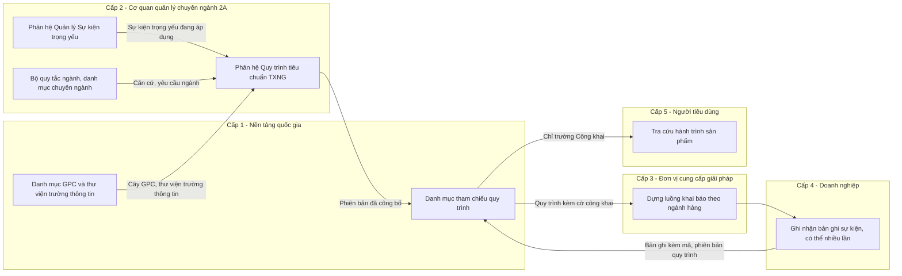
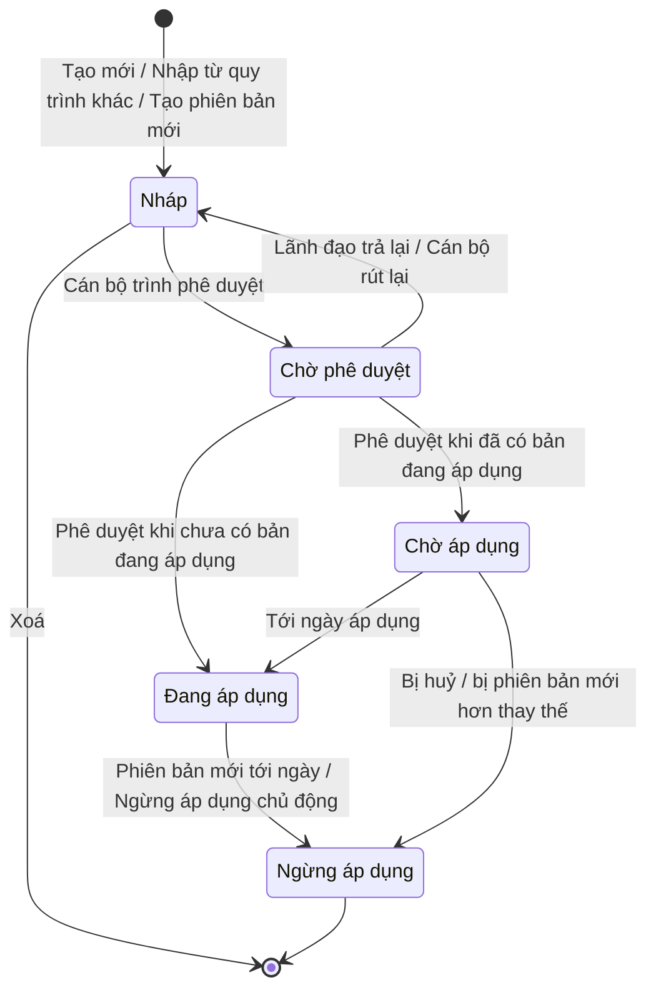

# Quy trình tiêu chuẩn TXNG - Tài liệu yêu cầu sản phẩm

| Thông tin | Nội dung |
| --- | --- |
| Sản phẩm | NDATrace — Nền tảng quốc gia truy xuất nguồn gốc |
| Phân hệ | Quy trình tiêu chuẩn truy xuất nguồn gốc (Quy trình tiêu chuẩn TXNG) |
| Chức năng tương ứng trong Khung chức năng nghiệp vụ (Quyển 3) | Quản lý bộ quy tắc ngành, chương trình và thị trường — phần danh mục sự kiện trọng yếu theo ngành hàng; phối hợp chức năng Ban hành và quản lý sự kiện trọng yếu và trường thông tin chuyên ngành — chủ thể Cấp 2 |
| Khung nghiệp vụ tương ứng (Quyển 2) | Khung yêu cầu nghiệp vụ theo ngành hàng và thị trường; Khung quản lý sự kiện trọng yếu và dữ liệu truy xuất nguồn gốc; Khung danh mục và phân loại; Khung công bố thông tin cho người tiêu dùng |
| Tài liệu liên quan | Tài liệu yêu cầu sản phẩm — Quản lý Sự kiện trọng yếu |
| Đối tượng sử dụng chính | Cơ quan quản lý nhà nước chuyên ngành ở trung ương (nhóm 2A) |
| Phiên bản tài liệu | 1.0 |
| Người soạn | Nguyễn Hà Cương — Quản lý sản phẩm |
| Trạng thái | Hoạt động |
| Căn cứ | Nghị định 37/2025/NĐ-CP; NDATrace Quyển 2 — Khung nghiệp vụ dùng chung (bản 4.2.0); NDATrace Quyển 3 — Khung chức năng nghiệp vụ (bản 4.3.2); chuẩn sự kiện truy xuất quốc tế GS1 EPCIS 2.0, bộ từ vựng nghiệp vụ CBV 2.0; bộ phân loại sản phẩm toàn cầu GS1 GPC |

### Mục lục

| Mục | Nội dung |
| --- | --- |
| 0   | Thuật ngữ và đối chiếu với kiến trúc nghiệp vụ — 0.1 Thuật ngữ · 0.2 Đối chiếu mô hình năm cấp · 0.3 Vị trí phân hệ |
| 1   | Tổng quan — 1.1 Bối cảnh · 1.2 Mục đích · 1.3 Vấn đề cần giải quyết · 1.4 Nguyên tắc thiết kế |
| 2   | Người dùng và vai trò |
| 3   | Phạm vi — 3.1 Trong phạm vi · 3.2 Ngoài phạm vi |
| 4   | Mô hình nghiệp vụ — 4.1 Thông tin Quy trình · 4.2 Sự kiện trong quy trình · 4.3 Vòng đời trạng thái · 4.4 Phân quyền |
| 5   | Quy định cấu hình — 5.1 Ngành hàng · 5.2 Danh sách sự kiện · 5.3 Trường thông tin và mức công khai |
| 6   | Quy tắc nghiệp vụ (QQ-01 → QQ-30) |
| 7   | Đặc tả tính năng — tổng hợp; chi tiết từng tính năng 7.1 → 7.9 nằm ở các trang con của trang này |
| 8   | Danh mục thông báo |
| 9   | Nhật ký thao tác |
| 10  | Phụ thuộc |
| 11  | Điều kiện sẵn sàng (DoR) |
| 12  | Điều kiện hoàn thành (DoD) |

---

## 0. Thuật ngữ và đối chiếu với kiến trúc nghiệp vụ

### 0.1. Thuật ngữ

Tài liệu dùng thuật ngữ thống nhất với tài liệu Quản lý Sự kiện trọng yếu và Nghị định 37/2025/NĐ-CP.

| Thuật ngữ | Định nghĩa |
| --- | --- |
| **Quy trình tiêu chuẩn TXNG** | Tập hợp **có thứ tự** các Sự kiện trọng yếu đang áp dụng, do cơ quan quản lý chuyên ngành ban hành thành yêu cầu khai báo cho **một ngành hàng** cụ thể. Quy trình quy định: gồm những Sự kiện trọng yếu nào, thứ tự trong chuỗi, sự kiện nào bắt buộc hay tuỳ chọn, trường thông tin nào được bổ sung theo ngành, trường thông tin nào được công khai cho người tiêu dùng. Quyển 2 xếp nội dung này vào "danh mục sự kiện trọng yếu và trường thông tin theo ngành, được quản lý thông qua bộ quy tắc áp dụng". |
| **Sự kiện trọng yếu** | Bản quy định cho một loại sự kiện, không gắn ngành hàng, do phân hệ Quản lý Sự kiện trọng yếu quản lý. Một Sự kiện trọng yếu được dùng lại trong nhiều Quy trình tiêu chuẩn TXNG. |
| **Sự kiện trong quy trình** | Một Sự kiện trọng yếu được gắn vào quy trình, **cố định theo một phiên bản**, kèm cấu hình riêng của quy trình: vị trí, mức bắt buộc, trường thông tin bổ sung, mức công khai. Cấu hình này không làm thay đổi Sự kiện trọng yếu gốc. |
| **Trường thông tin gốc** | Trường thông tin do Sự kiện trọng yếu gốc quy định, gồm trường hệ thống tự bắt buộc theo chuẩn và trường do cơ quan ban hành đặt. |
| **Trường thông tin bổ sung ngành** | Trường thông tin cán bộ thêm vào sự kiện trong phạm vi một quy trình, để phục vụ yêu cầu đặc thù của ngành hàng, ví dụ "Mã vùng nuôi", "Ngày kiểm dịch". |
| **Mức công khai** | Thuộc tính của từng trường thông tin trong quy trình: **Công khai** — người tiêu dùng thấy khi tra cứu; **Chỉ phục vụ quản lý** — vẫn bắt buộc ghi nhận và gửi lên Nền tảng quốc gia, nhưng không hiển thị cho người tiêu dùng. |
| **Ngành hàng (GPC Class)** | Ngành hàng mà quy trình áp dụng, xác định bằng mức **Class** của bộ phân loại sản phẩm toàn cầu GS1 GPC (Segment → Family → Class → Brick). Mức Class là mức mà chuỗi cung ứng bắt đầu phân nhánh sự kiện khác nhau. |
| **Bản ghi sự kiện** | Dữ liệu thực tế do tổ chức, cá nhân sản xuất, kinh doanh tạo ra khi sự kiện xảy ra. Doanh nghiệp được ghi nhận nhiều bản ghi cho cùng một sự kiện trong quy trình (ví dụ nhiều chặng vận chuyển, nhiều lần xuất kho). Cơ chế ghi nhận nhiều lần do phía doanh nghiệp và đơn vị cung cấp giải pháp xử lý, không thuộc phạm vi phân hệ này. |
| **Bộ lõi quốc gia, Chủ sở hữu nội dung, Căn cứ ban hành, Thời hạn chuyển tiếp, Quy tắc chuyển tiếp** | Dùng nguyên định nghĩa trong tài liệu Quản lý Sự kiện trọng yếu, mục 0.1. |

### 0.2. Đối chiếu với mô hình năm cấp của NDATrace

| Cấp | Chủ thể | Vai trò đối với phân hệ này |
| --- | --- | --- |
| **Cấp 1** | Nền tảng quốc gia và đơn vị vận hành | Duy trì danh mục GPC, thư viện trường thông tin. Tiếp nhận quy trình đã công bố vào danh mục tham chiếu quốc gia; cung cấp cho Cấp 3, Cấp 4 theo phiên bản và ngày hiệu lực. **Không phê duyệt nội dung chuyên ngành.** |
| **Cấp 2, nhóm 2A** | Cơ quan quản lý nhà nước trung ương theo ngành: Bộ, Cục, Vụ | Xây dựng, phê duyệt, công bố quy trình cho ngành hàng mình quản lý. **Duy nhất nhóm được thao tác trong giai đoạn này.** |
| **Cấp 2, nhóm 2B** | Uỷ ban nhân dân tỉnh, thành phố và cơ quan chuyên môn | Xem quy trình đang áp dụng của ngành được phân công. Chưa được tạo hoặc kế thừa quy trình (giai đoạn sau). |
| Cấp 2, nhóm 2C, 2D | Tổ chức chứng nhận; chủ sở hữu chương trình tự nguyện | Ngoài phạm vi giai đoạn này. |
| **Cấp 3** | Đơn vị cung cấp giải pháp | Nhận quy trình qua Nền tảng quốc gia để dựng luồng khai báo trong phần mềm. Không được tự sửa quy trình. |
| **Cấp 4** | Tổ chức, doanh nghiệp, hợp tác xã, hộ kinh doanh, cá nhân sản xuất, kinh doanh | Khai báo theo quy trình đang áp dụng của ngành hàng mình; được ghi nhận nhiều bản ghi cho cùng một sự kiện. |
| **Cấp 5** | Người tiêu dùng, công dân | Thấy các trường thông tin đặt mức Công khai khi tra cứu nguồn gốc. |

### 0.3. Vị trí của phân hệ trong chuỗi chức năng

**Nhận đầu vào từ:**

- Ban hành và quản lý sự kiện trọng yếu (Cấp 2): Sự kiện trọng yếu đang áp dụng, phiên bản, trường thông tin gốc.
- Quản lý bộ quy tắc ngành, chương trình và thị trường (Cấp 2): căn cứ, phạm vi ngành.
- Duy trì danh mục, từ điển dữ liệu dùng chung (Cấp 1): cây GPC, thư viện trường thông tin.

**Cung cấp đầu ra cho:**

- Quản lý danh mục tham chiếu sự kiện trọng yếu và trường thông tin (Cấp 1): phiên bản quy trình đã công bố.
- Cấu hình công cụ hỗ trợ định danh, sự kiện trọng yếu và bằng chứng (Cấp 3).
- Đăng ký áp dụng bộ quy tắc; ghi nhận và đính chính sự kiện trọng yếu (Cấp 4).
- Tra cứu và hiểu thông tin nguồn gốc (Cấp 5): cờ công khai từng trường thông tin.

---

## 1. Tổng quan

### 1.1. Bối cảnh

Phân hệ Quản lý Sự kiện trọng yếu cho phép cơ quan quản lý ban hành từng sự kiện **không gắn ngành hàng**, để dùng lại giữa các ngành. Nhưng doanh nghiệp không khai báo "từng sự kiện rời"; họ cần biết **với sản phẩm của mình, phải ghi nhận chuỗi sự kiện nào, theo thứ tự nào**. Quyển 2 xác định đây là khung cấu hình chính sách theo ngành, trong đó cơ quan chuyên ngành ban hành phạm vi, mức định danh, sự kiện trọng yếu, trường thông tin, thời hạn và dữ liệu công bố.

Đồng thời, Quyển 2 yêu cầu thông tin cho người tiêu dùng chỉ gồm "các công đoạn truy xuất trọng yếu được phép công bố" và "không công bố bí mật kinh doanh". Cùng một trường thông tin, ví dụ "Mã vùng nuôi", có ngành cần công khai, có ngành chỉ phục vụ quản lý. Vì vậy mức công khai được quyết định **theo quy trình của từng ngành**, không ở cấp Sự kiện trọng yếu.

### 1.2. Mục đích

Phân hệ giúp **cán bộ tiêu chuẩn nhóm 2A**:

- ghép các Sự kiện trọng yếu đang áp dụng thành quy trình khai báo cho một ngành hàng (GPC Class);
- quy định thứ tự, mức bắt buộc của từng sự kiện;
- bổ sung trường thông tin đặc thù ngành và quyết định trường nào công khai cho người tiêu dùng;
- trình duyệt, công bố, quản lý phiên bản với thời hạn chuyển tiếp;

để Cấp 3 dựng phần mềm khai báo đúng, Cấp 4 biết chính xác nghĩa vụ, Cấp 5 thấy đúng thông tin được phép công bố.

Mỗi quy trình ban hành qua phân hệ đáp ứng đủ yêu cầu của Quyển 2: có mã, tên; có chủ sở hữu nội dung; có căn cứ ban hành; có phạm vi; có phiên bản, ngày hiệu lực, trạng thái; có thời hạn chuyển tiếp và quy tắc chuyển tiếp.

### 1.3. Vấn đề cần giải quyết

| #   | Vấn đề hiện tại | Hậu quả | Cách phân hệ giải quyết |
| --- | --- | --- | --- |
| 1   | Doanh nghiệp không biết sản phẩm của mình phải khai báo những sự kiện nào. | Khai báo thiếu công đoạn; chuỗi truy xuất đứt đoạn. | Mỗi ngành hàng có một quy trình đang áp dụng, nêu rõ sự kiện, thứ tự, mức bắt buộc. |
| 2   | Đơn vị cung cấp giải pháp tự diễn giải luồng khai báo. | Mỗi phần mềm một kiểu; dữ liệu không đồng nhất giữa doanh nghiệp cùng ngành. | Nền tảng quốc gia trả quy trình dưới dạng có cấu trúc, kèm phiên bản và ngày hiệu lực. |
| 3   | Yêu cầu ngành (vùng nuôi, kiểm dịch…) không có chỗ đặt mà không làm thay đổi Sự kiện trọng yếu dùng chung. | Phải nhân bản Sự kiện trọng yếu cho từng ngành. | Trường thông tin bổ sung ngành đặt ở cấp quy trình, không sửa sự kiện gốc. |
| 4   | Không phân biệt dữ liệu quản lý và dữ liệu công khai. | Lộ bí mật kinh doanh, hoặc người tiêu dùng thấy quá ít. | Mức công khai đặt theo từng trường thông tin trong từng quy trình. |
| 5   | Sự kiện trọng yếu thay đổi phiên bản trong khi quy trình đang áp dụng. | Quy trình tự thay đổi ngầm; doanh nghiệp bị "đổi luật giữa chừng". | Quy trình cố định phiên bản sự kiện; chỉ cập nhật qua phiên bản quy trình mới có ngày áp dụng. |
| 6   | Trùng lặp quy trình cho cùng ngành hàng. | Doanh nghiệp không biết theo quy trình nào. | Cảnh báo trùng GPC Class; ưu tiên tạo phiên bản mới. |

### 1.4. Nguyên tắc thiết kế

1. **Ghép, không tạo lại.** Quy trình chỉ tham chiếu Sự kiện trọng yếu đang áp dụng; không sao chép nội dung sự kiện.
2. **Chỉ thêm chặt hơn sự kiện gốc.** Quy trình được thêm trường thông tin, không được bớt hoặc hạ mức trường bắt buộc của sự kiện gốc.
3. **Cố định phiên bản.** Mỗi sự kiện trong quy trình gắn với một phiên bản cụ thể; không tự cập nhật.
4. **Công khai có chủ đích, mặc định công khai.** Trường mới thêm mặc định Công khai; trường bắt buộc theo chuẩn không được ẩn.
5. **Quy trình quy định "phải có sự kiện nào", không quy định "ghi bao nhiêu lần".** Số lần ghi nhận mỗi sự kiện do thực tế chuỗi cung ứng của doanh nghiệp quyết định.
6. **Thay đổi có kiểm soát.** Thống nhất vòng đời, phê duyệt, phiên bản, chuyển tiếp với phân hệ Sự kiện trọng yếu.

---

## 2. Người dùng và vai trò

| Vai trò | Mô tả | Nhu cầu chính | Hành vi điển hình |
| --- | --- | --- | --- |
| **Cán bộ tiêu chuẩn cấp trung ương (2A)** | Chuyên viên Cục, Vụ. Am hiểu chuỗi cung ứng ngành hàng. | Dựng quy trình nhanh, tái sử dụng quy trình ngành tương tự; điều chỉnh mức công khai theo chính sách. | Nhập từ quy trình ngành gần nhất rồi chỉnh; làm theo đợt ban hành văn bản. |
| **Lãnh đạo phê duyệt (2A)** | Lãnh đạo phòng, Cục, Vụ được giao thẩm quyền. | Thấy toàn cảnh chuỗi sự kiện, trường công khai, thay đổi so với phiên bản trước. | Duyệt theo đợt; cần màn hình so sánh và xem trước người tiêu dùng. |
| **Cán bộ cấp địa phương (2B)** | Chuyên viên Sở. | Biết quy trình trung ương đang áp dụng để hướng dẫn doanh nghiệp tại địa bàn. | Chỉ xem. |
| **Quản trị nền tảng quốc gia (Cấp 1)** | Đơn vị vận hành Nền tảng quốc gia. | Tiếp nhận, giám sát, tra phiên bản hiệu lực theo ngày. | Chỉ xem. |
| **Đơn vị cung cấp giải pháp (Cấp 3)** | Doanh nghiệp công nghệ. | Nhận quy trình có cấu trúc, ngày áp dụng, quy tắc chuyển tiếp, cờ công khai. | Không thao tác trên phân hệ; nhận dữ liệu và thông báo. |
| **Tổ chức, cá nhân sản xuất, kinh doanh (Cấp 4)** | Doanh nghiệp, hợp tác xã, hộ kinh doanh. | Biết chính xác chuỗi sự kiện phải khai báo; được báo trước khi thay đổi. | Không thao tác trên phân hệ; nhận thông báo. |
| **Người tiêu dùng (Cấp 5)** | Công dân. | Thấy thông tin nguồn gốc dễ hiểu, đáng tin. | Quét mã truy xuất. |
| **Hệ thống** | Tác vụ tự động. | Chuyển trạng thái đúng ngày; phát hiện ảnh hưởng khi Sự kiện trọng yếu thay đổi. | Chạy định kỳ mỗi giờ. |

---

## 3. Phạm vi

### 3.1. Trong phạm vi

1. Cán bộ 2A tạo khung quy trình gắn GPC Class, khai báo căn cứ ban hành.
2. Cán bộ thêm sự kiện theo 3 cách: chọn có sẵn, tạo mới ngay trong luồng, nhập từ quy trình khác; bớt, sắp xếp, đặt bắt buộc hoặc tuỳ chọn.
3. Cán bộ cấu hình trường thông tin trong từng sự kiện: thêm, bớt, nâng mức, đặt mức công khai.
4. Tra cứu, xem chi tiết, sửa, xoá bản nháp.
5. Kiểm tra tổng thể, trình, rút lại; lãnh đạo phê duyệt và công bố, hoặc trả lại.
6. Vòng đời 5 trạng thái: Nháp, Chờ phê duyệt, Chờ áp dụng, Đang áp dụng, Ngừng áp dụng.
7. Tạo phiên bản mới, xem lịch sử, so sánh hai phiên bản; cập nhật phiên bản Sự kiện trọng yếu trong quy trình.
8. Ngừng áp dụng, huỷ phiên bản chờ áp dụng.
9. Phát hiện và cảnh báo khi Sự kiện trọng yếu trong quy trình có phiên bản mới, bị huỷ hoặc ngừng; khi bộ lõi ngừng một giá trị.
10. Đăng ký vào danh mục tham chiếu quốc gia; thông báo các bên; ghi nhật ký mọi thao tác.

### 3.2. Ngoài phạm vi

| Nội dung | Thuộc về |
| --- | --- |
| Tạo, sửa, phê duyệt từng Sự kiện trọng yếu | Tài liệu yêu cầu sản phẩm — Quản lý Sự kiện trọng yếu (phân hệ này chỉ mở màn hình tạo nhanh dùng chung) |
| Quy trình cấp địa phương (2B kế thừa, siết chặt) | Giai đoạn sau |
| Quy trình của nhóm 2C, 2D; yêu cầu thị trường xuất khẩu | Giai đoạn sau |
| Rẽ nhánh, vòng lặp, sự kiện song song trong cấu trúc quy trình | Giai đoạn sau. Giai đoạn này quy trình là chuỗi tuyến tính; sự kiện Tuỳ chọn dùng thay nhánh. |
| Cơ chế doanh nghiệp ghi nhận nhiều bản ghi cho cùng một sự kiện | Phân hệ ghi nhận sự kiện (Cấp 4) và phần mềm của Cấp 3 |
| Một quy trình áp cho nhiều GPC Class; cơ quan chủ trì, phối hợp khi sản phẩm thuộc nhiều ngành | Giai đoạn sau |
| Doanh nghiệp đăng ký áp dụng quy trình | Phân hệ Cấp 4 |
| Kiểm tra bản ghi theo quy trình; hiển thị trang tra cứu | Phân hệ Cấp 1, Cấp 5 |
| Phê duyệt nhiều cấp; ký số | Giai đoạn sau |

---

## 4. Mô hình nghiệp vụ

### 4.1. Thông tin của một Quy trình tiêu chuẩn TXNG

| Nhóm | Thông tin | Bắt buộc | Quy định |
| --- | --- | --- | --- |
| Định danh | Mã quy trình | Hệ thống sinh | Định dạng `{mã đơn vị}-QT-{4 chữ số}`. Giữ nguyên qua mọi phiên bản. Cán bộ không nhập tay. |
|     | Tên quy trình | Có  | Không trùng trong cùng đơn vị; tối đa 200 ký tự. |
|     | Mô tả | Không | Tối đa 2.000 ký tự. |
| Phạm vi áp dụng | Ngành hàng (GPC Class) | Có  | Đúng một Class. |
|     | Phạm vi địa bàn | Hệ thống điền | 2A — toàn quốc. |
|     | Đối tượng áp dụng | Không | Ví dụ "Cơ sở nuôi trồng, thu mua, chế biến thuỷ sản". |
| Thẩm quyền | Chủ sở hữu nội dung | Hệ thống điền | Cơ quan của người tạo. |
|     | Căn cứ ban hành | Có khi trình | Số hiệu, ngày ban hành, trích yếu, tệp đính kèm. |
| Nội dung | Danh sách sự kiện | Có  | Ít nhất một sự kiện Bắt buộc. Mục 4.2, 5.2. |
|     | Cấu hình trường thông tin | Có  | Mục 5.3. |
| Phiên bản và hiệu lực | Số phiên bản, trạng thái | Hệ thống sinh |     |
|     | Ngày công bố, ngày áp dụng, ngày ngừng áp dụng | Hệ thống / lãnh đạo |     |
|     | Lý do thay đổi, quy tắc chuyển tiếp | Có từ phiên bản 2 |     |
|     | Thay thế cho / Được thay thế bởi | Hệ thống sinh |     |
| Nguồn gốc | Nguồn tạo, quy trình nguồn | Hệ thống sinh | Tạo mới / Nhập từ quy trình khác / Phiên bản mới. |
| Trách nhiệm | Người soạn, người trình, người phê duyệt, thời điểm | Hệ thống sinh |     |

### 4.2. Sự kiện trong quy trình

| Thuộc tính | Quy định |
| --- | --- |
| Sự kiện trọng yếu và phiên bản | Cố định tại thời điểm thêm; chỉ đổi qua thao tác "Cập nhật phiên bản" trong bản nháp. |
| Thứ tự | Số nguyên liên tục từ 1; thể hiện trình tự công đoạn trong chuỗi cung ứng. |
| Mức bắt buộc | **Bắt buộc** (mặc định) hoặc **Tuỳ chọn** — doanh nghiệp được bỏ qua nếu chuỗi của họ không có công đoạn đó. |
| Mỗi Sự kiện trọng yếu xuất hiện | **Một lần** trong một quy trình. Quy trình xác định doanh nghiệp _phải có_ những sự kiện nào; **không giới hạn số lần ghi nhận**. Ví dụ quy trình có một sự kiện "Vận chuyển lạnh"; doanh nghiệp vận chuyển ba chặng thì ghi nhận ba bản ghi theo cùng sự kiện đó. |
| Trường thông tin | Trường gốc (đọc từ sự kiện) và trường bổ sung ngành; mỗi trường có mức bắt buộc, mức công khai, hướng dẫn điền. |

Ba lớp đối tượng liên quan:

1. **Quy trình tiêu chuẩn TXNG** — do phân hệ này quản lý.
2. **Sự kiện trọng yếu** — do phân hệ Quản lý Sự kiện trọng yếu quản lý; quy trình chỉ tham chiếu.
3. **Bản ghi sự kiện** — do Cấp 4 tạo, mang mã và phiên bản quy trình, mã và phiên bản sự kiện đã dùng. Trạng thái và số lượng bản ghi không làm thay đổi quy trình.

### 4.3. Vòng đời trạng thái

| Trạng thái | Ý nghĩa | Tương ứng Quyển 2 | Màu nhãn | Ai thấy | Cấp 3, Cấp 4 dùng được | Sửa / Xoá |
| --- | --- | --- | --- | --- | --- | --- |
| Nháp | Đang soạn | Dự thảo | Trắng | Đơn vị sở hữu | Không | Có / Có |
| Chờ phê duyệt | Đã trình, chờ lãnh đạo | Dự thảo chờ phê duyệt | Tím | Đơn vị sở hữu | Không | Không / Không |
| Chờ áp dụng | Đã phê duyệt và công bố, chưa tới ngày | Đã công bố, chưa hiệu lực | Vàng | Đơn vị sở hữu, 2B cùng ngành, Cấp 1, Cấp 3 | Nhận trước để chuẩn bị | Không / Chỉ huỷ |
| Đang áp dụng | Đang có hiệu lực | Có hiệu lực | Xanh lá | Đơn vị sở hữu, 2B cùng ngành, đơn vị 2A khác, Cấp 1, Cấp 3 | **Có** | Không / Không |
| Ngừng áp dụng | Hết hiệu lực, bị thay thế, bị huỷ | Hết hiệu lực / thay thế | Xám | Đơn vị sở hữu, Cấp 1 | Không dùng cho bản ghi mới; vẫn dùng để kiểm tra bản ghi cũ | Không / Không |

**Giới hạn đồng thời:** với mỗi mã quy trình, tại một thời điểm, có tối đa 1 phiên bản Đang áp dụng, 1 phiên bản Chờ áp dụng, 1 phiên bản đang soạn (Nháp hoặc Chờ phê duyệt). Với mỗi GPC Class trong một đơn vị, khuyến nghị một quy trình Đang áp dụng (cảnh báo, không chặn — QQ-04).

Phiên bản đã Ngừng áp dụng **không được kích hoạt lại**. Muốn dùng lại, cán bộ tạo phiên bản mới từ phiên bản đó và trình duyệt như bình thường.

### 4.4. Phân quyền

| Thao tác | Cán bộ 2A | Lãnh đạo phê duyệt 2A | Cán bộ, lãnh đạo 2B | Đơn vị 2A khác | Quản trị Cấp 1 |
| --- | --- | --- | --- | --- | --- |
| Xem | ✅   | ✅   | ✅ Đang áp dụng, Chờ áp dụng của ngành được phân công | ✅ Đang áp dụng (để nhập) | ✅ trạng thái đã công bố |
| Tạo, nhập, sửa, xoá bản nháp | ✅   | ❌   | ❌   | ❌   | ❌   |
| Trình phê duyệt, rút lại | ✅   | ❌   | ❌   | ❌   | ❌   |
| Phê duyệt và công bố, trả lại | ❌   | ✅ (không tự duyệt bản mình soạn, trình) | ❌   | ❌   | ❌   |
| Huỷ chờ áp dụng, ngừng áp dụng | Đề xuất | ✅   | ❌   | ❌   | ❌   |
| Tạo phiên bản mới | ✅   | ❌   | ❌   | ❌   | ❌   |

---

## 5. Quy định cấu hình

### 5.1. Ngành hàng

- Hệ thống hiển thị cây GPC Segment → Family → Class; chỉ cho chọn mức **Class**; Segment, Family chỉ là nhóm.
- Tìm theo tên tiếng Việt, tiếng Anh, mã GPC.
- Chỉ hiển thị Class đang hiệu lực trong danh mục GPC của Cấp 1.

### 5.2. Danh sách sự kiện

| Quy định | Nội dung |
| --- | --- |
| Nguồn | Chỉ Sự kiện trọng yếu **Đang áp dụng**, do chính đơn vị hoặc đơn vị 2A khác ban hành (hiển thị chủ sở hữu). |
| Cách thêm | (a) Chọn có sẵn · (b) Tạo mới ngay trong luồng · (c) Nhập từ quy trình Đang áp dụng khác. |
| Vị trí khi thêm | Cuối danh sách. Cán bộ kéo thả để đổi thứ tự. |
| Mức mặc định | Bắt buộc. |
| Tối thiểu | Ít nhất một sự kiện Bắt buộc. |
| Không trùng | Mỗi Sự kiện trọng yếu chỉ xuất hiện một lần; số lần ghi nhận không bị giới hạn (mục 4.2). |
| Gợi ý thứ tự | Hệ thống cảnh báo, không chặn, khi thứ tự bất hợp lý theo hành động: sự kiện có hành động **Kết thúc** (bán lẻ, tiêu huỷ) đứng trước sự kiện khác; sự kiện đầu tiên không có hành động **Tạo mới** đối tượng. |

### 5.3. Trường thông tin và mức công khai

| Loại trường | Thêm | Bớt | Đổi mức bắt buộc | Đặt "Chỉ phục vụ quản lý" |
| --- | --- | --- | --- | --- |
| Gốc — hệ thống tự bắt buộc theo chuẩn | —   | ❌   | ❌   | ❌   |
| Gốc — Bắt buộc do cơ quan đặt | —   | ❌   | ❌ (chỉ giữ) | ✅   |
| Gốc — Bắt buộc có điều kiện | —   | ❌   | Chỉ nâng lên Bắt buộc | ✅   |
| Gốc — Tuỳ chọn | —   | ✅   | Nâng được | ✅   |
| Bổ sung ngành | ✅ từ thư viện, lọc theo loại sự kiện | ✅   | Tự do | ✅ (kể cả khi Bắt buộc) |

- Mặc định mọi trường: **Công khai**.
- Trường hệ thống tự bắt buộc theo chuẩn (thời điểm xảy ra, múi giờ, mã đối tượng hoặc số lượng theo lô…) luôn Công khai, vì là xương sống của hành trình hiển thị cho người tiêu dùng.
- Trường gốc Bắt buộc do cơ quan đặt được phép đặt "Chỉ phục vụ quản lý", vì Quyển 2 cho phép không công bố bí mật kinh doanh (ví dụ số lượng, địa điểm kho).
- Trường bị cấm theo loại sự kiện không xuất hiện trong danh sách thêm. Trường đã có ở sự kiện gốc hiển thị mờ, nhãn "Đã có".

---

## 6. Quy tắc nghiệp vụ

Mỗi quy tắc được viết với đầy đủ chủ thể và hành động. Chủ thể chịu trách nhiệm hoặc chịu ràng buộc được in đậm.

### 6.1. Thẩm quyền và trách nhiệm

**QQ-01. Chủ sở hữu nội dung.** **Hệ thống** ghi nhận cơ quan của người tạo làm chủ sở hữu nội dung ngay khi quy trình được lưu lần đầu và không cho phép thay đổi sau đó. Khi nhập từ quy trình của đơn vị khác, **hệ thống** gán chủ sở hữu của quy trình mới là đơn vị thực hiện nhập.

**QQ-02. Chỉ nhóm 2A.** **Hệ thống** chỉ cho cán bộ nhóm 2A tạo và thao tác quy trình trong giai đoạn này.

**QQ-03. Căn cứ ban hành.** **Cán bộ tiêu chuẩn** phải khai báo căn cứ ban hành trước khi trình phê duyệt. **Hệ thống** chặn trình khi thiếu.

**QQ-04. Cảnh báo trùng ngành hàng.** Khi **cán bộ tiêu chuẩn** tạo quy trình cho GPC Class đã có quy trình Đang áp dụng, Chờ áp dụng hoặc đang soạn trong cùng đơn vị, **hệ thống** cảnh báo, gợi ý tạo phiên bản mới, và chỉ cho tiếp tục khi cán bộ xác nhận và nhập lý do.

**QQ-05. Tách người soạn và người phê duyệt.** **Hệ thống** không cho phép một người dùng phê duyệt bản do chính mình soạn, trình hoặc đề xuất, kể cả khi được giao cả hai vai trò.

### 6.2. Danh sách sự kiện

**QQ-06. Chỉ ghép sự kiện đang áp dụng.** **Hệ thống** chỉ hiển thị Sự kiện trọng yếu Đang áp dụng trong danh sách chọn.

**QQ-07. Tối thiểu một sự kiện bắt buộc.** **Hệ thống** chặn bớt hoặc đổi sang Tuỳ chọn sự kiện Bắt buộc cuối cùng, và chặn trình quy trình không có sự kiện Bắt buộc.

**QQ-08. Mỗi sự kiện một lần, ghi nhận không giới hạn.** **Hệ thống** không cho một mã Sự kiện trọng yếu xuất hiện hai lần trong cùng quy trình. **Hệ thống** không đặt giới hạn số bản ghi doanh nghiệp được tạo cho mỗi sự kiện; việc ghi nhận nhiều lần do phía doanh nghiệp và đơn vị cung cấp giải pháp xử lý.

**QQ-09. Cố định phiên bản sự kiện.** **Hệ thống** giữ nguyên phiên bản Sự kiện trọng yếu đã gắn; không tự cập nhật khi sự kiện có phiên bản mới.

**QQ-10. Sự kiện tạo trong luồng phải được duyệt riêng.** **Hệ thống** lưu sự kiện tạo mới trong luồng quy trình ở trạng thái Nháp của phân hệ Sự kiện trọng yếu và gắn vào quy trình với nhãn "Chờ ban hành". Sự kiện đó đi qua trình, phê duyệt của phân hệ Sự kiện trọng yếu. **Hệ thống** chặn trình quy trình khi còn sự kiện chưa Đang áp dụng.

**QQ-11. Nhập từ quy trình khác.** **Hệ thống** chỉ cho nhập từ quy trình Đang áp dụng; kế thừa thứ tự, mức bắt buộc, trường bổ sung, mức công khai; bỏ qua sự kiện đã có. Nếu sự kiện nguồn đã có phiên bản Đang áp dụng mới hơn, **hệ thống** gắn phiên bản mới nhất và báo cho cán bộ.

**QQ-12. Gợi ý thứ tự không chặn.** **Hệ thống** cảnh báo theo mục 5.2 và ghi nhận cảnh báo để hiển thị khi kiểm tra tổng thể.

### 6.3. Trường thông tin

**QQ-13. Chỉ thêm chặt hơn sự kiện gốc.** **Hệ thống** chặn bớt hoặc hạ mức trường thông tin Bắt buộc, Bắt buộc có điều kiện của sự kiện gốc.

**QQ-14. Thêm từ thư viện, lọc theo loại sự kiện.** **Hệ thống** chỉ hiển thị trường thông tin đang hiệu lực, tương thích loại sự kiện và hành động; ẩn trường bị cấm.

**QQ-15. Cấu hình ở cấp quy trình.** Mọi thay đổi trường thông tin trong quy trình **không** làm thay đổi Sự kiện trọng yếu gốc hoặc quy trình khác.

**QQ-16. Mặc định công khai.** **Hệ thống** đặt mức Công khai cho trường mới thêm, và cho trường mới xuất hiện khi cập nhật phiên bản sự kiện.

**QQ-17. Ẩn không miễn ghi nhận.** Trường đặt "Chỉ phục vụ quản lý" vẫn giữ nguyên mức bắt buộc; **doanh nghiệp** vẫn phải ghi nhận và **hệ thống** vẫn nhận lên Nền tảng quốc gia; chỉ không hiển thị cho Cấp 5.

**QQ-18. Không ẩn trường bắt buộc theo chuẩn.** **Hệ thống** chặn đặt "Chỉ phục vụ quản lý" cho trường hệ thống tự bắt buộc theo chuẩn.

**QQ-19. Phân biệt nguồn.** **Hệ thống** gắn nhãn "Theo sự kiện gốc" và "Bổ sung ngành" cho từng trường; gắn thêm nhãn "Siết chặt theo ngành" khi trường gốc được nâng mức.

### 6.4. Sửa, xoá, kiểm tra

**QQ-20. Chỉ bản nháp được sửa và xoá.** Với bản Chờ phê duyệt, **cán bộ tiêu chuẩn** phải rút lại về Nháp trước khi sửa. Với bản đã công bố, **cán bộ tiêu chuẩn** phải tạo phiên bản mới.

**QQ-21. Một người sửa tại một thời điểm.** **Hệ thống** mở bản nháp ở chế độ chỉ xem cho người khác khi đã có người đang sửa, kèm tên và thời điểm bắt đầu; tự mở khoá sau 30 phút không thao tác.

**QQ-22. Kiểm tra tổng thể trước khi trình.** **Hệ thống** chạy kiểm tra tổng thể mỗi khi cán bộ trình và mỗi khi lãnh đạo mở bản trình. **Hệ thống** chặn khi còn lỗi; chỉ cho trình khi còn cảnh báo nếu cán bộ xác nhận đã đọc.

### 6.5. Phê duyệt, công bố, hiệu lực

**QQ-23. Giới hạn phiên bản đồng thời.** **Hệ thống** bảo đảm giới hạn tại mục 4.3.

**QQ-24. Áp dụng ngay khi chưa có bản hiệu lực.** Khi **lãnh đạo phê duyệt** một phiên bản trong lúc mã quy trình chưa có phiên bản Đang áp dụng (phiên bản 1, hoặc phiên bản mới tạo từ bản đã ngừng), **hệ thống** chuyển phiên bản đó sang Đang áp dụng ngay.

**QQ-25. Ngày áp dụng tương lai khi đã có bản hiệu lực.** Khi trình phiên bản mới trong lúc đã có phiên bản Đang áp dụng, **cán bộ tiêu chuẩn** phải đề xuất ngày áp dụng, lý do thay đổi và quy tắc chuyển tiếp. Ngày áp dụng phải từ ngày mai trở đi; **hệ thống** gợi ý mặc định 30 ngày sau ngày trình. **Lãnh đạo phê duyệt** được điều chỉnh ngày áp dụng, với cùng điều kiện.

**QQ-26. Ngày áp dụng quy trình không sớm hơn ngày áp dụng của sự kiện.** **Hệ thống** chặn ngày áp dụng quy trình sớm hơn ngày áp dụng của bất kỳ phiên bản Sự kiện trọng yếu nào trong quy trình.

**QQ-27. Phiên bản mới thay bản đang chờ.** Khi **lãnh đạo phê duyệt** công bố phiên bản mới trong lúc đã có phiên bản Chờ áp dụng, **hệ thống** chuyển bản Chờ áp dụng cũ sang Ngừng áp dụng, ghi chú "Bị thay thế trước khi áp dụng".

**QQ-28. Không hồi tố.** **Hệ thống** không đánh giá lại bản ghi phát sinh trước ngày áp dụng của phiên bản mới. Ngừng áp dụng quy trình không làm sai dữ liệu doanh nghiệp đã khai báo. **Hệ thống** cung cấp cho Cấp 1 và Cấp 3 đầy đủ các phiên bản cũ kèm khoảng thời gian hiệu lực.

**QQ-29. Đăng ký vào danh mục quốc gia.** Ngay khi một phiên bản chuyển sang Chờ áp dụng, Đang áp dụng hoặc Ngừng áp dụng, **hệ thống** gửi sang danh mục tham chiếu quốc gia của Cấp 1: sự kiện theo thứ tự, phiên bản sự kiện, mức bắt buộc, từng trường thông tin kèm mức bắt buộc và cờ công khai, ngày áp dụng, ngày ngừng, quy tắc chuyển tiếp, chủ sở hữu nội dung. Bản Nháp, Chờ phê duyệt không được gửi.

### 6.6. Thay đổi từ Sự kiện trọng yếu và bộ lõi

**QQ-30. Sự kiện trong quy trình hoặc bộ lõi thay đổi.**

- Khi Sự kiện trọng yếu có **phiên bản mới được công bố**, **hệ thống** gắn nhãn "Có phiên bản mới" trên mọi quy trình đang dùng, thông báo đơn vị sở hữu quy trình; không tự cập nhật.
- Khi phiên bản sự kiện đang gắn **chuyển Ngừng áp dụng**, **hệ thống** giữ hiệu lực của quy trình Đang áp dụng, Chờ áp dụng, gắn cảnh báo "Đang dùng phiên bản sự kiện đã ngừng"; đánh dấu lỗi trên bản Nháp, Chờ phê duyệt, chặn trình và chặn phê duyệt.
- Khi **quản trị nền tảng quốc gia** ngừng một GPC Class hoặc trường thông tin đang được dùng, **hệ thống** xử lý tương tự: bản đã công bố giữ hiệu lực kèm cảnh báo; bản đang soạn bị đánh lỗi.
- **Phân hệ Sự kiện trọng yếu** hỏi phân hệ này trước khi cho xoá bản nháp sự kiện hoặc ngừng áp dụng chủ động sự kiện; **hệ thống** trả về danh sách quy trình đang chứa sự kiện.
- **Hệ thống** không tự sửa nội dung của bất kỳ phiên bản quy trình đã công bố nào.

---

## 7. Đặc tả tính năng

Mỗi tính năng được đặc tả chi tiết ở **một trang con riêng** của trang này. Mỗi trang con gồm:

- mô tả;
- yêu cầu người sử dụng, đánh số US-xx;
- đặc tả luồng chính, luồng thay thế, luồng ngoại lệ — mỗi luồng có bảng mô tả: tác nhân, sự kiện kích hoạt, điều kiện trước, các bước hành động, điều kiện sau, quy tắc nghiệp vụ áp dụng;
- sơ đồ swimlane, chia làn theo tác nhân, vẽ từ trên xuống;
- wireframe vẽ bằng Wire DSL.

| Mục | Tính năng (trang con) | Nội dung chính | Luồng chính | Tác nhân chính | Quy tắc chính |
| --- | --- | --- | --- | --- | --- |
| 7.1 | Tạo khung quy trình | Tạo quy trình gắn GPC Class, nhập tên, mô tả, đối tượng, căn cứ; cảnh báo trùng ngành | LQ-01: Tạo khung quy trình | Cán bộ tiêu chuẩn 2A | QQ-01 → QQ-04 |
| 7.2 | Cấu hình danh sách sự kiện | Thêm sự kiện có sẵn, tạo mới trong luồng, nhập từ quy trình khác; sắp xếp; bắt buộc / tuỳ chọn | LQ-02: Thêm sự kiện có sẵn và sắp xếp | Cán bộ tiêu chuẩn 2A; phân hệ Sự kiện trọng yếu | QQ-06 → QQ-12 |
| 7.3 | Cấu hình trường thông tin và mức công khai | Thêm, bớt, nâng mức trường; đặt Công khai / Chỉ phục vụ quản lý; xem trước như người tiêu dùng | LQ-03: Cấu hình trường thông tin của một sự kiện | Cán bộ tiêu chuẩn 2A | QQ-13 → QQ-19 |
| 7.4 | Xem và tra cứu Quy trình tiêu chuẩn TXNG | Danh sách, bộ lọc theo cây GPC, chi tiết, tra theo ngày hiệu lực, xuất tệp | LQ-04: Tra cứu và xem chi tiết | Cán bộ, lãnh đạo, 2B, quản trị Cấp 1 | 4.4, QQ-28 |
| 7.5 | Sửa và xoá bản nháp | Sửa bản nháp, khoá soạn thảo, xoá bản nháp | LQ-05: Sửa bản nháp | Cán bộ tiêu chuẩn 2A | QQ-20, QQ-21 |
| 7.6 | Kiểm tra tổng thể và trình phê duyệt | Kiểm tra KT-01 → KT-11, đề xuất ngày áp dụng, trình, rút lại | LQ-06: Trình phê duyệt | Cán bộ tiêu chuẩn 2A, lãnh đạo | QQ-03, QQ-22, QQ-25, QQ-26 |
| 7.7 | Phê duyệt và công bố | Phê duyệt, trả lại; tự chuyển trạng thái khi tới ngày; đăng ký danh mục quốc gia | LQ-07: Phê duyệt và công bố | Lãnh đạo phê duyệt, Cấp 1 | QQ-05, QQ-24 → QQ-29 |
| 7.8 | Quản lý phiên bản | Tạo phiên bản mới, cập nhật phiên bản sự kiện, lịch sử, so sánh | LQ-08: Tạo phiên bản mới | Cán bộ tiêu chuẩn 2A | QQ-09, QQ-16, QQ-23, QQ-24 |
| 7.9 | Ngừng áp dụng và xử lý thay đổi Sự kiện trọng yếu | Ngừng chủ động hoặc hẹn ngày; huỷ bản chờ; phản ứng khi sự kiện, bộ lõi thay đổi | LQ-09: Ngừng áp dụng chủ động | Cán bộ, lãnh đạo, Hệ thống | QQ-27 → QQ-30 |

Tệp `.drawio` của các sơ đồ swimlane được lưu ở repo `cuongnh-rd/ndatrace-attp`, thư mục `docs/prd/swimlane/`.

---

## 8. Danh mục thông báo

| Mã  | Tình huống | Người nhận | Nội dung |
| --- | --- | --- | --- |
| TB-Q01 | Trùng tên | Cán bộ | Tên quy trình đã tồn tại trong đơn vị. Vui lòng đặt tên khác. |
| TB-Q02 | Không có quyền | Người dùng | Chỉ cán bộ tiêu chuẩn cấp trung ương được tạo Quy trình tiêu chuẩn TXNG trong giai đoạn này. |
| TB-Q03 | Trùng ngành hàng | Cán bộ | Ngành hàng "\[Class\]" đã có quy trình "\[tên\]" (\[trạng thái\]). Nên tạo phiên bản mới cho quy trình này. |
| TB-Q04 | Thứ tự bất hợp lý | Cán bộ | Sự kiện "\[x\]" (\[hành động\]) đang đứng trước "\[y\]". Vui lòng kiểm tra lại thứ tự. |
| TB-Q05 | Thiếu sự kiện bắt buộc | Cán bộ | Quy trình phải có ít nhất 1 sự kiện bắt buộc. |
| TB-Q06 | Sự kiện không còn hiệu lực | Cán bộ | Sự kiện "\[x\]" không còn ở trạng thái Đang áp dụng. |
| TB-Q07 | Bớt hoặc hạ trường gốc | Cán bộ | Trường thông tin "\[x\]" là \[bắt buộc theo chuẩn / bắt buộc theo sự kiện gốc\]. Quy trình chỉ được thêm, không được bớt hoặc hạ mức. |
| TB-Q08 | Ẩn trường chuẩn | Cán bộ | Trường thông tin bắt buộc theo chuẩn không được ẩn khỏi người tiêu dùng. |
| TB-Q09 | Sự kiện tạo trong luồng đã ban hành | Cán bộ | Sự kiện "\[x\]" đã được phê duyệt và gắn chính thức vào quy trình "\[tên\]". |
| TB-Q10 | Sửa bản đã công bố | Cán bộ | Quy trình đã công bố không sửa trực tiếp. Hãy dùng "Tạo phiên bản mới". |
| TB-Q11 | Sửa bản đang trình | Cán bộ | Bản này đang chờ phê duyệt. Hãy rút lại về Nháp trước khi sửa. |
| TB-Q12 | Đang có người sửa | Cán bộ | Quy trình đang được sửa bởi \[tên\] từ \[giờ\]. |
| TB-Q13 | Đã có bản đang soạn | Cán bộ | Đã có phiên bản \[n\] đang soạn hoặc đang trình. |
| TB-Q14 | Có bản trình mới | Lãnh đạo | \[Cán bộ\] trình phê duyệt quy trình "\[tên\]" phiên bản \[n\]. |
| TB-Q15 | Rút lại | Lãnh đạo | \[Cán bộ\] đã rút lại quy trình "\[tên\]". Lý do: \[nội dung\]. |
| TB-Q16 | Ngày không hợp lệ | Cán bộ, lãnh đạo | Ngày áp dụng phải sau hôm nay và không sớm hơn \[ngày\] (ngày áp dụng của sự kiện "\[x\]"). |
| TB-Q17 | Bị trả lại | Cán bộ | Quy trình "\[tên\]" bị trả lại. Ý kiến: \[nội dung\]. |
| TB-Q18 | Được phê duyệt | Cán bộ | Quy trình "\[tên\]" phiên bản \[n\] đã được phê duyệt, áp dụng từ \[ngày\]. |
| TB-Q19 | Sắp áp dụng / mới áp dụng | Cấp 3, Cấp 4 thuộc ngành hàng | Quy trình tiêu chuẩn TXNG "\[tên\]" cho ngành hàng \[Class\], phiên bản \[n\], áp dụng từ \[ngày\]. Quy tắc chuyển tiếp: \[nội dung\]. |
| TB-Q20 | Đã chuyển phiên bản | Cấp 3, Cấp 4 | Quy trình "\[tên\]" đã chuyển sang phiên bản \[n\] từ hôm nay. |
| TB-Q21 | Tự phê duyệt | Lãnh đạo | Bạn là người soạn, trình hoặc đề xuất nên không thể tự phê duyệt. |
| TB-Q22 | Ngừng áp dụng | Cấp 3, Cấp 4 | Quy trình "\[tên\]" ngừng áp dụng từ \[ngày\]. Lý do: \[nội dung\]. Quy trình thay thế: \[tên / không có\]. |
| TB-Q23 | Huỷ bản chờ | Lãnh đạo | Thao tác không khuyến khích. Bạn có chắc muốn huỷ áp dụng phiên bản \[n\]? |
| TB-Q24 | Sự kiện có phiên bản mới | Cán bộ | Sự kiện "\[x\]" trong quy trình "\[tên\]" có phiên bản \[n\] áp dụng từ \[ngày\]. Cân nhắc tạo phiên bản quy trình mới. |
| TB-Q25 | Sự kiện đã ngừng | Cán bộ | Quy trình "\[tên\]" đang dùng phiên bản \[n\] của sự kiện "\[x\]" đã ngừng áp dụng. Hãy tạo phiên bản quy trình mới. |

## 9. Nhật ký thao tác

Hệ thống ghi nhật ký mọi thao tác; nhật ký lưu vĩnh viễn, không người dùng nào được sửa hay xoá.

| Thao tác | Thông tin được ghi |
| --- | --- |
| Tạo, nhập từ quy trình khác, tạo phiên bản | Người thực hiện, đơn vị, thời điểm, nguồn tạo, quy trình và phiên bản nguồn, lý do khi trùng ngành |
| Thêm, bớt, sắp xếp, đổi mức sự kiện | Sự kiện, phiên bản, vị trí trước và sau, mức trước và sau |
| Cấu hình trường thông tin | Sự kiện, trường, giá trị trước và sau (mức bắt buộc, mức công khai, hướng dẫn điền) |
| Cập nhật phiên bản sự kiện | Phiên bản cũ, phiên bản mới, khác biệt trường đã áp |
| Xoá bản nháp | Toàn bộ nội dung tại thời điểm xoá |
| Trình, rút lại | Người trình, lãnh đạo được trình, kết quả kiểm tra, cảnh báo đã xác nhận, lý do rút lại |
| Phê duyệt, trả lại | Lãnh đạo, quyết định, ý kiến, ngày áp dụng đã chốt |
| Huỷ chờ áp dụng, ngừng áp dụng | Người đề xuất, người quyết định, lý do, căn cứ, ngày |
| Tự chuyển trạng thái, đồng bộ danh mục quốc gia | Người thực hiện là Hệ thống, trạng thái trước và sau, kết quả đồng bộ |
| Gửi thông báo, xuất tệp | Loại, người nhận, thời điểm |

## 10. Phụ thuộc

| Quan hệ | Chức năng / phân hệ | Cấp | Nội dung |
| --- | --- | --- | --- |
| Cần dữ liệu từ | Ban hành và quản lý sự kiện trọng yếu và trường thông tin chuyên ngành | Cấp 2 | Sự kiện Đang áp dụng, phiên bản, trường thông tin gốc, mức bắt buộc; màn hình 7 bước dùng chung; tín hiệu sự kiện thay đổi phiên bản, ngừng |
| Cần dữ liệu từ | Duy trì danh mục, từ điển dữ liệu và quan hệ ánh xạ dùng chung | Cấp 1 | Cây GPC; thư viện trường thông tin; ràng buộc theo loại sự kiện |
| Cần dữ liệu từ | Quản lý bộ quy tắc ngành, chương trình và thị trường | Cấp 2 | Căn cứ, phạm vi ngành |
| Cần dữ liệu từ | Quản lý phạm vi thẩm quyền, vai trò và tư cách chuyên ngành | Cấp 2 | Nhóm 2A, ngành được giao, người có quyền phê duyệt |
| Hai chiều | Quản lý Sự kiện trọng yếu | Cấp 2 | Phân hệ đó hỏi phân hệ này trước khi xoá bản nháp, ngừng áp dụng sự kiện |
| Cần được báo từ | Ngừng sử dụng giá trị trong bộ lõi | Cấp 1 | Gắn lỗi, cảnh báo |
| Cung cấp đầu ra cho | Quản lý danh mục tham chiếu sự kiện trọng yếu và trường thông tin | Cấp 1 | Phiên bản quy trình đã công bố, kèm cờ công khai |
| Cung cấp đầu ra cho | Cấu hình công cụ hỗ trợ định danh, sự kiện trọng yếu và bằng chứng | Cấp 3 | Quy trình có cấu trúc, ngày áp dụng, quy tắc chuyển tiếp |
| Cung cấp đầu ra cho | Đăng ký áp dụng bộ quy tắc; ghi nhận và đính chính sự kiện trọng yếu | Cấp 4 | Chuỗi sự kiện phải khai báo, mức bắt buộc, hướng dẫn điền |
| Cung cấp đầu ra cho (gián tiếp) | Tra cứu và hiểu thông tin nguồn gốc | Cấp 5 | Cờ công khai từng trường thông tin |

## 11. Điều kiện sẵn sàng (DoR)

- [ ] Quản lý sản phẩm đã duyệt yêu cầu người sử dụng, bảng đặc tả luồng, sơ đồ swimlane và wireframe của tính năng.
- [ ] Đơn vị chủ trì dự án đã xác nhận các nội dung liên quan đến tính năng.
- [ ] Phân hệ Sự kiện trọng yếu có ít nhất 5 sự kiện Đang áp dụng, đủ 5 loại sự kiện, để kiểm thử.
- [ ] Danh mục GPC đã nhập; thư viện trường thông tin có dữ liệu.
- [ ] Định dạng dữ liệu gửi Cấp 1, Cấp 3 (gồm cờ công khai) đã thống nhất với đội Nền tảng quốc gia.
- [ ] Giao diện chi tiết trên Figma đã duyệt, dựa trên wireframe; nội dung thông báo mục 8 đã chốt.
- [ ] Đã có tài khoản kiểm thử: cán bộ và lãnh đạo 2A (ít nhất 2 đơn vị), cán bộ 2B, quản trị Cấp 1.

## 12. Điều kiện hoàn thành (DoD)

- [ ] Luồng chính, mọi luồng thay thế và luồng ngoại lệ của tính năng chạy đúng trên môi trường kiểm thử, đạt điều kiện sau đã mô tả.
- [ ] Mỗi quy tắc nghiệp vụ liên quan có ít nhất một kịch bản kiểm thử chứng minh.
- [ ] Phân quyền đúng mục 4.4, kiểm tra ở cả giao diện và phía máy chủ.
- [ ] Dữ liệu gửi Cấp 1 có cờ công khai đúng; bản Nháp, Chờ phê duyệt không bị gửi.
- [ ] Tác vụ chuyển trạng thái đúng ngày, sai lệch không quá 1 giờ; thông báo Cấp 3 gửi trong 5 phút.
- [ ] Hiệu năng: danh sách, chi tiết dưới 2 giây; cây GPC dưới 1 giây; tìm GPC dưới 500 ms; đổi mức công khai dưới 300 ms; kiểm tra tổng thể dưới 2 giây.
- [ ] Nhật ký và thông báo đúng mục 8, 9.
- [ ] Không còn lỗi mức nghiêm trọng hoặc cao.
- [ ] Quản lý sản phẩm nghiệm thu trong Sprint Review.